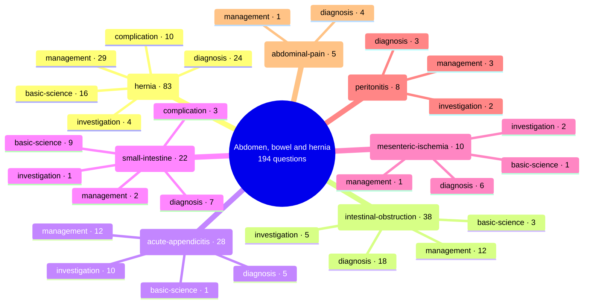

# Abdomen, bowel and hernia

Generated by `scripts/exam_mindmap.py` from `exam-map/tags/`. Edit the tags, not this page.
194 past General Sx MCQ questions (MDCU69, MDCU70, MDCU72, MDCU73, MDCU74, MDCU75, MDCU76, MDCU77, MDCU78). Subtopics say what each question asks, never its answer. Read = Board Review note (BR nn) first, then Chula Surgery 1 chapter and pages. AI-made labels from student-recalled papers and student keys, unchecked: check against the textbook or your attending.

## Mind map

## hernia

83 questions · asked by MDCU69, MDCU70, MDCU72, MDCU73, MDCU74, MDCU75, MDCU76, MDCU77, MDCU78 · management 29, diagnosis 24, basic-science 16, complication 10, investigation 4

Most cited reading: BR 33; Chula ch14 p554-556; Chula ch14 p560; Chula ch14 p537

| Question | Type | What it asks | Read |
| --- | --- | --- | --- |
| [mdcu78-gen-a Q901](https://github.com/playerplayrh/surgery-year-4/blob/main/exams/mdcu78-gen-a-mcq/exam.md) | diagnosis | Groin mass above the inguinal ligament with a positive occlusion test: diagnosis | BR 33; Chula ch14 p537 |
| [mdcu78-gen-a Q902](https://github.com/playerplayrh/surgery-year-4/blob/main/exams/mdcu78-gen-a-mcq/exam.md) | basic-science | Pressure over the mid-inguinal canal on coughing, with the mass appearing medial to the pressure point: the space it comes through | BR 33; Chula ch14 p534; p537 |
| [mdcu78-gen-a Q903](https://github.com/playerplayrh/surgery-year-4/blob/main/exams/mdcu78-gen-a-mcq/exam.md) | management | Bilateral indirect inguinal hernias in a patient worried about postoperative pain: which operation (open repairs, TEP, IPOM) | BR 33; Chula ch14 p549-550 |
| [mdcu78-gen-c Q901](https://github.com/playerplayrh/surgery-year-4/blob/main/exams/mdcu78-gen-c-mcq/exam.md) | complication | Numbness of the inner thigh after hernia repair: which nerve was injured | BR 33; Chula ch14 p535; p552 |
| [mdcu78-gen-c Q902](https://github.com/playerplayrh/surgery-year-4/blob/main/exams/mdcu78-gen-c-mcq/exam.md) | diagnosis | Bowel obstruction with a mass below the inguinal ligament: which incarcerated hernia | BR 33; Chula ch14 p537-539 |
| [mdcu78-gen-c Q903](https://github.com/playerplayrh/surgery-year-4/blob/main/exams/mdcu78-gen-c-mcq/exam.md) | complication | 15 cm cystic suprapubic lesion after bilateral inguinal hernia repair: what it is and what could have prevented it (stem cut off) | BR 33; Chula ch14 p552-553 |
| [mdcu78-gen-c Q904](https://github.com/playerplayrh/surgery-year-4/blob/main/exams/mdcu78-gen-c-mcq/exam.md) | management | Groin hernia in an adult: Lichtenstein repair vs herniotomy alone | BR 33; Chula ch14 p541-548 |
| [mdcu78-gen-c Q905](https://github.com/playerplayrh/surgery-year-4/blob/main/exams/mdcu78-gen-c-mcq/exam.md) | basic-science | Risk factors for inguinal hernia (appendectomy scar, ascites, smoking and others): which is not a risk | BR 33; Chula ch14 p528-529 |
| [mdcu78-gen-d Q901](https://github.com/playerplayrh/surgery-year-4/blob/main/exams/mdcu78-gen-d-mcq/exam.md) | diagnosis | Woman without previous surgery with a mass just lateral to the rectus below the umbilicus: hernia type | BR 33; Chula ch14 p528; p534 |
| [mdcu78-gen-d Q902](https://github.com/playerplayrh/surgery-year-4/blob/main/exams/mdcu78-gen-d-mcq/exam.md) | diagnosis | Right groin mass descending into the scrotum with a positive occlusion test: what the test means for the type | BR 33; Chula ch14 p537 |
| [mdcu78-gen-d Q903](https://github.com/playerplayrh/surgery-year-4/blob/main/exams/mdcu78-gen-d-mcq/exam.md) | management | Irreducible right groin mass with distension, vomiting and obstipation for 24 hours: management (choices not recalled) | BR 33; Chula ch14 p554-556 |
| [mdcu78-gen-d Q904](https://github.com/playerplayrh/surgery-year-4/blob/main/exams/mdcu78-gen-d-mcq/exam.md) | basic-science | Components of the spermatic cord: which listed structure is not one | BR 33; Chula ch14 p533 |
| [mdcu78-gen-d Q905](https://github.com/playerplayrh/surgery-year-4/blob/main/exams/mdcu78-gen-d-mcq/exam.md) | complication | Tender scrotal swelling with a firm mass after hernia repair: abscess vs torsion vs haematoma and other causes | BR 33; Chula ch14 p552 |
| [mdcu77-gen-a Q1](https://github.com/playerplayrh/surgery-year-4/blob/main/exams/mdcu77-gen-a-mcq/exam.md) | basic-science | Contents of the spermatic cord (genital branch of genitofemoral nerve, ilioinguinal nerve, pampiniform plexus, testicular artery, vas): which is not in the cord | BR 33; Chula ch14 p533 |
| [mdcu77-gen-a Q32](https://github.com/playerplayrh/surgery-year-4/blob/main/exams/mdcu77-gen-a-mcq/exam.md) | complication | Urinary retention after open hernioplasty: which treatment helps (analgesia, diuretics, antibiotics) | BR 33; Chula ch14 p551-553; lecture notes |
| [mdcu77-gen-a Q37](https://github.com/playerplayrh/surgery-year-4/blob/main/exams/mdcu77-gen-a-mcq/exam.md) | diagnosis | 8-year-old boy with a groin mass on running: expected occlusion test finding | BR 33; BR 38b; Chula ch14 p537 |
| [mdcu77-gen-a Q65](https://github.com/playerplayrh/surgery-year-4/blob/main/exams/mdcu77-gen-a-mcq/exam.md) | diagnosis | Bulge at a midline laparotomy scar shown in a photo: hernia type | BR 33; Chula ch14 p560 |
| [mdcu77-gen-b Q19](https://github.com/playerplayrh/surgery-year-4/blob/main/exams/mdcu77-gen-b-mcq/exam.md) | investigation | Bulging mass at an incision site: appropriate imaging (ultrasound, CTA, plain film) | BR 33; Chula ch14 p540 |
| [mdcu77-gen-b Q20](https://github.com/playerplayrh/surgery-year-4/blob/main/exams/mdcu77-gen-b-mcq/exam.md) | basic-science | Defect through which a Spigelian hernia emerges | BR 33; Chula ch14 p528; p534 |
| [mdcu77-gen-b Q46](https://github.com/playerplayrh/surgery-year-4/blob/main/exams/mdcu77-gen-b-mcq/exam.md) | basic-science | Material of standard hernia mesh (only one choice recalled) | BR 33; Chula ch14 p547 |
| [mdcu77-gen-b Q57](https://github.com/playerplayrh/surgery-year-4/blob/main/exams/mdcu77-gen-b-mcq/exam.md) | complication | Burning groin pain for 2 weeks after herniorrhaphy: mesh infection vs nerve injury | BR 33; Chula ch14 p552 |
| [mdcu77-gen-c Q7](https://github.com/playerplayrh/surgery-year-4/blob/main/exams/mdcu77-gen-c-mcq/exam.md) | management | Older man with severe COPD and recent heart failure needing hernia surgery: the factor that most influences the choice of operation and anaesthesia (stem cut off) | BR 33; Chula ch14 p540-550 |
| [mdcu77-gen-c Q9](https://github.com/playerplayrh/surgery-year-4/blob/main/exams/mdcu77-gen-c-mcq/exam.md) | management | Which repair also covers the direct, indirect and femoral spaces at once (laparoscopic, Marcy, Lichtenstein) | BR 33; Chula ch14 p549-550 |
| [mdcu77-gen-c Q50](https://github.com/playerplayrh/surgery-year-4/blob/main/exams/mdcu77-gen-c-mcq/exam.md) | management | Hernia booked for surgery in 2 weeks that today came out and cannot be pushed back: management (stem cut off) | BR 33; Chula ch14 p554-556 |
| [mdcu77-gen-c Q67](https://github.com/playerplayrh/surgery-year-4/blob/main/exams/mdcu77-gen-c-mcq/exam.md) | diagnosis | Description of a pantaloon hernia by where the two bulges appear | BR 33; Chula ch14 p540 |
| [mdcu77-gen-d Q25](https://github.com/playerplayrh/surgery-year-4/blob/main/exams/mdcu77-gen-d-mcq/exam.md) | basic-science | Myopectineal orifice of Fruchaud: which spaces it contains (femoral canal, Hesselbach triangle and others) | BR 33; Chula ch14 p533-536 |
| [mdcu77-gen-d Q26](https://github.com/playerplayrh/surgery-year-4/blob/main/exams/mdcu77-gen-d-mcq/exam.md) | management | Pantaloon hernia in a man who already had TURP for BPH: choice of repair and mesh material | BR 33; Chula ch14 p540-548 |
| [mdcu77-gen-d Q27](https://github.com/playerplayrh/surgery-year-4/blob/main/exams/mdcu77-gen-d-mcq/exam.md) | basic-science | Where pressure is applied in the occlusion test | BR 33; Chula ch14 p537 |
| [mdcu77-gen-d Q28](https://github.com/playerplayrh/surgery-year-4/blob/main/exams/mdcu77-gen-d-mcq/exam.md) | diagnosis | Groin mass below and lateral to the pubic tubercle: which hernia (femoral, obturator, indirect, direct) | BR 33; Chula ch14 p537-539 |
| [mdcu77-gen-d Q29](https://github.com/playerplayrh/surgery-year-4/blob/main/exams/mdcu77-gen-d-mcq/exam.md) | management | Painful irreducible groin mass after total abdominal hysterectomy: emergency surgery vs manual reduction with observation | BR 33; Chula ch14 p554-556 |
| [mdcu77-gen-d Q55](https://github.com/playerplayrh/surgery-year-4/blob/main/exams/mdcu77-gen-d-mcq/exam.md) | diagnosis | One day of obstipation, vomiting, distension and colic with a mass bulging from an abdominal scar (stem cut off) | BR 33; Chula ch14 p560 |
| [mdcu76-gen-a Q1](https://github.com/playerplayrh/surgery-year-4/blob/main/exams/mdcu76-gen-a-mcq/exam.md) | diagnosis | Bulge on coughing through a 3 cm defect lateral to the rectus in a woman with a caesarean scar: incisional vs Spigelian vs direct hernia | BR 33; Chula ch14 p528; p534 |
| [mdcu76-gen-a Q3](https://github.com/playerplayrh/surgery-year-4/blob/main/exams/mdcu76-gen-a-mcq/exam.md) | basic-science | Femoral hernia repair: on which side of the femoral canal the structure at risk lies | BR 33; Chula ch14 p535; p542 |
| [mdcu76-gen-a Q36](https://github.com/playerplayrh/surgery-year-4/blob/main/exams/mdcu76-gen-a-mcq/exam.md) | complication | Fever, red tender swollen wound with burning pain on day 5 after open hernia repair: mesh infection vs nerve injury vs granuloma | BR 33; Chula ch14 p552-553 |
| [mdcu76-gen-a Q63](https://github.com/playerplayrh/surgery-year-4/blob/main/exams/mdcu76-gen-a-mcq/exam.md) | management | Elderly patient with a reducible inguinal hernia booked for elective surgery: mesh vs tissue repair | BR 33; Chula ch14 p540-548 |
| [mdcu76-gen-a Q65](https://github.com/playerplayrh/surgery-year-4/blob/main/exams/mdcu76-gen-a-mcq/exam.md) | management | Previously reducible hernia that becomes irreducible with abdominal pain and fever: emergency vs elective repair | BR 33; Chula ch14 p554-556 |
| [mdcu76-gen-c Q33](https://github.com/playerplayrh/surgery-year-4/blob/main/exams/mdcu76-gen-c-mcq/exam.md) | management | Recurrent reducible groin hernia 20 years after an open repair: observe vs laparoscopic TAPP/TEP vs open darn vs tissue repair | BR 33; Chula ch14 p549-551 |
| [mdcu76-gen-c Q40](https://github.com/playerplayrh/surgery-year-4/blob/main/exams/mdcu76-gen-c-mcq/exam.md) | basic-science | Borders of the femoral canal | BR 33; Chula ch14 p535; p539 |
| [mdcu76-gen-c Q42](https://github.com/playerplayrh/surgery-year-4/blob/main/exams/mdcu76-gen-c-mcq/exam.md) | management | Painful tender irreducible hernia with fever: attempt reduction, observe with antibiotics, or explore with resection and repair | BR 33; Chula ch14 p554-556 |
| [mdcu76-gen-c Q43](https://github.com/playerplayrh/surgery-year-4/blob/main/exams/mdcu76-gen-c-mcq/exam.md) | diagnosis | Bulge through an upper abdominal incision after peptic ulcer surgery: hernia type | BR 33; Chula ch14 p560 |
| [mdcu76-gen-d Q12](https://github.com/playerplayrh/surgery-year-4/blob/main/exams/mdcu76-gen-d-mcq/exam.md) | diagnosis | Reducible scrotal mass appearing on sitting up: which examination finding to expect (getting above it, transillumination, impingement and occlusion tests) | BR 33; Chula ch14 p537-538 |
| [mdcu76-gen-d Q16](https://github.com/playerplayrh/surgery-year-4/blob/main/exams/mdcu76-gen-d-mcq/exam.md) | diagnosis | Examination findings of an indirect inguinal hernia (impingement on fingertip or finger side, occlusion test, getting above the mass) | BR 33; Chula ch14 p537 |
| [mdcu76-gen-d Q26](https://github.com/playerplayrh/surgery-year-4/blob/main/exams/mdcu76-gen-d-mcq/exam.md) | management | Reducible hernia in a diabetic: timing of repair and glucose control (only one choice recalled) | BR 33; Chula ch14 p540 |
| [mdcu75-gen-c Q13](https://github.com/playerplayrh/surgery-year-4/blob/main/exams/mdcu75-gen-c-mcq/exam.md) | diagnosis | Groin hernia that became irreducible after straining, with fever but a soft non-tender abdomen and hypoactive bowel sounds: incarcerated vs strangulated | BR 33; Chula ch14 p531; p554-555 |
| [mdcu75-gen-c Q27](https://github.com/playerplayrh/surgery-year-4/blob/main/exams/mdcu75-gen-c-mcq/exam.md) | diagnosis | Normally reducible scrotal hernia now irreducible after football, with hyperactive bowel sounds and stable vitals: naming the stage | BR 33; Chula ch14 p531; p554 |
| [mdcu75-gen-c Q46](https://github.com/playerplayrh/surgery-year-4/blob/main/exams/mdcu75-gen-c-mcq/exam.md) | management | Long-standing reducible hernia irreducible after football: management (no choices recalled) | BR 33; Chula ch14 p554-556 |
| [mdcu75-gen-c Q49](https://github.com/playerplayrh/surgery-year-4/blob/main/exams/mdcu75-gen-c-mcq/exam.md) | investigation | Reducible groin hernia with an empty scrotal sac on the other side: imaging to find the testis | BR 33; BR 38b |
| [mdcu75-gen-d Q15](https://github.com/playerplayrh/surgery-year-4/blob/main/exams/mdcu75-gen-d-mcq/exam.md) | management | Very elderly bed-bound man after acute MI with coronary intervention and an on-and-off groin hernia: urgent vs elective repair, open vs laparoscopic, and timing | BR 33; Chula ch14 p540-541 |
| [mdcu75-gen-d Q24](https://github.com/playerplayrh/surgery-year-4/blob/main/exams/mdcu75-gen-d-mcq/exam.md) | diagnosis | Bulge at a hysterectomy scar on standing and Valsalva that reduces when lying down: hernia type (no choices recalled) | BR 33; Chula ch14 p560 |
| [mdcu74-gen-a Q6](https://github.com/playerplayrh/surgery-year-4/blob/main/exams/mdcu74-gen-a-mcq/exam.md) | management | Painful, red, tender groin mass with fever, tachycardia, distension and high-pitched bowel sounds: immediate management (reduction, discharge, resuscitation with NG tube and fluids before emergency surgery, elective surgery) | BR 33; Chula ch14 p554-556 |
| [mdcu74-gen-a Q7](https://github.com/playerplayrh/surgery-year-4/blob/main/exams/mdcu74-gen-a-mcq/exam.md) | complication | Complications of a groin hernia (strangulation, inflammation, incarceration, obstruction): which listed one is not a complication | BR 33; Chula ch14 p530-531 |
| [mdcu74-gen-a Q8](https://github.com/playerplayrh/surgery-year-4/blob/main/exams/mdcu74-gen-a-mcq/exam.md) | diagnosis | Reducible groin mass with a positive occlusion test at the internal ring: what the test result means for the hernia type | BR 33; Chula ch14 p537 |
| [mdcu74-gen-a Q10](https://github.com/playerplayrh/surgery-year-4/blob/main/exams/mdcu74-gen-a-mcq/exam.md) | basic-science | Walls of the inguinal canal (floor, anterior, posterior), its direction and its lateral boundary: which statements are true | BR 33; Chula ch14 p533-534 |
| [mdcu74-gen-a Q11](https://github.com/playerplayrh/surgery-year-4/blob/main/exams/mdcu74-gen-a-mcq/exam.md) | management | Incisional hernia without peritoneal signs in a high-risk patient after stroke and with triple-vessel disease: repair vs observe | BR 33; Chula ch14 p560-561 |
| [mdcu74-gen-c Q7](https://github.com/playerplayrh/surgery-year-4/blob/main/exams/mdcu74-gen-c-mcq/exam.md) | management | Which inguinal repair is tension-free (Bassini, Lichtenstein, McVay) | BR 33; Chula ch14 p542-548 |
| [mdcu74-gen-d Q10](https://github.com/playerplayrh/surgery-year-4/blob/main/exams/mdcu74-gen-d-mcq/exam.md) | basic-science | Layer whose defect causes a direct inguinal hernia and the material of standard mesh | BR 33; Chula ch14 p535; p547 |
| [mdcu74-gen-d Q17](https://github.com/playerplayrh/surgery-year-4/blob/main/exams/mdcu74-gen-d-mcq/exam.md) | diagnosis | Hernia on the left side above the umbilicus at the lateral edge of the rectus: naming it | BR 33; Chula ch14 p528; p534 |
| [mdcu74-gen-d Q31](https://github.com/playerplayrh/surgery-year-4/blob/main/exams/mdcu74-gen-d-mcq/exam.md) | diagnosis | Abdominal wall defect superolateral to the umbilicus: hernia type | BR 33; Chula ch14 p528; p534 |
| [mdcu73-gen-c Q10](https://github.com/playerplayrh/surgery-year-4/blob/main/exams/mdcu73-gen-c-mcq/exam.md) | diagnosis | Reducible mass at a periumbilical surgical scar: hernia type | BR 33; Chula ch14 p560 |
| [mdcu73-gen-c Q11](https://github.com/playerplayrh/surgery-year-4/blob/main/exams/mdcu73-gen-c-mcq/exam.md) | basic-science | Examining an indirect inguinal hernia: pressure over which landmark controls the hernia | BR 33; Chula ch14 p537; p533 |
| [mdcu73-gen-c Q12](https://github.com/playerplayrh/surgery-year-4/blob/main/exams/mdcu73-gen-c-mcq/exam.md) | management | Groin hernia irreducible but painless with normal vitals: manual reduction with emergency vs urgent repair, or other options (timing definitions) | BR 33; Chula ch14 p554-556 |
| [mdcu73-gen-c Q13](https://github.com/playerplayrh/surgery-year-4/blob/main/exams/mdcu73-gen-c-mcq/exam.md) | diagnosis | Woman with intermittent vomiting and a swelling below the inguinal ligament for 2 weeks: diagnosis | BR 33; Chula ch14 p537-539 |
| [mdcu73-gen-c Q14](https://github.com/playerplayrh/surgery-year-4/blob/main/exams/mdcu73-gen-c-mcq/exam.md) | complication | Most common early complication on the morning after mesh inguinal hernia repair | BR 33; Chula ch14 p551-553 |
| [mdcu72-gen-a Q62](https://github.com/playerplayrh/surgery-year-4/blob/main/exams/mdcu72-gen-a-mcq/exam.md) | management | Long-standing groin hernia now painful for 6 hours with mild distension and hyperactive bowel sounds: observation, reduction or which emergency operation | BR 33; Chula ch14 p554-556 |
| [mdcu72-gen-a Q64](https://github.com/playerplayrh/surgery-year-4/blob/main/exams/mdcu72-gen-a-mcq/exam.md) | management | Recurrent right groin hernia after previous bilateral repair: observe vs open mesh vs laparoscopic vs tissue repair | BR 33; Chula ch14 p549-551 |
| [mdcu72-gen-c Q67](https://github.com/playerplayrh/surgery-year-4/blob/main/exams/mdcu72-gen-c-mcq/exam.md) | management | Previously reducible groin hernia irreducible and painful for 1 day with stable vitals and no fever: emergency repair, laparotomy, conservative care or reduction then elective repair | BR 33; Chula ch14 p554-556 |
| [mdcu72-gen-c Q68](https://github.com/playerplayrh/surgery-year-4/blob/main/exams/mdcu72-gen-c-mcq/exam.md) | complication | Burning thigh pain 3 days after inguinal hernia repair: most likely cause (mesh infection, cutaneous nerve injury, recurrence, granuloma, mesh allergy) | BR 33; Chula ch14 p552; p535 |
| [mdcu72-gen-c Q69](https://github.com/playerplayrh/surgery-year-4/blob/main/exams/mdcu72-gen-c-mcq/exam.md) | management | Reducible groin hernia in an older man with difficulty passing urine: what to deal with first | BR 33; Chula ch14 p529 |
| [mdcu72-gen-c Q70](https://github.com/playerplayrh/surgery-year-4/blob/main/exams/mdcu72-gen-c-mcq/exam.md) | investigation | Three months of groin pain and discomfort without a clear lump: most appropriate imaging | BR 33; Chula ch14 p540 |
| [mdcu72-gen-d Q30](https://github.com/playerplayrh/surgery-year-4/blob/main/exams/mdcu72-gen-d-mcq/exam.md) | management | Bilateral inguinal hernia in an elderly man with recent coronary stents on antiplatelet drugs: the main reason not to choose laparoscopic repair | BR 33; Chula ch14 p549-550 |
| [mdcu72-gen-d Q37](https://github.com/playerplayrh/surgery-year-4/blob/main/exams/mdcu72-gen-d-mcq/exam.md) | management | Incarcerated indirect inguinal hernia in a man with a recent TIA on aspirin: choice between observation, reduction, emergency operation with or without platelets, or delayed elective repair | BR 33; Chula ch14 p555-556; BR 01 (Hemostasis) |
| [mdcu72-gen-d Q46](https://github.com/playerplayrh/surgery-year-4/blob/main/exams/mdcu72-gen-d-mcq/exam.md) | basic-science | Which hernia type is most often bilateral | BR 33; Chula ch14 p532-533 |
| [mdcu72-gen-d Q47](https://github.com/playerplayrh/surgery-year-4/blob/main/exams/mdcu72-gen-d-mcq/exam.md) | management | Reducible groin hernia in a middle-aged man with urinary frequency, straining and dribbling (likely BPH): what to do first | BR 33; Chula ch14 p529 |
| [mdcu72-gen-d Q49](https://github.com/playerplayrh/surgery-year-4/blob/main/exams/mdcu72-gen-d-mcq/exam.md) | management | Previously reducible groin hernia now irreducible and painful with a normal examination otherwise: most appropriate management | BR 33; Chula ch14 p554-556 |
| [mdcu72-gen-d Q50](https://github.com/playerplayrh/surgery-year-4/blob/main/exams/mdcu72-gen-d-mcq/exam.md) | basic-science | Name of the hernia whose sac wall is formed partly by the sigmoid colon (sliding, Richter, Littre, Amyand, pantaloon) | BR 33; Chula ch14 p539; p557 |
| [mdcu70-gen-2 Q62](https://github.com/playerplayrh/surgery-year-4/blob/main/exams/mdcu70-gen-2-mcq/exam.md) | diagnosis | Reducible bulge through an old gastrectomy scar that falls back on lying down: hernia type | BR 33; Chula ch14 p560 |
| [mdcu70-gen-a Q41](https://github.com/playerplayrh/surgery-year-4/blob/main/exams/mdcu70-gen-a-mcq/exam.md) | basic-science | Most common risk factor for incisional hernia | BR 33; Chula ch14 p560 |
| [mdcu70-gen-a Q43](https://github.com/playerplayrh/surgery-year-4/blob/main/exams/mdcu70-gen-a-mcq/exam.md) | investigation | Irreducible right scrotal mass that the examiner cannot get above, with GI symptoms: investigation | BR 33; Chula ch14 p554 |
| [mdcu70-gen-a Q44](https://github.com/playerplayrh/surgery-year-4/blob/main/exams/mdcu70-gen-a-mcq/exam.md) | management | Reducible groin hernia in a man with urgency and dribbling: which step comes first (urology, catheter, emergency or elective repair, truss) | BR 33; Chula ch14 p529 |
| [mdcu69-gen-1 Q61](https://github.com/playerplayrh/surgery-year-4/blob/main/exams/mdcu69-gen-1-mcq/exam.md) | diagnosis | Young man with a reducible groin-scrotal mass with cough impulse that is controlled by pressure over the internal ring: hernia type | BR 33; Chula ch14 p537-538 |
| [mdcu69-gen-1 Q62](https://github.com/playerplayrh/surgery-year-4/blob/main/exams/mdcu69-gen-1-mcq/exam.md) | management | Previously reducible groin hernia now painful with abdominal distension in a stable patient: observe, reduce, image or operate, and which operation | BR 33; Chula ch14 p554-556 |
| [mdcu69-gen-1 Q63](https://github.com/playerplayrh/surgery-year-4/blob/main/exams/mdcu69-gen-1-mcq/exam.md) | diagnosis | Older woman with a reducible lump at the end of a scar from previous caesarean sections: hernia type | BR 33; Chula ch14 p560 |
| [mdcu69-gen-1 Q65](https://github.com/playerplayrh/surgery-year-4/blob/main/exams/mdcu69-gen-1-mcq/exam.md) | complication | Lower abdominal distension with a suprapubic mass 3 hours after hernia repair: next step (NG tube, ultrasound, urinary catheter) | BR 33; lecture notes |

## intestinal-obstruction

38 questions · asked by MDCU69, MDCU70, MDCU72, MDCU73, MDCU74, MDCU75, MDCU76, MDCU77, MDCU78 · diagnosis 18, management 12, investigation 5, basic-science 3

Most cited reading: BR 19; BR 25; BR 27; Chula ch8 p382-383

| Question | Type | What it asks | Read |
| --- | --- | --- | --- |
| [mdcu78-gen-a Q1001](https://github.com/playerplayrh/surgery-year-4/blob/main/exams/mdcu78-gen-a-mcq/exam.md) | diagnosis | Plain abdominal film shown: diagnosis (only one choice recalled) | BR 25; BR 19 |
| [mdcu78-gen-a Q1902](https://github.com/playerplayrh/surgery-year-4/blob/main/exams/mdcu78-gen-a-mcq/exam.md) | diagnosis | Distension, vomiting and obstipation with a plain film with an arrow: diagnosis (only one choice recalled) | BR 27; BR 19 |
| [mdcu78-gen-c Q1001](https://github.com/playerplayrh/surgery-year-4/blob/main/exams/mdcu78-gen-c-mcq/exam.md) | diagnosis | Specific sign of strangulated small bowel obstruction (pneumatosis intestinalis, string of beads, dilatation, step ladder) | BR 19; Chula ch8 p382-383 |
| [mdcu78-gen-c Q1002](https://github.com/playerplayrh/surgery-year-4/blob/main/exams/mdcu78-gen-c-mcq/exam.md) | management | Ileus on postoperative day 5 in a patient after a stroke: drug to give | BR 19; Chula ch8 p387-388 |
| [mdcu78-gen-c Q1303](https://github.com/playerplayrh/surgery-year-4/blob/main/exams/mdcu78-gen-c-mcq/exam.md) | diagnosis | Plain abdominal film (picture only): caecal vs sigmoid volvulus | BR 25 |
| [mdcu78-gen-c Q1304](https://github.com/playerplayrh/surgery-year-4/blob/main/exams/mdcu78-gen-c-mcq/exam.md) | diagnosis | Plain abdominal film (picture only): sigmoid volvulus vs colonic pseudo-obstruction | BR 25; Chula ch8 p386-387 |
| [mdcu78-gen-d Q1002](https://github.com/playerplayrh/surgery-year-4/blob/main/exams/mdcu78-gen-d-mcq/exam.md) | management | Sigmoid volvulus on a contrast enema image: next management (choices not recalled) | BR 25 |
| [mdcu78-gen-d Q1301](https://github.com/playerplayrh/surgery-year-4/blob/main/exams/mdcu78-gen-d-mcq/exam.md) | diagnosis | Cause of bowel obstruction (adhesion band vs hernia; stem mostly not recalled) | BR 19; Chula ch8 p379-380 |
| [mdcu78-gen-d Q1302](https://github.com/playerplayrh/surgery-year-4/blob/main/exams/mdcu78-gen-d-mcq/exam.md) | management | Adhesive bowel obstruction: initial management (only one choice recalled) | BR 19; Chula ch8 p384 |
| [mdcu77-gen-a Q38](https://github.com/playerplayrh/surgery-year-4/blob/main/exams/mdcu77-gen-a-mcq/exam.md) | diagnosis | Bilious vomiting, no stool, hyperactive bowel sounds and step-ladder levels on day 5 after surgery for intussusception: cause | BR 19; Chula ch8 p385 |
| [mdcu77-gen-a Q57](https://github.com/playerplayrh/surgery-year-4/blob/main/exams/mdcu77-gen-a-mcq/exam.md) | basic-science | Functional vs mechanical obstruction: which condition is functional | BR 19; Chula ch8 p386-387 |
| [mdcu77-gen-b Q7](https://github.com/playerplayrh/surgery-year-4/blob/main/exams/mdcu77-gen-b-mcq/exam.md) | management | Colicky pain, bilious vomiting and no flatus with fever after previous surgery for a perforated ulcer: whether to observe or operate | BR 19; Chula ch8 p382-386 |
| [mdcu77-gen-b Q14](https://github.com/playerplayrh/surgery-year-4/blob/main/exams/mdcu77-gen-b-mcq/exam.md) | management | Bowel obstruction with absent bowel sounds: fluids with serial examination vs resuscitation and laparotomy (repeat of Q7) | BR 19; Chula ch8 p382-386 |
| [mdcu77-gen-b Q26](https://github.com/playerplayrh/surgery-year-4/blob/main/exams/mdcu77-gen-b-mcq/exam.md) | diagnosis | Clinical picture with CT images (yellow arrows): gallstone ileus vs diverticulitis vs ileocolic intussusception vs mesenteric ischaemia | BR 19 |
| [mdcu77-gen-d Q63](https://github.com/playerplayrh/surgery-year-4/blob/main/exams/mdcu77-gen-d-mcq/exam.md) | diagnosis | Plain abdominal film with an arrow (picture only): impacted faeces vs gallstone ileus vs volvulus vs foreign body | BR 27; BR 19 |
| [mdcu76-gen-a Q29](https://github.com/playerplayrh/surgery-year-4/blob/main/exams/mdcu76-gen-a-mcq/exam.md) | diagnosis | SBO symptoms with a dense opacity in the RLQ on the plain film: diagnosis | BR 27; BR 19 |
| [mdcu76-gen-a Q64](https://github.com/playerplayrh/surgery-year-4/blob/main/exams/mdcu76-gen-a-mcq/exam.md) | investigation | Patient with a previous appendectomy, abdominal pain for over 6 hours, empty rectum and no flatus: conservative care, laparoscopy or plain films first | BR 19; Chula ch8 p382-385 |
| [mdcu76-gen-c Q23](https://github.com/playerplayrh/surgery-year-4/blob/main/exams/mdcu76-gen-c-mcq/exam.md) | management | Colicky pain with aerobilia on ultrasound and no previous biliary surgery: management of the suspected cause | BR 27; BR 19 |
| [mdcu76-gen-c Q37](https://github.com/playerplayrh/surgery-year-4/blob/main/exams/mdcu76-gen-c-mcq/exam.md) | diagnosis | Obstipation, vomiting and colicky pain: type of obstruction (only one choice recalled) | BR 19; Chula ch8 p380 |
| [mdcu76-gen-c Q71](https://github.com/playerplayrh/surgery-year-4/blob/main/exams/mdcu76-gen-c-mcq/exam.md) | diagnosis | Woman with a previous caesarean section, colicky pain, mucus but no stool on rectal exam and obstipation: small bowel adhesion vs colonic obstruction | BR 19; Chula ch8 p379-381 |
| [mdcu76-gen-d Q56](https://github.com/playerplayrh/surgery-year-4/blob/main/exams/mdcu76-gen-d-mcq/exam.md) | investigation | Cardinal signs of bowel obstruction: first imaging (plain films vs CT) | BR 19; Chula ch8 p381-383 |
| [mdcu75-gen-c Q12](https://github.com/playerplayrh/surgery-year-4/blob/main/exams/mdcu75-gen-c-mcq/exam.md) | management | Adhesive SBO after appendectomy: which management statement is wrong (catheter, antibiotics, colloid, timing of surgery) | BR 19; Chula ch8 p384-386 |
| [mdcu74-gen-c Q16](https://github.com/playerplayrh/surgery-year-4/blob/main/exams/mdcu74-gen-c-mcq/exam.md) | basic-science | Most common malignant cause of small bowel obstruction (metastasis or invasion vs primary tumours) | BR 19; Chula ch8 p391-393 |
| [mdcu73-gen-c Q80](https://github.com/playerplayrh/surgery-year-4/blob/main/exams/mdcu73-gen-c-mcq/exam.md) | investigation | Adhesive SBO after appendectomy: which plain-film finding does not belong (dilated small bowel, air-fluid levels, little rectal air, step-ladder levels, distended haustra) | BR 19; Chula ch8 p382-383 |
| [mdcu73-gen-c Q95](https://github.com/playerplayrh/surgery-year-4/blob/main/exams/mdcu73-gen-c-mcq/exam.md) | investigation | Elderly woman with 2 days of colicky pain, vomiting, distension and hyperactive bowel sounds: first imaging | BR 19; Chula ch8 p382-383 |
| [mdcu72-gen-a Q58](https://github.com/playerplayrh/surgery-year-4/blob/main/exams/mdcu72-gen-a-mcq/exam.md) | management | Bowel obstruction in a virgin abdomen with no previous surgery: management (only the laparotomy choice recalled) | BR 19; Chula ch8 p386 |
| [mdcu72-gen-c Q91](https://github.com/playerplayrh/surgery-year-4/blob/main/exams/mdcu72-gen-c-mcq/exam.md) | diagnosis | Young man with colicky pain, bilious vomiting and distension after laparotomy for bowel rupture: provisional diagnosis | BR 19; Chula ch8 p379-381 |
| [mdcu72-gen-d Q64](https://github.com/playerplayrh/surgery-year-4/blob/main/exams/mdcu72-gen-d-mcq/exam.md) | diagnosis | Elderly woman 3 days after CABG with distension, no flatus, hypoactive bowel sounds and dilated small and large bowel without free air: diagnosis | BR 25; Chula ch8 p386-387 |
| [mdcu72-gen-d Q82](https://github.com/playerplayrh/surgery-year-4/blob/main/exams/mdcu72-gen-d-mcq/exam.md) | management | Adult with proximal small bowel dilatation, distal collapse and a target sign on CT (intussusception): reduction vs laparotomy with reduction vs resection | BR 19 |
| [mdcu72-gen-d Q83](https://github.com/playerplayrh/surgery-year-4/blob/main/exams/mdcu72-gen-d-mcq/exam.md) | investigation | Older man with nausea, vomiting, distension and hyperactive bowel sounds but no scar or tenderness: initial investigation | BR 19; Chula ch8 p382-383 |
| [mdcu70-gen-1 Q6](https://github.com/playerplayrh/surgery-year-4/blob/main/exams/mdcu70-gen-1-mcq/exam.md) | basic-science | Mechanical vs functional obstruction: which condition causes paralytic ileus (adhesion, annular pancreas, peritonitis, volvulus, intussusception) | BR 19; Chula ch8 p386-387 |
| [mdcu70-gen-1 Q7](https://github.com/playerplayrh/surgery-year-4/blob/main/exams/mdcu70-gen-1-mcq/exam.md) | diagnosis | Functional intestinal obstruction (pseudo-obstruction) vs mechanical causes such as gallstone ileus, volvulus, intussusception and SMA syndrome; plain-film signs of complete small bowel obstruction | BR 19; Chula ch8 p382-387 |
| [mdcu70-gen-1 Q9](https://github.com/playerplayrh/surgery-year-4/blob/main/exams/mdcu70-gen-1-mcq/exam.md) | diagnosis | Clinical signs that suggest strangulation in bowel obstruction: tenderness, leukocytosis, fever, persistent pain | BR 19; Chula ch8 p382 |
| [mdcu70-gen-1 Q47](https://github.com/playerplayrh/surgery-year-4/blob/main/exams/mdcu70-gen-1-mcq/exam.md) | diagnosis | Middle-aged woman with previous open abdominal surgery, colicky pain, bilious vomiting and tachycardia: diagnosis among cholecystitis, gastroenteritis, SBO and pancreatitis-related ileus | BR 19; Chula ch8 p379-382 |
| [mdcu70-gen-1 Q48](https://github.com/playerplayrh/surgery-year-4/blob/main/exams/mdcu70-gen-1-mcq/exam.md) | management | Follow-on of Q47: which step in the initial management of adhesive SBO is inappropriate (fluids, NG tube, broad-spectrum antibiotics, urine output) | BR 19; Chula ch8 p384 |
| [mdcu70-gen-2 Q23](https://github.com/playerplayrh/surgery-year-4/blob/main/exams/mdcu70-gen-2-mcq/exam.md) | management | Adhesive SBO improving after 1 day of conservative care but no flatus yet: continue conservative management or operate | BR 19; Chula ch8 p384-385 |
| [mdcu70-gen-a Q7](https://github.com/playerplayrh/surgery-year-4/blob/main/exams/mdcu70-gen-a-mcq/exam.md) | diagnosis | Colicky pain, bilious vomiting, distension and obstipation 2 years after laparotomy for abdominal trauma: diagnosis among appendicitis, ischaemia, SBO, colon cancer and pancreatitis | BR 19; Chula ch8 p379-381 |
| [mdcu69-gen-1 Q58](https://github.com/playerplayrh/surgery-year-4/blob/main/exams/mdcu69-gen-1-mcq/exam.md) | management | Small bowel obstruction with pneumobilia and no previous biliary procedure: next management for the suspected cause | BR 27; BR 19; Chula ch8 p380 |

## acute-appendicitis

28 questions · asked by MDCU69, MDCU70, MDCU72, MDCU73, MDCU74, MDCU75, MDCU76, MDCU77, MDCU78 · management 12, investigation 10, diagnosis 5, basic-science 1

Most cited reading: BR 26; Chula ch9; Chula ch9 p409; Chula ch9 p415

| Question | Type | What it asks | Read |
| --- | --- | --- | --- |
| [mdcu78-gen-a Q1302](https://github.com/playerplayrh/surgery-year-4/blob/main/exams/mdcu78-gen-a-mcq/exam.md) | investigation | Pregnant woman with migrating RLQ pain and tenderness: imaging for the diagnosis | BR 26; Chula ch9 |
| [mdcu78-gen-a Q1303](https://github.com/playerplayrh/surgery-year-4/blob/main/exams/mdcu78-gen-a-mcq/exam.md) | diagnosis | Migrating RLQ pain with nausea, vomiting and anorexia: which listed condition is not a differential | BR 26; Chula ch9 p409 |
| [mdcu78-gen-a Q1305](https://github.com/playerplayrh/surgery-year-4/blob/main/exams/mdcu78-gen-a-mcq/exam.md) | management | Five days of RLQ pain with fever and a 5 by 6 cm inflammatory phlegmon around the appendix without abscess on CT: management | BR 26; Chula ch9 p415 |
| [mdcu78-gen-c Q1301](https://github.com/playerplayrh/surgery-year-4/blob/main/exams/mdcu78-gen-c-mcq/exam.md) | diagnosis | Differential diagnosis of acute appendicitis: which listed condition is not one | BR 26; Chula ch9 p409 |
| [mdcu78-gen-c Q1302](https://github.com/playerplayrh/surgery-year-4/blob/main/exams/mdcu78-gen-c-mcq/exam.md) | management | Appendicitis-like illness for several days with a 4 cm RLQ mass: management of the appendiceal mass (stem cut off) | BR 26; Chula ch9 p415 |
| [mdcu78-gen-d Q1102](https://github.com/playerplayrh/surgery-year-4/blob/main/exams/mdcu78-gen-d-mcq/exam.md) | diagnosis | RLQ pain after a trip to Phuket (stem largely not recalled) | BR 26; Chula ch9 |
| [mdcu77-gen-a Q5](https://github.com/playerplayrh/surgery-year-4/blob/main/exams/mdcu77-gen-a-mcq/exam.md) | diagnosis | Young woman with fever, periumbilical pain and RLQ tenderness with a non-compressible tubular structure on ultrasound images: diagnosis | BR 26; Chula ch9 p406-413 |
| [mdcu77-gen-a Q58](https://github.com/playerplayrh/surgery-year-4/blob/main/exams/mdcu77-gen-a-mcq/exam.md) | management | Normal appendix at surgery for RLQ pain and leukocytosis in a young adult: what else to look for | BR 26; Chula ch8 p394-395 |
| [mdcu77-gen-b Q21](https://github.com/playerplayrh/surgery-year-4/blob/main/exams/mdcu77-gen-b-mcq/exam.md) | management | Clinical appendicitis: which finding is a contraindication to appendectomy (ileocaecal Crohn, previous low midline incision, BMI over 40) | BR 26; BR 24 |
| [mdcu77-gen-c Q49](https://github.com/playerplayrh/surgery-year-4/blob/main/exams/mdcu77-gen-c-mcq/exam.md) | management | Laparoscopy for suspected appendicitis finds nothing obvious: close vs look for another cause and remove the appendix | BR 26; Chula ch9 p409-415 |
| [mdcu77-gen-d Q57](https://github.com/playerplayrh/surgery-year-4/blob/main/exams/mdcu77-gen-d-mcq/exam.md) | investigation | Most useful imaging for diagnosing appendicitis (abdominal series, ultrasound, CT, MRI, angiogram) | BR 26; Chula ch9 |
| [mdcu77-gen-d Q58](https://github.com/playerplayrh/surgery-year-4/blob/main/exams/mdcu77-gen-d-mcq/exam.md) | management | In whom appendectomy is not recommended (pregnancy, young adult, ruptured appendicitis, ileocolic Crohn disease) | BR 26; BR 24 |
| [mdcu77-gen-d Q59](https://github.com/playerplayrh/surgery-year-4/blob/main/exams/mdcu77-gen-d-mcq/exam.md) | investigation | Young woman with suspected appendicitis: first test | BR 26; Chula ch9 p409 |
| [mdcu76-gen-a Q62](https://github.com/playerplayrh/surgery-year-4/blob/main/exams/mdcu76-gen-a-mcq/exam.md) | management | Pregnant woman at 20 weeks with fever, migrating RLQ pain, tenderness and leukocytosis: imaging first or operate | BR 26; Chula ch9 |
| [mdcu76-gen-c Q7](https://github.com/playerplayrh/surgery-year-4/blob/main/exams/mdcu76-gen-c-mcq/exam.md) | basic-science | Components of the Alvarado score: which listed item is not part of it | BR 26; Chula ch9 p413 |
| [mdcu76-gen-c Q44](https://github.com/playerplayrh/surgery-year-4/blob/main/exams/mdcu76-gen-c-mcq/exam.md) | management | Normal appendix at operation for RLQ pain in a young man: what else to look for | BR 26; Chula ch9 p409; ch8 p394-395 |
| [mdcu75-gen-c Q8](https://github.com/playerplayrh/surgery-year-4/blob/main/exams/mdcu75-gen-c-mcq/exam.md) | investigation | Pregnant woman with suspected appendicitis and a non-diagnostic ultrasound: next imaging (no choices recalled) | BR 26; Chula ch9 |
| [mdcu75-gen-c Q31](https://github.com/playerplayrh/surgery-year-4/blob/main/exams/mdcu75-gen-c-mcq/exam.md) | investigation | Woman of reproductive age with migrated RLQ pain and fever: the most important laboratory test | BR 26; Chula ch9 p409 |
| [mdcu75-gen-c Q39](https://github.com/playerplayrh/surgery-year-4/blob/main/exams/mdcu75-gen-c-mcq/exam.md) | investigation | 16-week pregnancy with suspected appendicitis and a non-diagnostic ultrasound: next imaging | BR 26; Chula ch9 |
| [mdcu74-gen-d Q7](https://github.com/playerplayrh/surgery-year-4/blob/main/exams/mdcu74-gen-d-mcq/exam.md) | diagnosis | Physical signs in acute appendicitis vs signs that belong to pancreatitis or other conditions | BR 26; Chula ch9 p406-408 |
| [mdcu73-gen-c Q42](https://github.com/playerplayrh/surgery-year-4/blob/main/exams/mdcu73-gen-c-mcq/exam.md) | management | Type of drain left after appendectomy for ruptured appendicitis (closed active vs open passive drains) | BR 26; Chula ch9 p415 |
| [mdcu72-gen-a Q53](https://github.com/playerplayrh/surgery-year-4/blob/main/exams/mdcu72-gen-a-mcq/exam.md) | investigation | First-trimester pregnancy with 2 days of RLQ pain, fever and a RLQ mass but no peritonitis: further imaging | BR 26; Chula ch9 |
| [mdcu72-gen-c Q76](https://github.com/playerplayrh/surgery-year-4/blob/main/exams/mdcu72-gen-c-mcq/exam.md) | management | Pregnant woman at 20 weeks with migrated pain, guarding, leukocytosis and an incompressible blind-ending tube on ultrasound: next management | BR 26; Chula ch9 p413-415 |
| [mdcu72-gen-d Q61](https://github.com/playerplayrh/surgery-year-4/blob/main/exams/mdcu72-gen-d-mcq/exam.md) | investigation | Young woman with periumbilical pain migrating to the RLQ with fever and guarding: which test is essential before surgery | BR 26; Chula ch9 p406-409 |
| [mdcu70-gen-2 Q31](https://github.com/playerplayrh/surgery-year-4/blob/main/exams/mdcu70-gen-2-mcq/exam.md) | investigation | Young woman with RLQ pain and no GI symptoms, last period 2 weeks ago: first tests before diagnosing appendicitis | BR 26; Chula ch9 p409 |
| [mdcu70-gen-2 Q33](https://github.com/playerplayrh/surgery-year-4/blob/main/exams/mdcu70-gen-2-mcq/exam.md) | management | Classic migrating pain to the RLQ with fever, rebound tenderness and leukocytosis in a young man: whether to operate now or image first | BR 26; Chula ch9 p406-415 |
| [mdcu70-gen-a Q31](https://github.com/playerplayrh/surgery-year-4/blob/main/exams/mdcu70-gen-a-mcq/exam.md) | management | Pregnant woman at 31 weeks with migrating RLQ pain and an ultrasound that shows fluid but not the appendix: next management | BR 26; Chula ch9 |
| [mdcu69-gen-1 Q53](https://github.com/playerplayrh/surgery-year-4/blob/main/exams/mdcu69-gen-1-mcq/exam.md) | investigation | Suspected acute appendicitis in the first trimester of pregnancy: imaging of choice | BR 26; Chula ch9 |

## small-intestine

22 questions · asked by MDCU69, MDCU70, MDCU72, MDCU73, MDCU74, MDCU75, MDCU76, MDCU78 · basic-science 9, diagnosis 7, complication 3, management 2, investigation 1

Most cited reading: BR 19; Chula ch8 p398-400; Chula ch8 p399; BR 25

| Question | Type | What it asks | Read |
| --- | --- | --- | --- |
| [mdcu78-gen-a Q1401](https://github.com/playerplayrh/surgery-year-4/blob/main/exams/mdcu78-gen-a-mcq/exam.md) | diagnosis | Diarrhoea, cachexia and malnutrition after bowel resection: diagnosis (only one choice recalled) | BR 19; Chula ch8 p398-400 |
| [mdcu78-gen-d Q1001](https://github.com/playerplayrh/surgery-year-4/blob/main/exams/mdcu78-gen-d-mcq/exam.md) | basic-science | Factors that determine prognosis after massive bowel resection (age, remaining length, ileocaecal valve) | BR 19; Chula ch8 p399 |
| [mdcu76-gen-c Q2](https://github.com/playerplayrh/surgery-year-4/blob/main/exams/mdcu76-gen-c-mcq/exam.md) | basic-science | Amino acid that may improve absorption and enterocyte function after small bowel resection | BR 19; Chula ch8 p399 |
| [mdcu76-gen-c Q39](https://github.com/playerplayrh/surgery-year-4/blob/main/exams/mdcu76-gen-c-mcq/exam.md) | basic-science | Remaining small bowel length below which short bowel syndrome develops | BR 19; Chula ch8 p398 |
| [mdcu76-gen-d Q4](https://github.com/playerplayrh/surgery-year-4/blob/main/exams/mdcu76-gen-d-mcq/exam.md) | diagnosis | Mechanical SBO in a patient with pigmented spots on the lips: type of polyp causing it | BR 19; BR 25 |
| [mdcu76-gen-d Q44](https://github.com/playerplayrh/surgery-year-4/blob/main/exams/mdcu76-gen-d-mcq/exam.md) | management | Short bowel syndrome on day 5 with flatus: route of nutrition | BR 19; Chula ch8 p399 |
| [mdcu75-gen-c Q48](https://github.com/playerplayrh/surgery-year-4/blob/main/exams/mdcu75-gen-c-mcq/exam.md) | basic-science | Normal appendix at laparoscopy with an inflamed outpouching of the distal ileum: embryological origin of the pouch | BR 19; Chula ch8 p394 |
| [mdcu75-gen-d Q14](https://github.com/playerplayrh/surgery-year-4/blob/main/exams/mdcu75-gen-d-mcq/exam.md) | complication | Enterocutaneous fistula after laparotomy that fails to close on TPN and antisecretory drugs: which listed factor does not prevent closure | BR 19; Chula ch8 p390 |
| [mdcu75-gen-d Q33](https://github.com/playerplayrh/surgery-year-4/blob/main/exams/mdcu75-gen-d-mcq/exam.md) | diagnosis | Six months of diarrhoea, weight loss and fever, now SBO with three separate inflamed segments with fat wrapping: diagnosis | BR 24; Chula ch8 p388-389 |
| [mdcu75-gen-d Q34](https://github.com/playerplayrh/surgery-year-4/blob/main/exams/mdcu75-gen-d-mcq/exam.md) | complication | Factors preventing enterocutaneous fistula closure (repeat of Q14) | BR 19; Chula ch8 p390 |
| [mdcu74-gen-a Q28](https://github.com/playerplayrh/surgery-year-4/blob/main/exams/mdcu74-gen-a-mcq/exam.md) | diagnosis | Young woman with recurrent abdominal pain, multiple small bowel polyps and mucocutaneous pigmentation of the lips: histology of the polyps | BR 19; BR 25 |
| [mdcu74-gen-c Q6](https://github.com/playerplayrh/surgery-year-4/blob/main/exams/mdcu74-gen-c-mcq/exam.md) | basic-science | Distance of a Meckel diverticulum from the ileocaecal valve ("rule of twos") | BR 19; Chula ch8 p394 |
| [mdcu74-gen-d Q24](https://github.com/playerplayrh/surgery-year-4/blob/main/exams/mdcu74-gen-d-mcq/exam.md) | diagnosis | Teenager with diarrhoea and cramps after neonatal bowel resection for NEC: short bowel vs recurrent NEC | BR 19; Chula ch8 p398-400 |
| [mdcu73-gen-c Q94](https://github.com/playerplayrh/surgery-year-4/blob/main/exams/mdcu73-gen-c-mcq/exam.md) | complication | Most common complication of Meckel diverticulum, by age group | BR 19; Chula ch8 p395 |
| [mdcu72-gen-a Q60](https://github.com/playerplayrh/surgery-year-4/blob/main/exams/mdcu72-gen-a-mcq/exam.md) | basic-science | Most common malignant neoplasm of the small intestine | BR 19; Chula ch8 p391-392 |
| [mdcu72-gen-c Q93](https://github.com/playerplayrh/surgery-year-4/blob/main/exams/mdcu72-gen-c-mcq/exam.md) | basic-science | Which resection carries the greatest risk of short bowel syndrome (gastrectomy, proximal vs distal jejunum, colostomy, colostomy with terminal ileum) | BR 19; Chula ch8 p399 |
| [mdcu70-gen-2 Q24](https://github.com/playerplayrh/surgery-year-4/blob/main/exams/mdcu70-gen-2-mcq/exam.md) | diagnosis | Inflamed lesion 60 cm from the ileocaecal valve found at surgery for suspected appendicitis: naming the lesion | BR 19; Chula ch8 p394-395 |
| [mdcu70-gen-2 Q25](https://github.com/playerplayrh/surgery-year-4/blob/main/exams/mdcu70-gen-2-mcq/exam.md) | diagnosis | Chronic diarrhoea in a young adult who had bowel resection for necrotising enterocolitis as an infant: diagnosis | BR 19; Chula ch8 p398-400 |
| [mdcu70-gen-a Q9](https://github.com/playerplayrh/surgery-year-4/blob/main/exams/mdcu70-gen-a-mcq/exam.md) | management | Elderly patient with chronic diarrhoea and weight loss after a 200 cm small bowel resection: which listed treatment is not appropriate (diet, supplements, TPN, transplant, antidiarrhoeals) | BR 19; Chula ch8 p398-400 |
| [mdcu70-gen-a Q10](https://github.com/playerplayrh/surgery-year-4/blob/main/exams/mdcu70-gen-a-mcq/exam.md) | investigation | Small bowel bleeding suspected from a Meckel diverticulum after colonoscopy and angiography: best confirmatory test (CT, red cell scan, enteroscopy, capsule, Meckel scan) | BR 19; BR 16; Chula ch8 p394-395 |
| [mdcu69-gen-1 Q59](https://github.com/playerplayrh/surgery-year-4/blob/main/exams/mdcu69-gen-1-mcq/exam.md) | basic-science | Benign small bowel tumours and GIST: which statement on location and behaviour is false | BR 19; BR 21; Chula ch8 p391-393 |
| [mdcu69-gen-1 Q60](https://github.com/playerplayrh/surgery-year-4/blob/main/exams/mdcu69-gen-1-mcq/exam.md) | basic-science | Most common malignant neoplasm of the small bowel: adenocarcinoma, lymphoma, carcinoid, GIST or metastasis | BR 19; Chula ch8 p391-392 |

## mesenteric-ischemia

10 questions · asked by MDCU69, MDCU72, MDCU73, MDCU75, MDCU76, MDCU77, MDCU78 · diagnosis 6, investigation 2, management 1, basic-science 1

Most cited reading: BR 19; Chula ch8 p396-397; Chula ch8 p397; Chula ch8 p397-398

| Question | Type | What it asks | Read |
| --- | --- | --- | --- |
| [mdcu78-gen-a Q1002](https://github.com/playerplayrh/surgery-year-4/blob/main/exams/mdcu78-gen-a-mcq/exam.md) | diagnosis | Valvular heart disease with abdominal pain, irregular pulse and blood on rectal exam: embolism vs thrombosis | BR 19; Chula ch8 p396-397 |
| [mdcu78-gen-c Q1003](https://github.com/playerplayrh/surgery-year-4/blob/main/exams/mdcu78-gen-c-mcq/exam.md) | investigation | Colicky abdominal pain in a patient with AF: first imaging (CTA, X-ray, CT) | BR 19; Chula ch8 p397 |
| [mdcu78-gen-d Q1004](https://github.com/playerplayrh/surgery-year-4/blob/main/exams/mdcu78-gen-d-mcq/exam.md) | diagnosis | Pain out of proportion with blood on rectal examination: diagnosis (choices not recalled) | BR 19; Chula ch8 p397 |
| [mdcu77-gen-d Q56](https://github.com/playerplayrh/surgery-year-4/blob/main/exams/mdcu77-gen-d-mcq/exam.md) | management | Older man after mitral valve surgery with disproportionate abdominal pain and small bowel ischaemia: management of the cause (stem cut off) | BR 19; Chula ch8 p397-398 |
| [mdcu76-gen-c Q49](https://github.com/playerplayrh/surgery-year-4/blob/main/exams/mdcu76-gen-c-mcq/exam.md) | diagnosis | Severe abdominal pain with mild tenderness, no guarding and an irregular pulse: ischaemia vs SBO | BR 19; Chula ch8 p396-397 |
| [mdcu75-gen-c Q26](https://github.com/playerplayrh/surgery-year-4/blob/main/exams/mdcu75-gen-c-mcq/exam.md) | diagnosis | Patient with AF and aortoiliac disease with severe abdominal pain, tachycardia and a soft abdomen: diagnosis | BR 19; Chula ch8 p396-397 |
| [mdcu73-gen-c Q93](https://github.com/playerplayrh/surgery-year-4/blob/main/exams/mdcu73-gen-c-mcq/exam.md) | diagnosis | Abdominal pain with few signs and an irregular pulse in a patient with rheumatic heart disease: diagnosis | BR 19; Chula ch8 p396-397 |
| [mdcu72-gen-c Q94](https://github.com/playerplayrh/surgery-year-4/blob/main/exams/mdcu72-gen-c-mcq/exam.md) | investigation | Patient with AF and suspected acute mesenteric occlusion whose plain film shows small bowel ileus: next investigation | BR 19; Chula ch8 p397 |
| [mdcu69-gen-1 Q45](https://github.com/playerplayrh/surgery-year-4/blob/main/exams/mdcu69-gen-1-mcq/exam.md) | diagnosis | Elderly man with AF in shock with acute central abdominal pain and absent bowel sounds: provisional diagnosis among perforation, mesenteric embolus and pancreatitis | BR 19; Chula ch8 p396-397 |
| [mdcu69-gen-1 Q56](https://github.com/playerplayrh/surgery-year-4/blob/main/exams/mdcu69-gen-1-mcq/exam.md) | basic-science | Non-occlusive mesenteric ischaemia: which statement on frequency and settings (vasopressors, cardiogenic shock, burns, hypercoagulable state) is false | BR 19; Chula ch8 p396-397 |

## peritonitis

8 questions · asked by MDCU69, MDCU70, MDCU72, MDCU77, MDCU78 · diagnosis 3, management 3, investigation 2

Most cited reading: BR 31; BR 15; Chula ch8 p382-383; BR 01 (Surgical Infections)

| Question | Type | What it asks | Read |
| --- | --- | --- | --- |
| [mdcu78-gen-a Q1301](https://github.com/playerplayrh/surgery-year-4/blob/main/exams/mdcu78-gen-a-mcq/exam.md) | diagnosis | Acute abdomen series finding that indicates urgent surgery (dilated bowel, differential levels, step ladder, pneumoperitoneum) | BR 31; Chula ch8 p382-383 |
| [mdcu78-gen-d Q402](https://github.com/playerplayrh/surgery-year-4/blob/main/exams/mdcu78-gen-d-mcq/exam.md) | management | Weeks after abdominal surgery with LLQ tenderness and a 6 cm collection on CT: antibiotics alone vs drainage vs operation | BR 31; BR 01 (Surgical Infections) |
| [mdcu77-gen-a Q61](https://github.com/playerplayrh/surgery-year-4/blob/main/exams/mdcu77-gen-a-mcq/exam.md) | investigation | Sudden severe abdominal pain with loss of liver dullness: next investigation (chest film, CT, supine abdominal film) | BR 31; BR 15 |
| [mdcu72-gen-c Q79](https://github.com/playerplayrh/surgery-year-4/blob/main/exams/mdcu72-gen-c-mcq/exam.md) | management | Sudden epigastric pain with generalised peritonitis and free air under both diaphragms: which step is not part of management (antibiotics, fluids, urine output, CT, laparotomy) | BR 31; BR 15 |
| [mdcu72-gen-d Q65](https://github.com/playerplayrh/surgery-year-4/blob/main/exams/mdcu72-gen-d-mcq/exam.md) | management | Sudden abdominal pain with generalised tenderness and board-like rigidity: proper management (diagnostic laparoscopy, laparotomy, CT, films with serial examination) | BR 31; BR 15 |
| [mdcu70-gen-1 Q64](https://github.com/playerplayrh/surgery-year-4/blob/main/exams/mdcu70-gen-1-mcq/exam.md) | diagnosis | Acute abdominal pain with pneumoperitoneum on chest film: the most likely source of the free air | BR 31; BR 15 |
| [mdcu70-gen-2 Q34](https://github.com/playerplayrh/surgery-year-4/blob/main/exams/mdcu70-gen-2-mcq/exam.md) | investigation | Acute abdomen with guarding and rebound tenderness but no free air on the film: next step (decubitus film, ultrasound, CT with contrast, EGD, laparotomy) | BR 31 |
| [mdcu69-gen-1 Q54](https://github.com/playerplayrh/surgery-year-4/blob/main/exams/mdcu69-gen-1-mcq/exam.md) | diagnosis | Sudden severe pain in all four quadrants with free air under the right diaphragm: what the film means | BR 31 |

## abdominal-pain

5 questions · asked by MDCU74, MDCU76, MDCU77 · diagnosis 4, management 1

Most cited reading: BR 40; BR 39; BR 31; BR 26

| Question | Type | What it asks | Read |
| --- | --- | --- | --- |
| [mdcu77-gen-a Q17](https://github.com/playerplayrh/surgery-year-4/blob/main/exams/mdcu77-gen-a-mcq/exam.md) | diagnosis | Older woman writhing with right flank pain radiating to the groin and a normal examination: diagnosis among ureteric stone, cholecystitis, appendicitis, perforation and cholangitis | BR 39; BR 31 |
| [mdcu77-gen-b Q120](https://github.com/playerplayrh/surgery-year-4/blob/main/exams/mdcu77-gen-b-mcq/exam.md) | management | Woman with 3 days of RLQ and suprapubic tenderness, negative pregnancy test and normal ultrasound: management | BR 26; BR 40; Chula ch9 p409 |
| [mdcu77-gen-d Q60](https://github.com/playerplayrh/surgery-year-4/blob/main/exams/mdcu77-gen-d-mcq/exam.md) | diagnosis | Flank pain radiating to the groin with haematuria: diagnosis (only one choice recalled) | BR 39 |
| [mdcu76-gen-d Q11](https://github.com/playerplayrh/surgery-year-4/blob/main/exams/mdcu76-gen-d-mcq/exam.md) | diagnosis | Young woman with normal vitals, no fever and RLQ pain for 2 days, mid-cycle (last period 2 weeks ago): mittelschmerz vs appendicitis vs gynaecological causes | BR 26; BR 40; Chula ch9 p409 |
| [mdcu74-gen-d Q18](https://github.com/playerplayrh/surgery-year-4/blob/main/exams/mdcu74-gen-d-mcq/exam.md) | diagnosis | Young woman with pelvic pain: the gynaecological emergency to think of first (only one choice recalled) | BR 31; BR 40 |

