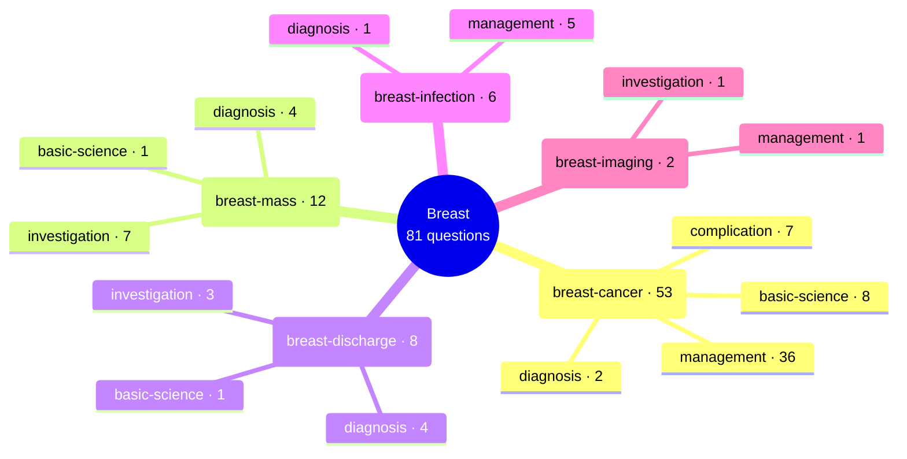

# Breast

Generated by `scripts/exam_mindmap.py` from `exam-map/tags/`. Edit the tags, not this page.
81 past General Sx MCQ questions (MDCU69, MDCU70, MDCU72, MDCU73, MDCU74, MDCU75, MDCU76, MDCU77, MDCU78). Subtopics say what each question asks, never its answer. Read = Board Review note (BR nn) first, then Chula Surgery 1 chapter and pages. AI-made labels from student-recalled papers and student keys, unchecked: check against the textbook or your attending.

## Mind map

## breast-cancer

53 questions · asked by MDCU69, MDCU70, MDCU72, MDCU73, MDCU74, MDCU75, MDCU76, MDCU77, MDCU78 · management 36, basic-science 8, complication 7, diagnosis 2

Most cited reading: BR 04; Chula ch19 p687-692; Chula ch19 p671-686; Chula ch7 p276-300

| Question | Type | What it asks | Read |
| --- | --- | --- | --- |
| [mdcu78-gen-a Q1502](https://github.com/playerplayrh/surgery-year-4/blob/main/exams/mdcu78-gen-a-mcq/exam.md) | management | Invasive ductal carcinoma, ER-negative PR-positive HER2-positive, with multiple abnormal axillary nodes: mastectomy with ALND vs neoadjuvant chemotherapy with targeted therapy | BR 04; Chula ch19 p671-686 |
| [mdcu78-gen-b Q8](https://github.com/playerplayrh/surgery-year-4/blob/main/exams/mdcu78-gen-b-mcq/exam.md) | complication | Lymphoedema (stem and choices not recalled) | BR 04; BR 13; Chula ch19 p705-709 |
| [mdcu78-gen-c Q1501](https://github.com/playerplayrh/surgery-year-4/blob/main/exams/mdcu78-gen-c-mcq/exam.md) | complication | Breast cancer patient refusing postoperative radiotherapy: what benefit she gives up | BR 04; Chula ch19 p687-692 |
| [mdcu78-gen-c Q1503](https://github.com/playerplayrh/surgery-year-4/blob/main/exams/mdcu78-gen-c-mcq/exam.md) | management | 4 cm breast cancer with positive nodes: neoadjuvant therapy vs mastectomy with ALND vs wide excision | BR 04; Chula ch19 p671-709 |
| [mdcu78-gen-d Q303](https://github.com/playerplayrh/surgery-year-4/blob/main/exams/mdcu78-gen-d-mcq/exam.md) | management | Mastectomy patient who needs postoperative radiotherapy but wants immediate reconstruction: TRAM flap vs implant alone vs delayed reconstruction | BR 04; BR 42; Chula ch19 p692-705 |
| [mdcu78-gen-d Q501](https://github.com/playerplayrh/surgery-year-4/blob/main/exams/mdcu78-gen-d-mcq/exam.md) | management | Primary prevention for a 25-year-old BRCA1 carrier (MRI screening, ultrasound with mammogram, tamoxifen, progestin, risk-reducing surgery) | BR 04; Chula ch7 p276-300 |
| [mdcu78-gen-d Q1503](https://github.com/playerplayrh/surgery-year-4/blob/main/exams/mdcu78-gen-d-mcq/exam.md) | management | Breast cancer T1N0M0: MRM vs ablation vs wide excision with SLNB | BR 04; Chula ch19 p687-709 |
| [mdcu77-gen-a Q6](https://github.com/playerplayrh/surgery-year-4/blob/main/exams/mdcu77-gen-a-mcq/exam.md) | management | LCIS found at wire-guided excision with a positive margin and strongly ER/PR-positive: further management (mastectomy, re-excision with radiotherapy, SLNB, hormonal therapy, follow-up) | BR 04; Chula ch19 p664-671 |
| [mdcu77-gen-a Q64](https://github.com/playerplayrh/surgery-year-4/blob/main/exams/mdcu77-gen-a-mcq/exam.md) | management | 5 cm breast mass fixed to the chest wall with peau d'orange and matted fixed axillary nodes: neoadjuvant therapy vs mastectomy with SLNB or ALND | BR 04; Chula ch19 p671-686 |
| [mdcu77-gen-b Q3](https://github.com/playerplayrh/surgery-year-4/blob/main/exams/mdcu77-gen-b-mcq/exam.md) | management | DCIS with a clinically and sonographically negative axilla planned for breast-conserving surgery: axillary management (ALND, SLNB, FNA, follow-up) | BR 04; Chula ch19 p664-671; p705-709 |
| [mdcu77-gen-b Q12](https://github.com/playerplayrh/surgery-year-4/blob/main/exams/mdcu77-gen-b-mcq/exam.md) | basic-science | Benign breast lesions and malignancy risk (squamoid metaplasia, fibroadenosis, complex fibroadenoma, florid and atypical hyperplasia): which carries no extra risk | BR 04; Chula ch7 p276-300 |
| [mdcu77-gen-b Q47](https://github.com/playerplayrh/surgery-year-4/blob/main/exams/mdcu77-gen-b-mcq/exam.md) | management | Contraindications to breast-conserving therapy (residual disease after excision, tumour near the nipple, scleroderma): which is not one | BR 04; Chula ch19 p687-692 |
| [mdcu77-gen-c Q19](https://github.com/playerplayrh/surgery-year-4/blob/main/exams/mdcu77-gen-c-mcq/exam.md) | management | 5 cm breast tumour with abnormal-looking nodes on imaging and core biopsy of the mass: next step for the axilla and treatment order (stem cut off) | BR 04; Chula ch19 p671-709 |
| [mdcu77-gen-c Q20](https://github.com/playerplayrh/surgery-year-4/blob/main/exams/mdcu77-gen-c-mcq/exam.md) | management | Young woman with a 4 cm ER and PR-positive mucinous carcinoma and a negative axilla: mastectomy vs wide excision with SLNB vs staging scans | BR 04; Chula ch19 p664-671; p687-692 |
| [mdcu77-gen-c Q21](https://github.com/playerplayrh/surgery-year-4/blob/main/exams/mdcu77-gen-c-mcq/exam.md) | management | Contraindications to breast-conserving therapy (SLE, late pregnancy before elective caesarean, 5 cm tumour, nearby satellite lesion): which is one | BR 04; Chula ch19 p687-692 |
| [mdcu77-gen-c Q62](https://github.com/playerplayrh/surgery-year-4/blob/main/exams/mdcu77-gen-c-mcq/exam.md) | management | Drain to prevent seroma after total mastectomy (Penrose, Jackson-Pratt, Redivac) | BR 04; Chula ch19 p692-705 |
| [mdcu77-gen-d Q18](https://github.com/playerplayrh/surgery-year-4/blob/main/exams/mdcu77-gen-d-mcq/exam.md) | basic-science | Young woman with breast cancer at 30, on the pill, with a strong family history: hereditary risk and what to recommend (stem cut off) | BR 04; Chula ch7 p276-300 |
| [mdcu77-gen-d Q65](https://github.com/playerplayrh/surgery-year-4/blob/main/exams/mdcu77-gen-d-mcq/exam.md) | management | Indications for post-mastectomy radiotherapy (T3, T4, multifocal, cT3N2, deep margin): which does not need it | BR 04; Chula ch19 p692-705 |
| [mdcu77-gen-d Q66](https://github.com/playerplayrh/surgery-year-4/blob/main/exams/mdcu77-gen-d-mcq/exam.md) | complication | Five years after mastectomy, cannot lift the left arm fully (photo): cause (stem cut off) | BR 04; Chula ch7 p265-269 |
| [mdcu77-gen-d Q68](https://github.com/playerplayrh/surgery-year-4/blob/main/exams/mdcu77-gen-d-mcq/exam.md) | management | Young woman with diffuse microcalcifications and three enlarged axillary nodes but no supraclavicular node: management (choices not recalled) | BR 04; Chula ch19 p671-709 |
| [mdcu77-gen-d Q69](https://github.com/playerplayrh/surgery-year-4/blob/main/exams/mdcu77-gen-d-mcq/exam.md) | management | Drain used after breast surgery (Redivac, Jackson-Pratt, Penrose) | BR 04; Chula ch19 p692-705 |
| [mdcu77-gen-d Q70](https://github.com/playerplayrh/surgery-year-4/blob/main/exams/mdcu77-gen-d-mcq/exam.md) | management | Whole-breast mass with abnormal axillary nodes on examination after biopsy: next management (stem cut off) | BR 04; Chula ch19 p671-686 |
| [mdcu76-gen-a Q18](https://github.com/playerplayrh/surgery-year-4/blob/main/exams/mdcu76-gen-a-mcq/exam.md) | management | Invasive ductal carcinoma with widespread microcalcifications in two quadrants and a clinically negative axilla: breast-conserving vs mastectomy and sentinel vs axillary dissection | BR 04; Chula ch19 p687-709 |
| [mdcu76-gen-a Q25](https://github.com/playerplayrh/surgery-year-4/blob/main/exams/mdcu76-gen-a-mcq/exam.md) | management | Breast microcalcifications with an impalpable axilla: choice of breast operation and axillary staging | BR 04; Chula ch19 p687-709 |
| [mdcu76-gen-a Q73](https://github.com/playerplayrh/surgery-year-4/blob/main/exams/mdcu76-gen-a-mcq/exam.md) | complication | Swollen arm after mastectomy shown in a picture: lymphoedema vs lymphangitis | BR 04; BR 13; Chula ch19 p705-709 |
| [mdcu76-gen-c Q41](https://github.com/playerplayrh/surgery-year-4/blob/main/exams/mdcu76-gen-c-mcq/exam.md) | management | 2 cm breast cancer without clinical nodes in a woman wanting breast conservation: wide excision with SLNB vs mastectomy options | BR 04; Chula ch19 p687-709 |
| [mdcu76-gen-d Q1](https://github.com/playerplayrh/surgery-year-4/blob/main/exams/mdcu76-gen-d-mcq/exam.md) | complication | Nerves at risk in axillary dissection: which one supplies latissimus dorsi | BR 04; Chula ch7 p265-269 |
| [mdcu76-gen-d Q9](https://github.com/playerplayrh/surgery-year-4/blob/main/exams/mdcu76-gen-d-mcq/exam.md) | management | Three right breast masses with matted axillary nodes: mastectomy with ALND vs sentinel biopsy vs radical mastectomy vs chemoradiation | BR 04; Chula ch19 p671-709 |
| [mdcu75-gen-c Q21](https://github.com/playerplayrh/surgery-year-4/blob/main/exams/mdcu75-gen-c-mcq/exam.md) | management | Woman whose mother and two sisters had breast cancer before 50: what is right about genetic counselling, testing and risk-reducing surgery | BR 04; Chula ch7 p276-300 |
| [mdcu75-gen-c Q41](https://github.com/playerplayrh/surgery-year-4/blob/main/exams/mdcu75-gen-c-mcq/exam.md) | management | 3 cm invasive ductal carcinoma with a clinically negative axilla: breast and axillary surgery choice (wide excision with SLNB, mastectomy with ALND, reconstruction, neoadjuvant therapy) | BR 04; Chula ch19 p687-709 |
| [mdcu75-gen-c Q52](https://github.com/playerplayrh/surgery-year-4/blob/main/exams/mdcu75-gen-c-mcq/exam.md) | management | Contraindications to breast-conserving surgery (previous implant vs inflammatory cancer) | BR 04; Chula ch19 p687-692 |
| [mdcu75-gen-d Q2](https://github.com/playerplayrh/surgery-year-4/blob/main/exams/mdcu75-gen-d-mcq/exam.md) | management | Contraindications to breast-conserving surgery (nipple invasion, inflammatory cancer, SLE): which is not one | BR 04; Chula ch19 p687-692 |
| [mdcu75-gen-d Q31](https://github.com/playerplayrh/surgery-year-4/blob/main/exams/mdcu75-gen-d-mcq/exam.md) | management | Wide excision with 2 of 3 sentinel nodes positive in a clinically negative axilla: next step (ALND, mastectomy, radiotherapy options) | BR 04; Chula ch19 p705-709 |
| [mdcu74-gen-c Q11](https://github.com/playerplayrh/surgery-year-4/blob/main/exams/mdcu74-gen-c-mcq/exam.md) | management | Contraindications to breast-conserving surgery (inflammatory cancer, nipple invasion, multiple masses, SLE, diffuse microcalcification): find the exception | BR 04; Chula ch19 p687-692 |
| [mdcu74-gen-c Q12](https://github.com/playerplayrh/surgery-year-4/blob/main/exams/mdcu74-gen-c-mcq/exam.md) | management | Indications for neoadjuvant therapy in breast cancer by clinical T and N stage and inflammatory cancer: find the exception | BR 04; Chula ch19 p671-686 |
| [mdcu74-gen-c Q26](https://github.com/playerplayrh/surgery-year-4/blob/main/exams/mdcu74-gen-c-mcq/exam.md) | basic-science | Which breast cancer risk factor carries the highest relative risk (early menarche, late menopause, late first birth, hormonal contraception, dense breast tissue) | BR 04; Chula ch7 p276-300 |
| [mdcu74-gen-d Q4](https://github.com/playerplayrh/surgery-year-4/blob/main/exams/mdcu74-gen-d-mcq/exam.md) | diagnosis | Features of locally advanced breast cancer (skin inflammation over a third, ulceration, peau d'orange, skin retraction, matted nodes): which is not one | BR 04; Chula ch19 p671-686 |
| [mdcu74-gen-d Q11](https://github.com/playerplayrh/surgery-year-4/blob/main/exams/mdcu74-gen-d-mcq/exam.md) | management | Contraindications to breast-conserving therapy (multicentric disease, no radiotherapy, no clear margin, locally advanced cancer, inflammatory cancer): which is not one | BR 04; Chula ch19 p687-692 |
| [mdcu74-gen-d Q13](https://github.com/playerplayrh/surgery-year-4/blob/main/exams/mdcu74-gen-d-mcq/exam.md) | diagnosis | Locally advanced breast cancer features: which is not one (repeat of Q4) | BR 04; Chula ch19 p671-686 |
| [mdcu73-gen-c Q59](https://github.com/playerplayrh/surgery-year-4/blob/main/exams/mdcu73-gen-c-mcq/exam.md) | management | Breast cancer with positive axillary nodes: choice of breast and axillary surgery and the place of chemotherapy and radiotherapy | BR 04; Chula ch19 p705-709 |
| [mdcu72-gen-c Q18](https://github.com/playerplayrh/surgery-year-4/blob/main/exams/mdcu72-gen-c-mcq/exam.md) | management | Absolute contraindications to breast-conserving surgery: pregnancy, subareolar site, close margin, diffuse suspicious microcalcification, bifocal lesion | BR 04; Chula ch19 p687-692 |
| [mdcu72-gen-c Q19](https://github.com/playerplayrh/surgery-year-4/blob/main/exams/mdcu72-gen-c-mcq/exam.md) | management | 1.5 cm breast cancer with a clinically and radiologically negative axilla: choice of breast operation and axillary staging | BR 04; Chula ch19 p687-709 |
| [mdcu72-gen-c Q20](https://github.com/playerplayrh/surgery-year-4/blob/main/exams/mdcu72-gen-c-mcq/exam.md) | basic-science | Nerves met in breast and axillary surgery: which one is purely sensory (intercostobrachial, long thoracic, thoracodorsal, pectoral nerves) | BR 04; Chula ch7 p265-269 |
| [mdcu72-gen-c Q28](https://github.com/playerplayrh/surgery-year-4/blob/main/exams/mdcu72-gen-c-mcq/exam.md) | management | Older woman with a 5 cm breast cancer and a biopsy-proven 2 cm axillary node: when chemotherapy should be given relative to surgery | BR 04; Chula ch19 p671-686 |
| [mdcu72-gen-c Q46](https://github.com/playerplayrh/surgery-year-4/blob/main/exams/mdcu72-gen-c-mcq/exam.md) | complication | Which breast operation carries the highest risk of lymphoedema (wide excision, BCT with SLNB, mastectomy with ALND by stage, neoadjuvant therapy then mastectomy with ALND) | BR 04; Chula ch19 p705-709 |
| [mdcu72-gen-d Q94](https://github.com/playerplayrh/surgery-year-4/blob/main/exams/mdcu72-gen-d-mcq/exam.md) | basic-science | Benign breast conditions that increase cancer risk (fibrocystic change, papillomatosis, atypical hyperplasia, fat necrosis) | BR 04; Chula ch7 p276-300 |
| [mdcu70-gen-1 Q30](https://github.com/playerplayrh/surgery-year-4/blob/main/exams/mdcu70-gen-1-mcq/exam.md) | basic-science | Breast cancer risk factors: which is not one (nulliparity, contraceptive pill, alcohol, smoking, implants) | BR 04; Chula ch7 p276-300 |
| [mdcu70-gen-a Q57](https://github.com/playerplayrh/surgery-year-4/blob/main/exams/mdcu70-gen-a-mcq/exam.md) | basic-science | Primary prevention of breast cancer: genetic testing, screening mammography, excision of benign lesions, DCIS excision, risk-reducing mastectomy in BRCA1 carriers | BR 04; Chula ch7 p276-300 |
| [mdcu70-gen-a Q98](https://github.com/playerplayrh/surgery-year-4/blob/main/exams/mdcu70-gen-a-mcq/exam.md) | management | Locally advanced ulcerated breast cancer with matted axillary nodes positive on FNA: next step (surgery with sentinel or axillary dissection, staging CT, markers, neoadjuvant therapy) | BR 04; Chula ch19 p671-686 |
| [mdcu70-gen-a Q100](https://github.com/playerplayrh/surgery-year-4/blob/main/exams/mdcu70-gen-a-mcq/exam.md) | management | Contraindications to breast-conserving therapy (stem and choices as in a past paper, not recalled) | BR 04; Chula ch19 p687-692 |
| [mdcu69-gen-1 Q90](https://github.com/playerplayrh/surgery-year-4/blob/main/exams/mdcu69-gen-1-mcq/exam.md) | management | Ulcerated breast cancer with peau d'orange and biopsy-proven axillary node metastasis: staging work-up vs choice of breast and axillary surgery | BR 04; Chula ch19 p671-686 |
| [mdcu69-gen-1 Q92](https://github.com/playerplayrh/surgery-year-4/blob/main/exams/mdcu69-gen-1-mcq/exam.md) | basic-science | Benign breast lesions and later cancer risk: which one raises risk (fibrocystic change, atypia, duct ectasia, fat necrosis) | BR 04; Chula ch7 p276-300 |
| [mdcu69-gen-1 Q93](https://github.com/playerplayrh/surgery-year-4/blob/main/exams/mdcu69-gen-1-mcq/exam.md) | complication | Breast-conserving surgery without the planned radiotherapy: expected consequence | BR 04; Chula ch19 p687-692 |

## breast-mass

12 questions · asked by MDCU70, MDCU72, MDCU73, MDCU74, MDCU76, MDCU77, MDCU78 · investigation 7, diagnosis 4, basic-science 1

Most cited reading: BR 04; Chula ch7 p302-328; Chula ch7

| Question | Type | What it asks | Read |
| --- | --- | --- | --- |
| [mdcu78-gen-a Q1501](https://github.com/playerplayrh/surgery-year-4/blob/main/exams/mdcu78-gen-a-mcq/exam.md) | investigation | 40-year-old woman with a fixed hard breast mass: next step (follow-up, ultrasound with mammogram, core biopsy) | BR 04; Chula ch7 p302-328 |
| [mdcu78-gen-c Q1502](https://github.com/playerplayrh/surgery-year-4/blob/main/exams/mdcu78-gen-c-mcq/exam.md) | diagnosis | Breast mass unchanged for 7 years with a "breast within a breast" mammogram (image): diagnosis | BR 04; Chula ch7 |
| [mdcu78-gen-d Q1501](https://github.com/playerplayrh/surgery-year-4/blob/main/exams/mdcu78-gen-d-mcq/exam.md) | diagnosis | 30-year-old woman with a 1 cm breast mass on an ultrasound image: diagnosis | BR 04; Chula ch7 p302-328 |
| [mdcu77-gen-d Q67](https://github.com/playerplayrh/surgery-year-4/blob/main/exams/mdcu77-gen-d-mcq/exam.md) | diagnosis | Rapidly growing breast mass over 8 months with skin changes (photo): phyllodes vs fibroadenoma vs DCIS | BR 04; Chula ch7 |
| [mdcu76-gen-a Q66](https://github.com/playerplayrh/surgery-year-4/blob/main/exams/mdcu76-gen-a-mcq/exam.md) | investigation | Young woman with a cystic-feeling breast lump: imaging by age | BR 04; Chula ch7 p302-328 |
| [mdcu76-gen-c Q57](https://github.com/playerplayrh/surgery-year-4/blob/main/exams/mdcu76-gen-c-mcq/exam.md) | diagnosis | Young woman with a breast mass with benign features and cyclical pain: diagnosis | BR 04; Chula ch7 |
| [mdcu76-gen-c Q58](https://github.com/playerplayrh/surgery-year-4/blob/main/exams/mdcu76-gen-c-mcq/exam.md) | investigation | 45-year-old woman with a breast mass at the first visit: initial imaging by age | BR 04; Chula ch7 p302-328 |
| [mdcu74-gen-c Q18](https://github.com/playerplayrh/surgery-year-4/blob/main/exams/mdcu74-gen-c-mcq/exam.md) | basic-science | Most common developmental disorder of the breast (amastia, polythelia, polymastia, macromastia, juvenile hypertrophy) | BR 04 |
| [mdcu73-gen-c Q58](https://github.com/playerplayrh/surgery-year-4/blob/main/exams/mdcu73-gen-c-mcq/exam.md) | investigation | Young nulliparous woman with a breast mass and no hormone use: first imaging | BR 04; Chula ch7 p302-328 |
| [mdcu72-gen-c Q17](https://github.com/playerplayrh/surgery-year-4/blob/main/exams/mdcu72-gen-c-mcq/exam.md) | investigation | Woman with a slow-growing 3 cm lobulated firm breast mass: proper investigation (imaging pair, CT, MRI, core biopsy, excision) | BR 04; Chula ch7 p302-328 |
| [mdcu72-gen-d Q92](https://github.com/playerplayrh/surgery-year-4/blob/main/exams/mdcu72-gen-d-mcq/exam.md) | investigation | Young woman with a 1.3 cm mobile oval breast lump painful before her periods: next step (reassure, ultrasound, mammogram, FNA) | BR 04; Chula ch7 p302-328 |
| [mdcu70-gen-a Q97](https://github.com/playerplayrh/surgery-year-4/blob/main/exams/mdcu70-gen-a-mcq/exam.md) | investigation | Young woman with a 1 cm firm mobile breast lump: first imaging (MRI, CT, ultrasound, mammogram) | BR 04; Chula ch7 p302-328 |

## breast-discharge

8 questions · asked by MDCU69, MDCU73, MDCU74, MDCU75, MDCU77, MDCU78 · diagnosis 4, investigation 3, basic-science 1

Most cited reading: BR 04; Chula ch7; BR 37

| Question | Type | What it asks | Read |
| --- | --- | --- | --- |
| [mdcu78-gen-d Q1502](https://github.com/playerplayrh/surgery-year-4/blob/main/exams/mdcu78-gen-d-mcq/exam.md) | investigation | Bilateral milky nipple discharge: which investigation is least important (TFT, visual fields, brain MRI, breast MRI) | BR 04; BR 37 |
| [mdcu77-gen-a Q53](https://github.com/playerplayrh/surgery-year-4/blob/main/exams/mdcu77-gen-a-mcq/exam.md) | diagnosis | Bloody nipple discharge increasing on pressure at one point of the areola: diagnosis | BR 04; Chula ch7 |
| [mdcu77-gen-c Q30](https://github.com/playerplayrh/surgery-year-4/blob/main/exams/mdcu77-gen-c-mcq/exam.md) | diagnosis | Red-yellow discharge from one duct when pressing at 1 o'clock lateral to the areola: diagnosis | BR 04; Chula ch7 |
| [mdcu77-gen-c Q31](https://github.com/playerplayrh/surgery-year-4/blob/main/exams/mdcu77-gen-c-mcq/exam.md) | basic-science | Bilateral galactorrhoea in a woman taking pills: which drug is least likely to be the cause | BR 04; BR 37 |
| [mdcu75-gen-d Q32](https://github.com/playerplayrh/surgery-year-4/blob/main/exams/mdcu75-gen-d-mcq/exam.md) | investigation | Young woman with clear yellow nipple discharge for 3 weeks: first investigation | BR 04; Chula ch7 |
| [mdcu74-gen-d Q1](https://github.com/playerplayrh/surgery-year-4/blob/main/exams/mdcu74-gen-d-mcq/exam.md) | investigation | Spontaneous clear yellow discharge from one breast with a normal examination: first investigation (imaging vs ductogram vs reassurance) | BR 04; Chula ch7 |
| [mdcu73-gen-c Q56](https://github.com/playerplayrh/surgery-year-4/blob/main/exams/mdcu73-gen-c-mcq/exam.md) | diagnosis | Single-duct blood-stained discharge from one point at the areolar edge with no mass or pain: diagnosis | BR 04; Chula ch7 |
| [mdcu69-gen-1 Q91](https://github.com/playerplayrh/surgery-year-4/blob/main/exams/mdcu69-gen-1-mcq/exam.md) | diagnosis | Single-duct bloody nipple discharge: the most common cause after intraductal papilloma | BR 04; Chula ch7 |

## breast-infection

6 questions · asked by MDCU69, MDCU72, MDCU73, MDCU76, MDCU77 · management 5, diagnosis 1

Most cited reading: BR 04; Chula ch7

| Question | Type | What it asks | Read |
| --- | --- | --- | --- |
| [mdcu77-gen-b Q27](https://github.com/playerplayrh/surgery-year-4/blob/main/exams/mdcu77-gen-b-mcq/exam.md) | management | Red swollen breast skin in a photo with a clinical history: IV antibiotics vs drainage vs excision vs debridement | BR 04; Chula ch7 |
| [mdcu77-gen-b Q42](https://github.com/playerplayrh/surgery-year-4/blob/main/exams/mdcu77-gen-b-mcq/exam.md) | management | Breastfeeding woman 8 weeks postpartum with breast pain and fever persisting on antibiotics: next step (stem cut off) | BR 04; Chula ch7 |
| [mdcu76-gen-d Q27](https://github.com/playerplayrh/surgery-year-4/blob/main/exams/mdcu76-gen-d-mcq/exam.md) | management | Breastfeeding woman with mastitis: imaging, NSAIDs or antibiotics | BR 04; Chula ch7 |
| [mdcu73-gen-c Q57](https://github.com/playerplayrh/surgery-year-4/blob/main/exams/mdcu73-gen-c-mcq/exam.md) | diagnosis | Breastfeeding woman with nipple pain, a 2 cm red swollen area and an enlarged node: mastitis vs abscess vs inflammatory cancer | BR 04; Chula ch7 |
| [mdcu72-gen-a Q94](https://github.com/playerplayrh/surgery-year-4/blob/main/exams/mdcu72-gen-a-mcq/exam.md) | management | Lactational breast abscess: which statement about management, including whether breastfeeding must stop, is wrong | BR 04; Chula ch7 |
| [mdcu69-gen-1 Q5](https://github.com/playerplayrh/surgery-year-4/blob/main/exams/mdcu69-gen-1-mcq/exam.md) | management | Lactating woman with a painful fluctuant breast lump, fever and erythema: choosing between culture, IV antibiotics, compression, drainage and imaging | BR 04; Chula ch7 |

## breast-imaging

2 questions · asked by MDCU73, MDCU77 · management 1, investigation 1

Most cited reading: BR 04; Chula ch7 p302-328

| Question | Type | What it asks | Read |
| --- | --- | --- | --- |
| [mdcu77-gen-a Q23](https://github.com/playerplayrh/surgery-year-4/blob/main/exams/mdcu77-gen-a-mcq/exam.md) | management | Young woman with a hypoechoic and cystic lesion graded BI-RADS 3 on ultrasound: follow-up interval vs biopsy vs excision vs more imaging | BR 04; Chula ch7 p302-328 |
| [mdcu73-gen-c Q60](https://github.com/playerplayrh/surgery-year-4/blob/main/exams/mdcu73-gen-c-mcq/exam.md) | investigation | Multiple microcalcifications on a screening mammogram: how to obtain tissue (FNA, ultrasound FNA, stereotactic core biopsy, excision) | BR 04; Chula ch7 p302-328 |

