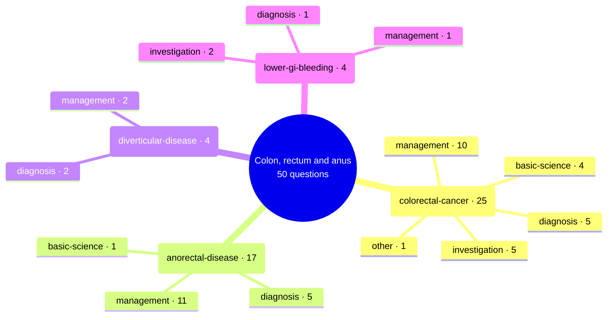

# Colon, rectum and anus

Generated by `scripts/exam_mindmap.py` from `exam-map/tags/`. Edit the tags, not this page.
50 past General Sx MCQ questions (MDCU69, MDCU70, MDCU72, MDCU73, MDCU74, MDCU75, MDCU76, MDCU77, MDCU78). Subtopics say what each question asks, never its answer. Read = Board Review note (BR nn) first, then Chula Surgery 1 chapter and pages. AI-made labels from student-recalled papers and student keys, unchecked: check against the textbook or your attending.

## Mind map

## colorectal-cancer

25 questions · asked by MDCU69, MDCU70, MDCU72, MDCU73, MDCU74, MDCU76, MDCU77, MDCU78 · management 10, diagnosis 5, investigation 5, basic-science 4, other 1

Most cited reading: BR 25; BR 01 (Oncology); BR 19; BR 24

| Question | Type | What it asks | Read |
| --- | --- | --- | --- |
| [mdcu78-gen-a Q502](https://github.com/playerplayrh/surgery-year-4/blob/main/exams/mdcu78-gen-a-mcq/exam.md) | basic-science | Family with colorectal cancer in father and grandfather and ovarian cancer in an aunt: mode of inheritance | BR 25; BR 01 (Oncology) |
| [mdcu78-gen-a Q2001](https://github.com/playerplayrh/surgery-year-4/blob/main/exams/mdcu78-gen-a-mcq/exam.md) | management | Frail elderly patient (ECOG 3) with sigmoid cancer and cardiac disease: palliative care vs stent | BR 25 |
| [mdcu78-gen-a Q2002](https://github.com/playerplayrh/surgery-year-4/blob/main/exams/mdcu78-gen-a-mcq/exam.md) | management | Node-positive right colon cancer without metastasis: name of the operation and how bowel continuity is restored | BR 25 |
| [mdcu78-gen-a Q2003](https://github.com/playerplayrh/surgery-year-4/blob/main/exams/mdcu78-gen-a-mcq/exam.md) | diagnosis | Lip pigmentation in a photo: what colonoscopy will find | BR 25; BR 19 |
| [mdcu78-gen-a Q2004](https://github.com/playerplayrh/surgery-year-4/blob/main/exams/mdcu78-gen-a-mcq/exam.md) | diagnosis | Colonoscopy showing continuous lesions from the rectum to the ascending colon: Crohn vs ulcerative colitis | BR 24 |
| [mdcu78-gen-c Q502](https://github.com/playerplayrh/surgery-year-4/blob/main/exams/mdcu78-gen-c-mcq/exam.md) | basic-science | Pathway of colorectal adenocarcinoma development (accumulated mutations vs a polyp sequence) | BR 25; BR 01 (Oncology) |
| [mdcu78-gen-c Q2001](https://github.com/playerplayrh/surgery-year-4/blob/main/exams/mdcu78-gen-c-mcq/exam.md) | management | 4 cm rectal cancer 3 cm above the puborectalis invading the serosa and abutting the uterus and cervix with positive nodes: treatment sequence and operation | BR 25 |
| [mdcu78-gen-c Q2002](https://github.com/playerplayrh/surgery-year-4/blob/main/exams/mdcu78-gen-c-mcq/exam.md) | investigation | Role of pelvic MRI in rectal cancer (metastasis detection vs local depth and staging) | BR 25 |
| [mdcu78-gen-c Q2003](https://github.com/playerplayrh/surgery-year-4/blob/main/exams/mdcu78-gen-c-mcq/exam.md) | diagnosis | Picture of blue-pigmented lips: which polyp type (only one choice recalled) | BR 25; BR 19 |
| [mdcu78-gen-d Q2001](https://github.com/playerplayrh/surgery-year-4/blob/main/exams/mdcu78-gen-d-mcq/exam.md) | management | Descending colon cancer: name the operation, the diverting procedure that protects the anastomosis and for how long (drawing) | BR 25 |
| [mdcu78-gen-d Q2002](https://github.com/playerplayrh/surgery-year-4/blob/main/exams/mdcu78-gen-d-mcq/exam.md) | diagnosis | Elderly man with weight loss, fatigue and anaemia without change in bowel habit and a positive FOBT: right vs left colon cancer | BR 25 |
| [mdcu78-gen-d Q2003](https://github.com/playerplayrh/surgery-year-4/blob/main/exams/mdcu78-gen-d-mcq/exam.md) | management | Rectal cancer 5 cm fixed to the prostate with a few pericolic nodes and no metastasis: management sequence and operation | BR 25 |
| [mdcu78-gen-d Q2004](https://github.com/playerplayrh/surgery-year-4/blob/main/exams/mdcu78-gen-d-mcq/exam.md) | management | 55-year-old with no family history: when to start colorectal cancer screening (stem cut off) | BR 25 |
| [mdcu78-gen-d Q2005](https://github.com/playerplayrh/surgery-year-4/blob/main/exams/mdcu78-gen-d-mcq/exam.md) | diagnosis | Chronic constipation now unable to pass stool (no choices recalled) | BR 25 |
| [mdcu78-gen-d Q2006](https://github.com/playerplayrh/surgery-year-4/blob/main/exams/mdcu78-gen-d-mcq/exam.md) | management | Metastatic colon cancer after colostomy now with obstruction for 24 hours: colonoscopy vs laparotomy vs laparoscopy | BR 25 |
| [mdcu77-gen-c Q55](https://github.com/playerplayrh/surgery-year-4/blob/main/exams/mdcu77-gen-c-mcq/exam.md) | management | Middle-aged man with relatives who had colon cancer at 65 and 75 and a normal colonoscopy: screening plan from here (stem cut off) | BR 25 |
| [mdcu76-gen-a Q47](https://github.com/playerplayrh/surgery-year-4/blob/main/exams/mdcu76-gen-a-mcq/exam.md) | management | Adenomatous polyp found on colonoscopy in a likely FAP patient: most important advice (family genetic testing, discussion, psychotherapy) | BR 25 |
| [mdcu76-gen-d Q15](https://github.com/playerplayrh/surgery-year-4/blob/main/exams/mdcu76-gen-d-mcq/exam.md) | management | Rectal cancer invading the prostate: en bloc resection of both (only one choice recalled) | BR 25 |
| [mdcu74-gen-c Q13](https://github.com/playerplayrh/surgery-year-4/blob/main/exams/mdcu74-gen-c-mcq/exam.md) | basic-science | Secondary prevention of colorectal cancer: which listed action counts (CEA screening, polypectomy, PET scan, faecal occult blood screening) | BR 25; BR 01 (Oncology) |
| [mdcu73-gen-c Q86](https://github.com/playerplayrh/surgery-year-4/blob/main/exams/mdcu73-gen-c-mcq/exam.md) | investigation | Tumour marker to follow colon cancer with liver metastases (CA19-9, CEA, AFP, c-KIT, CA-125) | BR 25; Chula ch15 p566 |
| [mdcu72-gen-a Q86](https://github.com/playerplayrh/surgery-year-4/blob/main/exams/mdcu72-gen-a-mcq/exam.md) | investigation | CEA in colorectal cancer: use for screening and diagnosis vs follow-up, and rises in benign conditions; which is false | BR 25 |
| [mdcu72-gen-c Q30](https://github.com/playerplayrh/surgery-year-4/blob/main/exams/mdcu72-gen-c-mcq/exam.md) | other | Middle-aged man with a month of bloody mucous stool: what is not the GP's role (history, rectal exam, CEA and PET, colonoscopy, counselling before referral) | BR 25 |
| [mdcu70-gen-1 Q31](https://github.com/playerplayrh/surgery-year-4/blob/main/exams/mdcu70-gen-1-mcq/exam.md) | investigation | Healthy 49-year-old with a positive faecal occult blood test and normal labs: next recommendation | BR 25 |
| [mdcu69-gen-1 Q86](https://github.com/playerplayrh/surgery-year-4/blob/main/exams/mdcu69-gen-1-mcq/exam.md) | investigation | Role of CEA in colon cancer: screening and diagnosis vs monitoring after treatment | BR 25 |
| [mdcu69-gen-1 Q89](https://github.com/playerplayrh/surgery-year-4/blob/main/exams/mdcu69-gen-1-mcq/exam.md) | basic-science | Young adult with many adenomatous polyps and a father dead of colon cancer: FAP genetics, screening age and upper GI surveillance; which statement is wrong | BR 25 |

## anorectal-disease

17 questions · asked by MDCU70, MDCU74, MDCU76, MDCU78 · management 11, diagnosis 5, basic-science 1

Most cited reading: BR 25; BR 16

| Question | Type | What it asks | Read |
| --- | --- | --- | --- |
| [mdcu78-gen-a Q1701](https://github.com/playerplayrh/surgery-year-4/blob/main/exams/mdcu78-gen-a-mcq/exam.md) | management | Anal pain with a proctoscopic photo of the lesion: management | BR 25 |
| [mdcu78-gen-a Q1702](https://github.com/playerplayrh/surgery-year-4/blob/main/exams/mdcu78-gen-a-mcq/exam.md) | management | Intermittent anal bleeding with a prolapsing mass that reduces manually, proctoscopic photo: grading and treatment | BR 25 |
| [mdcu78-gen-a Q1703](https://github.com/playerplayrh/surgery-year-4/blob/main/exams/mdcu78-gen-a-mcq/exam.md) | management | Two days of anal pain with a painful perianal lump in a photo: management | BR 25 |
| [mdcu78-gen-a Q1704](https://github.com/playerplayrh/surgery-year-4/blob/main/exams/mdcu78-gen-a-mcq/exam.md) | management | Anal pain with a photo of the anal region: management (only one choice recalled) | BR 25 |
| [mdcu78-gen-c Q1701](https://github.com/playerplayrh/surgery-year-4/blob/main/exams/mdcu78-gen-c-mcq/exam.md) | diagnosis | Hard stools with anal pain: diagnosis (only one choice recalled) | BR 25 |
| [mdcu78-gen-c Q1702](https://github.com/playerplayrh/surgery-year-4/blob/main/exams/mdcu78-gen-c-mcq/exam.md) | diagnosis | Elderly man passing painless bright red blood with stool: haemorrhoids vs diverticulosis vs fissure | BR 25; BR 16 |
| [mdcu78-gen-c Q1703](https://github.com/playerplayrh/surgery-year-4/blob/main/exams/mdcu78-gen-c-mcq/exam.md) | diagnosis | Anal ulcer in a man who has sex with men (only one choice recalled) | BR 25 |
| [mdcu78-gen-c Q1704](https://github.com/playerplayrh/surgery-year-4/blob/main/exams/mdcu78-gen-c-mcq/exam.md) | management | Treatment of anal condyloma (excision and coagulation vs imiquimod) | BR 25 |
| [mdcu78-gen-c Q1705](https://github.com/playerplayrh/surgery-year-4/blob/main/exams/mdcu78-gen-c-mcq/exam.md) | management | Painless mixed haemorrhoid that prolapses and needs manual reduction (photo): grading and treatment (stem cut off) | BR 25 |
| [mdcu78-gen-c Q1706](https://github.com/playerplayrh/surgery-year-4/blob/main/exams/mdcu78-gen-c-mcq/exam.md) | diagnosis | Perianal opening where a probe passes to the anal verge with a palpable fibrous tract: diagnosis (stem cut off) | BR 25 |
| [mdcu78-gen-d Q1701](https://github.com/playerplayrh/surgery-year-4/blob/main/exams/mdcu78-gen-d-mcq/exam.md) | management | Intermittent bleeding after defecation with large internal haemorrhoids at 3, 7 and 11 o'clock: most appropriate management | BR 25 |
| [mdcu78-gen-d Q1702](https://github.com/playerplayrh/surgery-year-4/blob/main/exams/mdcu78-gen-d-mcq/exam.md) | management | Low transsphincteric fistula with low incontinence risk: operation with the lowest recurrence (fistulotomy, LIFT, plug, seton, advancement flap) | BR 25 |
| [mdcu78-gen-d Q1703](https://github.com/playerplayrh/surgery-year-4/blob/main/exams/mdcu78-gen-d-mcq/exam.md) | basic-science | Cause of anal abscess (only one choice recalled) | BR 25 |
| [mdcu78-gen-d Q1705](https://github.com/playerplayrh/surgery-year-4/blob/main/exams/mdcu78-gen-d-mcq/exam.md) | management | Painful defecation with a spastic sphincter on examination: management (choices not recalled) | BR 25 |
| [mdcu76-gen-d Q54](https://github.com/playerplayrh/surgery-year-4/blob/main/exams/mdcu76-gen-d-mcq/exam.md) | management | Acute perianal pain with a fluctuant swelling beside the anus: excision vs incision and drainage | BR 25 |
| [mdcu74-gen-d Q28](https://github.com/playerplayrh/surgery-year-4/blob/main/exams/mdcu74-gen-d-mcq/exam.md) | diagnosis | HIV-positive man with previous anal warts and a new anal mass: cancer type | BR 25 |
| [mdcu70-gen-2 Q96](https://github.com/playerplayrh/surgery-year-4/blob/main/exams/mdcu70-gen-2-mcq/exam.md) | management | Fever with a tender, warm, fluctuant perianal swelling in a healthy man: appropriate management | BR 25 |

## diverticular-disease

4 questions · asked by MDCU72, MDCU75, MDCU76 · management 2, diagnosis 2

Most cited reading: BR 25

| Question | Type | What it asks | Read |
| --- | --- | --- | --- |
| [mdcu76-gen-a Q71](https://github.com/playerplayrh/surgery-year-4/blob/main/exams/mdcu76-gen-a-mcq/exam.md) | management | Sigmoid diverticulitis with multiple diverticula and a small abscess: resection with anastomosis vs Hartmann vs antibiotics | BR 25 |
| [mdcu76-gen-d Q45](https://github.com/playerplayrh/surgery-year-4/blob/main/exams/mdcu76-gen-d-mcq/exam.md) | diagnosis | Elderly woman with left iliac fossa pain: most likely diagnosis (only one choice recalled) | BR 25 |
| [mdcu75-gen-c Q16](https://github.com/playerplayrh/surgery-year-4/blob/main/exams/mdcu75-gen-c-mcq/exam.md) | management | Sigmoid diverticulitis with a 4 cm pelvic abscess in a stable patient on antibiotics: emergency resection vs percutaneous drainage | BR 25 |
| [mdcu72-gen-d Q58](https://github.com/playerplayrh/surgery-year-4/blob/main/exams/mdcu72-gen-d-mcq/exam.md) | diagnosis | LLQ pain and tenderness with altered bowel sounds, small liquid stool and feculent vomiting: sigmoid volvulus vs diverticulitis vs Meckel diverticulitis | BR 25 |

## lower-gi-bleeding

4 questions · asked by MDCU73, MDCU77, MDCU78 · investigation 2, diagnosis 1, management 1

Most cited reading: BR 16; Chula ch10; BR 25; ch8 p394-395

| Question | Type | What it asks | Read |
| --- | --- | --- | --- |
| [mdcu78-gen-a Q2005](https://github.com/playerplayrh/surgery-year-4/blob/main/exams/mdcu78-gen-a-mcq/exam.md) | diagnosis | Elderly patient with chronic constipation and massive painless rectal bleeding with stable vitals: haemorrhoids vs diverticulosis | BR 16; BR 25 |
| [mdcu78-gen-d Q1405](https://github.com/playerplayrh/surgery-year-4/blob/main/exams/mdcu78-gen-d-mcq/exam.md) | investigation | Haematochezia with an NG aspirate showing only bile: next step (choices not recalled) | BR 16; Chula ch10 |
| [mdcu77-gen-b Q6](https://github.com/playerplayrh/surgery-year-4/blob/main/exams/mdcu77-gen-b-mcq/exam.md) | investigation | Young woman with painless massive lower GI bleeding, negative upper endoscopy and colonoscopy: next investigation for a small bowel source | BR 16; Chula ch10; ch8 p394-395 |
| [mdcu73-gen-c Q37](https://github.com/playerplayrh/surgery-year-4/blob/main/exams/mdcu73-gen-c-mcq/exam.md) | management | Elderly woman with fresh rectal bleeding, mild tachycardia and borderline pressure: first step to exclude an upper GI source before colonoscopy | BR 16; Chula ch10 |

