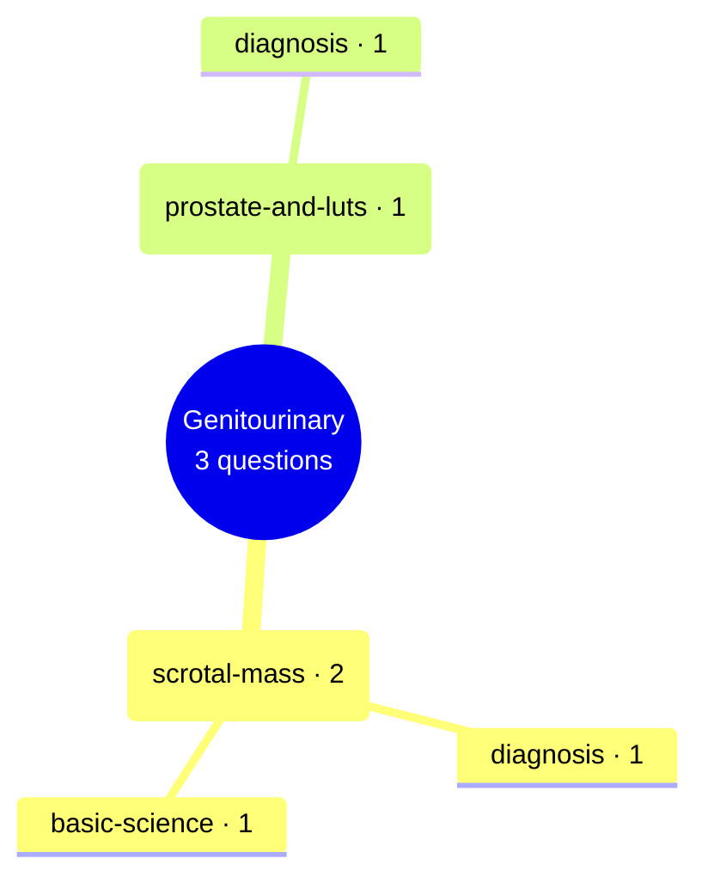

# Genitourinary

Generated by `scripts/exam_mindmap.py` from `exam-map/tags/`. Edit the tags, not this page.
3 past General Sx MCQ questions (MDCU70, MDCU76, MDCU77). Subtopics say what each question asks, never its answer. Read = Board Review note (BR nn) first, then Chula Surgery 1 chapter and pages. AI-made labels from student-recalled papers and student keys, unchecked: check against the textbook or your attending.

## Mind map

## scrotal-mass

2 questions · asked by MDCU70, MDCU76 · diagnosis 1, basic-science 1

Most cited reading: BR 39; BR 33; BR 38b

| Question | Type | What it asks | Read |
| --- | --- | --- | --- |
| [mdcu76-gen-d Q5](https://github.com/playerplayrh/surgery-year-4/blob/main/exams/mdcu76-gen-d-mcq/exam.md) | diagnosis | Scrotal mass with a positive transillumination test: diagnosis | BR 39; BR 33 |
| [mdcu70-gen-a Q42](https://github.com/playerplayrh/surgery-year-4/blob/main/exams/mdcu70-gen-a-mcq/exam.md) | basic-science | Most common position of an undescended testis | BR 38b; BR 39 |

## prostate-and-luts

1 questions · asked by MDCU77 · diagnosis 1

Most cited reading: BR 39

| Question | Type | What it asks | Read |
| --- | --- | --- | --- |
| [mdcu77-gen-c Q35](https://github.com/playerplayrh/surgery-year-4/blob/main/exams/mdcu77-gen-c-mcq/exam.md) | diagnosis | Nine months of poor stream and straining with recent pain and possible haematuria, getting worse (stem cut off) | BR 39 |

