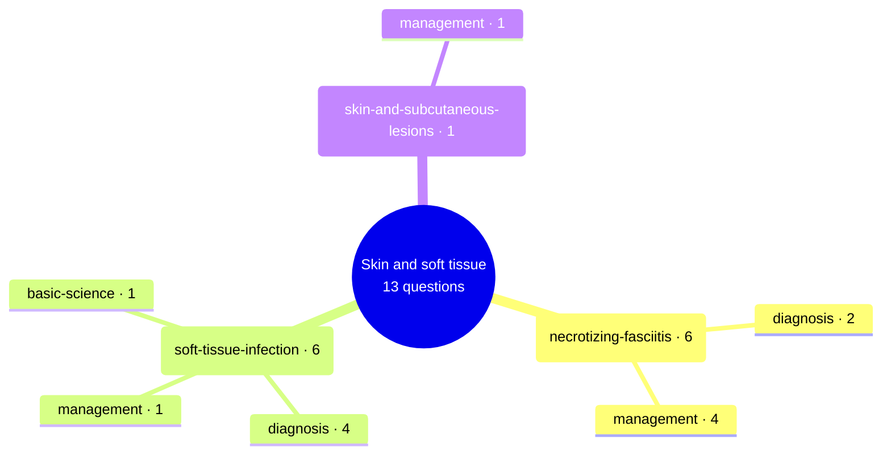

# Skin and soft tissue

Generated by `scripts/exam_mindmap.py` from `exam-map/tags/`. Edit the tags, not this page.
13 past General Sx MCQ questions (MDCU70, MDCU72, MDCU73, MDCU74, MDCU76, MDCU77, MDCU78). Subtopics say what each question asks, never its answer. Read = Board Review note (BR nn) first, then Chula Surgery 1 chapter and pages. AI-made labels from student-recalled papers and student keys, unchecked: check against the textbook or your attending.

## Mind map

## necrotizing-fasciitis

6 questions · asked by MDCU70, MDCU72, MDCU74, MDCU78 · management 4, diagnosis 2

Most cited reading: BR 03; BR 01 (Surgical Infections); BR 25; Chula ch5

| Question | Type | What it asks | Read |
| --- | --- | --- | --- |
| [mdcu78-gen-a Q304](https://github.com/playerplayrh/surgery-year-4/blob/main/exams/mdcu78-gen-a-mcq/exam.md) | management | Fever, tachycardia, bullae and necrotic tissue on the leg: management (only one choice recalled) | BR 03; BR 01 (Surgical Infections) |
| [mdcu78-gen-d Q1704](https://github.com/playerplayrh/surgery-year-4/blob/main/exams/mdcu78-gen-d-mcq/exam.md) | diagnosis | Picture of a gangrenous perineal and genital infection: diagnosis (choices not recalled) | BR 03; BR 25 |
| [mdcu74-gen-d Q5](https://github.com/playerplayrh/surgery-year-4/blob/main/exams/mdcu74-gen-d-mcq/exam.md) | management | Penetrating wound followed by purple skin and bullae: first treatment (debridement, amputation, prolonged antibiotics) | BR 03; BR 01 (Surgical Infections) |
| [mdcu74-gen-d Q6](https://github.com/playerplayrh/surgery-year-4/blob/main/exams/mdcu74-gen-d-mcq/exam.md) | diagnosis | Purple bullae with crepitus: most likely organism | BR 03; BR 01 (Surgical Infections) |
| [mdcu72-gen-d Q88](https://github.com/playerplayrh/surgery-year-4/blob/main/exams/mdcu72-gen-d-mcq/exam.md) | management | Septic diabetic with a purple, crepitant leg and black bullae: which step is not part of management (debridement, glucose control, hyperbaric oxygen, fluids, broad-spectrum antibiotics) | BR 03; BR 01 (Surgical Infections) |
| [mdcu70-gen-a Q87](https://github.com/playerplayrh/surgery-year-4/blob/main/exams/mdcu70-gen-a-mcq/exam.md) | management | Diabetic with a hot swollen painful leg, purple bullae and palpable pulses: which treatment package (antibiotics route, fluids, drainage vs debridement vs amputation) | BR 03; BR 01 (Surgical Infections); Chula ch5 |

## soft-tissue-infection

6 questions · asked by MDCU73, MDCU76, MDCU77, MDCU78 · diagnosis 4, management 1, basic-science 1

Most cited reading: BR 03; BR 01 (Surgical Infections); BR 13

| Question | Type | What it asks | Read |
| --- | --- | --- | --- |
| [mdcu78-gen-d Q403](https://github.com/playerplayrh/surgery-year-4/blob/main/exams/mdcu78-gen-d-mcq/exam.md) | management | Tender fluctuant red 4 cm lesion at a shaved area without systemic symptoms (photo): drainage vs antibiotics | BR 03; BR 01 (Surgical Infections) |
| [mdcu77-gen-c Q39](https://github.com/playerplayrh/surgery-year-4/blob/main/exams/mdcu77-gen-c-mcq/exam.md) | diagnosis | Southern farmer with unilateral elephantiasis-like leg swelling in a photo: cause (only one choice recalled) | BR 13 |
| [mdcu77-gen-d Q13](https://github.com/playerplayrh/surgery-year-4/blob/main/exams/mdcu77-gen-d-mcq/exam.md) | diagnosis | Small inflamed skin papule with a central crust in a photo: causative organism group | BR 03; BR 01 (Surgical Infections) |
| [mdcu76-gen-a Q41](https://github.com/playerplayrh/surgery-year-4/blob/main/exams/mdcu76-gen-a-mcq/exam.md) | basic-science | Organisms in a red swollen skin infection shown in a picture: which Gram groups may be involved (no stem recalled) | BR 03; BR 01 (Surgical Infections) |
| [mdcu73-gen-c Q48](https://github.com/playerplayrh/surgery-year-4/blob/main/exams/mdcu73-gen-c-mcq/exam.md) | diagnosis | Red, warm, tender streaking from forearm to axilla after a thorn prick in a woman who had axillary dissection: lymphangitis vs cellulitis vs erysipelas vs filariasis | BR 13; BR 03 |
| [mdcu73-gen-c Q49](https://github.com/playerplayrh/surgery-year-4/blob/main/exams/mdcu73-gen-c-mcq/exam.md) | diagnosis | Tense swollen painful leg after a mosquito bite in a heavy drinker: cellulitis, erysipelas, DVT or lymphatic obstruction | BR 13; BR 03 |

## skin-and-subcutaneous-lesions

1 questions · asked by MDCU76 · management 1

Most cited reading: BR 03

| Question | Type | What it asks | Read |
| --- | --- | --- | --- |
| [mdcu76-gen-c Q17](https://github.com/playerplayrh/surgery-year-4/blob/main/exams/mdcu76-gen-c-mcq/exam.md) | management | Posterior neck nodule present for 3 years that suddenly became inflamed: drainage, excision or aspiration first | BR 03 |

