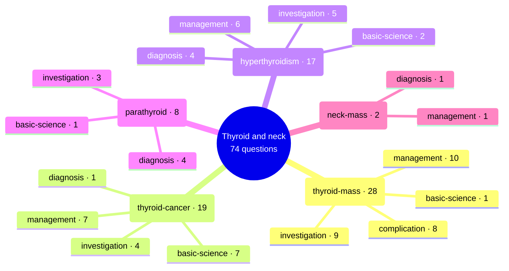

# Thyroid and neck

Generated by `scripts/exam_mindmap.py` from `exam-map/tags/`. Edit the tags, not this page.
74 past General Sx MCQ questions (MDCU69, MDCU70, MDCU72, MDCU73, MDCU74, MDCU76, MDCU77, MDCU78). Subtopics say what each question asks, never its answer. Read = Board Review note (BR nn) first, then Chula Surgery 1 chapter and pages. AI-made labels from student-recalled papers and student keys, unchecked: check against the textbook or your attending.

## Mind map

## thyroid-mass

28 questions · asked by MDCU69, MDCU70, MDCU72, MDCU73, MDCU76, MDCU77, MDCU78 · management 10, investigation 9, complication 8, basic-science 1

Most cited reading: BR 34; Chula ch6 p258-260; Chula ch6 p243-245; BR 35

| Question | Type | What it asks | Read |
| --- | --- | --- | --- |
| [mdcu78-gen-a Q1802](https://github.com/playerplayrh/surgery-year-4/blob/main/exams/mdcu78-gen-a-mcq/exam.md) | investigation | Firm 1.8 cm hypoechoic thyroid nodule with irregular border and increased vascularity: next step (only one choice recalled) | BR 34; Chula ch6 p245 |
| [mdcu78-gen-b Q6](https://github.com/playerplayrh/surgery-year-4/blob/main/exams/mdcu78-gen-b-mcq/exam.md) | complication | Carpopedal spasm on blood pressure measurement after thyroidectomy: management (choices not recalled) | BR 34; BR 35; Chula ch6 p258-260 |
| [mdcu78-gen-b Q7](https://github.com/playerplayrh/surgery-year-4/blob/main/exams/mdcu78-gen-b-mcq/exam.md) | management | Thyroid nodule suspicious for malignancy: management (choices not recalled) | BR 34; Chula ch6 p245-257 |
| [mdcu78-gen-c Q1801](https://github.com/playerplayrh/surgery-year-4/blob/main/exams/mdcu78-gen-c-mcq/exam.md) | management | Bethesda V (suspicious for malignancy): follow-up vs total thyroidectomy vs repeat FNA | BR 34; Chula ch6 p245-257 |
| [mdcu78-gen-c Q1802](https://github.com/playerplayrh/surgery-year-4/blob/main/exams/mdcu78-gen-c-mcq/exam.md) | investigation | Ultrasound feature of a thyroid nodule most suspicious for cancer (spongiform, lobulated, microcalcification) | BR 34; Chula ch6 p243-245 |
| [mdcu78-gen-d Q1802](https://github.com/playerplayrh/surgery-year-4/blob/main/exams/mdcu78-gen-d-mcq/exam.md) | investigation | Neck mass for 6 years with mildly raised TSH: next investigation | BR 34; Chula ch6 p243-245 |
| [mdcu78-gen-d Q1803](https://github.com/playerplayrh/surgery-year-4/blob/main/exams/mdcu78-gen-d-mcq/exam.md) | management | Thyroid nodule with spiculated margins and hypervascularity on ultrasound: next step (scan, core biopsy, FNA) | BR 34; Chula ch6 p245 |
| [mdcu77-gen-a Q3](https://github.com/playerplayrh/surgery-year-4/blob/main/exams/mdcu77-gen-a-mcq/exam.md) | complication | Hoarseness after total thyroidectomy: which nerve was injured (cervical plexus, branches of the superior laryngeal nerve, recurrent laryngeal nerve) | BR 34; Chula ch6 p258-260 |
| [mdcu77-gen-a Q4](https://github.com/playerplayrh/surgery-year-4/blob/main/exams/mdcu77-gen-a-mcq/exam.md) | complication | Stridor and desaturation soon after total thyroidectomy: what a first-year resident should not do (oxygen, bedside clot evacuation, calling the senior, airway steps) | BR 34; Chula ch6 p258-260 |
| [mdcu77-gen-b Q4](https://github.com/playerplayrh/surgery-year-4/blob/main/exams/mdcu77-gen-b-mcq/exam.md) | management | Long-standing multinodular goitre with a new 1 cm suspicious nodule and FNA showing atypia of undetermined significance (Bethesda III): next management | BR 34; Chula ch6 p245-250 |
| [mdcu77-gen-b Q11](https://github.com/playerplayrh/surgery-year-4/blob/main/exams/mdcu77-gen-b-mcq/exam.md) | management | Thyroid FNA reported as AUS: next step (repeat of Q4) | BR 34; Chula ch6 p245-250 |
| [mdcu77-gen-b Q64](https://github.com/playerplayrh/surgery-year-4/blob/main/exams/mdcu77-gen-b-mcq/exam.md) | basic-science | Structure preserved in near-total thyroidectomy to keep calcium homeostasis | BR 34; BR 35; Chula ch6 p258-260 |
| [mdcu77-gen-b Q119](https://github.com/playerplayrh/surgery-year-4/blob/main/exams/mdcu77-gen-b-mcq/exam.md) | management | Multinodular goitre with a 1 cm hypoechoic nodule and Bethesda III FNA: management (surgery, medication, RAI, follow-up) | BR 34; Chula ch6 p245-250 |
| [mdcu77-gen-c Q71](https://github.com/playerplayrh/surgery-year-4/blob/main/exams/mdcu77-gen-c-mcq/exam.md) | investigation | Thyroid lump for 2 years with no thyroid symptoms: first step (TFT, ultrasound, scan) | BR 34; Chula ch6 p243-245 |
| [mdcu77-gen-d Q71](https://github.com/playerplayrh/surgery-year-4/blob/main/exams/mdcu77-gen-d-mcq/exam.md) | complication | Chvostek and Trousseau signs after thyroidectomy: cause (hypothyroidism, cancer, too much thyroid removed, parathyroid devascularisation) | BR 34; BR 35; Chula ch6 p258-260 |
| [mdcu77-gen-d Q74](https://github.com/playerplayrh/surgery-year-4/blob/main/exams/mdcu77-gen-d-mcq/exam.md) | management | Long-standing neck mass with new night-time breathing difficulty from tracheal compression and isoechoic bilateral nodules: TFT, ablation, FNA or thyroidectomy | BR 34; Chula ch6 p253-257 |
| [mdcu77-gen-d Q75](https://github.com/playerplayrh/surgery-year-4/blob/main/exams/mdcu77-gen-d-mcq/exam.md) | investigation | 2 cm hypoechoic thyroid nodule without symptoms: first investigation (ultrasound-guided FNA, TFT, thyroglobulin) | BR 34; Chula ch6 p243-245 |
| [mdcu76-gen-a Q19](https://github.com/playerplayrh/surgery-year-4/blob/main/exams/mdcu76-gen-a-mcq/exam.md) | management | Goitre: total vs subtotal thyroidectomy and what decides the operation (size, compression, toxicity) | BR 34; Chula ch6 p253-257 |
| [mdcu76-gen-c Q6](https://github.com/playerplayrh/surgery-year-4/blob/main/exams/mdcu76-gen-c-mcq/exam.md) | complication | Perioral numbness and carpopedal spasm on blood pressure measurement on day 1 after total thyroidectomy: the expected laboratory abnormality | BR 34; BR 35; Chula ch6 p258-260 |
| [mdcu76-gen-c Q69](https://github.com/playerplayrh/surgery-year-4/blob/main/exams/mdcu76-gen-c-mcq/exam.md) | management | Left thyroid nodule with FNA showing follicular neoplasm: next step (core biopsy, lobectomy, with isthmectomy, subtotal or total thyroidectomy) | BR 34; Chula ch6 p245-250 |
| [mdcu76-gen-d Q30](https://github.com/playerplayrh/surgery-year-4/blob/main/exams/mdcu76-gen-d-mcq/exam.md) | investigation | 2 cm thyroid nodule moving with swallowing: tissue sampling by FNA vs core biopsy | BR 34; Chula ch6 p245 |
| [mdcu73-gen-c Q55](https://github.com/playerplayrh/surgery-year-4/blob/main/exams/mdcu73-gen-c-mcq/exam.md) | complication | Singer who cannot reach high notes after thyroidectomy: which nerve was injured | BR 34; Chula ch6 p258-260 |
| [mdcu72-gen-c Q36](https://github.com/playerplayrh/surgery-year-4/blob/main/exams/mdcu72-gen-c-mcq/exam.md) | management | Stable 1.5 cm spongiform thyroid nodule without symptoms and FNA Bethesda II: next management (no choices recalled) | BR 34; Chula ch6 p243-250 |
| [mdcu70-gen-1 Q55](https://github.com/playerplayrh/surgery-year-4/blob/main/exams/mdcu70-gen-1-mcq/exam.md) | complication | Choking on fluids and hoarseness on day 2 after total thyroidectomy: cause among intubation injury, viral infection, recurrent and superior laryngeal nerve injury | BR 34; Chula ch6 p258-260 |
| [mdcu70-gen-2 Q46](https://github.com/playerplayrh/surgery-year-4/blob/main/exams/mdcu70-gen-2-mcq/exam.md) | investigation | Single euthyroid thyroid nodule: most appropriate investigation (TFT, thyroglobulin, FNA, scan, ultrasound) | BR 34; Chula ch6 p243-245 |
| [mdcu70-gen-a Q47](https://github.com/playerplayrh/surgery-year-4/blob/main/exams/mdcu70-gen-a-mcq/exam.md) | investigation | Long-standing slowly enlarging thyroid mass with no thyroid or compressive symptoms: initial laboratory test | BR 34; Chula ch6 p243-245 |
| [mdcu69-gen-1 Q66](https://github.com/playerplayrh/surgery-year-4/blob/main/exams/mdcu69-gen-1-mcq/exam.md) | complication | Hoarseness after total thyroidectomy: which nerve or structure was injured | BR 34; Chula ch6 p258-260 |
| [mdcu69-gen-1 Q69](https://github.com/playerplayrh/surgery-year-4/blob/main/exams/mdcu69-gen-1-mcq/exam.md) | investigation | Older man with a 1 cm firm thyroid nodule moving with swallowing and a normal examination: appropriate first investigation | BR 34; Chula ch6 p243-245 |

## thyroid-cancer

19 questions · asked by MDCU69, MDCU70, MDCU72, MDCU73, MDCU74, MDCU76, MDCU77, MDCU78 · management 7, basic-science 7, investigation 4, diagnosis 1

Most cited reading: BR 34; Chula ch6; Chula ch6 p253-257; BR 38

| Question | Type | What it asks | Read |
| --- | --- | --- | --- |
| [mdcu78-gen-d Q1801](https://github.com/playerplayrh/surgery-year-4/blob/main/exams/mdcu78-gen-d-mcq/exam.md) | management | Known anaplastic thyroid cancer with dyspnoea from tracheal compression: palliative treatment to relieve the airway | BR 34; Chula ch6 |
| [mdcu78-gen-d Q1805](https://github.com/playerplayrh/surgery-year-4/blob/main/exams/mdcu78-gen-d-mcq/exam.md) | management | Metastatic anaplastic thyroid cancer presenting with stridor: best management (no lettered choices) | BR 34; Chula ch6 |
| [mdcu77-gen-a Q62](https://github.com/playerplayrh/surgery-year-4/blob/main/exams/mdcu77-gen-a-mcq/exam.md) | management | Single euthyroid nodule with FNA papillary carcinoma and node-negative imaging: total thyroidectomy with or without iodine vs neck dissection vs lobectomy | BR 34; Chula ch6 p253-257 |
| [mdcu77-gen-b Q10](https://github.com/playerplayrh/surgery-year-4/blob/main/exams/mdcu77-gen-b-mcq/exam.md) | basic-science | Thyroid tumour with amyloid in the stroma on pathology: cell of origin | BR 34; Chula ch6 |
| [mdcu76-gen-a Q8](https://github.com/playerplayrh/surgery-year-4/blob/main/exams/mdcu76-gen-a-mcq/exam.md) | management | Extent of thyroid surgery for papillary carcinoma (subtotal, total, lobectomy) and when lobectomy is enough | BR 34; Chula ch6 p253-257 |
| [mdcu76-gen-c Q1](https://github.com/playerplayrh/surgery-year-4/blob/main/exams/mdcu76-gen-c-mcq/exam.md) | investigation | Young man with medullary thyroid carcinoma on FNA: what to screen for before surgery (MEN-associated conditions, calcitonin and CEA) | BR 34; BR 38; Chula ch6 |
| [mdcu76-gen-c Q4](https://github.com/playerplayrh/surgery-year-4/blob/main/exams/mdcu76-gen-c-mcq/exam.md) | basic-science | Previous neck or chest irradiation (thymoma treated with radiotherapy): which thyroid cancer is most likely | BR 34; Chula ch6 |
| [mdcu76-gen-d Q29](https://github.com/playerplayrh/surgery-year-4/blob/main/exams/mdcu76-gen-d-mcq/exam.md) | investigation | First-degree relative with medullary thyroid carcinoma: most useful screening test | BR 34; BR 38; Chula ch6 |
| [mdcu76-gen-d Q31](https://github.com/playerplayrh/surgery-year-4/blob/main/exams/mdcu76-gen-d-mcq/exam.md) | management | Left papillary thyroid cancer: total thyroidectomy vs lobectomy with isthmectomy vs subtotal | BR 34; Chula ch6 p253-257 |
| [mdcu74-gen-c Q1](https://github.com/playerplayrh/surgery-year-4/blob/main/exams/mdcu74-gen-c-mcq/exam.md) | basic-science | Histological finding (psammoma bodies) and the thyroid cancer type it belongs to | BR 34; Chula ch6 |
| [mdcu74-gen-c Q3](https://github.com/playerplayrh/surgery-year-4/blob/main/exams/mdcu74-gen-c-mcq/exam.md) | investigation | Tumour marker used for medullary thyroid carcinoma | BR 34; BR 38; Chula ch6 |
| [mdcu73-gen-c Q52](https://github.com/playerplayrh/surgery-year-4/blob/main/exams/mdcu73-gen-c-mcq/exam.md) | diagnosis | Neck mass growing over 2 weeks with hoarseness, a hard fixed thyroid mass and bilateral nodes: which thyroid cancer type | BR 34; Chula ch6 |
| [mdcu72-gen-a Q68](https://github.com/playerplayrh/surgery-year-4/blob/main/exams/mdcu72-gen-a-mcq/exam.md) | basic-science | Thyroid cancer epidemiology (commonest type, peak age, sex ratio): which statement is false | BR 34; Chula ch6 |
| [mdcu72-gen-c Q39](https://github.com/playerplayrh/surgery-year-4/blob/main/exams/mdcu72-gen-c-mcq/exam.md) | basic-science | Most common thyroid malignancy | BR 34; Chula ch6 |
| [mdcu70-gen-2 Q47](https://github.com/playerplayrh/surgery-year-4/blob/main/exams/mdcu70-gen-2-mcq/exam.md) | investigation | Tumour markers in thyroid cancer: which one is not used (anti-thyroglobulin, thyroglobulin, CEA, CA19-9, calcitonin) | BR 34; Chula ch6 |
| [mdcu70-gen-2 Q84](https://github.com/playerplayrh/surgery-year-4/blob/main/exams/mdcu70-gen-2-mcq/exam.md) | management | Intubated patient with anaplastic thyroid cancer, stridor and neck nodes: next management (supportive care, urgent thyroidectomy, chemotherapy, radioiodine, radiotherapy) | BR 34; Chula ch6 |
| [mdcu70-gen-a Q49](https://github.com/playerplayrh/surgery-year-4/blob/main/exams/mdcu70-gen-a-mcq/exam.md) | management | 3 cm papillary thyroid carcinoma: lobectomy vs total thyroidectomy, preoperative imaging, thyroglobulin follow-up and iodine ablation; which is correct | BR 34; Chula ch6 p253-257 |
| [mdcu70-gen-a Q50](https://github.com/playerplayrh/surgery-year-4/blob/main/exams/mdcu70-gen-a-mcq/exam.md) | basic-science | Cell of origin of medullary thyroid carcinoma | BR 34; BR 38; Chula ch6 |
| [mdcu69-gen-1 Q68](https://github.com/playerplayrh/surgery-year-4/blob/main/exams/mdcu69-gen-1-mcq/exam.md) | basic-science | Epidemiology and cell of origin of thyroid cancers (papillary, Hurthle, medullary; sex and age): which statement is wrong | BR 34; Chula ch6 |

## hyperthyroidism

17 questions · asked by MDCU69, MDCU70, MDCU72, MDCU73, MDCU76, MDCU77, MDCU78 · management 6, investigation 5, diagnosis 4, basic-science 2

Most cited reading: BR 34; Chula ch6; Chula ch6 p253-257; Chula ch6 p243-245

| Question | Type | What it asks | Read |
| --- | --- | --- | --- |
| [mdcu78-gen-a Q1801](https://github.com/playerplayrh/surgery-year-4/blob/main/exams/mdcu78-gen-a-mcq/exam.md) | investigation | Thyroid nodules with suppressed TSH: next step (FNA vs radionuclide scan) | BR 34; Chula ch6 p243-245 |
| [mdcu78-gen-c Q1804](https://github.com/playerplayrh/surgery-year-4/blob/main/exams/mdcu78-gen-c-mcq/exam.md) | diagnosis | Lid lag: which thyroid disease (no lettered choices) | BR 34; Chula ch6 |
| [mdcu77-gen-a Q33](https://github.com/playerplayrh/surgery-year-4/blob/main/exams/mdcu77-gen-a-mcq/exam.md) | investigation | Young woman with tremor, palpitations and a diffusely enlarged thyroid: expected T3, T4 and TSH | BR 34; Chula ch6 |
| [mdcu77-gen-c Q70](https://github.com/playerplayrh/surgery-year-4/blob/main/exams/mdcu77-gen-c-mcq/exam.md) | management | Young mother with Graves disease and marked exophthalmos (photo): radioiodine vs drugs vs which thyroidectomy | BR 34; Chula ch6 p253-257 |
| [mdcu77-gen-d Q73](https://github.com/playerplayrh/surgery-year-4/blob/main/exams/mdcu77-gen-d-mcq/exam.md) | management | Woman with Graves disease and exophthalmos who plans pregnancy: treatment choice | BR 34; Chula ch6 p253-257 |
| [mdcu76-gen-a Q17](https://github.com/playerplayrh/surgery-year-4/blob/main/exams/mdcu76-gen-a-mcq/exam.md) | diagnosis | Low TSH with a cold nodule on thyroid scan: what the combination means | BR 34; Chula ch6 |
| [mdcu76-gen-a Q38](https://github.com/playerplayrh/surgery-year-4/blob/main/exams/mdcu76-gen-a-mcq/exam.md) | diagnosis | Low TSH with a cold nodule: interpretation (repeat theme of Q17) | BR 34; Chula ch6 |
| [mdcu76-gen-a Q39](https://github.com/playerplayrh/surgery-year-4/blob/main/exams/mdcu76-gen-a-mcq/exam.md) | basic-science | Causes of hyperthyroidism (Plummer disease, Graves, Hashimoto, medullary carcinoma): which does not cause it | BR 34; Chula ch6 |
| [mdcu76-gen-d Q57](https://github.com/playerplayrh/surgery-year-4/blob/main/exams/mdcu76-gen-d-mcq/exam.md) | investigation | Graves disease with low TSH: imaging to use | BR 34; Chula ch6 |
| [mdcu73-gen-c Q53](https://github.com/playerplayrh/surgery-year-4/blob/main/exams/mdcu73-gen-c-mcq/exam.md) | diagnosis | Weight loss despite increased appetite, heat intolerance, goitre and exophthalmos with lid retraction: diagnosis | BR 34; Chula ch6 |
| [mdcu73-gen-c Q54](https://github.com/playerplayrh/surgery-year-4/blob/main/exams/mdcu73-gen-c-mcq/exam.md) | investigation | Follow-on of Q53: expected T3, T4 and TSH pattern | BR 34; Chula ch6 |
| [mdcu72-gen-a Q70](https://github.com/playerplayrh/surgery-year-4/blob/main/exams/mdcu72-gen-a-mcq/exam.md) | management | When surgery is preferred for thyrotoxicosis: find the exception | BR 34; Chula ch6 p253-257 |
| [mdcu72-gen-c Q38](https://github.com/playerplayrh/surgery-year-4/blob/main/exams/mdcu72-gen-c-mcq/exam.md) | management | Indications for thyroidectomy in hyperthyroidism (drug allergy, failure of radioiodine, pregnancy resistant to PTU, stridor, recent onset): which is not an indication | BR 34; Chula ch6 p253-257 |
| [mdcu72-gen-c Q40](https://github.com/playerplayrh/surgery-year-4/blob/main/exams/mdcu72-gen-c-mcq/exam.md) | investigation | 2 cm firm thyroid nodule with palpitations and weight loss: first investigation | BR 34; Chula ch6 p243-245 |
| [mdcu70-gen-a Q46](https://github.com/playerplayrh/surgery-year-4/blob/main/exams/mdcu70-gen-a-mcq/exam.md) | management | Hyperthyroid woman with a long-standing nodule, low TSH and a cold nodule in a diffusely hot gland on scan: next step | BR 34; Chula ch6 |
| [mdcu69-gen-1 Q17](https://github.com/playerplayrh/surgery-year-4/blob/main/exams/mdcu69-gen-1-mcq/exam.md) | basic-science | Thyroid function pattern in primary hypothyroidism: expected T4 and TSH levels | BR 34; Chula ch6 |
| [mdcu69-gen-1 Q70](https://github.com/playerplayrh/surgery-year-4/blob/main/exams/mdcu69-gen-1-mcq/exam.md) | management | When surgery is preferred in thyrotoxicosis (multinodular goiter, Graves ophthalmopathy, pregnancy not controlled, airway compression, suspicious cytology): find the exception | BR 34; Chula ch6 p253-257 |

## parathyroid

8 questions · asked by MDCU70, MDCU72, MDCU76, MDCU77, MDCU78 · diagnosis 4, investigation 3, basic-science 1

Most cited reading: BR 35; Chula ch6

| Question | Type | What it asks | Read |
| --- | --- | --- | --- |
| [mdcu78-gen-c Q1803](https://github.com/playerplayrh/surgery-year-4/blob/main/exams/mdcu78-gen-c-mcq/exam.md) | diagnosis | High calcium, low phosphate, high PTH and osteoporosis without CKD: cause | BR 35 |
| [mdcu78-gen-d Q1804](https://github.com/playerplayrh/surgery-year-4/blob/main/exams/mdcu78-gen-d-mcq/exam.md) | investigation | Purpose of preoperative imaging in primary hyperparathyroidism | BR 35 |
| [mdcu77-gen-c Q11](https://github.com/playerplayrh/surgery-year-4/blob/main/exams/mdcu77-gen-c-mcq/exam.md) | diagnosis | Older woman with hypercalcaemia and a single bright nodule on sestamibi: most likely cause | BR 35 |
| [mdcu77-gen-d Q72](https://github.com/playerplayrh/surgery-year-4/blob/main/exams/mdcu77-gen-d-mcq/exam.md) | diagnosis | Three months of nausea, vomiting and hypercalcaemia with normal renal chemistry and urine output and PTH of 90: which hyperparathyroidism | BR 35 |
| [mdcu76-gen-a Q7](https://github.com/playerplayrh/surgery-year-4/blob/main/exams/mdcu76-gen-a-mcq/exam.md) | investigation | Functional imaging used to localise parathyroid adenoma (sestamibi, PET-CT, contrast CT) | BR 35 |
| [mdcu72-gen-c Q37](https://github.com/playerplayrh/surgery-year-4/blob/main/exams/mdcu72-gen-c-mcq/exam.md) | diagnosis | Young woman with a fragility wrist fracture, severe osteoporosis on bone density and mildly raised calcium: diagnosis among hyperparathyroidism, vitamin D excess, FHH, Graves and idiopathic osteoporosis | BR 35; Chula ch6 |
| [mdcu72-gen-d Q52](https://github.com/playerplayrh/surgery-year-4/blob/main/exams/mdcu72-gen-d-mcq/exam.md) | investigation | Imaging with the highest sensitivity for localising a parathyroid adenoma | BR 35 |
| [mdcu70-gen-a Q48](https://github.com/playerplayrh/surgery-year-4/blob/main/exams/mdcu70-gen-a-mcq/exam.md) | basic-science | Causes of hypercalcaemia: which listed condition is not related (thyrotoxicosis, chronic renal disease, primary hyperparathyroidism, FHH, massive transfusion) | BR 35; Chula ch6 |

## neck-mass

2 questions · asked by MDCU73, MDCU74 · management 1, diagnosis 1

Most cited reading: BR 05; BR 34

| Question | Type | What it asks | Read |
| --- | --- | --- | --- |
| [mdcu74-gen-c Q14](https://github.com/playerplayrh/surgery-year-4/blob/main/exams/mdcu74-gen-c-mcq/exam.md) | management | Long-standing 2 cm soft smooth mass above the thyroid that moves with swallowing: name of the operation | BR 05; BR 34 |
| [mdcu73-gen-c Q51](https://github.com/playerplayrh/surgery-year-4/blob/main/exams/mdcu73-gen-c-mcq/exam.md) | diagnosis | Young man with an anterior midline neck mass that moves with tongue protrusion: diagnosis | BR 05; BR 34 |

