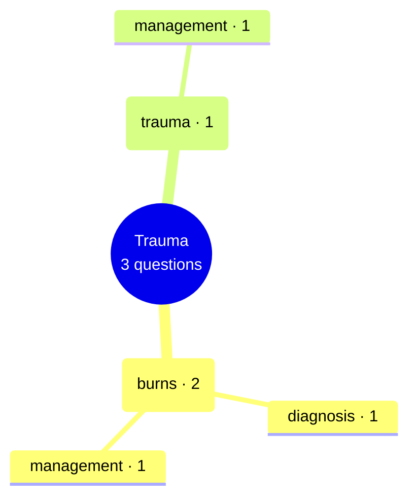

# Trauma

Generated by `scripts/exam_mindmap.py` from `exam-map/tags/`. Edit the tags, not this page.
3 past General Sx MCQ questions (MDCU75, MDCU77, MDCU78). Subtopics say what each question asks, never its answer. Read = Board Review note (BR nn) first, then Chula Surgery 1 chapter and pages. AI-made labels from student-recalled papers and student keys, unchecked: check against the textbook or your attending.

## Mind map

## burns

2 questions · asked by MDCU77, MDCU78 · management 1, diagnosis 1

Most cited reading: BR 01 (Burns); BR 42; BR 01 (Surgical Infections)

| Question | Type | What it asks | Read |
| --- | --- | --- | --- |
| [mdcu78-gen-a Q302](https://github.com/playerplayrh/surgery-year-4/blob/main/exams/mdcu78-gen-a-mcq/exam.md) | management | Scald burn on the leg with a red granulating ring in a photo: wound dressing choice | BR 01 (Burns); BR 42 |
| [mdcu77-gen-c Q77](https://github.com/playerplayrh/surgery-year-4/blob/main/exams/mdcu77-gen-c-mcq/exam.md) | diagnosis | 30% burn with blue-green sweet-smelling exudate: likely organism (no choices recalled) | BR 01 (Burns); BR 01 (Surgical Infections) |

## trauma

1 questions · asked by MDCU75 · management 1

Most cited reading: BR 43-12; BR 29

| Question | Type | What it asks | Read |
| --- | --- | --- | --- |
| [mdcu75-gen-d Q17](https://github.com/playerplayrh/surgery-year-4/blob/main/exams/mdcu75-gen-d-mcq/exam.md) | management | Splenectomy for rupture with a haematoma over the pancreatic head: whether to drain and with which drain type | BR 43-12; BR 29 |

