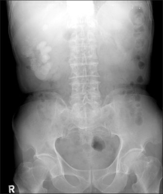
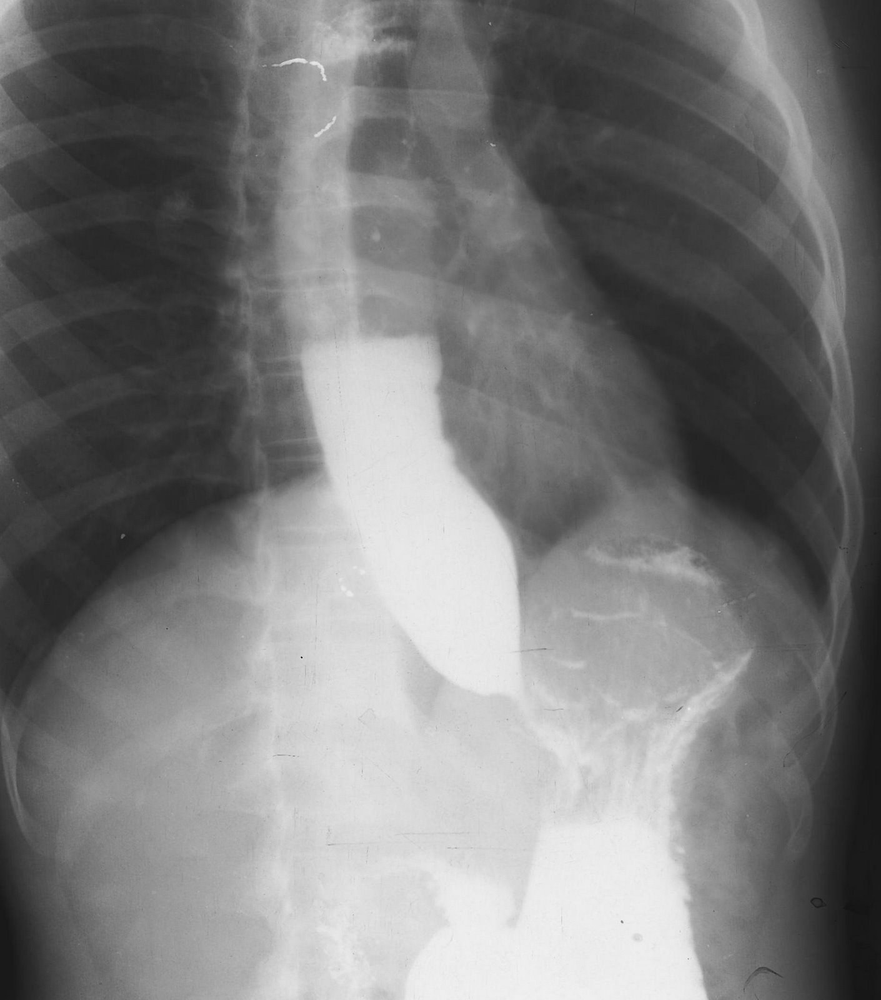

Source: file "Sx (OSCE)", pages 91-94, the section "MDCU66 R3" (heading "OSCE: ข้อละ 4 นาที ไม่มีข้อพัก", 4 minutes per station, no rest station), stations recalled by students, mixed Thai and English. The paper was sat at the end of the whole surgery rotation, so it combines General Surgery and subspecialty content and is filed whole; it is a low-priority set (see CLAUDE.md). The MCQ part of this rotation is in `bank-mdcu66-subspe-r3-mcq`. This extraction was made without comparing the questions with the per-cohort exam files, as the owner asked. It is a bank file, so it is not tagged into the exam topic map.
Numbers Q1-Q13 are the paper's own (the paper numbers the items of Q12 as 14.1-14.4; kept as written). Some stations carry the students' answers in brackets (for example the muscles and nerve roots of Q3, "Esophagography" and "Achalasia cardia" in Q8); they are put in the Checklist line as "students' note" and are NOT an official key. Stations without a bracketed note have a checklist "not given in the source".
Pictures with no name, label or ID band are kept in images/ under their station. The Q6 film is left out because a label on it gives the diagnosis; the mammogram films of Q4 are not in the paper.
exam_year 2013 follows the MCQ part of the same rotation (academic year 2556); the calendar year is inferred.
The rotation number (3) is not mapped to a G.

## Q1 (original no. 1)
เย็บ vertical mattress 2 stitches (หมอนเหลือ ร้อยไหมไว้ให้แล้ว)
1.1 stitch แรกผูก surgical knot ด้วยเครื่องมือ
1.2 stitch ที่สอง square knot ด้วย one hand technique

**Station type:** suturing and knot tying
**Checklist:** not given in the source
**Explanation:** not stated
**Guideline / source:** not stated

## Q2 (original no. 2)
ซักประวัติผู้ป่วยที่มาด้วยอาการปวดท้องมา 1 วัน ให้การวินิจฉัยและ Ddx มา 1 โรค
- Acute cholecystitis (มีอาการมีไข้ ปวด RUQ ร้าวไปสะบักขวา ไม่เหลือง)

**Station type:** history taking and diagnosis
**Checklist:** the paper's note in brackets: "Acute cholecystitis (มีอาการมีไข้ ปวด RUQ ร้าวไปสะบักขวา ไม่เหลือง)" (students' note; not an official key)
**Explanation:** not stated
**Guideline / source:** not stated

## Q3 (original no. 3)
ตรวจร่างกายระบบประสาท ให้ตรวจ motor ของ upper and lower extremities, บอก muscle ที่ตรวจ และ nerve root ที่เลี้ยง
(ให้ทำท่าการตรวจพร้อมพูดว่ากำลังตรวจ muscle ใด ซึ่งเลี้ยงด้วย nerve root ใด ทีละมัด)

**Station type:** examination (motor neurological)
**Checklist:** the paper's note in brackets: C4 Rhomboid; C5 Deltoid; C6 Biceps, Wrist extensor; C7 Tricep, wrist extensor; C8 Hand grip; T1 Abductor digiti minimi; L2 Ileopsoas; L3 Quadricoes femolis; L4 Tibialis anterior; L5 Extensor hallucis longus; S1 Gastrocnemius; S2,3,4 PR ดู Spincter tone (students' note; not an official key)
**Explanation:** not stated
**Guideline / source:** not stated

## Q4 (original no. 4)
mammogram
4.1 การตรวจนี้เรียกว่าอะไร
4.2 เป็นการตรวจในท่าใดบ้าง
4.3 จงบรรยายลักษณะความผิดปกติที่ตรวจพบ และระบุตำแหน่งของความผิดปกติ
4.4 จะตรวจอะไรเพิ่มเติม (the films are not included in the paper)

**Station type:** imaging interpretation (mammogram)
**Checklist:** the paper's note in brackets: 4.2 mediolateral oblique view, craniocaudal view; 4.3 clusters of microcalcification, hyperdensity lesion (students' note; not an official key)
**Explanation:** not stated
**Guideline / source:** not stated

## Q5 (original no. 5)
ตรวจ Prostate gland จากหุ่น
5.1 เขียนรายงานผล
5.2 จงให้การวินิจฉัย

**Station type:** examination (rectal examination on a model) and diagnosis
**Checklist:** not given in the source
**Explanation:** not stated
**Guideline / source:** not stated

## Q6 (original no. 6)
IVP (ให้ฟิล์ม IVP series มา ต้องเรียงดูเอง)
6.1 การตรวจนี้มีชื่อว่าอะไร
6.2 จงบรรยายความผิดปกติที่ตรวจพบ
6.3 จงให้การวินิจฉัย
6.4 วิธีการรักษา
[picture in the paper: an abdominal film with a labelled tumour in the bladder; left out because its label gives the answer]

**Station type:** imaging interpretation (IVP)
**Checklist:** the paper's note in brackets: 6.3 CA urinary bladder (students' note; not an official key)
**Explanation:** not stated
**Guideline / source:** not stated

## Q7 (original no. 7)

7.1 ฟิล์มนี้มีชื่อเรียกว่าอะไร
7.2 จงบรรยายความผิดปกติที่ตรวจพบ
7.3 วิธีการรักษา

**Station type:** imaging interpretation (scout film)
**Checklist:** the paper's note in brackets: 7.1 Scout film; 7.2 Right staghorn stone (students' note; not an official key)
**Explanation:** not stated
**Guideline / source:** not stated

## Q8 (original no. 8)

8.1 การตรวจนี้มีชื่อว่าอะไร
8.2 จงให้การวินิจฉัย
8.3 จะให้การรักษาอย่างไร

**Station type:** imaging interpretation (barium swallow)
**Checklist:** the paper's note in brackets: 8.1 Esophagography; 8.2 Achalasia cardia (students' note; not an official key)
**Explanation:** not stated
**Guideline / source:** not stated

## Q9 (original no. 9)
จงบอกชื่อเครื่องมือดังต่อไปนี้ และบอกหน้าที่
9.1 Richardson retractor
9.2 Allis tissue forcep
9.3 Babcock forcep
9.4 Backhaus towel clip

**Station type:** instrument identification
**Checklist:** not given in the source
**Explanation:** not stated
**Guideline / source:** not stated

## Q10 (original no. 10)
TMN staging both clinical and pathological of breast cancer (ให้ Pathological report มาให้อ่านผล)

**Station type:** pathology report reading and staging
**Checklist:** not given in the source
**Explanation:** not stated
**Guideline / source:** not stated

## Q11 (original no. 11)
บอกชื่ออุปกรณ์ต่อไปนี้ และบอกการผ่าตัดที่ใช้อุปกรณ์ดังกล่าวมา 2 ชื่อ
11.1 Jackson-Pratt drain
11.2 Penrose drain

**Station type:** instrument identification
**Checklist:** not given in the source
**Explanation:** not stated
**Guideline / source:** not stated

## Q12 (original no. 12)
ให้ suture มา 3 ชนิดคือ Prolene มาพร้อมซอง, Chromic catgut, และ silk
14.1 บอก Generic name ไหมที่ให้
14.2 ทำจากวัสดุอะไร natural/synthetic, multi/monofilament, absorb/non-absorbable
14.3 ใช้เย็บอะไรได้บ้าง
14.4 ชนิดไหนใช้เย็บผิวหนังได้ (อาจมีคำตอบได้มากกว่า 1 ชนิด)

**Station type:** suture identification
**Checklist:** not given in the source
**Explanation:** not stated
**Guideline / source:** not stated

## Q13 (original no. 13)
เช็ดมือ และใส่ถุงมือใน OR ด้วย open technique

**Station type:** hand drying and sterile gloving
**Checklist:** not given in the source
**Explanation:** not stated
**Guideline / source:** not stated

## Flagged for checking
- No official answer key exists for this paper; the bracketed answers are the students' notes.
- exam_year 2013 is inferred.
