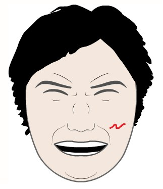
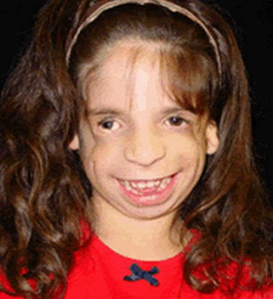
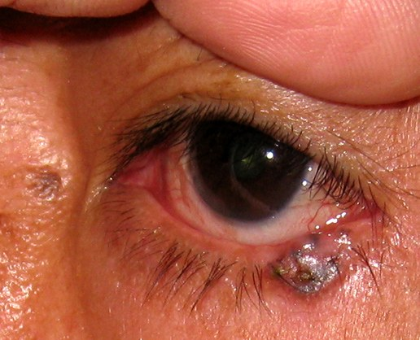
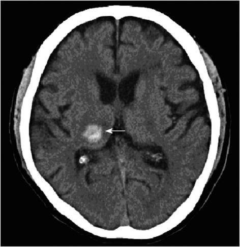
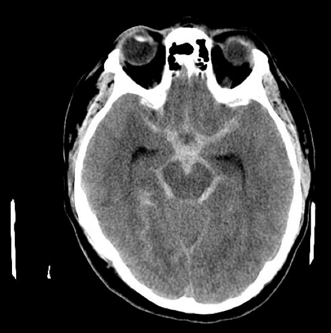
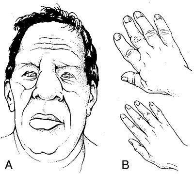

Source: file "Sx (Subspecialties) แอคเปล่า รวม 71-72", pages 86-104, the section "MDCU67 R1" (heading "AC Subspecialty Rotate 1-2557": 90 questions, 15 per subject, 2 hours; the paper warns that the real exam's pictures were black and white and not clear), questions recalled by students, mixed Thai and English, under the headings Pediatrics Surgery, Colorectal, Plastic, CVT, Neuro and Uro. It is a subspecialty MCQ paper, so it is kept apart from General Surgery. This extraction was made without comparing the questions with the per-cohort exam files, as the owner asked. It is a bank file, so it is not tagged into the exam topic map.
The paper's own numbers are kept (Q1-12, 16-24, 26-42, 46-90; the other numbers are not in the paper). There are two different questions numbered 32 in the paper; the second is numbered Q232 and its heading says "second question numbered 32". The subject tag in brackets at the start of each stem is the paper's own heading for that group. Q61-Q63 repeat one case with different questions (Q62 and Q63 stems are shortened here to "the same stem as Q61"); Q64 and Q70 refer to earlier questions. Q60, Q89 and Q90 are only a stem or a note with no choices. Where the paper writes "[โจทย์จริงยาวกว่านี้]" or "[จำโจทย์จริงไม่ได้ เลยแต่งโจทย์ให้แนวใกล้เคียงกับของจริง]" (the real stem was longer / the question was re-written by the students from memory), that note is kept.
Answers: the paper gives no answers, so every answer is "not given in the source", except that Q69 has a note under its picture: "Ans. RBC 25,000 WBC 500 (N....% L...%) protein 200 glucose 50" with the remark that the other choices vary these numbers (see Q69). That is the students' own answer note, not an official key.
Pictures with no name, label or ID band are kept in images/ under their question (Q31, Q32, Q35, Q36, Q67, Q69, Q75). The credit line on the Q35 picture and the logo on the Q36 picture are cropped out. Q68 mentions a picture that is not in the paper.
exam_year 2014 follows the heading "Rotate 1-2557" (academic year 2557 = 2014-15); the calendar year is inferred.
The rotation number (1) is not mapped to a G.

## Q1 (original no. 1)
[Pediatrics Surgery] อะไรคือ malignant tumor ที่พบบ่อยที่สุดในเด็ก

A. Neuroblastoma
B. Nephroblastoma
C. Hydronephosis
D. Duplication cyst
E. Rhabdomyosarcoma

**Answer:** not given in the source
**Explanation:** not stated
**Guideline / source:** not stated

## Q2 (original no. 2)
[Pediatrics Surgery] ข้อใดผิดเกี่ยวกับ Torsion tessis

A. ยกถุงอัณฑะขึ้นแล้วเจ็บลดลง (Phren's test)
B. อาจมีอาการเจ็บมาก่อนหน้านี้
C. ไม่พบเม็ดเลือดขาวในปัสสาวะ
D. คลำไม่พบอัณฑะในข้างนั้น
E. พบแกนของอัณฑะในแนวนอน

**Answer:** not given in the source
**Explanation:** not stated
**Guideline / source:** not stated

## Q3 (original no. 3)
[Pediatrics Surgery] Undescending testis ไม่มี complication อะไร

A. Orchitis
B. Hernia
C. Torsion testis
D. Infertile
E. Testicular CA

**Answer:** not given in the source
**Explanation:** not stated
**Guideline / source:** not stated

## Q4 (original no. 4)
[Pediatrics Surgery] Previously well, 3 weeks old infant presents with sudden onset of bilious vomiting. What is the most probable diagnosis

A. Pyloric stenosis
B. Duodenal atresia
C. Intussusception
D. Necrotizing enterocolitis
E. Malrotation midgut volvulus

**Answer:** not given in the source
**Explanation:** not stated
**Guideline / source:** not stated

## Q5 (original no. 5)
[Pediatrics Surgery] What is true about gastroschisis

A. Associated chromosomal syndrome
B. High incidence of association anormalies
C. Prolong adynaamic ileus after repair
D. Intestinal atresia 80 % most case
E. Eviscesation of spleen and liver

**Answer:** not given in the source
**Explanation:** not stated
**Guideline / source:** not stated

## Q6 (original no. 6)
[Pediatrics Surgery] ผู้ป่วยเด็ก 2 เดือนที่มาด้วยอาการสะดือแฉะ นึกถึงโรคอะไรน้อยที่สุด

A. Omphalitis
B. Umbilical hernia
C. Umbilical polyp
D. Patent urachus
E. Patent vitelline duct

**Answer:** not given in the source
**Explanation:** not stated
**Guideline / source:** not stated

## Q7 (original no. 7)
[Pediatrics Surgery] ผู้ป่วยเด็กอายุ 4 ปี มาด้วยอาการมีของเหลวไหลออกมาจากรูบริเวณคอ หน้าต่อ sternocleidomastoid muscle จงให้การวินิจฉัย

A. First branchial cleft cyst
B. First branchial cleft sinus
C. Second branchial cleft cyst
D. Second branchial cleft sinus

**Answer:** not given in the source
**Explanation:** not stated
**Guideline / source:** not stated

## Q8 (original no. 8)
[Pediatrics Surgery] เด็กแรกคลอด แพทย์คลำพบก้อนในท้องที่บริเวณชายโครงซ้าย นึกถึงโรคไรมากที่สุด

A. Hydronephrosis
B. Polycystic kidney disease
C. Duplication cyst in kidney
D. Nephroblastoma
E. Neuroblastoma

**Answer:** not given in the source
**Explanation:** not stated
**Guideline / source:** not stated

## Q9 (original no. 9)
[Pediatrics Surgery] ข้อใดเป็นอาการของ duodenal atresia

A. Maternal polyhydramnios
B. Abdominal dilation
C. Visible peristalsis
D. Bloody stool

**Answer:** not given in the source
**Explanation:** not stated
**Guideline / source:** not stated

## Q10 (original no. 10)
[Pediatrics Surgery] เด็กอายุ 30 วัน อาเจียนพุ่งมา 2 วัน ก่อนมาโรงพยาบาล หลังกลับบ้านได้ 5 วัน กินนมได้ 10 นาที ก็อาเจียนเป็นนมสีขาว ไม่เคยมีสีเขียวสีเหลืองปน คลำก้อนได้ที่ชายโครงขวา จงให้การวินิจฉัย

A. Milk allergy
B. Overfeeeding
C. Choledocchal cyst
D. Duodenal atresia
E. Hypertrophic pyloric stenosis

**Answer:** not given in the source
**Explanation:** not stated
**Guideline / source:** not stated

## Q11 (original no. 11)
[Pediatrics Surgery] เมื่อใดที่จะนำคนไข้ congenital diaphragmatic hernia ไปทำการผ่าตัด

A. ทันทีที่วินิจฉัยได้
B. 6 ชม.หลังคลอด
C. เมื่อใส่ chest tube
D. เมื่อแก้ไขภาวะ acidosis ได้
E. เมื่อน้ำหนักรวมมากกว่า 2500 grams

**Answer:** not given in the source
**Explanation:** not stated
**Guideline / source:** not stated

## Q12 (original no. 12)
[Pediatrics Surgery] 3 years old boy come to your office with right neck mass, firm, smooth surface, no erythema, PPD +ve. What is your next investigation?

A. Biopsy, Frozen-section, Excision
B. Start Anti-TB drug
C. PPD test again
D. Ultrasound and watchful waiting
E. FNA for diagnosis

**Answer:** not given in the source
**Explanation:** not stated
**Guideline / source:** not stated

## Q16 (original no. 16)
[Colorectal] ใครควรทำ Colon cancer screening ด้วย Colonoscope/ Barium enema/ Rigid sigmoidoscope น้อยที่สุด (ให้อายุ และช่วงเวลาที่ทำล่าสุดมาให้ ไปดู Screening cancer ว่าทำอะไรเวลาไหน)

A. Occult blood positive & Weight loss
B. FAP
C. Peutz-Jegher syndrome
D. อุจจาระสีดำและลำเล็กลง
E. Ulcerative colitis มา 14 ปี

**Answer:** not given in the source
**Explanation:** not stated
**Guideline / source:** not stated

## Q17 (original no. 17)
[Colorectal] ข้อใดเป็น screening for Colorectal cancer ได้ดีที่สุด

A. Colonoscope
B. CT colonography
C. Stool occult blood
D. Barium enema
E. Rigid sigmoidoscope

**Answer:** not given in the source
**Explanation:** not stated
**Guideline / source:** not stated

## Q18 (original no. 18)
[Colorectal] ผู้ป่วยไทยอายุ 2 ปี มีเลือดออก bright red blood เมื่อเช้า แพทย์ซักประวัติได้ว่า ถ่ายมีมูกเลือด 3 เดือนก่อน ตรวจร่างกายได้ Internal hemorrhoid without palpable mass ควรจะ management อย่างไร

A. Sclerosing agent
B. Rubber band
C. Hemorrhoidectomy
D. Colonoscopy
E. CT colonography

**Answer:** not given in the source
**Explanation:** not stated
**Guideline / source:** not stated

## Q19 (original no. 19)
[Colorectal] ผู้ป่วยไทยอายุ 61 ปี มาด้วยอาการ Acute diverticulitis ข้อใดคือการ manage ที่ดีที่สุดร่วมกับการให้ IV fluid

A. Diagnostic colonoscopy
B. NG suction
C. Sigmoidectomy
D. Empirical antibiotics
E. APR

**Answer:** not given in the source
**Explanation:** not stated
**Guideline / source:** not stated

## Q20 (original no. 20)
[Colorectal] ผู้ป่วยชายประวัติมาด้วยเลือดออกทางทวารและมีก้อนออกมาตอนเบ่งถ่ายอุจจาระ ตอนตรวจไม่พบก้อนออกมาจากรูทวาร จงให้การวินิจฉัย Grade ของ hemorrhoid ในผู้ป่วยรายนี้

A. I
B. II
C. III
D. IV
E. Mixed

**Answer:** not given in the source
**Explanation:** not stated
**Guideline / source:** not stated

## Q21 (original no. 21)
[Colorectal] Which condition found with increasing incidence of colorectal cancer

A. Pseudomembranous colitis
B. Juvenile polyp
C. FAP
D. Amoebic colitis
E. Thombosed hemorrhoid

**Answer:** not given in the source
**Explanation:** not stated
**Guideline / source:** not stated

## Q22 (original no. 22)
[Colorectal] The following statements are true for sigmoid volvulus except?

A. Reduction and bowel decompression by flexible sigmoidoscopy should be followed by elective sigmoidectomy
B. Coffee bean sign is seen in acute abdomen series
C. If can’t reduce or has signs of bowel ischemia, patient should go to operation room emergently
D. Mostly occurs in the elderly and institutionalizes patient
E. Sigmoid volvulus accounts for less than 50% of colonic volvulus

**Answer:** not given in the source
**Explanation:** not stated
**Guideline / source:** not stated

## Q23 (original no. 23)
[Colorectal] ให้อาการของ chronic anal fissure (เจ็บก้นเวลาถ่ายและมีเลือดสดปนออกมา เป็นนานเกือบปี) ท่านคิดว่าควรรักษาด้วยวิธีการใด

A. LIS
B. Lifestyle modification with bulk-forming laxative
C. Laxative + NTG ointment

**Answer:** not given in the source
**Explanation:** not stated
**Guideline / source:** not stated

## Q24 (original no. 24)
[Colorectal] Which is/are complex fistula in ano?

A. High transphincteric abscess
B. Multiple opening
C. Hemihorseshoes
D. Fistula with Crohn’s disease
E. All of above3

**Answer:** not given in the source
**Explanation:** not stated
**Guideline / source:** not stated

## Q26 (original no. 26)
[Colorectal] Anal canal tumor invading sphincter complex. What is the proper management for this patient?

A. LAR
B. APR
C. Wide excision with LN dissection

**Answer:** not given in the source
**Explanation:** not stated
**Guideline / source:** not stated

## Q27 (original no. 27)
[Colorectal] What is the characteristic of anoderm?

A. Sensory nerve
B. Sebaceous gland
C. Hair follicle
D. Sweat gland
E. Keratinized stratified squamous cell

**Answer:** not given in the source
**Explanation:** not stated
**Guideline / source:** not stated

## Q28 (original no. 28)
[Colorectal] Patient underwent colorectal resection. Pathology reveals tumor invading muscularis propria, no adjacent tissue invasion. There are metastatic lymph node pericolic node 2 of 15 and apical node 1 of 4. No metastasis has seen so far. What is the staging for this case?

A. T1N1M0 stage 3
B. T1N2M0 stage 3
C. T2N1M0 stage 3
D. T2N2M0 stage 3
E. T2N1M1 stage 4

**Answer:** not given in the source
**Explanation:** not stated
**Guideline / source:** not stated

## Q29 (original no. 29)
[Colorectal] Patient had rectum cancer invading uterus. Imaging found CT-enhanced nodule at liver but normal lung imaging. Patient underwent colorectal resection. Pathology reveals tumor invading uterus. There are metastatic lymph node pericolic 2 of 15 and apical node 2 of 5. Wedge resection of liver revealed focal nodular hyperplasia. What is the staging for this case?

A. T4N2M1 stage 4
B. T3N1M1 stage 4
C. T4N1M1 stage 4
D. T4N2M0 stage 3
E. T4N1M0 stage 3

**Answer:** not given in the source
**Explanation:** not stated
**Guideline / source:** not stated

## Q30 (original no. 30)
[Colorectal] Right CA colon invades stomach. What is the proper management?

A. Hemicolectomy
B. Hemicolectomy with gastrectomy
C. Roux en Y gastric bypass
D. Internal anastomosis

**Answer:** not given in the source
**Explanation:** not stated
**Guideline / source:** not stated

## Q31 (original no. 31)
[Plastic] ผู้ป่วยมี lacerated wound ที่ใบหน้าตามรูป จะบาดเจ็บต่อโครงสร้างใด

A. Stensen’s duct
B. Infraorbital nerve
C. Frontal branch of facial nerve
D. Marginal branch of facial nerve
E. P... muscle

**Answer:** not given in the source
**Explanation:** not stated
**Guideline / source:** not stated

## Q32 (original no. 32)
[Plastic] What is the most associated functional deficit important for routine evaluation? (the picture's caption says: ให้รูปเด็กผู้หญิงหน้าเหมือน Treacher – Collin syndrome)

A. Conductive hearing loss
B. Expose keratitis
C. Increased intracranial pressure
D. Upper airway obstruction

**Answer:** not given in the source
**Explanation:** not stated
**Guideline / source:** not stated

## Q232 (original no. 32, topic: second question numbered 32 in the paper)
[Plastic] ให้รูป craniosynostosis มี หน้าผากปูด exopthalmos และcleft lip ตรงกลางริมฝีปากบน อะไรต้องรีบ manage และ evaluate มากที่สุด (the paper has two different questions numbered 32; this is the second)

A. Conductive hearing loss
B. Expose keratitis
C. Increased intracranial pressure
D. Upper airway obstruction

**Answer:** not given in the source
**Explanation:** not stated
**Guideline / source:** not stated

## Q33 (original no. 33)
[Plastic] แผลที่หน้าท้อง ลึกถึงชั้นไขมัน ขนาด 5x8 cm. ควรทำอะไร

A. Free flap
B. Skin flap
C. Skin graft
D. Primary closure
E. Spontaneous healing

**Answer:** not given in the source
**Explanation:** not stated
**Guideline / source:** not stated

## Q34 (original no. 34)
[Plastic] ผู้ป่วยเป็นไส้ติ่ง แผลเป็นเส้นตรง หลังจากผ่าตัดประมาณ 2เดือน เริ่มรู้สึกคัน มีก้อนนูน 4 ก้อน ไม่เกินขอบแผล รักษาโดยอะไร

A. Observe
B. Hirudoid cream
C. Scar gel
D. Sclerosing agent
E. กรีดแผลใหม่

**Answer:** not given in the source
**Explanation:** not stated
**Guideline / source:** not stated

## Q35 (original no. 35)
[Plastic] จากภาพที่ได้มาจากแผลบริเวณหน้าของผู้ป่วย จงให้การวินิจฉัย

A. Folliculitis
B. Furuncle
C. Carbuncle
D. Cellulitis
E. Necrotizing fasciitis

**Answer:** not given in the source
**Explanation:** not stated
**Guideline / source:** not stated

## Q36 (original no. 36)
[Plastic] ผู้ป่วยพบแผลที่ขอบตาล่างขวา ไม่เจ็บ ไม่มีหนองไหลออกมา ผลการตรวจชิ้นเนื้อพบว่าเป็น Basal cell carcinoma จงเลือกวิธีการรักษาที่เหมาะสมที่สุด

A. Excision for definitive pathology
B. Wide excision, margin 0.5 cm
C. Wide excision, margin 1.0 cm
D. Wide excision, margin 2.0 cm
E. Mohs surgery

**Answer:** not given in the source
**Explanation:** not stated
**Guideline / source:** not stated

## Q37 (original no. 37)
[Plastic] ผู้ป่วยมาด้วยอาการ พบแผลในปากบริเวณกระพุ้งแก้ม 4 วัน เจ็บ จงให้การรักษาที่เหมาะสมที่สุด

A. Observe
B. Incisional biopsy
C. Excisional biopsy
D. Radical neck dissection
E. Elective neck dissection

**Answer:** not given in the source
**Explanation:** not stated
**Guideline / source:** not stated

## Q38 (original no. 38)
[Plastic] ผู้ป่วยชายอายุ 40 ปี ได้รับการช่วยเหลือลงมาจากอพาร์ตเมนต์ไฟไหม้ พบมีรอยไหม้ที่ใบหน้า ลำคอ หน้าอก แขนสองข้าง กระสับกระส่าย มีรอยคราบดำติดตามปากและจมูก สิ่งที่ควรทำก่อนส่งตัวต่อไปรักษาคือ

A. ใส่ endotracheal tube
B. ใส่ bronchoscope เพื่อดูดเอาเสมหะออก
C. วัด pulse oximetry
D. ให้ oxygen with mask 10L/min
E. แทงสาย subclavian vein สำหรับ fluid resuscitation

**Answer:** not given in the source
**Explanation:** not stated
**Guideline / source:** not stated

## Q39 (original no. 39)
[Plastic] ผู้ป่วยหนัก 60 kg Burn 40% TBSA ก่อนมารพ. 5 ชม. ได้รับ Ringer’s lactate solution 3000 ml จงคำนวณการให้ fluid ที่เหลือในอีก 3 ชม. ว่าต้องให้ในอัตราเท่าใด

A. 300 ml/hr
B. 400 ml/hr
C. 500 ml/hr
D. 600 ml/hr
E. 700 ml/hr

**Answer:** not given in the source
**Explanation:** not stated
**Guideline / source:** not stated

## Q40 (original no. 40)
[Plastic] ในการดูแลผู้ป่วยburn หลังจากผ่าน 24 ชม.ไปแล้ว วิธีที่ดีที่สุดในการ monitor fluid status ในผู้ป่วยรายนี้คือ

A. Keep BP = ....
B. Keep CVP < ...
C. Monitor urine output = 60 ml/hr
D. ปฏิบัติตามกฎ 4%kg อย่างเคร่งครัด

**Answer:** not given in the source
**Explanation:** not stated
**Guideline / source:** not stated

## Q41 (original no. 41)
[Plastic] ผู้ป่วยในข้อใดต้องส่งต่อไปให้กับBurn center เพื่อดูแลรักษาต่อไป

A. ผู้ป่วยหญิงอายุ 37 ปี 7% third degree burn at face
B. ผู้ป่วยหญิงอายุ 55 ปี 2% third degree burn at right thigh
C. ผู้ป่วยชายอายุ 18 ปี 1% full thickness skin burn at left thigh
D. ผู้ป่วยหญิงอายุ 25 ปี 5% second and third degree burn at back

**Answer:** not given in the source
**Explanation:** not stated
**Guideline / source:** not stated

## Q42 (original no. 42)
[Plastic] ข้อใดไม่ใช่ sign & symptom in zygoma fracture

A. Trismus
B. Malocclusion
C. Diplopia
D. Paresthesia of infraorbital nerve
E. Periorbital ecchymosis

**Answer:** not given in the source
**Explanation:** not stated
**Guideline / source:** not stated

## Q46 (original no. 46)
[CVT] Mass at anterior mediastinum พบ AFP, beta-HCG both positive ผู้ป่วยมีอาการหน้าบวม แขนบวม หายใจลำบาก พบหลอดเลือดดำที่คอโต น่าจะรักษาอย่างไร

A. Biopsy ให้ได้ Histopathology เพื่อเลือกวิธีการรักษา
B. ผ่าตัด และให้ chemotherapy และ Radiation ต่อ
C. ผ่าตัด และให้แค่ Chemotherapy เพราะเนื้องอกไม่น่าจะตอบสนองต่อ Radiation
D. ให้ Chemotherapy และ Radiation ก่อน แล้วผ่าตัดก้อนที่เหลือ
E. ให้ Chemotherapy เพียงอย่างเดียว แล้วผ่าตัด

**Answer:** not given in the source
**Explanation:** not stated
**Guideline / source:** not stated

## Q47 (original no. 47)
[CVT] ผู้ป่วยหญิงไทยอายุ 25 ปี มี ptosis, diplopia ทำ CXR CT พบ Soft tissue mass @ anterior mediastinum ข้อใดคือ management ของผู้ป่วยรายนี้

A. ไม่ผ่าตัดและใช้รักษาแบบเดิม
B. เจาะดู Histopathology ก่อนจะตัดสินใจทำอย่างอื่นต่อไป
C. ผ่าตัดเอา Soft tissue & Thymus ใน anterior mediastinum ออก
D. Radiation and Chemotherapy
E. Chemotherapy เพราะฉายแสงไม่ได้ผล

**Answer:** not given in the source
**Explanation:** not stated
**Guideline / source:** not stated

## Q48 (original no. 48)
[CVT] ผู้ป่วยมาด้วยอาการแน่นหน้าอก ไข้ เหงื่อออกตอนกลางคืน น้ำหนักลด คลำได้กลุ่มก้อนต่อมน้ำเหลืองโต ขรุขระ แข็ง บริเวณ Rt. supraclavicular ผลการตรวจ CXR พบ anterior mediastinal mass ขนาดใหญ่ ขอบเขตไม่ชัด จงให้ staging ของผู้ป่วยรายนี้

A. II
B. IIb
C. III
D. IIIb
E. IV

**Answer:** not given in the source
**Explanation:** not stated
**Guideline / source:** not stated

## Q49 (original no. 49)
[CVT] What is the most common cause of anterior mediastinal mass?

A. Thymoma
B. Lymphoma
C. Thyroid tumor
D. Teratoma
E. Neurogenic tumor

**Answer:** not given in the source
**Explanation:** not stated
**Guideline / source:** not stated

## Q50 (original no. 50)
[CVT] Which is/are true regarding to chronic constrictive pericarditis?

A. Abdominal distention is the most common symptoms
B. Pulsus paradoxus is more common in the setting of atrial fibrillation
C. The most common cause of chronic constrictive pericarditis is previous heart surgery
D. CT scan demonstrates thickened pericardium
E. All of above

**Answer:** not given in the source
**Explanation:** not stated
**Guideline / source:** not stated

## Q51 (original no. 51)
[CVT] ข้อใดไม่ใช่ criteria ของ Emphyema thoracis

A. Stain positive
B. WBC > 10,000
C. LDH > 1000
D. Glucose < 40
E. pH < 7

**Answer:** not given in the source
**Explanation:** not stated
**Guideline / source:** not stated

## Q52 (original no. 52)
[CVT] ผู้ป่วยหญิงอายุ .... ปี เหนื่อยง่าย นอนราบไม่ได้ ตรวจพบ severe MS ไม่พบ Clot ไม่พบ MR ทานยาอาการดีขึ้นเล็กน้อย ควรให้การรักษาอย่างไร

A. ปรับชนิด/ขนาดของยา
B. PBMV
C. ผ่าตัดเปลี่ยนลิ้นหัวใจ หากไม่สามารถขยายได้ด้วย ballon
D. Open commissulotomy
E. All of above

**Answer:** not given in the source
**Explanation:** not stated
**Guideline / source:** not stated

## Q53 (original no. 53)
[CVT] ผู้ป่วยมี severe MS, mild MR, Severe TR มีอาการเหนื่อย ทำงานไม่ไหว ควรได้รับการรักษาด้วยวิธีใด

A. Adjust medication
B. Balloon
C. Mitral valve repair, tricuspid valve repair
D. Mitral valve replacement, tricuspid valve repair
E. Mitral valve replacement, tricuspid valve replacement

**Answer:** not given in the source
**Explanation:** not stated
**Guideline / source:** not stated

## Q54 (original no. 54)
[CVT] CABG ในผู้ป่วยลิ้นหัวใจตีบ ข้อใดส่งผลต่อ long term survival มากสุด

A. LIMA → LCX
B. SVG → LCX
C. Radial a. → RCA
D. Radial a. → LCA
E. LIMA → LDA

**Answer:** not given in the source
**Explanation:** not stated
**Guideline / source:** not stated

## Q55 (original no. 55)
[CVT] ข้อใดถูกเกี่ยวกับ Empyema

A. Cloudy pleura fluid
B. Air-fluid level
C. Fluid pH < 7
D. Gram positive organism in gram stain
E. C & D

**Answer:** not given in the source
**Explanation:** not stated
**Guideline / source:** not stated

## Q56 (original no. 56)
[CVT] ข้อใดเป็นสิ่งที่ควรทำเพิ่มเติมเพื่อรักษาผู้ป่วย lung abscess ที่ไม่มีภาวะแทรกซ้อน ในระยะแรก นอกจากการให้ยาปฏิชีวนะ

A. Postural drainage & physiotherapy
B. ICD
C. Lobectomy
D. Aspiration

**Answer:** not given in the source
**Explanation:** not stated
**Guideline / source:** not stated

## Q57 (original no. 57)
[CVT] Which is/are the indication(s) for surgery in lung abscess?

A. Poor response to ATB after 2 weeks
B. Occasional hemoptysis
C. Bronchopleural fistula
D. Multiple small abscess in bilateral lung in immunocompromised host
E. All of above

**Answer:** not given in the source
**Explanation:** not stated
**Guideline / source:** not stated

## Q58 (original no. 58)
[CVT] What is/are true about lung abscess?

A. Hematologic seeding is a common mechanism
B. Posterior upper love and superior lower lobe of right lung are the most common site
C. Hemoptysis and foul smell sputum are uncommon
D. Staphylococcus is a common pathogen

**Answer:** not given in the source
**Explanation:** not stated
**Guideline / source:** not stated

## Q59 (original no. 59)
[CVT] ข้อใดต่อนี้ผิดเกี่ยวกับ Acute mediastinitis

A. Mediastinitis ส่วนใหญ่ให้ antibiotic เพียงอย่างเดียวก็เพียงพอต่อการรักษา
B. เชื้อก่อโรคที่สำคัญใน Post medianstenotomy mediastinitis คือ Staphylococcus aureus
C. .
D. .
E. None of above

**Answer:** not given in the source
**Explanation:** not stated
**Guideline / source:** not stated

## Q60 (original no. 60)
[CVT] ถามเกี่ยวกับ Ludwig’s angina // post MI แล้วพบ systolic murmur เกิดจากสาเหตุใด

**Answer:** not given in the source (the paper has only the stem, no choices)
**Explanation:** not stated
**Guideline / source:** not stated

## Q61 (original no. 61)
[Neuro] ผู้ป่วยชาย โดนตีหัวด้านซ้ายมา สลบไป 5 นาที หลังจากนั้นผู้ป่วยตื่นขึ้นมาและถูกนำส่งโรงพยาบาลใน 2 ชั่วโมงถัดมา ผลการตรวจร่างกาย Glasgow coma score xxx, puffy scalp at Lt frontotemporal region, Rt. Decerebrate, Rt pupil 2 cm RTL, Lt pupil 5 cm NRTL. จงให้การวินิจฉัยในผู้ป่วยรายนี้

A. Subfalcine herniation
B. Central herniation
C. Uncal herniation
D. Tonsillar herniation
E. Transcalvarial herniation

**Answer:** not given in the source
**Explanation:** not stated
**Guideline / source:** not stated

## Q62 (original no. 62)
[Neuro] (the same stem as Q61) ผู้ป่วยชาย โดนตีหัวด้านซ้ายมา สลบไป 5 นาที ... Rt. Decerebrate, Rt pupil 2 cm RTL, Lt pupil 5 cm NRTL. จงให้การวินิจฉัยในผู้ป่วยรายนี้

A. Acute epidural hematoma
B. Chronic subdural hematoma
C. Intracerebral hemorrhage
D. Subarachnoid hemorrhage
E. Intraventricular hemorrhage

**Answer:** not given in the source
**Explanation:** not stated
**Guideline / source:** not stated

## Q63 (original no. 63)
[Neuro] (the same stem as Q61 but Lt. Decerebrate) ผู้ป่วยชาย โดนตีหัวด้านซ้ายมา สลบไป 5 นาที ... Lt. Decerebrate, Rt pupil 2 cm RTL, Lt pupil 5 cm NRTL. จงอธิบายเหตุการณ์ที่เกิดขึ้นในผู้ป่วยรายนี้

A. Kernohan’s phenomenon
B. Monro-Kellie phenomenon

**Answer:** not given in the source
**Explanation:** not stated
**Guideline / source:** not stated

## Q64 (original no. 64)
[Neuro] ข้อใดคือวิธีการจัดการที่เหมาะสมสำหรับผู้ป่วยในข้อที่ผ่านมา

A. Non-contrast CT scan
B. ET tube

**Answer:** not given in the source
**Explanation:** not stated
**Guideline / source:** not stated

## Q66 (original no. 66)
[Neuro] Which one is a contraindication of lumbar puncture?

A. Normal pressure hydrocephalus
B. Communicating hydrocephalus
C. Congenital aqueductal stenosis with hydrocephalus
D. TB meningitis with hydrocephalus
E. Subarachnoid hemorrhage with hydrocephalus

**Answer:** not given in the source
**Explanation:** not stated
**Guideline / source:** not stated

## Q67 (original no. 67)
[Neuro] ให้อาการผู้ป่วยมา(ผลการตรวจร่างกาย BP 160/80 Glasgow coma score) + ภาพCT scan จงให้การวินิจฉัย

A. Basal ganglion hemorrhage
B. Caudate hemorrhage
C. Thalamic hemorrhage
D. MCA hemorrhage
E. Pontine hemorrhage

**Answer:** not given in the source
**Explanation:** not stated
**Guideline / source:** not stated

## Q68 (original no. 68)
[Neuro] ผู้ป่วยไทยอายุ 50 ปี ปฏิเสธประวัติโรคประจำตัว ปวดหัวหน่วงๆ conscious ดี ใช้มือซ้ายลำบาก pronator drift +ve BP 160/90 ผลการตรวจCT scan(ดังรูป) [ภาพ intracerebral hemorrhage ซีกขวา 3 จุด] (the picture is not included in the paper)
What one is a proper management?

A. CT without contrast
B. CTA
C. Coagulogram
D. Echocardiogram
E. IV antihypertensive drug

**Answer:** not given in the source
**Explanation:** not stated
**Guideline / source:** not stated

## Q69 (original no. 69)
[Neuro] ผู้ป่วยปวดหัว ซึมมา 3 วันก่อนมาโรงพยาบาล หลังมาโรงพยาบาลได้ทำ CT scan (ดังรูป) ข้อใดเป็น CSF profile ที่เป็นไปได้มากที่สุดในผู้ป่วยรายนี้

**Answer:** not matched to a listed choice: the paper gives no choices; under the picture the students write "Ans. RBC 25,000 WBC 500 (N....% L...%) protein 200 glucose 50" and note that the other choices would swap the numbers around (the students' own note, not an official key)
**Explanation:** not stated
**Guideline / source:** not stated

## Q70 (original no. 70)
[Neuro] จากข้อ 69 อยากทราบว่าควรส่งตรวจสิ่งใดเพิ่มเติมมากที่สุด

A. Contrasted CT brain
B. Cerebral angiography
C. CT angiography
D. MRA
E. Lumbar puncture

**Answer:** not given in the source
**Explanation:** not stated
**Guideline / source:** not stated

## Q71 (original no. 71)
[Neuro] Parinuad syndrome พบในโรคอะไร

A. CP angle tumor
B. Craniopharyngioma
C. Sphenoid meningioma
D. Pineal tumor
E. All of above

**Answer:** not given in the source
**Explanation:** not stated
**Guideline / source:** not stated

## Q72 (original no. 72)
[Neuro] ข้อใดไม่ถูกต้องเกี่ยวกับ Brain tumor

A. Malignant brain tumor มัก metastasis ออกนอกสมอง
B. ในเด็กมักพบ infratentorial tumor
C. Benign brain tumor ก็สามารถทำให้เข้าตายได้
D. Benign brain tumor ไม่ได้แปลว่าจะผ่าตัดออกได้ง่ายหรือหมด

**Answer:** not given in the source
**Explanation:** not stated
**Guideline / source:** not stated

## Q73 (original no. 73)
[Neuro] What is the most common malignant brain tumor?

A. Medulloblastoma
B. Meningioma
C. Acoustic neuroma
D. Pineal tumor
E. Metastatic tumor

**Answer:** not given in the source
**Explanation:** not stated
**Guideline / source:** not stated

## Q74 (original no. 74)
[Neuro] Brain tumor ชนิดใดที่ทำให้เกิด neurosensory hearing loss

A. Pineal tumor
B. Acoustic schwannoma
C. Craniopharyngioma
D. Glioblastoma multiforme
E. Meningioma

**Answer:** not given in the source
**Explanation:** not stated
**Guideline / source:** not stated

## Q75 (original no. 75)
[Neuro] ผู้ป่วยมาพบแพทย์ด้วยลักษณะดังภาพ จงให้การวินิจฉัย

A. Acromegaly
B. Cushing’s disease
C. Pineal tumor
D. Prolactinoma
E. Ependymoma

**Answer:** not given in the source
**Explanation:** not stated
**Guideline / source:** not stated

## Q76 (original no. 76)
[Uro] ผู้ป่วยหญิงไทยอายุ 45 ปี ทำ IVP พบก้อนหนึ่งขนาด 1 cm. @ minor calyx ที่ไตขวา ผู้ป่วยไม่เคยมี Hydronephosis มีปวด และปัสสาวะเป็นเลือด ควรทำอย่างไรต่อไป

A. Observe
B. ESWL
C. PCNL
D. ให้ยาละลายนิ่ว
E. ผ่าตัดเอานิ่วออก

**Answer:** not given in the source
**Explanation:** not stated
**Guideline / source:** not stated

## Q77 (original no. 77)
[Uro] ผู้ป่วยชาย ตรวจค่า PSA ได้ 3.5 ตรวจ DRE ได้ firm smooth surface prostate ได้ก้อนแข็ง ต้องทำอะไรต่อไป

A. Alpha blocker
B. 5- Alpha inhibitor
C. TRUS with biopsy

**Answer:** not given in the source
**Explanation:** not stated
**Guideline / source:** not stated

## Q78 (original no. 78)
[Uro] ผู้ป่วยชาย มีอาการ LUTS มี Underlying disease เป็น Asthma กินยาอยู่ ก่อนหน้านี้ทานยาไม่มีปัญหาปัสสาวะคั่ง แต่หลังทานยาพบว่าตัวเองปัสสาวะไม่ออก จะ Management อย่างไร

A. Intermittent catheter และ หยุดยา Asthma
B. Intermittent catheter และ ให้ Alpha blocker
C. Intermittent catheter อย่างเดียว
D. Retained catheter ให้ผู้ป่วยหยุดยา Follow up 2 wk
E. Retained catheter ให้ยา Alpha blocker Follow up 2 wk

**Answer:** not given in the source
**Explanation:** not stated
**Guideline / source:** not stated

## Q79 (original no. 79)
[Uro] ผู้ป่วยหญิงไทยโสด อายุ 35 ปี dysuria suprapubic pain และ hematuria ตอนท้ายของปัสสาวะ ไม่มีไข้ UA: RBC, WBC 30 – 50 HPF ยังไม่ได้ทานยาอะไร ข้อใดเป็นการ manage ที่ดีที่สุด

A. ABT + u/s KUB, IVP, cystoscpoe
B. ABT + cystoscope
C. ABT + retrograde pyerography
D. ABT + ..................
E. ABT + แนะนำว่า 2-3 วัน ถ้าไม่ดีขึ้นต้องมาตรวจเพิ่มเติม

**Answer:** not given in the source
**Explanation:** not stated
**Guideline / source:** not stated

## Q80 (original no. 80)
[Uro] ผู้ป่วยเด็กอายุ 5 ปี มาด้วยอาการไม่สามารถรูดหนังหุ้มปลายองคชาตลงมาได้ ไม่เคยมีอาการปัสสาวะแล้วหนังหุ้มปลายโป่งพอง ไม่เคยมีอาการอักเสบหรือปวดแสบบริเวณปลายองคชาต จงให้การรักษาที่เหมาะสมที่สุดในผู้ป่วยรายนี้

A. รอให้หายเอง
B. ทา 0.1% TA cream
C. Circumcision
D. Sedate + พยายามรูดลง

**Answer:** not given in the source
**Explanation:** not stated
**Guideline / source:** not stated

## Q81 (original no. 81)
[Uro] ผู้ป่วยเด็กมีรูเปิดท่อปัสสาวะในตำแหน่ง ventral midshaft of penis จะสามารถพบอะไรร่วมด้วยได้

A. Dorsal curvature, long foreskin
B. Ventral curvature, long foreskin
C. Dorsal curvature, phimosis
D. Ventral curvature, dorsa skin hood
E. Dorsal curvature, ventral skin hood

**Answer:** not given in the source
**Explanation:** not stated
**Guideline / source:** not stated

## Q82 (original no. 82)
[Uro] เด็กผู้หญิงอายุ 2 ปี มาด้วยอาการ Acute pyelonephritis 3 วัน โดยไม่มีประวัติมาก่อนในอดีต จงเลือกการรักษาที่เหมาะสมที่สุด [โจทย์ไม่สมบูรณ์, ในตัวเลือกไม่มี imaging ให้ทำ]

A. IV antibiotic
B. Oral antibiotic
C. Prophylaxis antibiotic
D. Observe

**Answer:** not given in the source
**Explanation:** not stated
**Guideline / source:** not stated

## Q83 (original no. 83)
[Uro] ผู้ป่วยมาด้วยอาการ hematuria หลังตรวจ IVP พบ filling defect 3 cm at Rt pelvis and Normal Lt kidney, CT scan พบ mass at Rt pelvis, Cystoscope พบ normal lower urinary tract จงเลือกวิธีการดูแลรักษาที่เหมาะสมที่สุด [จำโจทย์จริงไม่ได้ เลยแต่งโจทย์ให้แนวใกล้เคียงกับของจริง]

A. Right Radical nephroureterectomy
B. Right Radiacal nephrectomy
C. Right Radical cystectomy with ileum conduit
D. U/S
E. MRI Right kidney

**Answer:** not given in the source
**Explanation:** not stated
**Guideline / source:** not stated

## Q84 (original no. 84)
[Uro] ผู้ป่วยชายมาด้วยก้อนบริเวณ shaft of penis ขนาด 2 cm ไม่เจ็บ จงเลือกวิธีการดูแลรักษาที่เหมาะสมที่สุด [จำโจทย์จริงไม่ได้ เลยแต่งโจทย์ให้แนวใกล้เคียงกับของจริง]

A. Incisional biopsy
B. Excisional biopsy
C. Circumcision
D. Partial penectomy
E. Total penectomy

**Answer:** not given in the source
**Explanation:** not stated
**Guideline / source:** not stated

## Q85 (original no. 85)
[Uro] มะเร็งบริเวณ scrotum จะตรวจพบการกระจายไปต่อมน้ำเหลืองบริเวณใดเป็นบริเวณแรก

A. External iliac node
B. Internal iliac node
C. Aortocaval node
D. Paraaortic node
E. Inguinal node

**Answer:** not given in the source
**Explanation:** not stated
**Guideline / source:** not stated

## Q86 (original no. 86)
[Uro] ผู้ป่วยเด็กชายอายุ 2 ปี มาด้วยอาการมีไข้ ปวดหลัง ปัสสาวะแสบขัด 2 วันก่อนมาโรงพยาบาล เด็กร้องให้ งอแง ซึมๆ ไม่ยอมทานอาหาร ตรวจร่างกายพบว่าชีพจรเต้นเร็วขึ้น อาการในผู้ป่วยคนนี้เกิดจากสาเหตุใด [โจทย์จริงยาวกว่านี้]

A. Respiratory tract infection
B. Urinary tract infection
C. Gastrointestinal tract infection
D. Sepsis from skin infection

**Answer:** not given in the source
**Explanation:** not stated
**Guideline / source:** not stated

## Q87 (original no. 87)
[Uro] ข้อใดคือสาเหตุของอาการที่เกิดขึ้นในผู้ป่วยรายนี้

A. Vesicoureteric reflux
B. Posterior urethral valve
C. Ureteropelvic junction obstruction
D. Bladder outlet obstruction

**Answer:** not given in the source
**Explanation:** not stated
**Guideline / source:** not stated

## Q88 (original no. 88)
[Uro] จากข้อ 86 จงให้การรักษาเบื้องต้นที่เหมาะสมสำหรับคนไข้รายนี้

A. Oral antibiotic, antipyretic
B. Oral antibiotic, hydration
C. IV antibiotic, hydration

**Answer:** not given in the source
**Explanation:** not stated
**Guideline / source:** not stated

## Q89 (original no. 89)
[Uro] ATB in UTI

**Answer:** not given in the source (the paper has only the stem, no choices)
**Explanation:** not stated
**Guideline / source:** not stated

## Q90 (original no. 90)
[Uro] ผู้ป่วยที่มีด้วยอาการ .... ต้องทำ urgent ureteric diversion ในทุกคน ยกเว้น

**Answer:** not given in the source (the paper has only the stem, no choices)
**Explanation:** not stated
**Guideline / source:** not stated

## Flagged for checking
- No answer key exists for this paper in the files supplied.
- Two different questions are numbered 32 in the paper.
- exam_year 2014 is inferred from the academic year 2557.
