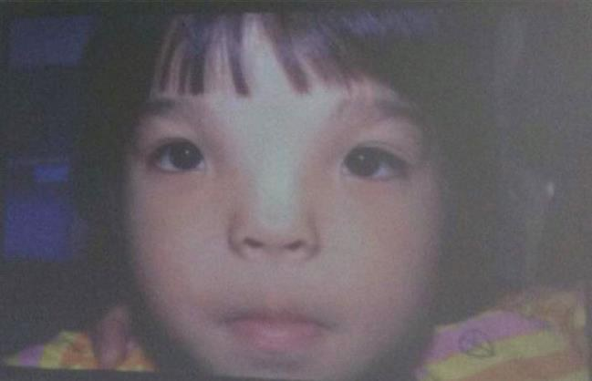

Source: file "Sx (Subspecialties) แอคเปล่า รวม 71-72", pages 106-113, the section "MDCU67 R2" (heading "Subspecialty Sx Rotate 2/2557"), questions recalled by students, mixed Thai and English, under the headings Pediatrics, Colo, CVT, Plastic, Neuro and Uro. It is a subspecialty MCQ paper, so it is kept apart from General Surgery. This extraction was made without comparing the questions with the per-cohort exam files, as the owner asked. It is a bank file, so it is not tagged into the exam topic map.
The paper's own numbers are kept (Q1, 3-12, 14-17, 20, 23, 24, 30, 35, 36, 38, 42, 43, 45-49, 58, 59, 67-71, 76, 80-82, 84-87; the other numbers are not in the paper). The subject tag in brackets at the start of each stem is the paper's own heading for that group. Q85-Q87 share one stem (written under Q85 here; Q86 and Q87 are short).
Answers: the paper gives no answers (it is a clean typed list), so every answer is "not given in the source". A choice the paper leaves blank is "(not recalled)". Q67, Q70 and Q71 mention a picture or film that is not in the paper; the Q49 picture (no name, label or ID band) is kept in images/.
exam_year 2014 follows the heading "Rotate 2/2557" (academic year 2557 = 2014-15); the calendar year is inferred.
The rotation number (2) is not mapped to a G.

## Q1 (original no. 1)
[Pediatrics] เกี่ยวกับ gastroschisis ข้อใดถูก

A. เกี่ยวข้องกับ SGA
B. มักมี associated anomaly
C. Liver and spleen involvement
D. 50% intestinal atresia
E. No prolonged adynamic ileus following repair

**Answer:** not given in the source
**Explanation:** not stated
**Guideline / source:** not stated

## Q3 (original no. 3)
[Pediatrics] เด็กชายอายุ 1 ปี มาพบแพทย์ที่ OPD ด้วยเรื่องก้อนบริเวณสะดือโดยจะโผล่ออกมาเวลาที่เด็กร้อง และก้อนสามารถดันกลับได้เมื่อหยุดร้อง ก้อนอยู่ตรงกลางสะดือ ขนาด 1 cm ถามว่าควร management อย่างไร

A. ไม่ต้องทำอะไร รอจนกว่าอายุ 4 ขวบ
B. Urgent surgery
C. Elective surgery
D. หาอะไรมาแปะ
E. Sclerosing agent

**Answer:** not given in the source
**Explanation:** not stated
**Guideline / source:** not stated

## Q4 (original no. 4)
[Pediatrics] A 2.8-kg. neonate with excessive salivation develops respiratory distress. Attempts to pass an orogastric catheter fail because the catheter coils in the back of the throat. A chest film is obtained and shows right upper lobe atelectasis and a gasless abdomen. The most likely diagnosis is?

A. Proximal esophageal atresia without a fistula
B. Proximal esophageal atresia with a distal tracheoesophageal (TE) fistula
C. “H-type” TE fistula
D. Esophageal atresia with both proximal and distal TE fistula
E. Congenital esophageal stricture

**Answer:** not given in the source
**Explanation:** not stated
**Guideline / source:** not stated

## Q5 (original no. 5)
[Pediatrics] Excision is the treatment of choice for the following diseases EXCEPT.

A. Thyroglossal duct cyst
B. Branchial cleft cyst
C. Cystic hygroma
D. Dermoid cyst
E. Sternocleidomastoid tumor

**Answer:** not given in the source
**Explanation:** not stated
**Guideline / source:** not stated

## Q6 (original no. 6)
[Pediatrics] A male newborn infant presents with bilious vomiting. On air-contrast upper GI study shows a “double bubble” sign with distal air. A nasogastric tube was placed and suction produces bilious fluid. What is the appropriate management?

A. Gastrojejunostomy
B. Upper gastrointestinal study
C. Lower gastrointestinal study
D. Duodenojejunostomy
E. Ladd’s procedure

**Answer:** not given in the source
**Explanation:** not stated
**Guideline / source:** not stated

## Q7 (original no. 7)
[Pediatrics] ข้อใดถูกเกี่ยวกับ biliary atresia

A. 2/3 จะ develop chronic liver disease
B. ควรทำผ่าตัดหลังอายุ 80 วัน
C. common type คือ type 2 (common hepatic duct)
D. ควรทำ hepatoduodenostomy
E. (not recalled)

**Answer:** not given in the source
**Explanation:** not stated
**Guideline / source:** not stated

## Q8 (original no. 8)
[Pediatrics] ข้อใดผิดเกี่ยวกับ anorectal malformation

A. Associate กับ VACTERL
B. ต้องทำ x-ray lateral prone cross table ทุกราย
C. ถ้ามี urethrorectal fistula ต้องทำ colostomy ก่อน
D. ส่วนใหญ่มักจะมี fistula ร่วมด้วย
E. (not recalled)

**Answer:** not given in the source
**Explanation:** not stated
**Guideline / source:** not stated

## Q9 (original no. 9)
[Pediatrics] เด็กชายมี non-communicating hydrocele ไม่มีอาการใดๆ ควรทำการผ่าตัดเมื่อใด

A. ทันทีที่พบ
B. เมื่ออายุน้อยกว่า 1 เดือน
C. เมื่ออายุน้อยกว่า 1 ปี
D. เมื่ออายุน้อยกว่า 2 ปี
E. เมื่ออายุมากกว่า 2 ปี

**Answer:** not given in the source
**Explanation:** not stated
**Guideline / source:** not stated

## Q10 (original no. 10)
[Pediatrics] เมื่อ biopsy ใน Hirschsprung’s disease จะพบอะไร

A. Increased ganglion cell, increased AChE activity
B. Increased ganglion cell, decreased AChE activity
C. Absent ganglion cell, increased AChE activity
D. Absent ganglion cell, decreased AChE activity
E. (not recalled)

**Answer:** not given in the source
**Explanation:** not stated
**Guideline / source:** not stated

## Q11 (original no. 11)
[Pediatrics] เด็กแรกเกิดมี PDA ไม่มี heart failure ตอบสนองดีต่อ indomethacin 4 วันต่อมา มี feeding intolerance, bloating ทำ x-ray พบ dilated bowel, air in bowel wall จงบอก management

A. NPO, IV antibiotic
B. Explore laparotomy
C. (not recalled)
D. (not recalled)
E. (not recalled)

**Answer:** not given in the source
**Explanation:** not stated
**Guideline / source:** not stated

## Q12 (original no. 12)
[Pediatrics] เด็กอายุ 9 เดือน ก่อนหน้านี้สบายดี มีอาการคลื่นไส้อาเจียน, mucous bloody stool และมี intermittent abdominal clamp ควรส่ง investigation อะไร

A. CT scan
B. Proctoscope
C. Ultrasound
D. Stool examination
E. PR

**Answer:** not given in the source
**Explanation:** not stated
**Guideline / source:** not stated

## Q14 (original no. 14)
[Pediatrics] ผู้ป่วยเด็กชายไทย อายุ 3 ปี คลำไม่ได้ testis ด้านขวา ทำ ultrasound ที่ left inguinal และ scrotum ก็ไม่พบอะไร ควร management อย่างไร

A. CT abdomen
B. MRI abdomen
C. Diagnostic laparoscopy
D. Observe จนอายุ 4 ขวบ
E. วินิจฉัยว่าไม่มีอัณฑะด้านซ้ายตั้งแต่แรกเกิด

**Answer:** not given in the source
**Explanation:** not stated
**Guideline / source:** not stated

## Q15 (original no. 15)
[Pediatrics] What is an initial management in 10-year-old girl with proximal dilated colon and normal size sigmoid and rectum?

A. Swenson’s operation
B. Duhamel’s operation
C. Soave’s operation
D. Ileostomy
E. Daily enema

**Answer:** not given in the source
**Explanation:** not stated
**Guideline / source:** not stated

## Q16 (original no. 16)
[Colo] Most common complication of hemorrhoidectomy

A. Urinary retention
B. Bleeding
C. Skin tag
D. Infection
E. Wound disruption

**Answer:** not given in the source
**Explanation:** not stated
**Guideline / source:** not stated

## Q17 (original no. 17)
[Colo] Perianal abscess แบบใดที่ควรให้ antibiotic

A. มีไข้
B. Ischioanal abscess
C. Cellulitis
D. Immunocompromised host
E. ถูกทุกข้อ

**Answer:** not given in the source
**Explanation:** not stated
**Guideline / source:** not stated

## Q20 (original no. 20)
[Colo] ผู้ป่วยหญิง อายุ 72 ปี มาโรงพยาบาลด้วยอาการปวดแน่นท้อง ไม่ถ่ายไม่ผายลมมา 3 วัน ตรวจท้องไม่พบ peritonitis คลำท้องไม่ได้ก้อน PR ไม่พบสิ่งผิดปกติ จะส่ง investigation อะไรเป็นอันดับแรก

A. Film acute abdomen series
B. CT whole abdomen
C. Barium enema
D. Colonoscopy
E. MRI whole abdomen

**Answer:** not given in the source
**Explanation:** not stated
**Guideline / source:** not stated

## Q23 (original no. 23)
[Colo] ผู้ป่วยชาย อายุ 80 ปี มาด้วย acute diverticulitis หลังจากให้ IV fluid แล้วควรทำอะไรต่อ

A. Colonoscope
B. Broad-spectrum ATB
C. Sigmoidectomy
D. (not recalled)
E. Pain control

**Answer:** not given in the source
**Explanation:** not stated
**Guideline / source:** not stated

## Q24 (original no. 24)
[Colo] All of the followings are true according to sigmoid volvulus EXCEPT.

A. Reduction and bowel decompression by flexible sigmoidoscopy should be followed by elective sigmoidectomy
B. Coffee bean sign is seen in acute abdomen series
C. If can’t reduce or has signs of bowel ischemia, patient should go to operating room emergently
D. Mostly occurs in the elderly and institutionalizes patient
E. Accounts for less than 50% of colonic volvulus

**Answer:** not given in the source
**Explanation:** not stated
**Guideline / source:** not stated

## Q30 (original no. 30)
[Colo] ข้อใดเป็น branch ของ inferior mesenteric artery

A. Middle colic artery
B. Right colic artery
C. Ileocolic artery
D. Sigmoidal artery
E. Wandering artery

**Answer:** not given in the source
**Explanation:** not stated
**Guideline / source:** not stated

## Q35 (original no. 35)
[CVT] Which is/are indication for surgical intervention in lung abscess?

A. Failure to 2 weeks of medical treatment
B. Bronchopleural fistula
C. Multiple small bilateral abscess in immunocompromised host
D. Occasional hemoptysis
E. All of the above

**Answer:** not given in the source
**Explanation:** not stated
**Guideline / source:** not stated

## Q36 (original no. 36)
[CVT] Which is true about lung abscess?

A. Hematologic seeding is a common mechanism
B. Posterior upper lobe and superior lower lobe of right lung are the most common site
C. Hemoptysis and foul smell sputum are uncommon
D. Staphylococcus is a common pathogen
E. All of the above

**Answer:** not given in the source
**Explanation:** not stated
**Guideline / source:** not stated

## Q38 (original no. 38)
[CVT] ข้อใดเป็น most common anterior mediastinal tumor

A. Thymoma
B. Teratoma
C. Thyroid
D. Lymphoma
E. Neurogenic tumor

**Answer:** not given in the source
**Explanation:** not stated
**Guideline / source:** not stated

## Q42 (original no. 42)
[CVT] ข้อใดผิด

A. Proper ATB is sufficient to treat mediastinitis
B. (not recalled)
C. (not recalled)
D. (not recalled)
E. (not recalled)

**Answer:** not given in the source
**Explanation:** not stated
**Guideline / source:** not stated

## Q43 (original no. 43)
[CVT] ข้อใดไม่ใช่ criteria ในการวินิจฉัย empyema thoracis

A. LDH > 1,000 U/L
B. WBC > 10,000/mm3
C. pH < 7
D. Glucose < 40 mg/dl
E. Protein > 3 g/dl

**Answer:** not given in the source
**Explanation:** not stated
**Guideline / source:** not stated

## Q45 (original no. 45)
[CVT] Apart of ATB, which is recommended treatment of early lung abscses?

A. Physiotherapy – postural drainage
B. Abscess aspiration
C. Intercostal drainage
D. Lobectomy
E. None of above

**Answer:** not given in the source
**Explanation:** not stated
**Guideline / source:** not stated

## Q46 (original no. 46)
[Plastic] ผู้ป่วยประสบเหตุเพลิงไหม้ที่อพาร์ตเม้นแห่งหนึ่ง มีแผลไฟไหม้ที่หน้า คอ และหน้าอก มีไฟไหม้ตามผมและขนจมูก ควรให้ management อย่างไร

A. ใส่ tube และให้ Oxygen
B. Bronchoscope
C. ทำ Escharotomy ที่หน้าอก
D. Oxygen mask
E. วัด Oxygen saturation

**Answer:** not given in the source
**Explanation:** not stated
**Guideline / source:** not stated

## Q47 (original no. 47)
[Plastic] ผู้ป่วยชายอายุ 30 ปี น้ำหนัก 60 kg, มีแผลไฟไหม้ 2nd degree burn 40% BSA ได้ RLS มาแล้ว 1,200 cc ในเวลา 2 ชั่วโมงที่ผ่านมา ต้องได้ RLS อีกเท่าใดในอีก 6 ชั่วโมงถัดไป

A. 500 cc/hr
B. 600 cc/hr
C. 800 cc/hr
D. 1,000 cc/hr
E. 1,200 cc/hr

**Answer:** not given in the source
**Explanation:** not stated
**Guideline / source:** not stated

## Q48 (original no. 48)
[Plastic] ข้อใดเป็นลักษณะเด่นของ full-thickness burn

A. สูญเสีย epidermis ไปทั้งชั้น
B. ไม่จำเป็นต้องทำ skin graft
C. หายได้เองใน 7 วัน
D. หายได้เองใน 14 วัน
E. เจ็บมาก

**Answer:** not given in the source
**Explanation:** not stated
**Guideline / source:** not stated

## Q49 (original no. 49)
[Plastic] จงวินิจฉัย

A. FEEM
B. Frontonasal dysplasia
C. Craniosynostosis
D. Cleft lip
E. (not recalled)

**Answer:** not given in the source
**Explanation:** not stated
**Guideline / source:** not stated

## Q58 (original no. 58)
[Plastic] Z-plasty มุม 60 องศา ขยายได้กี่ %

A. 50%
B. 60%
C. 75%
D. 90%
E. 100%

**Answer:** not given in the source
**Explanation:** not stated
**Guideline / source:** not stated

## Q59 (original no. 59)
[Plastic] สงสัย fracture of condyle of mandible ควรส่ง film x-ray ท่าไหน

A. AP view
B. Waters’ view
C. Towne’s view
D. Lateral oblique view
E. Panoramic view

**Answer:** not given in the source
**Explanation:** not stated
**Guideline / source:** not stated

## Q67 (original no. 67)
[Neuro] ผู้ป่วยชายอายุ 52 ปี มาด้วยปวดหัว BP 180/110 mmHg ให้รูป CT มา ถามว่าเป็นอะไร (the picture is not included in the paper)

A. Basal ganglion hemorrhage
B. Thalamic hemorrhage
C. (not recalled)
D. (not recalled)
E. Caudate hemorrhage

**Answer:** not given in the source
**Explanation:** not stated
**Guideline / source:** not stated

## Q68 (original no. 68)
[Neuro] จากข้อ 67. ควรส่ง investigation อะไรต่อ

A. CT with contrast
B. MRI
C. Angiogram
D. CTA
E. X-ray

**Answer:** not given in the source
**Explanation:** not stated
**Guideline / source:** not stated

## Q69 (original no. 69)
[Neuro] ผู้ป่วยหญิงอายุ 73 ปี ไม่มีโรคประจำตัว ปวดหัวขึ้นมาทันที 1 wkPTA กินยาแก้ปวด ดีขึ้นแต่ไม่หายสนิท จึงมาที่ ER: BP 140/90 mmHg CT ปกติ ควรทำอะไรต่อ

A. BP measurement ซ้ำ
B. Cerebral angiography
C. Lumbar puncture
D. Oral analgesia
E. Parenteral analgesia

**Answer:** not given in the source
**Explanation:** not stated
**Guideline / source:** not stated

## Q70 (original no. 70)
[Neuro] ผู้ป่วยหญิงอายุ 35 ปี ไม่มีโรคประจำตัว 5 วันก่อนไปเที่ยวกับเพื่อน หมดสติขึ้นมาทันที จำเรื่องราวไม่ได้ เพื่อนนำส่งโรงพยาบาล ตื่นขึ้นมาปวดหัว อาเจียน แพทย์ส่ง x-ray สมอง จากนั้นอยู่โรงพยาบาลต่ออีก 4 วัน และกลับบ้านได้ ตอนนี้ปวดหัวน้อยลง ช่วยเหลือตัวเองได้บ้างที่บ้าน ผู้ป่วยนำ film วันเกิดเหตุมาปรึกษาท่าน (โจทย์ให้รูป film สมองมา) (the film is not included in the paper)

A. บอกให้ไป film ซ้ำเนื่องจากก้อนเลือดอาจขยายขนาด
B. บอกให้ไปผ่าออก
C. (not recalled)
D. กินยากันชักต่อเนื่อง + follow up MRI
E. ให้กินอาหารมันน้อยๆ รักษาความดัน และตรวจติดตามอย่างต่อเนื่อง

**Answer:** not given in the source
**Explanation:** not stated
**Guideline / source:** not stated

## Q71 (original no. 71)
[Neuro] ให้รูปคนเป็น acromegaly มา ถามว่าลักษณะดังรูปเกิดจากอะไร (the picture is not included in the paper)

A. Craniopharyngioma
B. Glioblastoma multiforme
C. Prolactin-producing pituitary adenoma
D. Growth hormone producing pituitary adenoma
E. ACTH producing pituitary adenoma

**Answer:** not given in the source
**Explanation:** not stated
**Guideline / source:** not stated

## Q76 (original no. 76)
[Uro] Most common testicular tumor in children

A. Seminoma
B. Choriocarcinoma
C. Teratoma
D. Yolk sac tumor
E. Embryonal carcinoma

**Answer:** not given in the source
**Explanation:** not stated
**Guideline / source:** not stated

## Q80 (original no. 80)
[Uro] ผู้ป่วยเด็กหญิงแรกเกิด ตรวจร่างกายพบ clitoromegaly and labioscrotal fusion ปัสสาวะได้ปกติ จงบอก initial management

A. ทายา steriod
B. Chromosome study + serum electrolytes
C. ผ่าลดขนาด clitoris ทันที และผ่าแยก labioscrotal fusion เมื่ออายุ 6-12 เดือน
D. ผ่าลดขนาด clitoris ตอนอายุ 6-12 เดือน และผ่าแก้ labioscrotal fusion เมื่อเข้า puberty
E. ผ่าแก้ labioscrotal fusion ตอนอายุ 6-12 เดือน และผ่าลดขนาด clitoris เมื่อเข้า puberty

**Answer:** not given in the source
**Explanation:** not stated
**Guideline / source:** not stated

## Q81 (original no. 81)
[Uro] เด็กอายุ 5 ปี คลำพบก้อนที่ชายโครงซ้าย renal function scan ทำงานได้ 5%, VCUG ปกติ ถามว่าควร management อย่างไร

A. Pyeloplasty
B. Nephrectomy
C. (not recalled)
D. Percutaneous drainage
E. Cystoscopic with J stent

**Answer:** not given in the source
**Explanation:** not stated
**Guideline / source:** not stated

## Q82 (original no. 82)
[Uro] ผู้ป่วยอายุ 75 ปี หกล้ม humerus หัก x-ray พบก้อน ตรวจก้อนพบว่าเป็นต่อม ROS: พบความผิดปกติที่ระบบขับถ่าย, ตรวจ Prostate ขนาด > 50 g irregular surface, PSA > 100 ควรทำอะไรต่อ

A. TURP
B. Radiation
C. Chemotherapy
D. Orchiectomy
E. ฝัง radiation

**Answer:** not given in the source
**Explanation:** not stated
**Guideline / source:** not stated

## Q84 (original no. 84)
[Uro] ผู้ป่วยชายอายุ 65 ปีมาด้วยอาการ... สรุปว่าเป็น LUTS (IPSS = 30)
DRE: Prostate > 50 g smooth rubbery well-defined border
UA: WBC, RBC จำนวนมาก, ไตบวมน้ำทั้ง 2 ข้าง, พบนิ่วในกระเพาะปัสสาวะ cm จงบอก management

A. TURP + cystolithopaxy
B. α-blocker + 5α reductase inhibitor
C. Antibiotic + α-blocker
D. ใส่สายสวนทันที + TURP + cystolithopaxy
E. ใส่สายสวนทันที + TURP + urodynamic test

**Answer:** not given in the source
**Explanation:** not stated
**Guideline / source:** not stated

## Q85 (original no. 85)
[Uro] (85-87 share one stem) ผู้ป่วยชายอายุ 30 ปี มาด้วยอาการปัสสาวะแสบขัดมา 3 วัน ตอนนี้ปัสสาวะมีสีแดงปนมาด้วยทุกครั้ง มีอาการครั่นเนื้อครั่นตัว ปวดหลังด้านซ้าย ปวดอัณฑะซ้ายมา 3 ชั่วโมง
ท่านจะซักประวัติอะไรเพิ่มเติม

A. ประวัติเพศสัมพันธ์
B. ประวัติอุบัติเหตุต่ออวัยวะเพศ
C. ประวัติเคยเป็นนิ่ว
D. ประวัติแรกคลอด
E. (not recalled)

**Answer:** not given in the source
**Explanation:** not stated
**Guideline / source:** not stated

## Q86 (original no. 86)
[Uro] (85-87) จะส่งตรวจอะไรเพิ่มเติม

A. UA
B. UC
C. CBC
D. X-ray plain KUB
E. ถูกทุกข้อ

**Answer:** not given in the source
**Explanation:** not stated
**Guideline / source:** not stated

## Q87 (original no. 87)
[Uro] (85-87) ท่านคิดว่าผู้ป่วยเป็นโรคอะไรมากที่สุด

A. Acute orchitis (Lt.)
B. Acute prostitis
C. Acute cystitis
D. Acute pyelonephritis (Lt.)
E. None of above

**Answer:** not given in the source
**Explanation:** not stated
**Guideline / source:** not stated

## Flagged for checking
- No answer key exists for this paper in the files supplied.
- exam_year 2014 is inferred from the academic year 2557.
