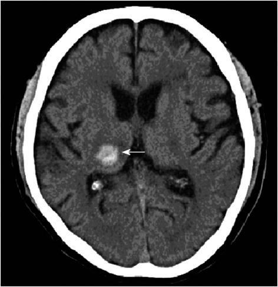
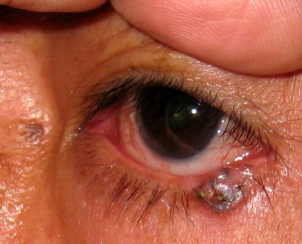
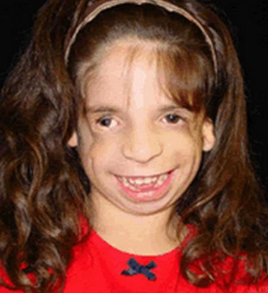

Source: file "Sx (Subspecialties) แอคเปล่า รวม 71-72", pages 114-127, the section "MDCU67 R3" (heading "AC Subspeciality Surgery R3/2557"; the section starts at the end of the chunk of pages 91-120 and continues in the chunk of pages 121-150), questions recalled by students, mixed Thai and English, under the headings Neuro surgery, Colorectal surgery, Plastic surgery, CVT, Pediatric Surgery and Uro. It is a subspecialty MCQ paper, so it is kept apart from General Surgery. This extraction was made without comparing the questions with the per-cohort exam files, as the owner asked. It is a bank file, so it is not tagged into the exam topic map.
The paper's own numbers are kept (Q1-3, 5-12, 15-19, 21, 26, 28, 29, 31-34, 37, 41, 42, 44, 45, 48-58, 61-63, 65, 67-69, 71, 72, 76-90 where present; the other numbers are not in the paper). The subject tag in brackets at the start of each stem is the paper's own heading for that group. Q7-Q9 repeat one case with different questions (Q8 and Q9 stems are shortened here to "the same stem as Q7"); Q10 refers to the earlier case. Q80, Q85, Q86 and Q87 are only a stem with no choices.
Answers: the paper gives no answers (it is a clean typed list), so every answer is "not given in the source". A choice the paper leaves blank is "(not recalled)". Pictures with no name, label or ID band are kept in images/ (Q6, Q32, Q33, Q37); the credit line on the Q33 picture and the logo on the Q32 picture are cropped out. The labelled drawing of Q3 is left out because its labels give the diagnosis. Q11 and Q31 mention a picture that is not in the paper.
exam_year 2014 is inferred: the heading says "R3/2557" (academic year 2557 = 2014-15); the calendar year is not stated.
The rotation number (3) is not mapped to a G.

## Q1 (original no. 1)
[Neuro surgery] ข้อใดถูกเกี่ยวกับการใช้ steroid ใน brain tumor

A. (not recalled)
B. ลด cytotoxic edema ได้
C. เริ่มใช้จาก dose น้อยๆ ก่อน แล้วค่อยๆ เพิ่ม
D. อันตราย ไม่ควรใช้
E. ไม่มีข้อถูก

**Answer:** not given in the source
**Explanation:** not stated
**Guideline / source:** not stated

## Q2 (original no. 2)
[Neuro surgery] ข้อใดถูกต้องเกี่ยวกับ Brain tumor

A. Malignant brain tumor มักตายจาก metastasis ออกนอกสมอง
B. ในผู้ใหญ่มักพบ infratentorial tumor
C. metastasis จะไม่ผ่า เพราะเป็น end stage cancer แล้ว
D. malignant พบมากกว่า benign
E. primary พบมากกว่า secodary

**Answer:** not given in the source
**Explanation:** not stated
**Guideline / source:** not stated

## Q3 (original no. 3)
[Neuro surgery] What is the diagnosis? [picture in the paper: a labelled drawing of a standing figure with the typical body changes listed beside it; left out because its labels give the diagnosis]

A. Cushing syndrome
B. Acromegaly
C. Gigantism
D. Morbid obesity
E. Parinaud syndrome

**Answer:** not given in the source
**Explanation:** not stated
**Guideline / source:** not stated

## Q5 (original no. 5)
[Neuro surgery] bitemporal hemianopia อาจพบในโรคใดต่อไปนี้มากที่สุด

A. Pinealoma
B. Acoustic Schwannoma
C. Prolactinoma
D. Medulloblastoma
E. Frontal lobe ganglioma

**Answer:** not given in the source
**Explanation:** not stated
**Guideline / source:** not stated

## Q6 (original no. 6)
[Neuro surgery] ผู้ป่วยหญิงอายุ 51 ปี ไม่มีโรคประจำตัว ปวดหัวมา 2 hrPTA ตรวจแรกรับได้ E3M6V4 BP 170/100 mmHg CT พบดังรูป ขนาดก้อน 10x25x20 mm3

A. Basal ganglion hemorrhage
B. Caudate hemorrhage
C. Thalamic hemorrhage
D. MCA hemorrhage
E. Pontine hemorrhage

**Answer:** not given in the source
**Explanation:** not stated
**Guideline / source:** not stated

## Q7 (original no. 7)
[Neuro surgery] ผู้ป่วยชาย โดนตีหัวด้านซ้ายมา สลบไป 5 นาที หลังจากนั้นผู้ป่วยตื่นขึ้นมาและถูกนำส่งโรงพยาบาลใน 2 ชั่วโมงถัดมา ผลการตรวจร่างกาย Glasgow coma score xxx, puffy scalp at Lt frontotemporal region, Rt. Decerebrate, Rt pupil 2 cm RTL, Lt pupil 5 cm NRTL. จงให้การวินิจฉัยในผู้ป่วยรายนี้

A. Subfalcine herniation
B. Central herniation
C. Uncal herniation
D. Tonsillar herniation
E. Transcalvarial herniation

**Answer:** not given in the source
**Explanation:** not stated
**Guideline / source:** not stated

## Q8 (original no. 8)
[Neuro surgery] (the same stem as Q7) ผู้ป่วยชาย โดนตีหัวด้านซ้ายมา สลบไป 5 นาที ... Rt. Decerebrate, Rt pupil 2 cm RTL, Lt pupil 5 cm NRTL. จงให้การวินิจฉัยในผู้ป่วยรายนี้

A. Acute epidural hematoma
B. Chronic subdural hematoma
C. Intracerebral hemorrhage
D. Subarachnoid hemorrhage
E. Intraventricular hemorrhage

**Answer:** not given in the source
**Explanation:** not stated
**Guideline / source:** not stated

## Q9 (original no. 9)
[Neuro surgery] (the same stem as Q7) ผู้ป่วยชาย โดนตีหัวด้านซ้ายมา สลบไป 5 นาที ... Rt. Decerebrate, Rt pupil 2 cm RTL, Lt pupil 5 cm NRTL. จงอธิบายเหตุการณ์ที่เกิดขึ้นในผู้ป่วยรายนี้

A. Kernohan’s phenomenon
B. Monro-Kellie phenomenon

**Answer:** not given in the source
**Explanation:** not stated
**Guideline / source:** not stated

## Q10 (original no. 10)
[Neuro surgery] ข้อใดคือวิธีการจัดการที่เหมาะสมสำหรับผู้ป่วยในข้อที่ผ่านมา

A. Non-contrast CT scan
B. ET tube

**Answer:** not given in the source
**Explanation:** not stated
**Guideline / source:** not stated

## Q11 (original no. 11)
[Neuro surgery] ผู้ป่วยชายไทยอายุ 50 ปี ปฏิเสธประวัติโรคประจำตัว ปวดหัวหน่วงๆ conscious ดี ใช้มือซ้ายลำบาก pronator drift +ve BP 160/90 ผลการตรวจCT scan(ดังรูป) [ภาพ intracerebral hemorrhage ซีกขวา 3 จุด] What one is a proper management? (the picture is not included in the paper)

A. CT with contrast
B. CTA
C. Coagulogram
D. Echocardiogram
E. IV antihypertensive drug

**Answer:** not given in the source
**Explanation:** not stated
**Guideline / source:** not stated

## Q12 (original no. 12)
[Neuro surgery] คนไข้หลอดเลือดในสมองแตกอาการแย่ลงใน 2-3 วันแรก อาการแย่ลงเพราะอะไร

A. เลือดเลี้ยงข้างๆมากกว่าปกติ
B. หลอดเลือดดำที่ยังมีสมองอักเสบ
C. หลอดเลือดแดงที่ฐานสมองหดตัวและอักเสบ
D. เกิดการแตกซ้ำของหลอดเลือด
E. ก้อนเลือดกดเบียดฐานสมอง

**Answer:** not given in the source
**Explanation:** not stated
**Guideline / source:** not stated

## Q15 (original no. 15)
[Neuro surgery] Which one is a contraindication of lumbar puncture?

A. Normal pressure hydrocephalus
B. Communicating hydrocephalus
C. Congenital aqueductal stenosis with hydrocephalus
D. TB meningitis with hydrocephalus
E. Subarachnoid hemorrhage with hydrocephalus

**Answer:** not given in the source
**Explanation:** not stated
**Guideline / source:** not stated

## Q16 (original no. 16)
[Colorectal surgery] ผู้ป่วยชายประวัติมาด้วยเลือดออกทางทวารและมีก้อนออกมาตอนเบ่งถ่ายอุจจาระ ตอนตรวจไม่พบก้อนออกมาจากรูทวาร จงให้การวินิจฉัย Grade ของ hemorrhoid ในผู้ป่วยรายนี้

A. I
B. II
C. III
D. IV
E. Mixed

**Answer:** not given in the source
**Explanation:** not stated
**Guideline / source:** not stated

## Q17 (original no. 17)
[Colorectal surgery] Most common complication of hemorrhoidectomy

A. Urinary retention
B. Bleeding
C. anal stricture
D. Infection
E. skin tag

**Answer:** not given in the source
**Explanation:** not stated
**Guideline / source:** not stated

## Q18 (original no. 18)
[Colorectal surgery] chronic anal fissure

A. fibrotic edge
B. hypertrophic anal papilla
C. sentinel pile
D. ลึกเห็น internal sphincter
E. ถูกทุกข้อ

**Answer:** not given in the source
**Explanation:** not stated
**Guideline / source:** not stated

## Q19 (original no. 19)
[Colorectal surgery] ฝีคัณฑสูตรเรียบพลัน ควรให้ antibiotic เมื่อใด

A. มีไข้
B. Ischioanal fistula
C. Cellulitis บริเวณ fistula
D. Immunocompromised host
E. ถูกทุกข้อ

**Answer:** not given in the source
**Explanation:** not stated
**Guideline / source:** not stated

## Q21 (original no. 21)
[Colorectal surgery] most common cause of massive LGIB in elderly

A. diverticulum
B. cancer
C. angiodysplasia
D. internal hemorrhoid
E. ischemic bowel

**Answer:** not given in the source
**Explanation:** not stated
**Guideline / source:** not stated

## Q26 (original no. 26)
[Colorectal surgery] ปี 2008 ตรวจพบว่ามี sigmoid cancer T3N0M0 รักษาโดยทำ sigmoidectomy ปี 2009 CT พบ liver metastasis รักษาโดยทำ left hepatectomy ปี 2010 ตรวจพบว่ามี liver nodule 3 cm no local recurrence ควร management อย่างไรต่อ

A. liver resection
B. chemotherapy for palliative care
C. RFA
D. intrahepatic chemotherapy
E. chemoembolization

**Answer:** not given in the source
**Explanation:** not stated
**Guideline / source:** not stated

## Q28 (original no. 28)
[Colorectal surgery] ผู้ป่วย 55 ปี ทำ colonoscope พบ 1 cm polyp ที่ ascending colon ทำ polypec พบเป็น intramucosal adenocarcinoma with free resected margin ควรทำอย่างไรต่อ

A. Rt colectomy
B. subtotal colectomy
C. total colectomy
D. chemoradiation
E. closed follow up

**Answer:** not given in the source
**Explanation:** not stated
**Guideline / source:** not stated

## Q29 (original no. 29)
[Colorectal surgery] ผู้ป่วยชายไทยอายุ 50 ปี มาด้วยอาการ Acute diverticulitis ครั้งแรก ข้อใดคือการ manage ที่ดีที่สุดร่วมกับการให้ IV fluid

A. Diagnostic colonoscopy
B. NG suction
C. Sigmoidectomy
D. Empirical antibiotics
E. APR

**Answer:** not given in the source
**Explanation:** not stated
**Guideline / source:** not stated

## Q31 (original no. 31)
[Plastic surgery] ให้รูป ก้อนเนื้อแดงๆ เป็นตั้งแต่เกิดโตขึ้นเรื่อยๆ ตอนนี้ 3 ขวบเริ่มคงที่แล้ว ไม่หายเอง no pulsatile mass ถามว่าเป็นอะไร (the picture is not included in the paper)

A. hemangioma
B. capillary-venous malformation
C. arterio-venous mal formation
D. lymphatic malformation
E. pyogenic granuloma

**Answer:** not given in the source
**Explanation:** not stated
**Guideline / source:** not stated

## Q32 (original no. 32)
[Plastic surgery] ผู้ป่วยพบแผลที่ขอบตาล่างขวา ไม่เจ็บ ไม่มีหนองไหลออกมา ผลการตรวจชิ้นเนื้อพบว่าเป็น Basal cell carcinoma จงเลือกวิธีการรักษาที่เหมาะสมที่สุด

A. total excision for definitive pathology
B. Wide excision, margin 0.5 cm
C. Wide excision, margin 1.0 cm
D. Wide excision, margin 2.0 cm
E. Mohs surgery

**Answer:** not given in the source
**Explanation:** not stated
**Guideline / source:** not stated

## Q33 (original no. 33)
[Plastic surgery] ชายอายุ 25 ปี มีแผลบริเวณหน้าของผู้ป่วย จงให้การวินิจฉัย

A. Folliculitis
B. Furuncle
C. Carbuncle
D. Cellulitis
E. Necrotizing fasciitis

**Answer:** not given in the source
**Explanation:** not stated
**Guideline / source:** not stated

## Q34 (original no. 34)
[Plastic surgery] ผู้ป่วยเป็นไส้ติ่ง แผลเป็นเส้นตรง หลังจากผ่าตัดประมาณ 2เดือน เริ่มรู้สึกคัน มีก้อนนูน 4 ก้อน ไม่เกินขอบแผล รักษาโดยอะไร

A. Observe
B. Hirudoid cream
C. Scar gel
D. Steroid
E. กรีดแผลเย็บใหม่

**Answer:** not given in the source
**Explanation:** not stated
**Guideline / source:** not stated

## Q37 (original no. 37)
[Plastic surgery] What is the most associated functional deficit important for routine evaluation? (the picture's caption says: ให้รูปเด็กผู้หญิงหน้าเหมือน Treacher – Collin syndrome)

A. Conductive hearing loss
B. Expose keratitis
C. Increased intracranial pressure

**Answer:** not given in the source
**Explanation:** not stated
**Guideline / source:** not stated

## Q41 (original no. 41)
[Plastic surgery] ผู้ป่วยหญิงไทย อายุ 50 ปี มีก้อนขนาดใหญ่ในปาก เลือดออกปริมาณมาก ท่านคิดว่าจะส่ง investigation อะไรที่จะเป็นประโยชน์มากที่สุด

A. x-ray
B. CTA
C. MRA
D. angiogram
E. U/S

**Answer:** not given in the source
**Explanation:** not stated
**Guideline / source:** not stated

## Q42 (original no. 42)
[Plastic surgery] ผู้ป่วยชายอายุ 35 ปี ได้รับการช่วยเหลือลงมาจากอพาร์ตเมนต์ไฟไหม้ 40 นาทีก่อน พบมีรอยไหม้ที่ใบหน้า ลำคอ หน้าอก แขนสองข้าง ซึมกระสับกระส่าย มีรอยคราบดำติดตามปากและขนจมูก สิ่งที่ควรทำก่อนส่งตัวต่อไปรักษาคือ

A. ใส่ endotracheal tube
B. ทำ bronchoscope เพื่อดูดเอาเสมหะออก
C. วัด pulse oximetry
D. ทำ escharotomy ที่หน้าอก ผู้ป่วยจะได้หายใจสะดวกขึ้น
E. แทงสาย subclavian vein สำหรับ fluid resuscitation

**Answer:** not given in the source
**Explanation:** not stated
**Guideline / source:** not stated

## Q44 (original no. 44)
[Plastic surgery] ผู้ป่วยชาย อายุ 40 ปี หนัก 60 kg Burn 40% TBSA 4hPTA BP 120/90 PR 160 ได้รับ RLS แล้ว 1200 cc ควร management ยังไง

A. Keep BP เท่าเดิม
B. Keep CVP 17 cmH2O
C. keep urine output = 60 ml/hr
D. ให้ mannitol
E. ให้ RLS อีก 400 cc/hr

**Answer:** not given in the source
**Explanation:** not stated
**Guideline / source:** not stated

## Q45 (original no. 45)
[Plastic surgery] ให้รูป craniosynostosis มี หน้าผากปูด exopthalmos และcleft lip ตรงกลางริมฝีปากบน อะไรต้องรีบ manage และ evaluate มากที่สุด

A. Conductive hearing loss
B. Expose keratitis
C. Increased intracranial pressure
D. Upper airway obstruction

**Answer:** not given in the source
**Explanation:** not stated
**Guideline / source:** not stated

## Q48 (original no. 48)
[CVT] ผู้ป่วยชายอายุ 60 ปีมาด้วยอาการแน่นหน้าอก มีไข้ เหงื่อออกตอนกลางคืน น้ำหนักลด ตรวจร่างกายคลำได้กลุ่มก้อนต่อมน้ำเหลืองโต ขรุขระ แข็งบริเวณ Rt. supraclavicular ผลการตรวจ CXR พบ anterior mediastinal mass ขนาดใหญ่ ขอบเขตไม่ชัด จงให้ staging ของผู้ป่วยรายนี้

A. IIa
B. IIb
C. IIIa
D. IIIb
E. IV

**Answer:** not given in the source
**Explanation:** not stated
**Guideline / source:** not stated

## Q49 (original no. 49)
[CVT] Mass at anterior mediastinum พบ AFP, beta-HCG both positive ผู้ป่วยมีอาการหน้าบวม แขนบวม หายใจลำบาก พบหลอดเลือดดำที่คอโต น่าจะรักษาอย่างไร

A. Biopsy ให้ได้ Histopathology เพื่อเลือกวิธีการรักษา
B. ผ่าตัด และให้ chemotherapy และ Radiation ต่อ
C. ผ่าตัด และให้แค่ Chemotherapy เพราะเนื้องอกไม่น่าจะตอบสนองต่อ Radiation
D. ให้ Chemotherapy และ Radiation ก่อน แล้วผ่าตัดก้อนที่เหลือ
E. ให้ Chemotherapy เพียงอย่างเดียว แล้วผ่าตัด

**Answer:** not given in the source
**Explanation:** not stated
**Guideline / source:** not stated

## Q50 (original no. 50)
[CVT] Which is/are the indication(s) for surgery in lung abscess?

A. Failure to resolve after ATB 2 weeks
B. Occasional hemoptysis
C. Bronchopleural fistula
D. Multiple small abscess in bilateral lung in immunocompromised host
E. All of above

**Answer:** not given in the source
**Explanation:** not stated
**Guideline / source:** not stated

## Q51 (original no. 51)
[CVT] What is true about lung abscess

A. Hematologic seeding is a common mechanism
B. Posterior upper lobe and superior lower lobe of right lung are the most common site
C. Hemoptysis and foul smell sputum are uncommon
D. Staphylococcus is a common pathogen
E. All of the above

**Answer:** not given in the source
**Explanation:** not stated
**Guideline / source:** not stated

## Q52 (original no. 52)
[CVT] Which is/are true regarding to chronic constrictive pericarditis?

A. Abdominal distention is the most common symptoms
B. Pulsus paradoxus is more common in the setting of atrial fibrillation
C. The most common cause of chronic constrictive pericarditis is previous heart surgery
D. CT scan demonstrates thickened pericardium
E. All of above

**Answer:** not given in the source
**Explanation:** not stated
**Guideline / source:** not stated

## Q53 (original no. 53)
[CVT] ข้อใดไม่ใช่ criteria ของ Emphyema thoracis

A. Stain positive
B. WBC > 10,000
C. LDH > 1000
D. Glucose < 40
E. pH < 7

**Answer:** not given in the source
**Explanation:** not stated
**Guideline / source:** not stated

## Q54 (original no. 54)
[CVT] ข้อใดเป็น most common anterior mediastinal tumor ?

A. thymoma
B. teratoma
C. thyroid
D. lymphoma
E. neurogenic tumor

**Answer:** not given in the source
**Explanation:** not stated
**Guideline / source:** not stated

## Q55 (original no. 55)
[CVT] ข้อใดต่อนี้ผิดเกี่ยวกับ Acute mediastinitis

A. Mediastinitis ส่วนใหญ่ให้ antibiotic เพียงอย่างเดียวก็เพียงพอต่อการรักษา
B. เชื้อก่อโรคที่สำคัญใน Post mediansternotomy mediastinitis คือ Staphylococcus aureus
C. .
D. .
E. None of above

**Answer:** not given in the source
**Explanation:** not stated
**Guideline / source:** not stated

## Q56 (original no. 56)
[CVT] CABG ในผู้ป่วยลิ้นหัวใจตีบ ข้อใดส่งผลต่อ long term survival มากสุด

A. LIMA → LCX
B. SVG → LCX
C. Radial a. → RCA
D. Radial a. → LCA
E. LIMA → LDA

**Answer:** not given in the source
**Explanation:** not stated
**Guideline / source:** not stated

## Q57 (original no. 57)
[CVT] ผู้ป่วยมี severe MS, mild MR, Severe TR มีอาการเหนื่อย ทำงานไม่ไหว ควรได้รับการรักษาด้วยวิธีใด

A. Adjust medication
B. Balloon
C. Mitral valve repair, tricuspid valve repair
D. Mitral valve replacement, tricuspid valve repair
E. Mitral valve replacement, tricuspid valve replacement

**Answer:** not given in the source
**Explanation:** not stated
**Guideline / source:** not stated

## Q58 (original no. 58)
[CVT] ข้อใดเป็นสิ่งที่ควรทำเพิ่มเติมเพื่อรักษาผู้ป่วย lung abscess ที่ไม่มีภาวะแทรกซ้อน ในระยะแรก นอกจากการให้ยาปฏิชีวนะ

A. Postural drainage & physiotherapy
B. ICD
C. Lobectomy
D. Aspiration

**Answer:** not given in the source
**Explanation:** not stated
**Guideline / source:** not stated

## Q61 (original no. 61)
[Pediatric Surgery] Newborn มีexcessive salivation, OG cannot pass, CXR : Rt lung atelectesis, no air in abdomen ถามว่าเป็นอะไร

A. Proximal esophageal atresia without TE fistula

**Answer:** not given in the source
**Explanation:** not stated
**Guideline / source:** not stated

## Q62 (original no. 62)
[Pediatric Surgery] อะไรคือ malignant tumor ที่พบบ่อยที่สุดในเด็ก

A. Neuroblastoma
B. Nephroblastoma
C. Hydronephosis
D. Duplication cyst
E. Rhabdomyosarcoma

**Answer:** not given in the source
**Explanation:** not stated
**Guideline / source:** not stated

## Q63 (original no. 63)
[Pediatric Surgery] ข้อใดผิดเกี่ยวกับ Torsion tessis

A. ยกถุงอัณฑะขึ้นแล้วเจ็บลดลง (Phren’s test)
B. อาจมีอาการเจ็บมาก่อนหน้านี้
C. ไม่พบเม็ดเลือดขาวในปัสสาวะ
D. คลำไม่พบอัณฑะในข้างนั้น
E. พบแกนของอัณฑะในแนวนอน

**Answer:** not given in the source
**Explanation:** not stated
**Guideline / source:** not stated

## Q65 (original no. 65)
[Pediatric Surgery] 3 years old boy come to your office with right neck mass, firm, smooth surface, no erythema, PPD +ve. What is your next investigation?

A. Biopsy, Frozen-section, Excision
B. Start Anti-TB drug
C. PPD test again
D. Ultrasound and watchful waiting
E. FNA for diagnosis

**Answer:** not given in the source
**Explanation:** not stated
**Guideline / source:** not stated

## Q67 (original no. 67)
[Pediatric Surgery] The 2 month old girl present with jaundice ,acholic stool, dark urine. PE reveal jaundice and hepatomegaly. The girl was otherwise healthy.What is your initial management?

A. NG intubation
B. LFT
C. Doppler ultrasound
D. MRLP
E. Liver fibroscan

**Answer:** not given in the source
**Explanation:** not stated
**Guideline / source:** not stated

## Q68 (original no. 68)
[Pediatric Surgery] congental diaphragmatic hernia ข้างซ้าย ไม่ทำอะไร

A. IV
B. OG
C. CXR
D. ใส่tube
E. chest drainage

**Answer:** not given in the source
**Explanation:** not stated
**Guideline / source:** not stated

## Q69 (original no. 69)
[Pediatric Surgery] เด็กอายุ2วัน GA 34 wk, 2500g, ท้องอืด อีออกปนbile ไม่ถ่ายmeconium เป็นอะไร

A. duodenal atresia
B. jejuna atresia
C. Hirschprung
D. intertinenal malrotation
E. infantile hypertrophic pyolric stenosis

**Answer:** not given in the source
**Explanation:** not stated
**Guideline / source:** not stated

## Q71 (original no. 71)
[Pediatric Surgery] เด็กชาย 6 เดือน มาด้วยอาเจียน ปวดท้อง mucous bloody stool สาตุคืออะไร

A. Payer’s Patch hypertrophy
B. meckel’s diverticulum
C. Intussusception
D. Hemorrhoid
E. (not recalled)

**Answer:** not given in the source
**Explanation:** not stated
**Guideline / source:** not stated

## Q72 (original no. 72)
[Pediatric Surgery] What is true about gastroschisis

A. Associated chromosomal syndrome
B. High incidence of association anormalies
C. Prolong adynaamic ileus after repair
D. Intestinal atresia 80 % most case
E. Eviscesation of spleen and liver

**Answer:** not given in the source
**Explanation:** not stated
**Guideline / source:** not stated

## Q76 (original no. 76)
[Uro] ชาย45ปี Left renal mass 3cm , normal right kidney , painless hematuria managementอย่างไร

A. Neprectomy
B. Neprouretectomy
C. Transneprostomy with removal
D. Ureteropelvis with removal

**Answer:** not given in the source
**Explanation:** not stated
**Guideline / source:** not stated

## Q77 (original no. 77)
[Uro] CA bladder ที่พบบ่อยที่สุด

A. squamous cell carcinoma
B. Adenocarcinoma

**Answer:** not given in the source
**Explanation:** not stated
**Guideline / source:** not stated

## Q78 (original no. 78)
[Uro] SCC ที่ penis ข้อใดไม่ใช่ปัจจัยที่นำมาคิดในการรักษา

A. Length of penis
B. tumor size
C. Patient preference
D. Sexual activity
E. Tumor stage

**Answer:** not given in the source
**Explanation:** not stated
**Guideline / source:** not stated

## Q79 (original no. 79)
[Uro] Neonatal circumcision มีประโยชน์อะไร

A. ช่วยลดrisk ของinfection

**Answer:** not given in the source
**Explanation:** not stated
**Guideline / source:** not stated

## Q80 (original no. 80)
[Uro] Hypospadia → ลด risk CA??

**Answer:** not given in the source (the paper has only the stem, no choices)
**Explanation:** not stated
**Guideline / source:** not stated

## Q81 (original no. 81)
[Uro] เด็กอายุ1ปี หลังหายจากfebrile UTI ทำ ultrasound พบว่าKUB ปกติ VCUG ไตซ้ายมี vesicoureteric reflux grade 3 ไตขวาปกติ ทำอะไรต่อไป

A. left neprectomy
B. left nephroureterectomy
C. left ureteric reimplantation
D. Cystoscope with double J stent insertion
E. Prophylaxis ATB and follow up VCUG

**Answer:** not given in the source
**Explanation:** not stated
**Guideline / source:** not stated

## Q82 (original no. 82)
[Uro] พ่อเป็น CA prostate ลูกอายุ 48ปี PSA=8 ทำ TRUS biopsy พบว่าเป็นCA prostate ไม่มีmetas ใดๆ managementอย่างไร

A. ฝังแร่
B. ตัดไข่2ข้าง
C. Chemo
D. Radio
E. ตัดต่อมลูกหมากออกทั้งหมด

**Answer:** not given in the source
**Explanation:** not stated
**Guideline / source:** not stated

## Q83 (original no. 83)
[Uro] ผู้ชายอายุ65ปี ฉี่ไม่พุ่ง ต้องเบ่ง ฉี่ไม่สุด ฉี่บ่อย ตื่นมาฉี่ตอนกลางคืน2-3ครั้ง/คืน IPSS=23 DRE: prostate โตมาก60g กดไม่เจ็บ เรียบไม่มีก้อน PSA=3 UA,U/S ปกติ manageอย่างไร

A. Watchful wating ตรวจซ้ำทุกๆปี
B. alpha blocker , Anti androgen
C. alpha blocker , 5’ reductase inhibition

**Answer:** not given in the source
**Explanation:** not stated
**Guideline / source:** not stated

## Q84 (original no. 84)
[Uro] ผู้ชาย มาที่ER ด้วย painless gross hematuria ควรทำอย่างไร

A. non contrast CT
B. scope
C. IVP, U/S
D. retrograde pyelogram
E. กินยา

**Answer:** not given in the source
**Explanation:** not stated
**Guideline / source:** not stated

## Q85 (original no. 85)
[Uro] ลักษณะของstruvite stone

**Answer:** not given in the source (the paper has only the stem, no choices)
**Explanation:** not stated
**Guideline / source:** not stated

## Q86 (original no. 86)
[Uro] นิ่วพบมากในภาคไหน

**Answer:** not given in the source (the paper has only the stem, no choices)
**Explanation:** not stated
**Guideline / source:** not stated

## Q87 (original no. 87)
[Uro] colisky pain มาER ส่งตรวจอะไร

**Answer:** not given in the source (the paper has only the stem, no choices)
**Explanation:** not stated
**Guideline / source:** not stated

## Q88 (original no. 88)
[Uro] penis มีdischargeเป็นของเหลวเหลืองข้น เกิดจากอะไร

A. ลำส่อนทางเพศ

**Answer:** not given in the source
**Explanation:** not stated
**Guideline / source:** not stated

## Q90 (original no. 90)
[Uro] ผู้ป่วย 24ปีมาด้วยปวดอัณฑะ ข้างขวาบวมแดงมา2วัน ทำอะไร

A. Orchidectomy
B. Rt. Orchidoplexy
C. IV ATB ,hydration
D. Oral ATB

**Answer:** not given in the source
**Explanation:** not stated
**Guideline / source:** not stated

## Flagged for checking
- No answer key exists for this paper in the files supplied.
- exam_year 2014 is inferred from the academic year 2557.
