Source: file "Sx (OSCE)", pages 29-42, the section "MDCU67 R1" (13 slides, "ข้อ 1" to "ข้อ 13"), stations recalled by students, mixed Thai and English. The paper was sat at the end of the whole surgery rotation, so it combines General Surgery and subspecialty content and is filed whole; it is a low-priority set (see CLAUDE.md). The MCQ part of this rotation is in `bank-mdcu67-subspe-r1-mcq`. This extraction was made without comparing the questions with the per-cohort exam files, as the owner asked. It is a bank file, so it is not tagged into the exam topic map.
Numbers Q1-Q13 are the paper's own. No answer key or checklist is given; where a slide carries the students' own written answer (Q2, Q3, Q9, Q10, Q11) it is put in the Checklist line as "students' note" and is NOT an official key. The films mentioned in Q4-Q6 are not in the paper.
Pictures with no name, label or ID band are kept in images/ under their station. The Q10 picture is left out because a red circle on it marks the answer.
exam_year 2014 follows the MCQ part of the same rotation ("Rotate 1-2557", academic year 2557 = 2014-15); the calendar year is inferred.
The rotation number (1) is not mapped to a G.

## Q1 (original no. 1)
จงเย็บ Vertical mattress 1 stitch และ ผูกด้วยเครื่องมือ
จงผูกด้ายด้วย one-handed technique ให้ยางมาชนกัน

**Station type:** suturing and knot tying
**Checklist:** not given in the source
**Explanation:** not stated
**Guideline / source:** not stated

## Q2 (original no. 2)
จงซักประวัติและให้การวินิจฉัยโรคพร้อมสาเหตุมา 1 โรค ผู้ป่วยหญิงไทย อายุ 41 ปี มีอาการปวดท้องบริเวณลิ้นปี่และไข้ มานาน 3 วัน
ประวัติ: ปวดแสบๆท้องๆ ตื้อๆ ค่อยปวดมากขึ้น มีช่วงที่ไม่มีอาการ หลังอาหาร ร้าวไปยังสะบักขวา มีคนทักว่าตัวเหลืองขึ้น ไข้หนาวสั่น ไม่มีโรคประจำตัว ไม่มีประวัติครอบครัว ไม่ทานอาหารสุกๆดิบๆ

**Station type:** history taking and diagnosis
**Checklist:** the slide adds "สงสัย Acute cholangitis?" (students' note; not an official key)
**Explanation:** not stated
**Guideline / source:** not stated

## Q3 (original no. 3)
จงตรวจร่างกาย(เต้านม) ผู้ป่วยหญิงอายุ 44 ปี มาขอตรวจเต้านมสุขภาพประจำปี
หุ่นจำลองเต้านมแบบเดียวกับที่อยู่ในห้องพิพิธภัณฑ์ ลองไปฝึกคลำได้

**Station type:** examination (breast, on a model)
**Checklist:** the slide lists the model's findings (students' note): Rt. normal; Lt. mobile mass at upper outer quadrant, fixed mass at nipple, nipple retraction, peau de orange, axillary LN, +others (not an official key)
**Explanation:** not stated
**Guideline / source:** not stated

## Q4 (original no. 4)
ให้ภาพฟิล์ม MMG มี mass & 2 macrocalcifications
จงบอกว่าฟิล์มชื่ออะไร
จงบอกชื่อท่าการถ่ายฟิล์ม
จงอธิบายรอยโรคที่พบในฟิล์มและตำแหน่งของรอยโรค
จงบอกแนวทางการรักษา (the films are not included in the paper)

**Station type:** imaging interpretation (mammogram)
**Checklist:** not given in the source
**Explanation:** not stated
**Guideline / source:** not stated

## Q5 (original no. 5)
(ให้ภาพ IVP)
- มีมากกว่า 8 films
- Rt kidney ไม่มี contrast
- Lt kidney พบ radioopaque(scout), hydronephrosis
จงอธิบายความผิดปกติที่พบในฟิล์ม
จงให้การวินิจฉัย
จงให้แนวทางการรักษา (the films are not included in the paper)

**Station type:** imaging interpretation (IVP)
**Checklist:** not given in the source
**Explanation:** not stated
**Guideline / source:** not stated

## Q6 (original no. 6)
(ให้ภาพ Acute abdomen series)
- พบ small, large bowel dilate
- No air in rectum, No free air below diaphragm
- Coffee bean appearance?
จงบอกชื่อภาพแต่ละฟิล์ม (A,B,C)
จงอธิบายสิ่งที่พบในฟิล์ม
จงให้การวินิจฉัย
จงให้แนวทางการรักษา (the films are not included in the paper)

**Station type:** imaging interpretation (acute abdomen series)
**Checklist:** not given in the source
**Explanation:** not stated
**Guideline / source:** not stated

## Q7 (original no. 7)
ให้ภาพอุปกรณ์ 3 อย่าง

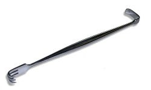
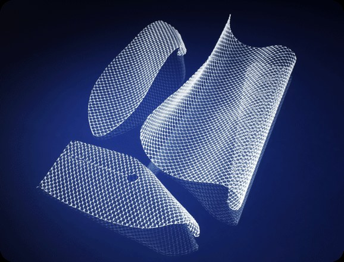
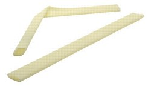

จงบอกชื่อ
จงบอกตัวอย่างการใช้งานมา 1 อย่าง

**Station type:** instrument identification
**Checklist:** not given in the source
**Explanation:** not stated
**Guideline / source:** not stated

## Q8 (original no. 8)
ผู้ป่วยมาด้วยอาการปวดก้นซ้ายมานาน 6 เดือน

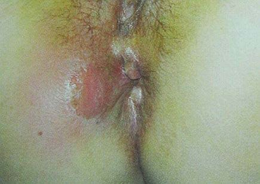

จงให้การวินิจฉัย
จงเขียนแนวทางการรักษา

**Station type:** picture diagnosis and management
**Checklist:** not given in the source
**Explanation:** not stated
**Guideline / source:** not stated

## Q9 (original no. 9)
(วางอุปกรณ์ไว้ให้)

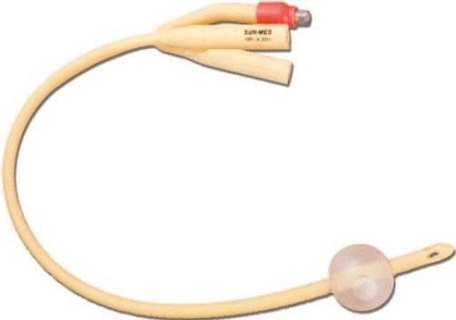

จงบอกชื่ออุปกรณ์ชนิดนี้
จงบอก specific indication ของอุปกรณ์ชิ้นนี้

**Station type:** instrument identification
**Checklist:** the slide writes "Name: 3 way Foley’s catheter" and "Ix: Continuous bladder irrigation" (students' note; not an official key)
**Explanation:** not stated
**Guideline / source:** not stated

## Q10 (original no. 10)
จงอธิบายลักษณะต่อมลูกหมากที่ตรวจได้
จงให้การวินิจฉัยโรคที่เป็นไปได้มากที่สุด
[picture in the paper: a row of prostate models with one marked by a red circle; left out because the circle marks the answer]

**Station type:** examination (rectal examination on a model) and diagnosis
**Checklist:** the slide writes: "Mild enlarged with a hard nodular mass about 1.5 cm in size at lateral, upper pole of right lobe, Asymmetry, Smooth surface" and "Diagnosis : CA prostate" (students' note; not an official key)
**Explanation:** not stated
**Guideline / source:** not stated

## Q11 (original no. 11)
(no stem text in the paper; the slide has only the pictures and the items below)

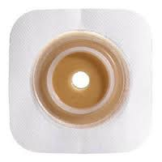
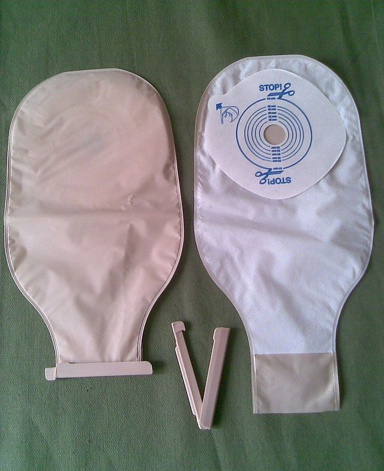

จงบอกชื่ออุปกรณ์
จงบอกภาวะ/โรคที่ต้องใช้อุปกรณ์ชนิดนี้ พร้อมทั้งหัตถการของภาวะ/โรคดังกล่าว

**Station type:** instrument identification
**Checklist:** the slide writes: "A = Ostomy Wafer/Baseplate, B = Ostomy pouch"; "CA left side colon – Hartmann’s procedure"; "CA rectum - APR" (students' note; not an official key)
**Explanation:** not stated
**Guideline / source:** not stated

## Q12 (original no. 12)
(no stem text in the paper; the slide has only the pictures and the items below)

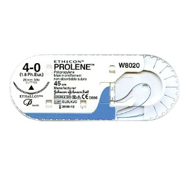
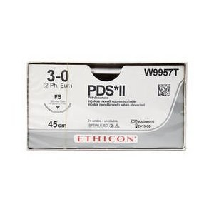
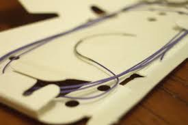

(ปิดชื่อ generic) (ปิดชื่อ generic) (Vicryl แกะซอง)
จงบอกชื่อ generic ของด้ายแต่ละชนิด
จงบรรยายลักษณะของไหมในแง่ของ การผลิต การเรียงตัว และการละลาย
จงบอกการใช้งานของไหมแต่ละชนิด
ไหมในข้อใดสามารถใช้เย็บลำไส้ได้ (ตอบได้มากกว่า 1 ข้อ)

**Station type:** suture identification
**Checklist:** not given in the source
**Explanation:** not stated
**Guideline / source:** not stated

## Q13 (original no. 13)
สมมติว่าท่านล้างมือออกจากห้องผ่าตัดเสร็จแล้ว จงใส่ถุงมือsterlieอย่างถูกต้อง และทำการฉีดยาชาตรงรอบก้อน (มี 2 ก้อน ที่แขนด้านบนด้านล่าง)
อาจารย์ทำหน้าที่เป็นผู้ช่วยเท่านั้น
ควรบรรยายตลอดการทำหัตถการ (ใส่ถุงมือ ดูดยาชา ทำความสะอาดแผล ปูผ้า ฉีดยา)
อย่าลืมแนะนำตัวและเตือนผู้ป่วยด้วยว่าจะทำหัตถการ

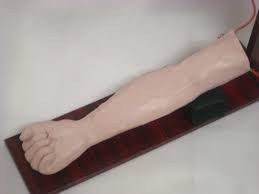

**Station type:** sterile gloving and local anaesthetic injection
**Checklist:** not given in the source
**Explanation:** not stated
**Guideline / source:** not stated

## Flagged for checking
- No official answer key or checklist exists for this paper in the files supplied; the slides' own answers are marked as the students' notes.
- Q4-Q6 refer to films that are not in the paper.
- exam_year 2014 is inferred.
