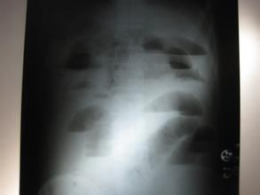
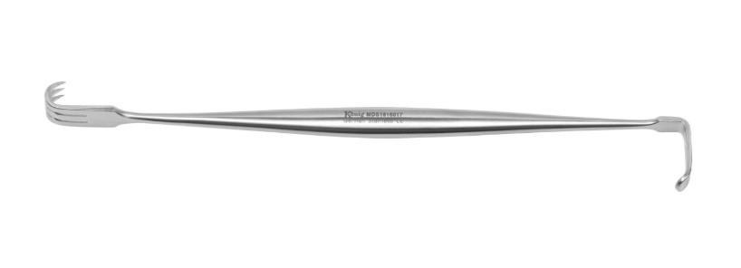
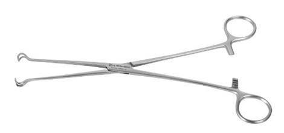
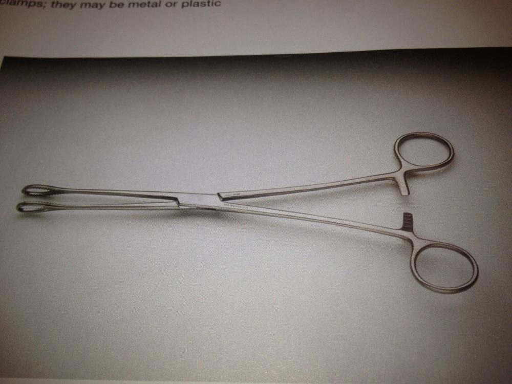
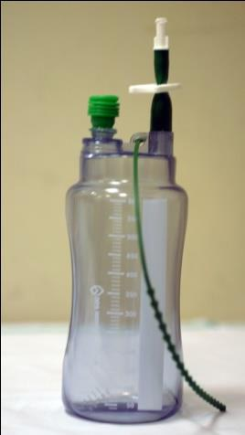
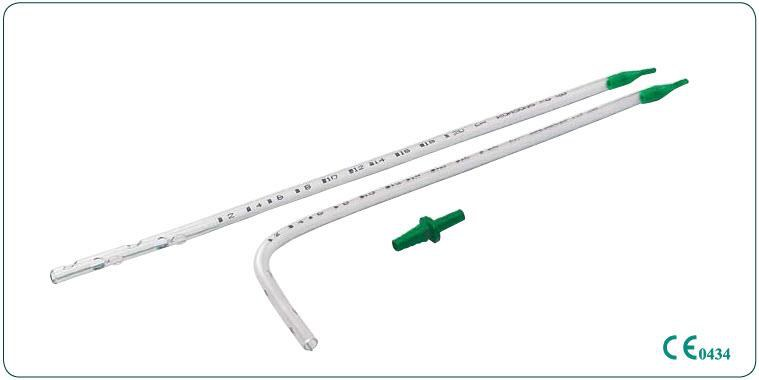
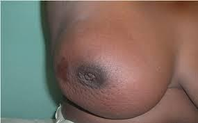
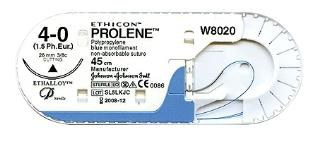

Source: file "Sx (OSCE)", pages 43-57, the section "MDCU67 R2" (slides "OSCE 1" to "OSCE 13" followed by an answer guide headed "แนวคำตอบ"), stations recalled by students, mixed Thai and English. The paper was sat at the end of the whole surgery rotation, so it combines General Surgery and subspecialty content and is filed whole; it is a low-priority set (see CLAUDE.md). The MCQ part of this rotation is in `bank-mdcu67-subspe-r2-mcq`. This extraction was made without comparing the questions with the per-cohort exam files, as the owner asked. It is a bank file, so it is not tagged into the exam topic map.
Numbers Q1-Q13 are the paper's own. The answer guide gives short answers for OSCE 2-10 (the stations that have no entry have none); they are put in the Checklist line and are written by the students, NOT an official key. The films mentioned in Q4-Q5 are not in the paper.
Pictures with no name, label or ID band are kept in images/ under their station. The ultrasound picture of Q8 is left out because its labels give the answer, and two of the three suture pictures of Q13 carry a website watermark and are left out.
exam_year 2014 follows the MCQ part of the same rotation ("Rotate 2/2557", academic year 2557 = 2014-15); the calendar year is inferred.
The rotation number (2) is not mapped to a G.

## Q1 (original no. 1)
เย็บ Vertical mattress 1 stitch และผูกด้วย two hand technique
- ร้อยเข็มมาให้เย็บกับเบาะเหลือง, ใช้เชือกเขียวแดงผูกยางเส้นสีเหลือง

**Station type:** suturing and knot tying
**Checklist:** not given in the source
**Explanation:** not stated
**Guideline / source:** not stated

## Q2 (original no. 2)
จงซักประวัติผู้ป่วยหญิงอายุ 50ปี อาเจียนเป็นเลือดมา 1 ชั่วโมงก่อนมารพ.

**Station type:** history taking
**Checklist:** history points: amount and character of the blood, any froth; after vomiting blood, any dizziness, fainting, palpitations; before this any abdominal pain, any history of bloody stool, black tarry stool; medication history, ask about aspirin; do not forget to ask about systemic bleeding (the answer guide at the end of the section (written by the students); not an official key)
**Explanation:** not stated
**Guideline / source:** not stated

## Q3 (original no. 3)
ตรวจร่างกายผู้ป่วยหญิงมีไข้,ปวดท้องขวาบน มา 2 วันก่อนมารพ. และให้การวินิจฉัย

**Station type:** examination (abdomen) and diagnosis
**Checklist:** inspect, auscultate, palpate and percuss completely, with Murphy’s sign and the eyes; diagnosis: acute cholecystitis (the answer guide at the end of the section (written by the students); not an official key)
**Explanation:** not stated
**Guideline / source:** not stated

## Q4 (original no. 4)
Mammogram
1) ภาพต่อไปนี้เกิดจากวิธีอะไร
2) ท่าที่ถ่ายคือท่าอะไร
3) จงบรรยายความผิดปกติที่เห็น
4) provisional diagnosis
5) จงส่งเพื่อการวินิจฉัยเพิ่มเติม (the films are not included in the paper)

**Station type:** imaging interpretation (mammogram)
**Checklist:** CA breast: upper outer of left breast (the answer guide at the end of the section (written by the students); not an official key)
**Explanation:** not stated
**Guideline / source:** not stated

## Q5 (original no. 5)
IVP
1) บรรยายความผิดปกติที่เห็น
2) ให้การวินิจฉัย
3) ให้การรักษา
มีที่เสียบฟิล์ม 2 อัน กับฟิล์ม IVP ทั้งหมด (the films are not included in the paper)

**Station type:** imaging interpretation (IVP)
**Checklist:** staghorn stone at right renal pelvis with right hydronephrosis and right hydroureter and residual urine (the answer guide at the end of the section (written by the students); not an official key)
**Explanation:** not stated
**Guideline / source:** not stated

## Q6 (original no. 6)
Acute abdomen series
1) ชื่อฟิล์มอะไร ประกอบด้วยท่าอะไรบ้าง
2) จงบรรยายความผิดปกติที่พบ
3) ให้การวินิจฉัย
4) ให้การรักษา

**Station type:** imaging interpretation (acute abdomen series)
**Checklist:** acute abdomen series: CXR, abdomen supine and upright; generalized small bowel dilatation (seen by valvulae conniventes), air-fluid levels at different heights in the same loop, no air in the rectum; small bowel obstruction; IV fluid, NG tube, Foley, and treat the cause that comes to mind (the answer guide at the end of the section (written by the students); not an official key)
**Explanation:** not stated
**Guideline / source:** not stated

## Q7 (original no. 7)
รูปอุปกรณ์ บอกชื่อพร้อมการใช้งาน

**Station type:** instrument identification
**Checklist:** Senn retractor, sponge-holding forceps, Babcock forceps (the answer guide at the end of the section (written by the students); not an official key)
**Explanation:** not stated
**Guideline / source:** not stated

## Q8 (original no. 8)
ผู้ป่วยหญิงไทยอายุ 40 ปี มีอาการปวดท้องบริเวณลิ้นปี่เป็นๆหายๆ เป็นมากหลังทานอาหาร เป็นมา1 เดือนก่อนมารพ.
[picture in the paper: an ultrasound image of the right upper abdomen with the gallbladder and a stone labelled and an arrow; left out because its labels give the answer]
1) investigation ชนิดนี้เรียกว่าอะไร
2) จงบรรยายลักษณะที่พบ
3) Provisional diagnosis
4) Treatment

**Station type:** imaging interpretation (ultrasound)
**Checklist:** transabdominal ultrasound; symptomatic gallstone; elective LC (the answer guide at the end of the section (written by the students); not an official key)
**Explanation:** not stated
**Guideline / source:** not stated

## Q9 (original no. 9)
จงบอกชื่ออุปกรณ์ต่อไปนี้พร้อมข้อบ่งชี้ในการใช้

**Station type:** instrument identification
**Checklist:** Radivac drain, intercostal chest drain (the answer guide at the end of the section (written by the students); not an official key)
**Explanation:** not stated
**Guideline / source:** not stated

## Q10 (original no. 10)
คลำ prostate gland (DRE) ในหุ่น
1) บรรยายลักษณะที่คลำได้
2) ให้การวินิจฉัย

**Station type:** examination (rectal examination on a model) and diagnosis
**Checklist:** enlarged bilaterally prostate gland, symmetry, there is a hard nodule at the upper pole of the right lobe; CA prostate with BPH (the answer guide at the end of the section (written by the students); not an official key)
**Explanation:** not stated
**Guideline / source:** not stated

## Q11 (original no. 11)
รูปbreast ตรวจร่างกายอื่นๆพบ supraclavicular nodes negative, axillary node movable hard oval 2 nodes ตรวจร่างกายอย่างอื่นปกติ

1) จงบรรยายสิ่งผิดปกติที่สังเกตเห็น
2) จงบอกระยะทางclinic (clinical staging)
3) Management

**Station type:** picture description, staging and management
**Checklist:** not given in the source
**Explanation:** not stated
**Guideline / source:** not stated

## Q12 (original no. 12)
แสดงวิธีการเช็ดมือพร้อมใส่ถุงมือแบบ open แบบ sterile

**Station type:** hand drying and sterile gloving
**Checklist:** not given in the source
**Explanation:** not stated
**Guideline / source:** not stated

## Q13 (original no. 13)
ไหม 3 ชนิดวางไว้ ใส่ซอง-ไม่ใส่ซอง ตามรูป
[pictures in the paper: three suture pictures; two of them carry a website watermark and are left out]

1) บอกชื่อสามัญ
2) natural/synthetic, absorbable/non-absorbable, monofilament/multifilament
3) ยกตัวอย่างการใช้งาน

**Station type:** suture identification
**Checklist:** not given in the source
**Explanation:** not stated
**Guideline / source:** not stated

## Flagged for checking
- The answer guide is written by students, not an official key.
- Q4 and Q5 refer to films that are not in the paper.
- exam_year 2014 is inferred.
