Source: file "Sx (OSCE)", pages 58-72, the section "MDCU67 R3" (slides "OSCE1" to "OSCE13"), stations recalled by students, mixed Thai and English. The paper was sat at the end of the whole surgery rotation, so it combines General Surgery and subspecialty content and is filed whole; it is a low-priority set (see CLAUDE.md). The MCQ part of this rotation is in `bank-mdcu67-subspe-r3-mcq`. This extraction was made without comparing the questions with the per-cohort exam files, as the owner asked. It is a bank file, so it is not tagged into the exam topic map.
Numbers Q1-Q13 are the paper's own. No answer key or checklist is given, so every checklist is "not given in the source".
Pictures with no name, label or ID band are kept in images/ under their station. The mammogram of Q4 is left out because the image carries printed examination details; the caption printed under the Q5 film (which states the finding) is cropped out; one of the three suture pictures of Q12 carries a website watermark and is left out.
exam_year 2014 follows the MCQ part of the same rotation ("R3/2557", academic year 2557 = 2014-15); the calendar year is inferred.
The rotation number (3) is not mapped to a G.

## Q1 (original no. 1)
1.1. เย็บ vertical mattress 1 stitch และผูกด้วยเครื่องมือ
1.2. ผูกด้ายด้วย one-handed technique ให้ยางมาชนกัน

**Station type:** suturing and knot tying
**Checklist:** not given in the source
**Explanation:** not stated
**Guideline / source:** not stated

## Q2 (original no. 2)
จงซักประวัติผู้ป่วยชายที่มาด้วยอาการปวดท้อง 6 เดือน

**Station type:** history taking
**Checklist:** not given in the source
**Explanation:** not stated
**Guideline / source:** not stated

## Q3 (original no. 3)
จงแสดง motor neurological examination of upper and lower extremities พร้อมบอกชื่อ muscle และ nerve root ที่ทำการตรวจ

**Station type:** examination (motor neurological)
**Checklist:** not given in the source
**Explanation:** not stated
**Guideline / source:** not stated

## Q4 (original no. 4)
[picture in the paper: two mammogram views labelled A and B; left out because the image carries printed examination details]
4.1. ชื่อการตรวจ
4.2. ท่าการตรวจ
4.3. บรรยายความผิดปกติที่พบ
4.4. ให้การส่งตรวจเพิ่ม

**Station type:** imaging interpretation (mammogram)
**Checklist:** not given in the source
**Explanation:** not stated
**Guideline / source:** not stated

## Q5 (original no. 5)
(no stem text in the paper; the slide has only the pictures and the items below)

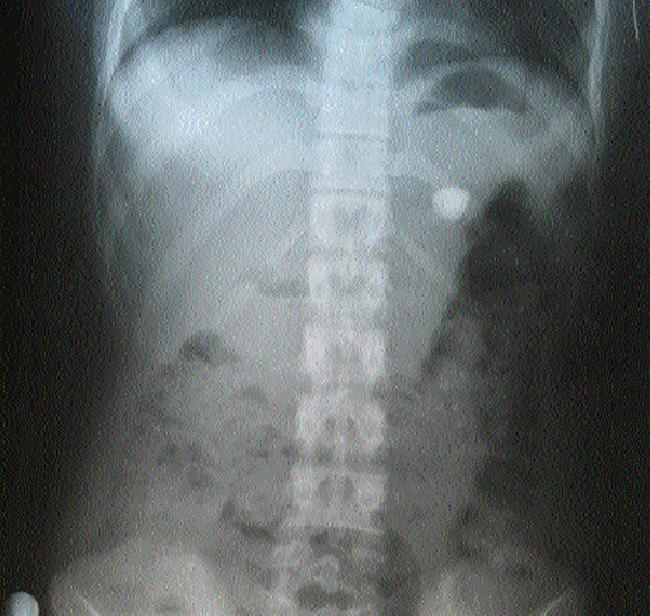

5.1. บรรยายสิ่งที่เห็นจาก IVP
5.2. Diagnosis
5.3. Treatment

**Station type:** imaging interpretation (IVP)
**Checklist:** not given in the source
**Explanation:** not stated
**Guideline / source:** not stated

## Q6 (original no. 6)
(no stem text in the paper; the slide has only the pictures and the items below)

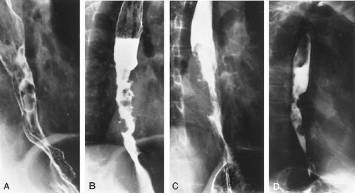

6.1. ชื่อการตรวจ
6.2. บรรยายสิ่งที่เห็น
6.3. Diagnosis
6.4. Treatment

**Station type:** imaging interpretation (barium swallow)
**Checklist:** not given in the source
**Explanation:** not stated
**Guideline / source:** not stated

## Q7 (original no. 7)
(no stem text in the paper; the slide has only the pictures and the items below)

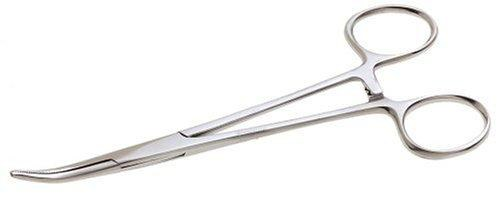
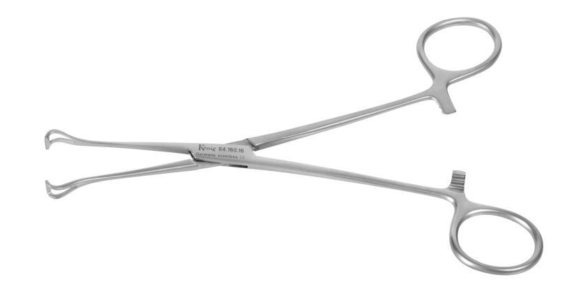
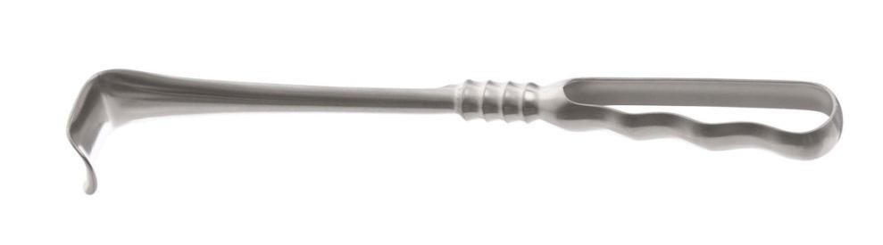

7.1. ชื่อเครื่องมือ
7.2. ตัวอย่างการใช้งาน 1 ตัวอย่าง

**Station type:** instrument identification
**Checklist:** not given in the source
**Explanation:** not stated
**Guideline / source:** not stated

## Q8 (original no. 8)
(no stem text in the paper; the slide has only the pictures and the items below)

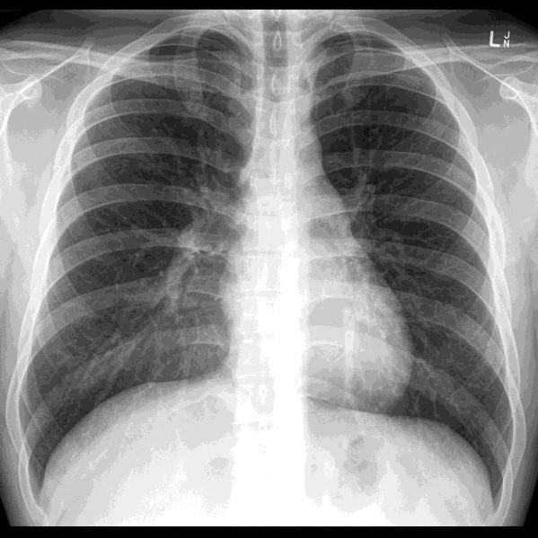
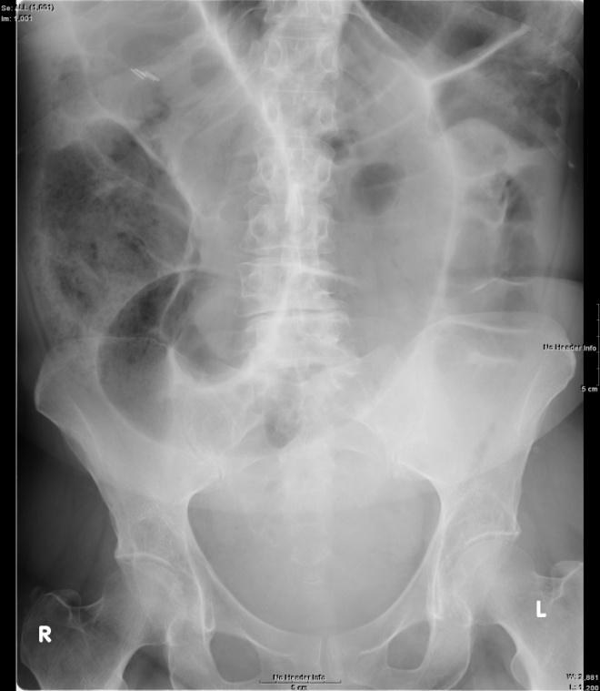
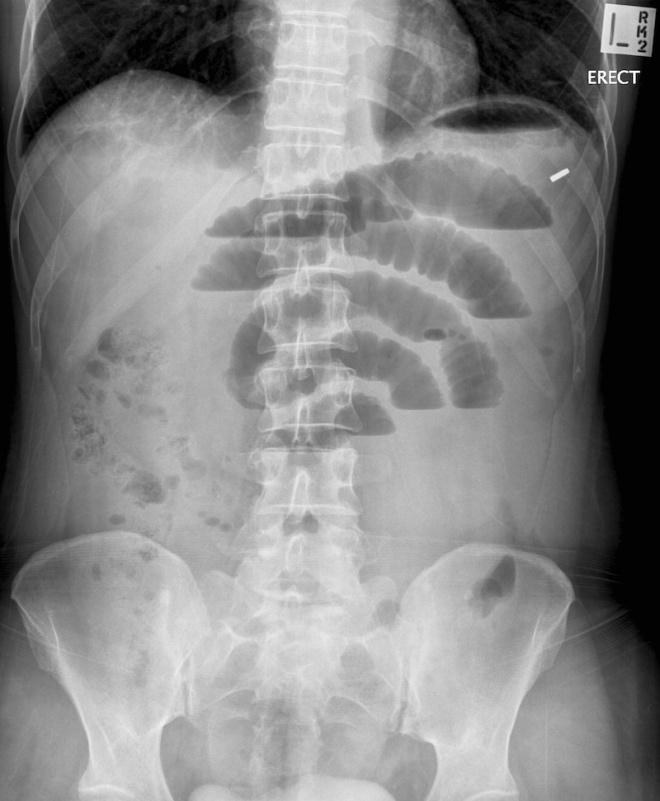

8.1. ชื่อการตรวจ
8.2. ชื่อฟิล์ม
8.3. บรรยายสิ่งที่เห็น
8.4. Diagnosis

**Station type:** imaging interpretation (acute abdomen series)
**Checklist:** not given in the source
**Explanation:** not stated
**Guideline / source:** not stated

## Q9 (original no. 9)
(no stem text in the paper; the slide has only the pictures and the items below)

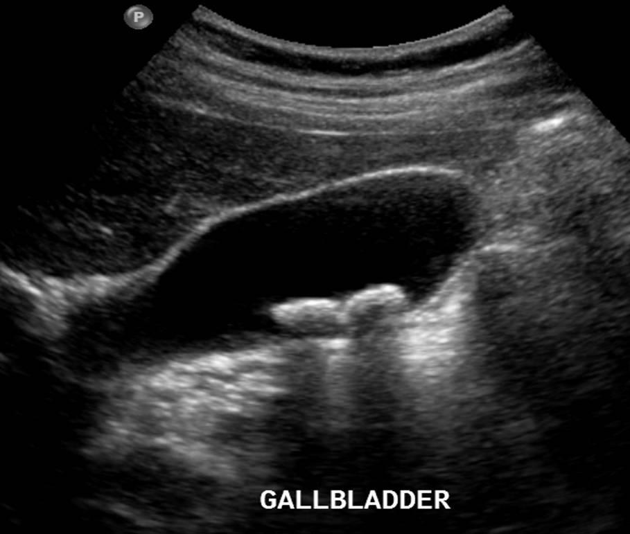

9.1. ชื่อการตรวจ
9.2. บรรยายสิ่งที่เห็น
9.3. Diagnosis
9.4. Treatment

**Station type:** imaging interpretation (ultrasound)
**Checklist:** not given in the source
**Explanation:** not stated
**Guideline / source:** not stated

## Q10 (original no. 10)
(no stem text in the paper; the slide has only the pictures and the items below)

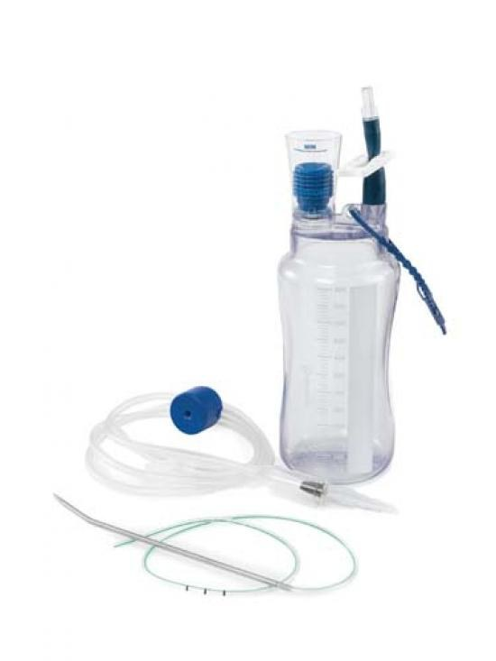
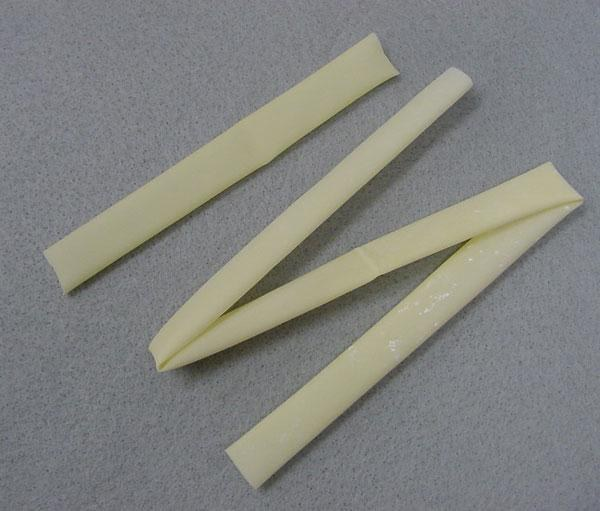
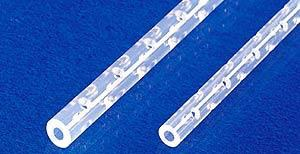

10.1. ชื่ออุปกรณ์
10.2. ตัวอย่างการใช้งาน 1 ตัวอย่าง

**Station type:** instrument identification
**Checklist:** not given in the source
**Explanation:** not stated
**Guideline / source:** not stated

## Q11 (original no. 11)
(no stem text in the paper; the slide has only the pictures and the items below)

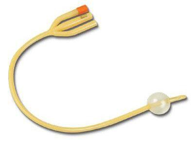

11.1. ชื่ออุปกรณ์
11.2. Specific indication

**Station type:** instrument identification
**Checklist:** not given in the source
**Explanation:** not stated
**Guideline / source:** not stated

## Q12 (original no. 12)
(no stem text in the paper; the slide has only the pictures and the items below)

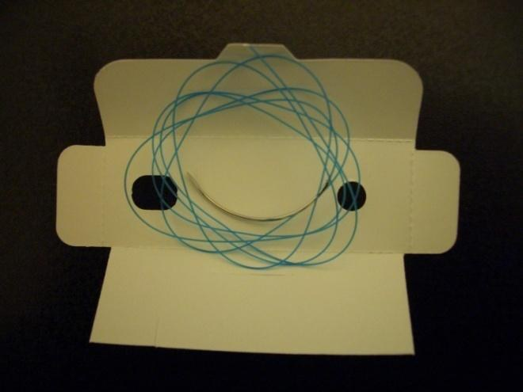
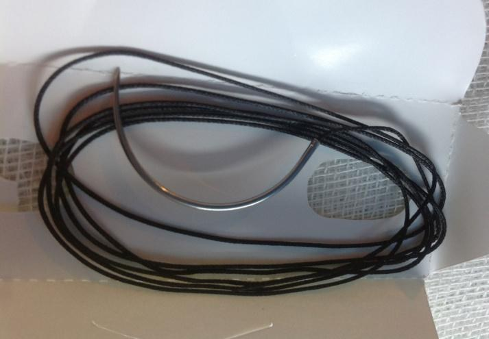
[picture B in the paper carries a website watermark and is left out; the images are listed as A and C]

12.1. Generic name
12.2. การผลิต การเรียงตัว การละลาย
12.3. ยกตัวอย่างการใช้งาน 1 ตัวอย่าง
12.4. ไหมในข้อใดใช้เย็บปิดแผลที่ skin ได้

**Station type:** suture identification
**Checklist:** not given in the source
**Explanation:** not stated
**Guideline / source:** not stated

## Q13 (original no. 13)
จงแสดงวิธีการทำแผลและการใส่ถุงมือด้วยวิธี sterile technique

**Station type:** wound dressing and sterile gloving
**Checklist:** not given in the source
**Explanation:** not stated
**Guideline / source:** not stated

## Flagged for checking
- No answer key or checklist exists for this paper in the files supplied.
- exam_year 2014 is inferred.
