Source: file "Sx (OSCE)", pages 73-85, the section "MDCU67 R4" (slides numbered 1 to 12), stations recalled by students, mixed Thai and English. The paper was sat at the end of the whole surgery rotation, so it combines General Surgery and subspecialty content and is filed whole; it is a low-priority set (see CLAUDE.md). The MCQ part of this rotation is in `bank-mdcu67-subspe-r4-mcq`. This extraction was made without comparing the questions with the per-cohort exam files, as the owner asked. It is a bank file, so it is not tagged into the exam topic map.
Numbers Q1-Q12 are the paper's own. Some slides carry a short note under the picture (for example the diagnosis or the instrument names); it is put in the Checklist line as "the slide's own note" and is written by the students, NOT an official key. Stations without a note have a checklist "not given in the source".
Pictures with no name, label or ID band are kept in images/ under their station; the credit banner on the Q6 film is cropped out. The drawings of Q10 and Q11 are left out (a publication credit; labels that give the diagnosis).
exam_year 2014 follows the MCQ part of the same rotation ("4/2557", academic year 2557 = 2014-15); the calendar year is inferred.
The rotation number (4) is not mapped to a G.

## Q1 (original no. 1)
1.1 เย็บ simple mattress 2 ปม ผูกด้วย instrument technique
1.2 แสดงวิธีตัดไหมอย่างถูกต้อง

**Station type:** suturing and knot tying
**Checklist:** not given in the source
**Explanation:** not stated
**Guideline / source:** not stated

## Q2 (original no. 2)
ผู้หญิงมาด้วยอาการปวดท้อง 5 ชั่วโมงก่อนมาโรงพยาบาล
จงซักประวัติเพิ่มเติม (ไม่ต้องวินิจฉัย)

**Station type:** history taking
**Checklist:** the slide's own note under the picture: "acute appendicitis" (students' note; not an official key)
**Explanation:** not stated
**Guideline / source:** not stated

## Q3 (original no. 3)
แสดงการตรวจเต้านมผู้ป่วยที่มาด้วยอาการเจ็บเต้านม ตรวจเหมือนคนไข้จริงๆเลยนะจ๊ะ
(the slide's note: อย่าลืมขออนุญาต และบอก ให้มีพยาบาลมาอยู่ด้วย)

**Station type:** examination (breast)
**Checklist:** not given in the source
**Explanation:** not stated
**Guideline / source:** not stated

## Q4 (original no. 4)
ฟิลม์ IVP จ้า
4.1 จงบรรยายฟิล์ม IVP
4.2 จง diagnosis
4.3 จงบอกวิธี treatment

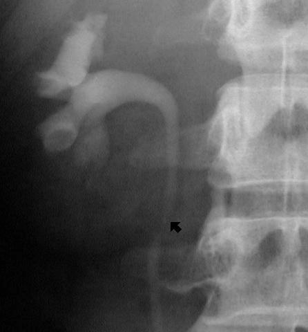

**Station type:** imaging interpretation (IVP)
**Checklist:** the slide's own note under the picture: "Right hydronephrosis with right renal stone" (students' note; not an official key)
**Explanation:** not stated
**Guideline / source:** not stated

## Q5 (original no. 5)
5.1 ฟิล์มที่เห็นเรียกว่าฟิล์มอะไร ท่าอะไรบ้าง A B C
5.2 บรรยายลักษณะผิดปกติ และให้การวินิจฉัย
5.3 บอกการรักษาเบื้องต้น

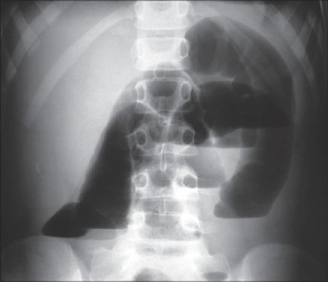

**Station type:** imaging interpretation (acute abdomen series)
**Checklist:** the slide's own note under the picture: "acute abdomen small bowel obstruct" (students' note; not an official key)
**Explanation:** not stated
**Guideline / source:** not stated

## Q6 (original no. 6)
6.1 ฟิล์มที่เห็นเรียกว่าอะไร
6.2 บอก diagnosis
6.3 จงบอกว่าจะ counseling ผู้ป่วยยังไงบ้าง

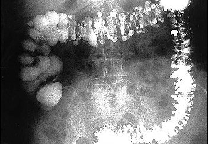

**Station type:** imaging interpretation (barium enema) and counselling
**Checklist:** the slide's own note under the picture: "multiple diverticulosis" (students' note; not an official key)
**Explanation:** not stated
**Guideline / source:** not stated

## Q7 (original no. 7)
7.1 จงบอกชื่ออุปกรณ์ต่างๆ
7.2 บอกว่าเอาไปใช้ทำไรได้

A 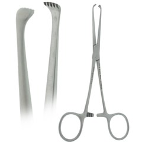
B 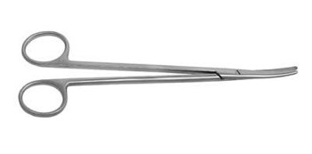
C 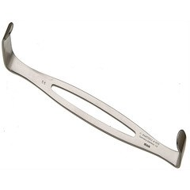

**Station type:** instrument identification
**Checklist:** the slide's own note under the picture: "A - allis tissue forceps; B - curved metzenbaum scissors; C - army navy retractor" (students' note; not an official key)
**Explanation:** not stated
**Guideline / source:** not stated

## Q8 (original no. 8)
8.1 จงบอกชื่ออุปกรณ์ต่างๆ
8.2 บอกว่าเอาไปใช้ทำไรได้

A 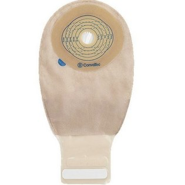
B 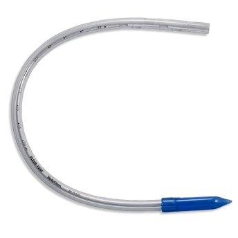

**Station type:** instrument identification
**Checklist:** the slide's own note under the picture: "A - ostomy bag; B - chest tube" (students' note; not an official key)
**Explanation:** not stated
**Guideline / source:** not stated

## Q9 (original no. 9)
9.1 จงบอกชื่อสามัญ
9.2 จงบอกคุณสมบัติคือ
- natural หรือ synthetic
- monofilament หรือ polyfilament
- absorbable หรือ non-absorbable
9.3 จงบอกที่ใช้

A 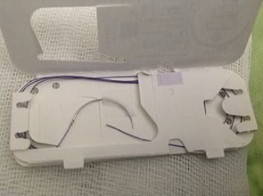
B 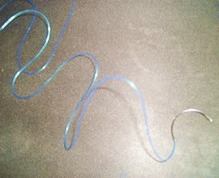
C 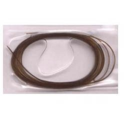

**Station type:** suture identification
**Checklist:** the slide's own note under the picture: "A - vicryl; B - nylon; C - chromic catgut"; the slide adds that the rest is to be opened by the student (ที่เหลือเปิดเองนะ 55) (students' note; not an official key)
**Explanation:** not stated
**Guideline / source:** not stated

## Q10 (original no. 10)
จงแสดงวิธีการใส่ NG tube อย่างถูกต้อง เหมือนคนไข้จริง
[picture in the paper: a line drawing of measuring a nasogastric tube on an infant, with a publication credit; left out]

**Station type:** nasogastric tube insertion
**Checklist:** not given in the source
**Explanation:** not stated
**Guideline / source:** not stated

## Q11 (original no. 11)
ผู้ป่วยชายไทยอายุ 65 ปี มาด้วยอาการปัสสาวะลำบาก ปัสสาวะไม่สุด ปัสสาวะบ่อย
มีหุ่น Prostate มาให้คลำ
11.1 จงบรรยายลักษณะก้อน
11.2 จง ให้การวินิจฉัย
11.3 จงบอกวิธีการรักษา
[picture in the paper: a drawing of a normal and an enlarged prostate with their labels; left out because its labels give the diagnosis]

**Station type:** examination (rectal examination on a model) and diagnosis
**Checklist:** not given in the source
**Explanation:** not stated
**Guideline / source:** not stated

## Q12 (original no. 12)
ผู้ป่วยชายอายุ 54 ปี มาด้วยมีก้อนที่แขนขวามา 3 เดือน ตรวจร่างกายพบ 1 cm circumscribed mass at right forearm rubbery consistency, not fixed to skin or bone, not tender
12.1 จง ให้การวินิจฉัย
12.2 จงบอกแนวทางการรักษา
12.3 จงบอก incision ที่จะทำ ( ให้ขีดลงไปในรูป)

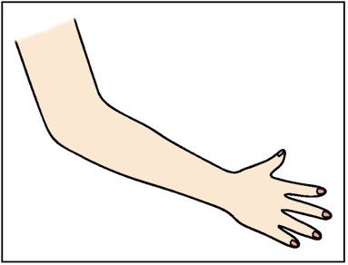

**Station type:** diagnosis, management and incision planning
**Checklist:** not given in the source
**Explanation:** not stated
**Guideline / source:** not stated

## Flagged for checking
- No official answer key exists for this paper; the slides' own notes are the students'.
- exam_year 2014 is inferred.
