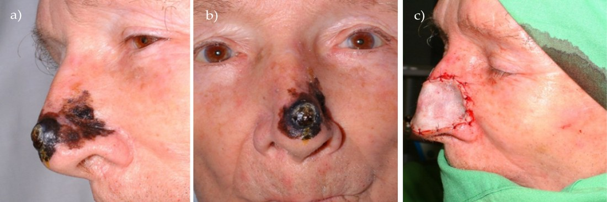
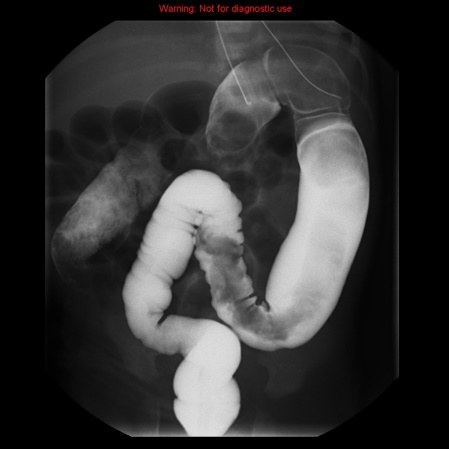
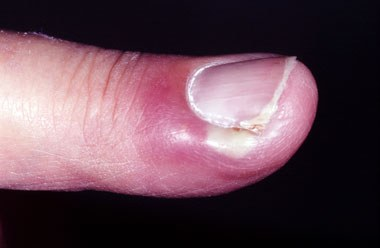

Source: file "Sx (Subspecialties) แอคเปล่า รวม 71-72", pages 67-68, the MEQ part of the section "MDCU68 R2", questions recalled by students, mixed Thai and English. The paper was sat at the end of the whole surgery rotation, so it combines General Surgery and subspecialty content and is filed whole; it is a low-priority set (see CLAUDE.md). The MCQ part is in `bank-mdcu68-subspe-r2-mcq` and the OSCE part in `bank-mdcu68-sx-r2-osce`. This extraction was made without comparing the questions with the per-cohort exam files, as the owner asked. It is a bank file, so it is not tagged into the exam topic map.
Numbers Q1-Q10 are the paper's own. No answer key is given, so every answer is "not given in the source"; guesses written inside the stems (for example "คิดว่าเป็น basal cell CA" in Q1, "คิดว่าเป็น melanoma" in Q3, "(paronychia)" in Q8) are the author's own recall and are not treated as a key.
Pictures with no name, label or ID band are kept in images/ under their question (Q1, Q5, Q8); the others are not in the paper.
exam_year 2015 is inferred from the academic year 2558 of the sibling section "MDCU68 R3".
The rotation number (2) is not mapped to a G.

## Q1 (original no. 1)
รูปไฝที่จมูกสีดำอันใหญ่มาก dx & management ( คิดว่าเป็น basal cell CA)

**Answer:** not given in the source
**Explanation:** not stated
**Guideline / source:** not stated

## Q2 (original no. 2)
จงเขียนขั้นตอน reconstruction (sub.plastic)

**Answer:** not given in the source
**Explanation:** not stated
**Guideline / source:** not stated

## Q3 (original no. 3)
รูปแผลสีดำๆที่นิ้วเท้า ( คิดว่าเป็น melanoma) จงบอกผลการวินิจฉัย และ การรักษา (the picture is not included in the paper)

**Answer:** not given in the source
**Explanation:** not stated
**Guideline / source:** not stated

## Q4 (original no. 4)
จงคำนวณค่า ABI เค้าจะมีตารางค่าต่างๆมากให้อะ ก็ไปท่องสูตรกันซะ

**Answer:** not given in the source
**Explanation:** not stated
**Guideline / source:** not stated

## Q5 (original no. 5)
รูป Hirschprung disease ให้ดู 2 film อันนึงเป็น AP อีกอันเป็น lateral รูปจริงดูค่อนข้างยาก ไม่ชัดเลยอะ ให้dx.

**Answer:** not given in the source
**Explanation:** not stated
**Guideline / source:** not stated

## Q6 (original no. 6)
จงอธิบาย ureteric colic

**Answer:** not given in the source
**Explanation:** not stated
**Guideline / source:** not stated

## Q7 (original no. 7)
indication for thyroidectomy

**Answer:** not given in the source
**Explanation:** not stated
**Guideline / source:** not stated

## Q8 (original no. 8)
จงบอกผลวินิจฉัย สาเหตุและการดูแลรักษา (paronychia)

**Answer:** not given in the source
**Explanation:** the paper writes "(paronychia)" beside the question; it is the author's own note and is not treated as a key
**Guideline / source:** not stated

## Q9 (original no. 9)
จงบอกการตรวจระบบประสาทตาม dermatome C5 C6 C7 C8 T1 ...ว่าตรวจกล้ามเนื้อส่วนใด
(ข้อนี้ก้ตามแอคปีก่อนๆเลย เช่น C5 ตรวจ biceps)

**Answer:** not given in the source
**Explanation:** not stated
**Guideline / source:** not stated

## Q10 (original no. 10)
เด็กมีอาการคลื่นไส้และปวดท้องกระทันหัน ก่อนหน้านี้ปกติดี ให้ภาพ acute abdomen เห็น double bubble sign จงบอกวิธีการวินิจฉัย และรักษา (the picture is not included in the paper)

**Answer:** not given in the source
**Explanation:** not stated
**Guideline / source:** not stated

## Flagged for checking
- No answer key exists for this paper in the files supplied.
- exam_year 2015 is inferred.
