Source: file "Sx (Subspecialties) แอคเปล่า รวม 71-72", pages 73-75, the MEQ part of the section "MDCU68 R3" (heading "AC Subspecialties Sx Rotate 3/2558"), questions recalled by students, mixed Thai and English, mostly a picture with short items. The paper was sat at the end of the whole surgery rotation, so it combines General Surgery and subspecialty content and is filed whole; it is a low-priority set (see CLAUDE.md). The MCQ part is in `bank-mdcu68-subspe-r3-mcq` and the OSCE part in `bank-mdcu68-sx-r3-osce`. This extraction was made without comparing the questions with the per-cohort exam files, as the owner asked. It is a bank file, so it is not tagged into the exam topic map.
Numbers Q1-Q13 are the paper's own. After Q13 the paper has a list headed "เฉลย" (answers) giving the diagnosis for each picture question; it is written by the students, is NOT an official key, and may be wrong ("-" means no answer is given). It is copied into the Answer lines.
Pictures with no name, label or ID band are kept in images/ under their question.
exam_year 2015 is inferred from the academic year 2558 (2015-16) in the heading.
The rotation number (3) is not mapped to a G.

## Q1 (original no. 1)
ผู้ป่วยมาด้วยอาการปวดนิ้ว มีนิ้วลักษณะนิ้วมือที่ดำขึ้น

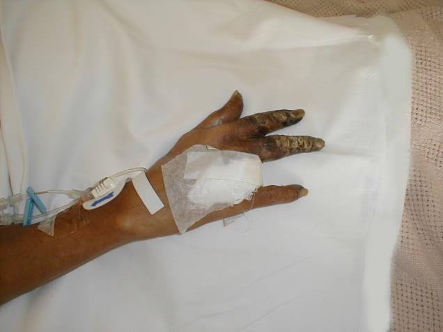

1.1 Diagnosis
1.2 Treatment

**Answer:** 1: Chronic arterial occlusion (มั้ง, the author is unsure) (from the paper's own "เฉลย" list, written by the students; not an official key)
**Explanation:** not stated
**Guideline / source:** not stated

## Q2 (original no. 2)
(no stem text in the paper; the question has only the picture and the items below)

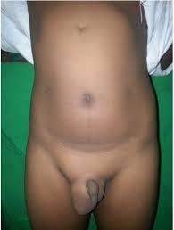

2.1 Diagnosis
2.2 Treatment

**Answer:** 2: Rt. indirect inguinal hernia (from the paper's own "เฉลย" list, written by the students; not an official key)
**Explanation:** not stated
**Guideline / source:** not stated

## Q3 (original no. 3)
(no stem text in the paper; the question has only the picture and the items below)

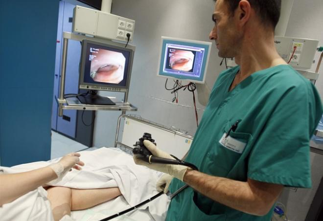

3.1 การตรวจชื่ออะไร
3.2 จงบอก indication ของการตรวจนี้ 4 ข้อ

**Answer:** 3: Colonoscopy (from the paper's own "เฉลย" list, written by the students; not an official key)
**Explanation:** not stated
**Guideline / source:** not stated

## Q4 (original no. 4)
(no stem text in the paper; the question has only the picture and the items below)

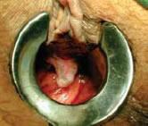

4.1 จงบรรยายลักษณะ lesion
4.2 Diagnosis
4.3 Treatment

**Answer:** 4: Chronic anal fissure (from the paper's own "เฉลย" list, written by the students; not an official key)
**Explanation:** not stated
**Guideline / source:** not stated

## Q5 (original no. 5)
โดนตีหัว สลบไป 5 min บอกอาการ
5.1 ถาม GCS
5.2 neuro sign ที่น่าจะพบ

**Answer:** 5: - (from the paper's own "เฉลย" list, written by the students; not an official key)
**Explanation:** not stated
**Guideline / source:** not stated

## Q6 (original no. 6)
ผู้ป่วยมาด้วยก้อนที่แขนดังภาพ เป็นมานาน 3 เดือน ขณะนี้ ปวด บวม แดง ร้อน มา 3 วัน

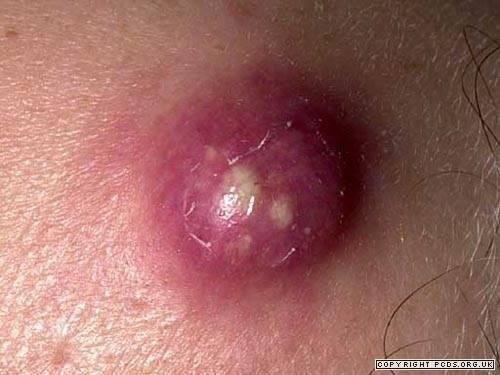

6.1 Diagnosis
6.2 Management

**Answer:** 6: Furuncle (from the paper's own "เฉลย" list, written by the students; not an official key)
**Explanation:** not stated
**Guideline / source:** not stated

## Q7 (original no. 7)
(no stem text in the paper; the question has only the picture and the items below)

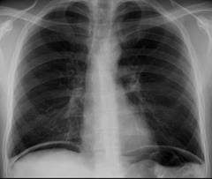

7.1 จงบรรยาย CXR
7.2 Differential diagnosis 2 โรค
7.3 Treatment

**Answer:** 7: Free air under diaphragm (from the paper's own "เฉลย" list, written by the students; not an official key)
**Explanation:** not stated
**Guideline / source:** not stated

## Q8 (original no. 8)
(no stem text in the paper; the question has only the picture and the items below)

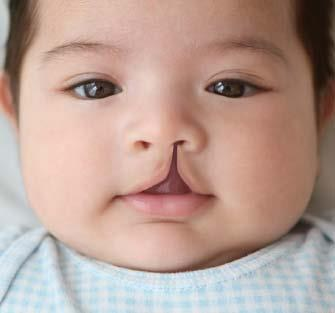

8.1 Diagnosis
8.2 จงบอกอายุที่เหมาะสมที่จะผ่าตัดแก้ไข พร้อมเหตุผล

**Answer:** 8: Left complete cleft lip (from the paper's own "เฉลย" list, written by the students; not an official key)
**Explanation:** not stated
**Guideline / source:** not stated

## Q9 (original no. 9)
(no stem text in the paper; the question has only the picture and the items below)

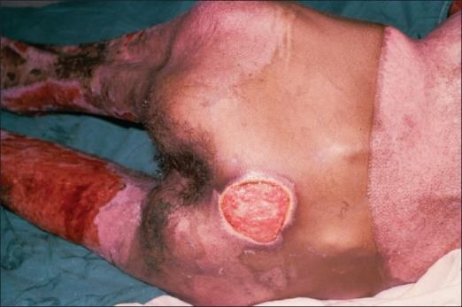

9.1 ถามว่าผู้ป่วยอยู่ในท่าใดถึงเกิด lesion นี้
9.2 โดนกระดูกอะไร

**Answer:** 9: Pressure sore (from the paper's own "เฉลย" list, written by the students; not an official key)
**Explanation:** not stated
**Guideline / source:** not stated

## Q10 (original no. 10)
Newborn with imperforated anus

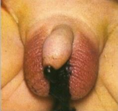

10.1 Diagnosis
11.1 Management (the paper numbers this item 11.1)

**Answer:** 10: Rectourethral fistula (from the paper's own "เฉลย" list, written by the students; not an official key)
**Explanation:** not stated
**Guideline / source:** not stated

## Q11 (original no. 11)
(no stem text in the paper; the question has only the picture and the items below)

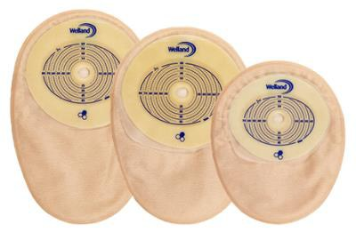

11.1 อุปกรณ์นี้ชื่ออะไร
11.2 จงบอกชื่อโรคที่ใช้อุปกรณ์นี้ พร้อมชื่อการผ่าตัดมา 2 อย่าง

**Answer:** 11: Colostomy bag (from the paper's own "เฉลย" list, written by the students; not an official key)
**Explanation:** not stated
**Guideline / source:** not stated

## Q12 (original no. 12)
ให้รูปแผล burn ถามว่า
12.1 แผลลึกระดับไหน
12.2 ดูแลแผลยังไง

**Answer:** 12: - (from the paper's own "เฉลย" list, written by the students; not an official key)
**Explanation:** not stated
**Guideline / source:** not stated

## Q13 (original no. 13)
(no stem text in the paper; the question has only the picture and the items below)

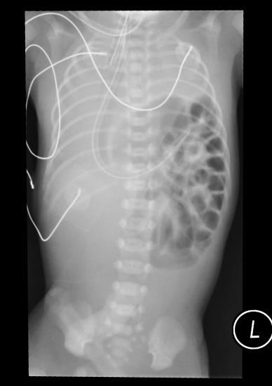

13.1 Diagnosis
13.2 Management

**Answer:** 13: Congenital diaphragmatic hernia (from the paper's own "เฉลย" list, written by the students; not an official key)
**Explanation:** not stated
**Guideline / source:** not stated

## Flagged for checking
- The "เฉลย" list is written by students, not an official key; Q1 is marked uncertain by the author.
- Q5 and Q12 have no answer in the list.
- exam_year 2015 is inferred.
