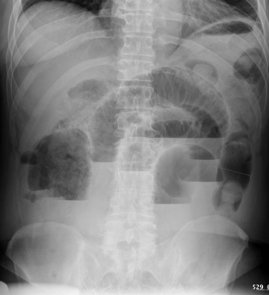
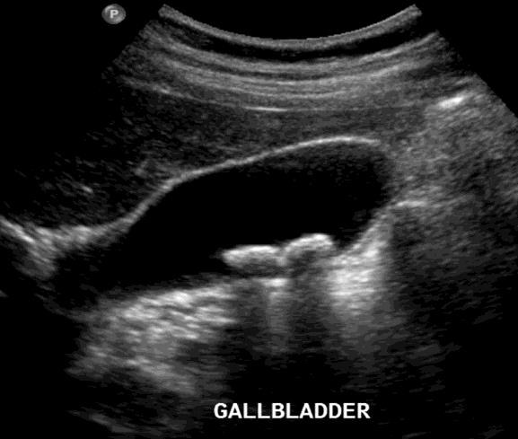
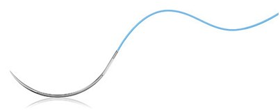
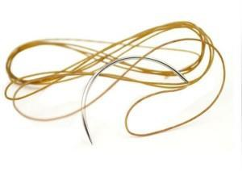
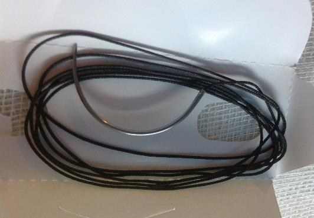
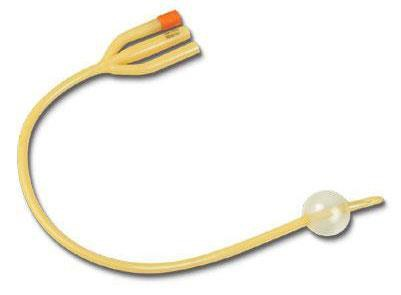

Source: file "Sx (Subspecialties) แอคเปล่า รวม 71-72", pages 76-79, the OSCE part of the section "MDCU68 R3" (heading "AC Subspecialties Sx Rotate 3/2558"), stations recalled by students, mixed Thai and English. The paper was sat at the end of the whole surgery rotation, so it combines General Surgery and subspecialty content and is filed whole; it is a low-priority set (see CLAUDE.md). The MCQ part is in `bank-mdcu68-subspe-r3-mcq` and the MEQ part in `bank-mdcu68-sx-r3-meq`. This extraction was made without comparing the questions with the per-cohort exam files, as the owner asked. It is a bank file, so it is not tagged into the exam topic map.
Numbers Q1-Q12 are the paper's own. Some stations carry the students' notes under "Ans."; they are put in the Checklist line and are NOT an official key. Pages 78-79 are two photographs of the standardised-patient answer sheet for station 2; they are summarised in the Checklist of Q2 and not copied, and the simulated patient's name on the sheet is not kept.
Pictures with no name, label or ID band are kept in images/ under their station. The mammogram and IVP films of Q4 and Q6 are not in the paper.
exam_year 2015 is inferred from the academic year 2558 (2015-16) in the heading.
The rotation number (3) is not mapped to a G.

## Q1 (original no. 1)
จงแสดงการใส่ถุงมือ Sterile และวิธีการฉีดยาชา (ปูผ้าและทำความสะอาดแผลแล้ว)

**Station type:** sterile gloving and local anaesthetic injection
**Checklist:** students' note under "Ans.": the station has a manikin arm and a person pretending to be a patient who will cry out when injected; remember to ask about allergy to the anaesthetic before injecting and tell the person you are going to inject (not an official key)
**Explanation:** not stated
**Guideline / source:** not stated

## Q2 (original no. 2)
ผู้ป่วยหญิง อายุ 22 ปี มาด้วยอาการปวดท้อง 6 ชม. ก่อนมารพ. จงซักประวัติ

**Station type:** history taking
**Checklist:** students' note under "Ans.": pain in the lower abdomen; the paper adds two pasted photographs of the examiner's standardised-patient answer sheet (history of a 22-year-old woman with abdominal pain for 6 hours: pain began around the umbilicus with nausea and one vomit, then moved to the right lower abdomen; no previous episode; no fever answered; appetite lost; no bleeding disorder; no medicines; no operation; no smoking or alcohol; no family cancer); the photographs are not copied
**Explanation:** not stated
**Guideline / source:** not stated

## Q3 (original no. 3)
ผู้ป่วยหญิงมารับการตรวจเต้านม จงแสดงการตรวจเต้านมโดยปฏิบัติกับหุ่นให้เหมือนผู้ป่วยจริง

**Station type:** examination (breast, on a model)
**Checklist:** students' note under "Ans.": before examining, remember to ask permission and introduce yourself, then call the nurse to be present; the model is in the examination room, and you may explain to the examiner while you examine (not an official key)
**Explanation:** not stated
**Guideline / source:** not stated

## Q4 (original no. 4)
ให้รูป Mammogram มา ถาม
4.1 ชื่อการตรวจ มีฟิล์มอะไรบ้าง
4.2 จงบรรยาย lesion
4.3 Diagnosis
4.4 ส่งตรวจอะไรเพิ่มเติม (the films are not included in the paper)

**Station type:** imaging interpretation (mammogram)
**Checklist:** not given in the source
**Explanation:** not stated
**Guideline / source:** not stated

## Q5 (original no. 5)
ให้อุปกรณ์มา 3 อย่าง (Vascular graft, Mesh, Penrose drain) จงบอกชื่ออุปกรณ์ ประโยชน์ และชื่อหัตถการที่ใช้

**Station type:** instrument identification
**Checklist:** not given in the source
**Explanation:** not stated
**Guideline / source:** not stated

## Q6 (original no. 6)
ให้ film IVP มา 8 แผ่น มี hydronephrosis ข้างขวา
6.1 จงอ่านผล IVP
6.2 Diagnosis
6.3 Management (the films are not included in the paper)

**Station type:** imaging interpretation (IVP)
**Checklist:** students' note under "Ans.": there is a stone at the right UVJ (sorry, the picture could not be found) (not an official key)
**Explanation:** not stated
**Guideline / source:** not stated

## Q7 (original no. 7)
ชายอายุ 49 ปีมาด้วยท้องอืด ไม่อุจจาระมา 2 วัน

7.1 ฟิล์มเรียกว่าอะไร ประกอบด้วยฟิล์มอะไรบ้าง
7.2 จงบรรยายลักษณะจากฟิล์ม
7.3 จงวินิจฉัย
7.4 บอกโรคที่เป็นไปได้มากที่สุด

**Station type:** imaging interpretation (acute abdomen series)
**Checklist:** not given in the source
**Explanation:** not stated
**Guideline / source:** not stated

## Q8 (original no. 8)
ให้ใบผล patho นมมา ให้อ่าน TNM staging

**Station type:** pathology report reading and TNM staging
**Checklist:** students' note under "Ans.": the report is very long, about 2 A4 pages, so hurry; look at the summary at the end; the case had 2 nodes with lymph node positive (1/13), and the student was not sure whether there was metastasis (not an official key)
**Explanation:** not stated
**Guideline / source:** not stated

## Q9 (original no. 9)
ผู้ชายปวดท้องหลังกินข้าวเป็นๆหายๆ ทำ U/S พบ

9.1 จงบรรยาย
9.2 Diagnosis (Symptomatic gallstone)
9.3 Treatment

**Station type:** imaging interpretation (ultrasound)
**Checklist:** the paper writes "(Symptomatic gallstone)" beside item 9.2 (written by the students; not an official key)
**Explanation:** not stated
**Guideline / source:** not stated

## Q10 (original no. 10)
วางไหมมา 3 ชนิด

10.1 จงบอกชื่อของไหม
10.2 คุณสมบัติ
10.3 การใช้งาน

**Station type:** suture identification
**Checklist:** not given in the source
**Explanation:** not stated
**Guideline / source:** not stated

## Q11 (original no. 11)
(no stem text in the paper; only the picture and the items below)

11.1 จงบอกชื่ออุปกรณ์ (3 way Foley Catheter)
11.2 Indication

**Station type:** instrument identification
**Checklist:** the paper writes "(3 way Foley Catheter)" beside item 11.1 (written by the students; not an official key)
**Explanation:** not stated
**Guideline / source:** not stated

## Q12 (original no. 12)
ชายไทยอายุ 56 ปี มาด้วยอาการปัสสาวะลำบาก ปัสสาวะไม่สุด ปัสสาวะบ่อย (PR หุ่นจำลอง)
12.1 จงบรรยายลักษณะก้อน
12.2 จงให้การวินิจฉัย
12.3 จงบอกวิธีการรักษา

**Station type:** examination (rectal examination on a model) and diagnosis
**Checklist:** students' note under "Ans.": probably BPH (น่าจะตอบ BPH มั้งนะ) (not an official key)
**Explanation:** not stated
**Guideline / source:** not stated

## Flagged for checking
- No official answer key or checklist exists for this paper in the files supplied; the students' notes are marked as such.
- Q4 and Q6 refer to films that are not in the paper.
- exam_year 2015 is inferred.
