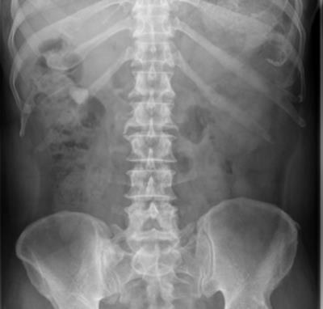
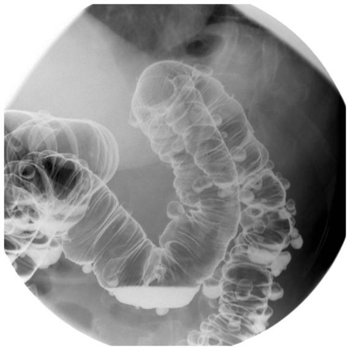
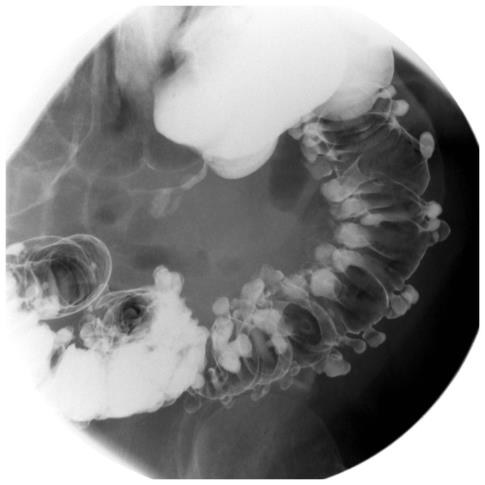
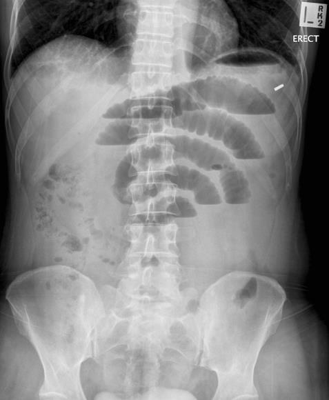
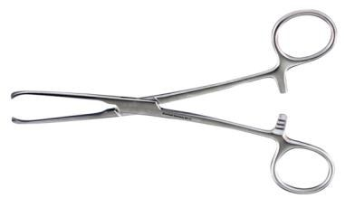
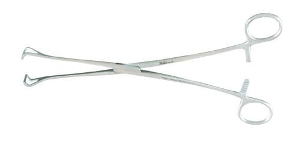
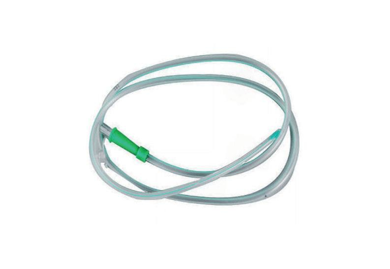
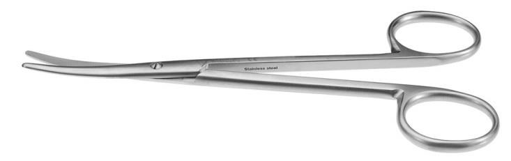

Source: file "Sx (OSCE)", pages 26-28, the section "MDCU68 R4" (heading "AC OSCE Surgery Rotate 4 MDCU 68"), stations recalled by students, mixed Thai and English, with the students' notes. The paper was sat at the end of the whole surgery rotation, so it combines General Surgery and subspecialty content and is filed whole; it is a low-priority set (see CLAUDE.md). The MCQ part of this rotation is in `bank-mdcu68-subspe-r4-mcq`. This extraction was made without comparing the questions with the per-cohort exam files, as the owner asked. It is a bank file, so it is not tagged into the exam topic map.
Numbers are the paper's own: Q1-Q6 and Q8-Q12 (the paper has no Q7). The "Note" lines are the students' own advice and are kept in the stems. No answer key or checklist is given, so every checklist is "not given in the source", except where the students wrote a remark about a picture (Q4); that is marked as the students' note.
Pictures with no name, label or ID band are kept in images/ under their station; the mammogram films of Q6 are not in the paper.
exam_year 2016 is inferred (see the MCQ part, `bank-mdcu68-subspe-r4-mcq`: heading "Rotate 4" in academic year 2558).
The rotation number (4) is not mapped to a G.

## Q1 (original no. 1)
ให้แสดงวิธีการฉีดยาชาก่อนเย็บแผล ทายาฆ่าเชื้อและปูผ้าให้เรียบร้อยแล้วให้เย็บ vertical mattress 1 ปม และผูกด้วยการใช้ instrument
Note : เป็นแขนจำลองมีแผลอยู่ให้พูดอธิบายขั้นตอนไปด้วย อย่าลืมบอกคนไข้ว่าจะเจ็บก่อนปักเข็ม อย่าลืมถามก่อนฉีดว่าเคยแพ้ยาชามั้ย

**Station type:** local anaesthetic injection and suturing
**Checklist:** not given in the source
**Explanation:** not stated
**Guideline / source:** not stated

## Q2 (original no. 2)
คนไข้หญิง มาด้วยคลำได้ก้อนในเต้านมข้างขวา (คนไข้จำลอง) ให้ซักประวัติผู้ป่วย แล้ว present อาจารย์

**Station type:** history taking
**Checklist:** not given in the source
**Explanation:** not stated
**Guideline / source:** not stated

## Q3 (original no. 3)
คนไข้ชายมาด้วยปวดท้องข้างล่างขวา ร้าวไปขาหนีบ (คนไข้จำลองนอนบนเตียง)
3.1 ให้ตรวจร่างกาย ตอนตรวจให้บรรยายไปด้วยว่าตรวจเจออะไรบ้าง
3.2 ตรวจเสร็จแล้วให้ตอบคำถามอาจารย์
Note : - คนนี้มี CVA tenderness + ตรวจท้องไม่เจออะไร
- อาจารย์จะถามว่าจะส่งตรวจอะไรเพิ่มบ้าง จะถามไปเรื่อยๆว่าจะส่งอะไรอีกมั้ย จะตอบเยอะแค่ไหนเค้าก็จะถามไปเรื่อยๆจนหมดเวลา

**Station type:** examination (abdomen) and viva
**Checklist:** not given in the source
**Explanation:** not stated
**Guideline / source:** not stated

## Q4 (original no. 4)
4.1 บรรยายความผิดปกติ
4.2 Give the diagnosis
4.3 Treatment
Note : จะให้ film มาหลายแผ่นมากๆ ต้องดูเร็วๆ
รูปนี้เป็น Rt. Renal canaliculi

**Station type:** imaging interpretation (abdominal film)
**Checklist:** the paper's note says the picture shows "Rt. Renal canaliculi" (students' note; not an official key)
**Explanation:** not stated
**Guideline / source:** not stated

## Q5 (original no. 5)
ผู้หญิงแก่ๆ อาการ gut obstruction มี cardinal signs นิดหน่อย ดู partial obstruction
5.1 การตรวจนี้เรียกว่าเทคนิคอะไร
5.2 บรรยายความผิดปกติที่พบ
5.3 Diagnosis

**Station type:** imaging interpretation (contrast enema)
**Checklist:** not given in the source
**Explanation:** not stated
**Guideline / source:** not stated

## Q6 (original no. 6)
Film มี mass ในนมที่ lower outer left breast
6.1 บอกชื่อการตรวจ, ฟิล์มไหนชื่ออะไรบ้าง
6.2 บรรยาย lesion
6.3 Diagnosis and staging
6.4 บอกการตรวจวินิจฉัยทางรังสีวิทยาที่จะส่งเพิ่มเติม เฉพาะที่ส่งแล้วจะมีประโยชน์ต่อการวินิจฉัยชิ้นเนื้อและบอกระยะของโรค
Note: มี cancer หลายก้อน และมี axillary lymph node หลายก้อน ระวังไม่ทัน (the films are not included in the paper)

**Station type:** imaging interpretation (mammogram) and staging
**Checklist:** not given in the source
**Explanation:** not stated
**Guideline / source:** not stated

## Q8 (original no. 8)
คนใช้หญิง มาด้วยอาการกลืนสิ่งนี้ลงท้อง ท่านเป็นแพทย์ที่ห้องฉุกเฉิน จงเขียนคำสั่งการรักษา

**Station type:** writing treatment orders (ingestion)
**Checklist:** not given in the source
**Explanation:** not stated
**Guideline / source:** not stated

## Q9 (original no. 9)
9.1 Film แบบนี้เรียกว่าอะไร
9.2 บรรยายความผิดปกติ
9.3 Diagnosis and Most common cause

**Station type:** imaging interpretation (acute abdomen)
**Checklist:** not given in the source
**Explanation:** not stated
**Guideline / source:** not stated

## Q10 (original no. 10)
ให้บอกชื่ออุปกรณ์ และตัวอย่างการใช้งานที่จำเพาะมาชิ้นละ 1 อย่าง

**Station type:** instrument identification
**Checklist:** not given in the source
**Explanation:** not stated
**Guideline / source:** not stated

## Q11 (original no. 11)
ให้บอกชื่อสามัญไหม 4 เส้น ผลิตจากวัตถุดิบอะไร (natural/synthetic) เป็นไหม mono/multifilament และบอกตัวอย่างการนำแต่ละเส้นไปใช้อย่างน้อย 1 อย่าง ( Catgut PDS Silk Nylon )

**Station type:** suture identification
**Checklist:** not given in the source
**Explanation:** not stated
**Guideline / source:** not stated

## Q12 (original no. 12)
ผู้ชายมาด้วย LUTS ล้วงตรวจต่อมลูกหมาก บรรยายแค่เรื่องต่อมลูกหมาก เขียนตอบ
( เป็น hard fixed nodular lesion อยู่มุมนึง )

**Station type:** examination (rectal examination, written answer)
**Checklist:** not given in the source
**Explanation:** not stated
**Guideline / source:** not stated

## Flagged for checking
- No answer key or checklist exists for this paper in the files supplied.
- The paper has no Q7; exam_year 2016 is inferred.
