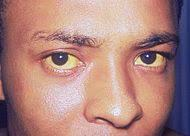
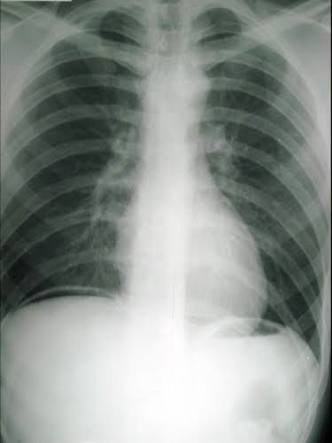
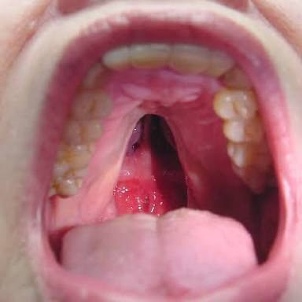
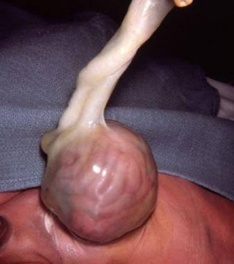
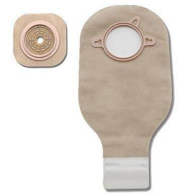
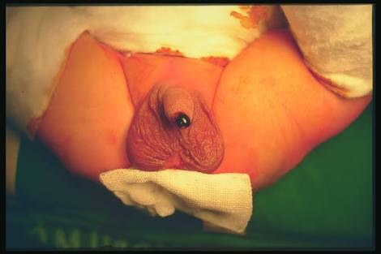
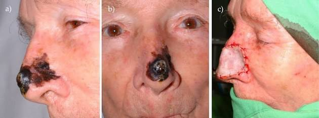
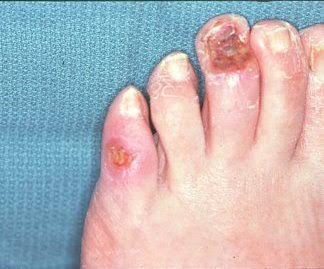
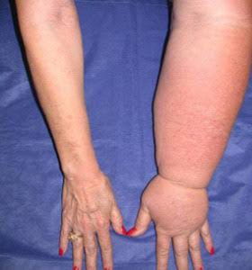
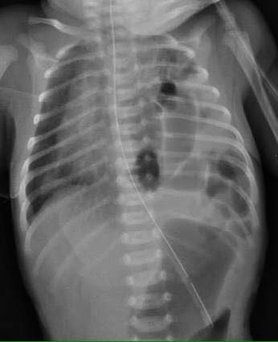

Source: "MEQ ROTATE 1 2016 MDCU 69" (file "AC MEQ Sx Rotate 1 MDCU 69", dated November 2016), questions recalled by students, mixed Thai and English. The paper was sat at the end of the whole surgery rotation, so it combines General Surgery and subspecialty content and is filed whole. It is a low-priority set (see CLAUDE.md). The OSCE part of the same exam is in `mdcu69-gen-1-osce`.
Numbers Q1-Q14 are the paper's own. No answer key was found and the paper gives no answers, so every answer is "not given in the source". Q4, Q7, Q8, Q9 and Q12 are only a picture with items (their stems say so). Q6 has four sub-questions of 1 minute each and no picture ("CT brain" is not shown). Q11 has no picture.
Pictures with no name, label or ID band are kept in images/ under their question. The Q3 picture is a slide whose title gives the diagnosis, so it is left out and described in words.
exam_year 2016 is stated in the paper's title ("ROTATE 1 2016").
The rotation number (1) is not mapped to a G.

## Q1 (original no. 1)
ผู้ป่วยชายอายุ 35 ปี ตัวเหลืองตาเหลืองมา 1 เดือน ไม่ปวดท้อง ไม่มีไข้
PE : mild icteric sclerae
Lab: LFT - total bilirubin 21, direct bilirubin 17, sgot 40, sgpt 45, alp 240

1.1 บอกชนิดของ hyperbilirubin ในผู้ป่วยรายนี้
1.2 ddx 3 โรค

**Answer:** not given in the source
**Explanation:** not stated
**Guideline / source:** not stated

## Q2 (original no. 2)
ผู้ป่วยหญิงปวดท้องทันที มี guarding

2.1 Imaging ที่เห็นคืออะไร ท่าที่เห็นคืออะไร
2.2 อธิบายสิ่งที่เห็น
2.3 Differential diagnosis มา 2 โรค

**Answer:** not given in the source
**Explanation:** not stated
**Guideline / source:** not stated

## Q3 (original no. 3)
ผู้ป่วยมีอาการถ่ายเป็นเลือด มีก้อนที่ทวารหนัก ต้องใช้นิ้วดันกลับ
[picture in the paper: a slide showing a prolapsed mass at the anus; left out because the slide's title gives the diagnosis]
3.1 Grading
3.2 Management

**Answer:** not given in the source
**Explanation:** not stated
**Guideline / source:** not stated

## Q4 (original no. 4)
(no stem text in the paper; the question has only the picture and items 4.1-4.3)

4.1 diagnosis
4.2 อายุที่เหมาะสมจะทำการผ่าตัด
4.3 เหตุผลที่ผ่าตัดที่อายุเท่านั้น

**Answer:** not given in the source
**Explanation:** not stated
**Guideline / source:** not stated

## Q5 (original no. 5)
ผู้ป่วยชายประสบอุบัติเหตุ 10 เดือน มีแผลดังรูป

5.1 ผู้ป่วยอยู่ในท่าใด
5.2 กระดูกอะไรอยู่ข้างใต้

**Answer:** not given in the source
**Explanation:** not stated
**Guideline / source:** not stated

## Q6 (original no. 6)
มี 4 ข้อย่อย ข้อละ 1 นาที
6.1 ผู้ป่วยชายไทย อายุ 25 ปี ประสบอุบัติเหตุรถชน แรกรับลืมตาเมื่อเรียกชื่อ พูดคุยเป็นประโยคแต่สับสน สามารถทำตามสั่งได้ จงประเมิน glasgow coma score
6.2 หลังจากนั้น ผู้ป่วยไม่สามารถลืมตาได้เมื่อกระตุ้นด้วยความเจ็บปวด พูดคุยเป็นคำๆไม่มีความหมาย แขนซ้าย decerebrate แขนขาเหยียด แขนขวา flexion จงประเมิน glasgow coma score อีกครั้ง
6.3 จะสามารถตรวจพบอาการแสดงอะไรได้บ้าง
6.4 จงอธิบายสิ่งที่พบใน CT brain (ไม่มีรูปให้)

**Answer:** not given in the source
**Explanation:** not stated
**Guideline / source:** not stated

## Q7 (original no. 7)
(no stem text in the paper; the question has only the picture and items 7.1-7.3)

7.1 Diagnosis
7.2 ความผิดปกติที่พบร่วมด้วย
7.3 Initial management

**Answer:** not given in the source
**Explanation:** not stated
**Guideline / source:** not stated

## Q8 (original no. 8)
(no stem text in the paper; the question has only the picture and items 8.1-8.2)

8.1 อุปกรณ์ในรูปคืออะไร
8.2 ใช้ในโรค/ภาวะอะไร และใช้ในหัตถการอะไร

**Answer:** not given in the source
**Explanation:** not stated
**Guideline / source:** not stated

## Q9 (original no. 9)
(no stem text in the paper; the question has only the picture and items 9.1-9.3)

9.1 Diagnosis
9.2 Management
9.3 ความผิดปกติอื่นๆที่พบร่วมด้วย

**Answer:** not given in the source
**Explanation:** not stated
**Guideline / source:** not stated

## Q10 (original no. 10)
ผู้ป่วยมีจุดสีดำที่จมูก โตขึ้นเรื่อยๆ

10.1 diagnosis
10.2 management

**Answer:** not given in the source
**Explanation:** not stated
**Guideline / source:** not stated

## Q11 (original no. 11)
ผู้ป่วยชาย มีก้อนที่ขาหนีบข้างขวาลงมาที่ถุงอัณฑะ เลื่อนเข้าออกได้
11.1 diagnosis
11.2 สาเหตุ 2อย่าง
11.3 management

**Answer:** not given in the source
**Explanation:** not stated
**Guideline / source:** not stated

## Q12 (original no. 12)
(no stem text in the paper; the question has only the picture and items 12.1-12.3)

12.1 diagnosis
12.2 ตรวจร่างกายอะไรเพิ่มเติม
12.3 risk factor

**Answer:** not given in the source
**Explanation:** not stated
**Guideline / source:** not stated

## Q13 (original no. 13)
แขนปวดบวมแดงร้อน

1. Diagnosis
2. Cause

**Answer:** not given in the source
**Explanation:** not stated
**Guideline / source:** not stated

## Q14 (original no. 14)
เด็ก full term มี difficult breathing decrease breath sound ข้างซ้าย

14.1 diagnosis
14.2 management

**Answer:** not given in the source
**Explanation:** not stated
**Guideline / source:** not stated

## Flagged for checking
- No answer key exists for this paper in the files supplied.
- Q3's picture is left out (the slide title gives the diagnosis).
