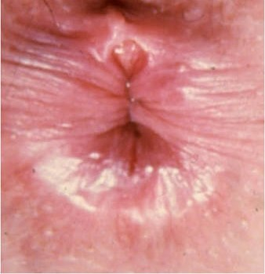
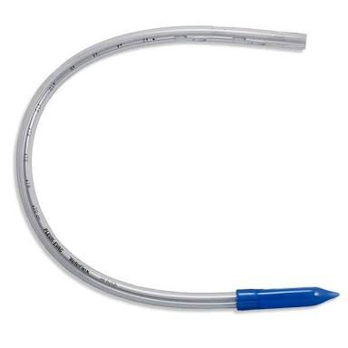
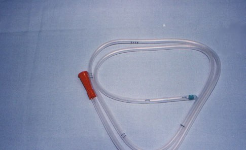
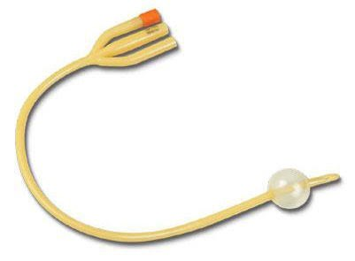

Source: "OSCE ROTATE 1 2016 MDCU 69" (file "AC OSCE Sx Rotate 1 MDCU 69", dated November 2016), stations recalled by students, mixed Thai and English. The paper was sat at the end of the whole surgery rotation, so it combines General Surgery and subspecialty content and is filed whole. It is a low-priority set (see CLAUDE.md). The MEQ part of the same exam is in `mdcu69-gen-1-meq`.
Numbers Q1-Q12 are the paper's own. No answer key was found and the paper has no checklists, so every checklist is "not given in the source", except where the students wrote a diagnosis under an item (Q4, Q6, Q9); that is copied into the Checklist line and marked as recalled, not an official key.
Pictures: pictures with no name, label or ID band are kept in images/. The Q3 picture is cropped to remove a website watermark at the top and the Q5 tube picture is cropped to remove a watermark at the foot. The IVP, mammogram and acute abdomen films are not in the paper.
exam_year 2016 is stated in the paper's title ("ROTATE 1 2016").
The rotation number (1) is not mapped to a G.

## Q1 (original no. 1)
แสดงวิธีการฉีดยาชาและเย็บแผลด้วย simple interrupted 2 sticht ผูกด้วยเครื่องมือ (ไม่ต้องทายาปูผ้า สมมติว่าใส่ถุงมือแล้ว เริ่มจาก draw ยาชา แสดงวิธีฉีด แล้วก็เย็บ)

**Station type:** local anaesthetic injection and suturing
**Checklist:** not given in the source
**Explanation:** not stated
**Guideline / source:** not stated

## Q2 (original no. 2)
จงซักประวัติผู้ป่วย มีสองฝั่ง คนนึงมาด้วย upper GI bleed อีกคนมาด้วย abdominal pain

**Station type:** history taking
**Checklist:** not given in the source
**Explanation:** not stated
**Guideline / source:** not stated

## Q3 (original no. 3)
ผู้ป่วยหญิง ถ่ายเป็นเลือดมา จงแสดงวิธีตรวจร่างกาย และวินิจฉัย (มีผู้ป่วยจริงกับหุ่นฝึก PR ให้ทำกับหุ่น แต่ผู้ป่วยจะแสดงตลอดแบบร้องว่าเจ็บ และมีรูป lesion ให้ดู)

**Station type:** examination (rectal examination on a model) and diagnosis
**Checklist:** not given in the source
**Explanation:** not stated
**Guideline / source:** not stated

## Q4 (original no. 4)
IVP (the film is not included in the paper)
4.1 จงบรรยายสิ่งที่เห็น
4.2 Diagnosis
4.3 Management

**Station type:** imaging interpretation (IVP)
**Checklist:** the paper writes "(Right renal stone)" under the item (recalled by the students; not an official key)
**Explanation:** not stated
**Guideline / source:** not stated

## Q5 (original no. 5)
ให้ NG tube, Chest tube มาถามว่า คืออะไร indication อย่างละ 3 ข้อ

**Station type:** instrument identification
**Checklist:** not given in the source
**Explanation:** not stated
**Guideline / source:** not stated

## Q6 (original no. 6)
ให้ mammogram มา (the film is not included in the paper)
6.1 ชื่อวิธีการตรวจ ท่าไหน
6.2 บรรยาย mammogram
6.3 ตรวจอะไรเพิ่มเติมเพื่อวินิจฉัย

**Station type:** imaging interpretation (mammogram)
**Checklist:** the paper writes "(right CA breast with axillary lymph node metas)" under the item (recalled by the students; not an official key)
**Explanation:** not stated
**Guideline / source:** not stated

## Q7 (original no. 7)
ให้ PDS (ปิดชื่อสามัญ), Vicryl (ปิดชื่อทั้งหมด), Catgut (ปิดชื่อทั้งหมด), แผ่น prolene mesh
1. ถามชื่อสามัญ
2. ถามธรรมชาติของเส้นใย (natural/synthetic) และลักษณะเส้นใย (แบบ mono/multi)
3. ตัวอย่างการใช้งาน 1 อย่าง

**Station type:** suture and mesh identification
**Checklist:** not given in the source
**Explanation:** not stated
**Guideline / source:** not stated

## Q8 (original no. 8)
ให้อุปกรณ์ allis, crile arterial clamp, army navy, metzenbaum
1. ถามชื่ออุปกรณ์
2. การใช้งาน

**Station type:** instrument identification
**Checklist:** not given in the source
**Explanation:** not stated
**Guideline / source:** not stated

## Q9 (original no. 9)
ให้ film acute abdomen series ถาม (the films are not included in the paper)
1. ประกอบด้วย film อะไรบ้าง ท่าไหน
2. บรรยายสิ่งที่พบ
3. สาเหตุที่พบบ่อยที่ทำให้เกิดภาวะนี้

**Station type:** imaging interpretation (acute abdomen series)
**Checklist:** the paper writes "(Small bowel obstruction)" under the item (recalled by the students; not an official key)
**Explanation:** not stated
**Guideline / source:** not stated

## Q10 (original no. 10)
ให้ 3 way catheter ถาม

1. ชื่ออุปกรณ์
2. Indication

**Station type:** instrument identification
**Checklist:** not given in the source
**Explanation:** not stated
**Guideline / source:** not stated

## Q11 (original no. 11)
ผู้ป่วยชายมาด้วย LUTS จะถามคำถามอะไรบ้าง (ตาม IPSS score เลย)

**Station type:** history taking
**Checklist:** not given in the source
**Explanation:** not stated
**Guideline / source:** not stated

## Q12 (original no. 12)
แสดงวิธีเช็ดมือ และสวมถุงมือ sterile (สมมุติว่าล้างมือเสร็จแล้ว ทำท่าแบบล้างมือแล้วเข้ามา มีsize ถุงมือให้เลือก เตรียมก่อนเริ่มเลย)

**Station type:** hand drying and sterile gloving
**Checklist:** not given in the source
**Explanation:** not stated
**Guideline / source:** not stated

## Flagged for checking
- No answer key or checklist exists for this paper in the files supplied; the students' own recalled diagnoses are marked as such.
- Q4, Q6 and Q9 refer to films that are not in the paper.
