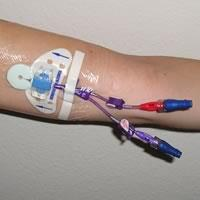
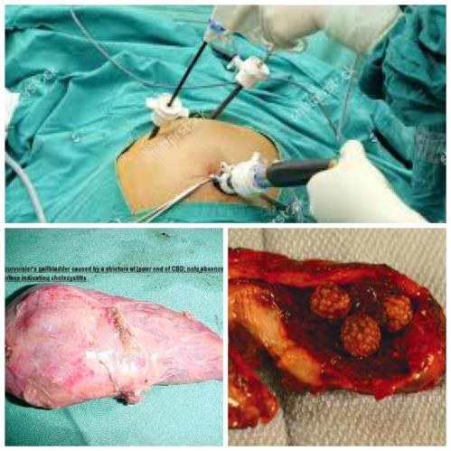
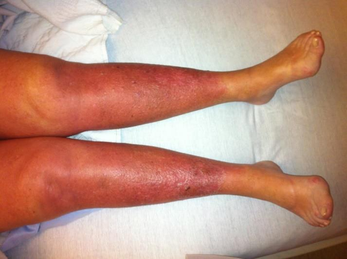
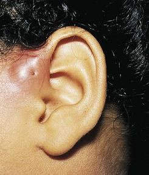
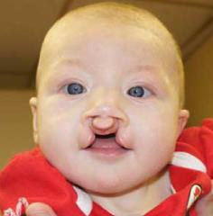
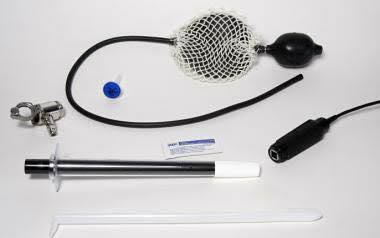
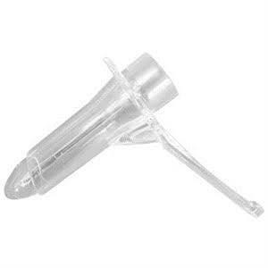
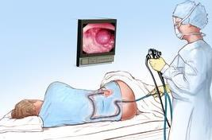

Source: "AC MEQ Surgery Rotate 3/2559" (the MEQ part of "AC OSCE MEQ Surgery Rotate 3", file dated December 2016), questions recalled by students, mixed Thai and English. The paper says: 14 questions in all but only 11 were remembered, about 3 minutes each (the students are unsure), some questions have more than one slide, and the examiner does not go back to an earlier slide. The paper was sat at the end of the whole surgery rotation, so it combines General Surgery and subspecialty content and is filed whole. It is a low-priority set (see CLAUDE.md). The OSCE part of the same exam is in `mdcu69-gen-3-osce`.
Numbers Q1-Q11 are the paper's own. No answer key was found, so every answer is "not given in the source", except where the students wrote a name beside an item (Q1.1 and Q8.1), which is copied and marked as the students' own recall, not a key.
Pictures with no name, label or ID band are kept in images/ under their question. The three screenshots in Q5 are left out because the slides print the answer on them. The breast, hydrocele and X-ray pictures of Q3, Q10 and Q11 are not in the paper.
exam_year 2016 is taken from the PDF date (December 2016) and the academic year 2559 (2016-17) in the heading.
The rotation number (3) is not mapped to a G.

## Q1 (original no. 1)
จากรูปอุปกรณ์ดังกล่าว

1.1 อุปกรณ์นี้มีชื่อว่าอะไร
1.2 จงบอกข้อบ่งชี้ในการใช้อุปกรณ์นี้มา 3 ข้อ
1.3 การใช้อุปกรณ์นี้มีโอกาสติดเชื้ออะไรมากที่สุด

**Answer:** 1.1: PICC line (recalled by the students; written in the paper beside the item)
**Explanation:** not stated
**Guideline / source:** not stated

## Q2 (original no. 2)
จากรูปดังกล่าว

2.1 อวัยวะที่เห็นในภาพคืออะไร
2.2 เมื่อผ่าเปิดอวัยวะดังกล่าวออกมา พบอะไรอยู่ข้างใน
2.3 การผ่าตัดดังกล่าวเรียกว่าอะไร
2.4 จงบอกข้อบ่งชี้สำหรับการผ่าตัดมา 2 ข้อ

**Answer:** not given in the source
**Explanation:** not stated
**Guideline / source:** not stated

## Q3 (original no. 3)
ให้รูปเต้านมมา 2 ข้าง สังเกตเห็นเต้านมซ้ายแดงๆบวมๆ + มีการชี้บอกว่าตรวจพบ left matted axillary node, negative supraclavicular node (สไลด์1) เห็น nipple retraction + peau d'orange ชัดเจน (สไลด์2 ซูมนมซ้ายให้) (the pictures are not included in the paper)
3.1 จงบอก findings ที่พบทั้งหมด
3.2 Clinical staging
3.3 ส่งตรวจอะไรเพิ่มเติม เพื่อยืนยันการวินิจฉัย

**Answer:** not given in the source
**Explanation:** not stated
**Guideline / source:** not stated

## Q4 (original no. 4)
ผู้ป่วยมาด้วยประวัติปวดขา เป็นมากตอนเย็น มีลักษณะขาดังรูป (ของจริงขาดำกว่านี้)

4.1 จงให้การวินิจฉัย
4.2 จงบอกการตรวจร่างกายสำคัญ
4.3 จะส่งตรวจอะไรเพิ่มเติม

**Answer:** not given in the source
**Explanation:** not stated
**Guideline / source:** not stated

## Q5 (original no. 5)
จากท่าการตรวจดังต่อไปนี้ จงบอก กล้ามเนื้อ Nerve root ที่กำลังถูกตรวจในแต่ละอัน (หาในเวปแล้วเจอรูปเป๊ะๆพอดี เลยแคปมาใส่)
5.1 [screenshot of a web slide of a finger-flexion test]
5.2 [screenshot of a web slide of a hip-flexion test]
5.3 [screenshot of a web slide of an ankle plantar-flexion test]

**Answer:** not given in the source as an answer; the pasted screenshots carry their own titles: 5.1 "C8 - Finger Flexion" (median nerve), 5.2 "L1 & L2: Hip Flexion" (femoral nerve), 5.3 "Ankle Plantar Flexion" (nerve root not shown) - these are labels of a website slide, not a key
**Explanation:** the three screenshots are left out because the slides print the answers on them
**Guideline / source:** not stated

## Q6 (original no. 6)
จากรูป

6.1 จงบอก treatment plan

**Answer:** not given in the source
**Explanation:** not stated
**Guideline / source:** not stated

## Q7 (original no. 7)
มารดาพาบุตรอายุ 4 เดือนมา ดังรูป

7.1 จงให้การวินิจฉัย
7.2 จงบอกอายุที่เหมาะสำหรับการให้การรักษา พร้อมเหตุผลประกอบ
7.3 จงให้คำแนะนำสำหรับมารดาในการดูแลผู้ป่วย

**Answer:** not given in the source
**Explanation:** not stated
**Guideline / source:** not stated

## Q8 (original no. 8)
จากรูปอุปกรณ์ดังกล่าว A,B

8.1 จงบอกชื่อ
8.2 การใช้งาน

**Answer:** 8.1: Sigmoidoscope, Disposable proctoscope (recalled by the students; written in the paper beside the item)
**Explanation:** not stated
**Guideline / source:** not stated

## Q9 (original no. 9)
จากรูป

9.1 หัตถการดังกล่าวเรียกว่าอะไร
9.2 จงบอกข้อบ่งชี้ในการทำหัตถการมา 4 ข้อ

**Answer:** not given in the source
**Explanation:** not stated
**Guideline / source:** not stated

## Q10 (original no. 10)
เด็กมาด้วยประวัติท้องอืด ไม่ถ่าย meconium ให้รูป film X-rays มาเห็นเป็น dilated colon (สไลด์1) (the film is not included in the paper)
10.1 จงบอก Differential diagnosis มา 2 โรค
10.2 จะส่งตรวจอะไรเพิ่มเติมเพื่อการวินิจฉัย
(สไลด์2 เป็นรูป Barium enema เห็น transitional zone)
10.3 จงให้การวินิจฉัย
10.4 จงบอก initial & definitive treatment

**Answer:** not given in the source
**Explanation:** not stated
**Guideline / source:** not stated

## Q11 (original no. 11)
ให้รูปเด็กที่เป็น hydrocele (the picture is not included in the paper)
11.1 จงบอกการตรวจร่างกายเพิ่มเติมที่สำคัญเพื่อนำไปสู่การวินิจฉัย และ จงให้การวินิจฉัย
11.2 จงบอกวิธีการรักษาและอายุที่เหมาะสมสำหรับการให้การรักษา

**Answer:** not given in the source
**Explanation:** not stated
**Guideline / source:** not stated

## Flagged for checking
- No answer key exists for this paper in the files supplied.
- Q3, Q10 and Q11 refer to pictures that are not in the paper.
