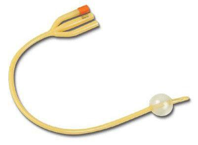
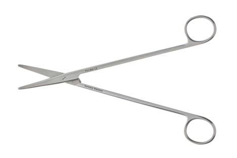
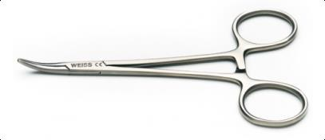
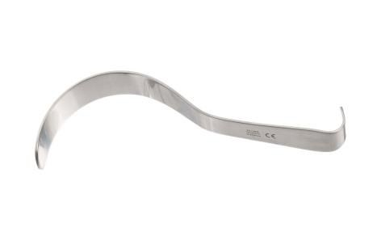
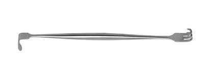
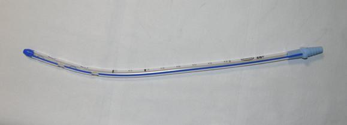
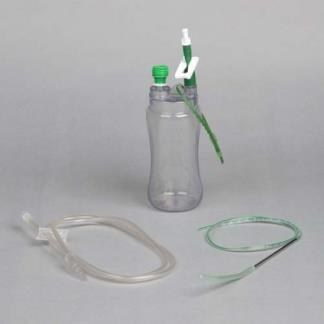

Source: "AC OSCE Surgery Rotate 3/2559" (the OSCE part of "AC OSCE MEQ Surgery Rotate 3", file dated December 2016), stations recalled by students, mixed Thai and English. The paper opens with a note: OSCE and MEQ were sat in the afternoon; the students were split into two groups (one group MEQ first, the other OSCE first); the OSCE had 2 loops; the MEQ was sat in a meeting room where the examiner showed slides and the students wrote on answer sheets. This OSCE had 12 stations, no rest station, 4 minutes each, and stations marked * had an examiner. The paper was sat at the end of the whole surgery rotation, so it combines General Surgery and subspecialty content and is filed whole. It is a low-priority set (see CLAUDE.md). The MEQ part of the same exam is in `mdcu69-gen-3-meq`.
Numbers Q1-Q12 are the paper's own. No answer key was found and the paper has no checklists. Where the students wrote an answer beside an item (for example "3 way catheter"), it is put in the Checklist line as "recalled by the students" and is NOT an official key.
Pictures with no name, label or ID band are kept in images/ under their station. The IVP, acute abdomen and mammogram films are not in the paper.
exam_year 2016 is taken from the PDF date (December 2016) and the academic year 2559 (2016-17) in the heading.
The rotation number (3) is not mapped to a G.

## Q1 (original no. 1)
ผู้ป่วยหญิงมีน้ำไหลออกจากเต้านม (ไม่บอกอายุ ไม่บอกข้าง) ให้ซักประวัติที่สำคัญ (station with an examiner)

**Station type:** history taking
**Checklist:** not given in the source
**Explanation:** not stated
**Guideline / source:** not stated

## Q2 (original no. 2)
แสดงการตรวจร่างกายผู้ป่วยที่มาด้วยปวดท้องรุนแรงบริเวณท้องน้อยด้านขวา (station with an examiner)

**Station type:** examination (abdomen)
**Checklist:** not given in the source
**Explanation:** not stated
**Guideline / source:** not stated

## Q3 (original no. 3)
Film IVP (ฟิล์มมากมาย ต้องรีบหา Scout film; มีชื่อฟิล์มที่มุมซ้ายล่าง) (the films are not included in the paper)
3.1 บรรยายความผิดปกติที่พบ
3.2 ให้การวินิจฉัย
3.3 การรักษา

**Station type:** imaging interpretation (IVP)
**Checklist:** 3.1: right staghorn stone with right hydronephrosis (recalled by the students; the paper writes this beside item 3.1)
**Explanation:** not stated
**Guideline / source:** not stated

## Q4 (original no. 4)
ให้ดูอุปกรณ์ดังรูป

4.1 อุปกรณ์นี้เรียกว่าอะไร
4.2 Indication

**Station type:** instrument identification
**Checklist:** 4.1: 3 way catheter; 4.2: continuous bladder irrigation (recalled by the students; the paper writes these beside the items)
**Explanation:** not stated
**Guideline / source:** not stated

## Q5 (original no. 5)
ผู้ป่วยมาด้วยอาการ LUTS มา 6 เดือน จะซักประวัติว่าอย่างไรเพื่อประเมินความรุนแรงของอาการของผู้ป่วย

**Station type:** history taking
**Checklist:** not given in the source
**Explanation:** not stated
**Guideline / source:** not stated

## Q6 (original no. 6)
Film Acute abdomen series (3 ฟิล์ม ติดตัวอักษร ABC) (the films are not included in the paper)
6.1 ท่าที่ถ่ายของฟิล์ม A,B,C คืออะไร
6.2 จงบรรยายความผิดปกติที่พบ
6.3 จงให้การวินิจฉัย(?)
6.4 จงบอกการให้การรักษาเบื้องต้น

**Station type:** imaging interpretation (acute abdomen series)
**Checklist:** not given in the source
**Explanation:** not stated
**Guideline / source:** not stated

## Q7 (original no. 7)
Mammogram มีฟิล์มให้เอามาเรียง/วางเอง (the films are not included in the paper)
7.1 การส่งตรวจนี้เรียกว่าอะไร จงบอกว่า A,B คือถ่ายท่าอะไร
7.2 จงบอกความผิดปกติที่พบ
7.3 จะส่งตรวจอะไรเพิ่มเติมเพื่อการวินิจฉัย

**Station type:** imaging interpretation (mammogram)
**Checklist:** not given in the source
**Explanation:** not stated
**Guideline / source:** not stated

## Q8 (original no. 8)
ให้ด้ายมา 6 อัน PDS Prolene Nylon Silk Catgut Vicryl (ปิดชื่อ อาศัยจำสีซองสีด้าย) แล้วให้ตอบคำถามต่อไปนี้
8.1 จงบอก generic name แต่ละตัว + ชนิด filament
8.2 ตัวไหนที่ละลายได้บ้าง (ตอบมาให้หมด)
8.3 จงบอกหัตถการที่ใช้ไหมดังกล่าวมาอย่างละ 1 หัตถการ

**Station type:** suture identification
**Checklist:** not given in the source
**Explanation:** not stated
**Guideline / source:** not stated

## Q9 (original no. 9)
ให้อุปกรณ์มา 3 อย่าง

9.1 จงบอกชื่อ
9.2 ยกตัวอย่างการใช้งาน

**Station type:** instrument identification
**Checklist:** 9.1 names listed beside the item in the paper: Mosquito artery forcep, Curved metzenbaum, Senn retractor, Deaver retractor (recalled by the students; the paper says 3 instruments but lists four names and shows four pictures; the pictures are listed here in the order they stand in the paper's layout, so the match between name and picture is not given)
**Explanation:** not stated
**Guideline / source:** not stated

## Q10 (original no. 10)
ให้อุปกรณ์มา 2 อย่าง ดังรูป (หารูปดีๆยาก ไปดูบนวอร์ดเอานะ)

10.1 จงบอกว่าอุปกรณ์ A,B คืออะไร
10.2 จงยกตัวอย่าง ภาวะ/โรค – หัตถการ ที่ใช้อุปกรณ์แต่ละตัวมาอย่างละ 2 ตัวอย่าง

**Station type:** instrument identification
**Checklist:** 10.1: Chest tube, Redivac (recalled by the students; the paper writes these beside the item; the paper does not say which picture is A and which is B)
**Explanation:** not stated
**Guideline / source:** not stated

## Q11 (original no. 11)
จงอธิบายขั้นตอนการล้างมือด้วยแอลกอฮอล์เจลตาม WHO พร้อมทั้งสรุปว่ามีทั้งหมดกี่ขั้นตอน (scene มีการตั้งขวดแอลกอฮอล์เจล 1 ขวด + ผ้าเช็ดมือใน OR) (station with an examiner)

**Station type:** hand hygiene
**Checklist:** not given in the source
**Explanation:** not stated
**Guideline / source:** not stated

## Q12 (original no. 12)
(มีอาจารย์+พี่เด้นช่วย) จงเย็บแผล vertical mattress 2 stitches (ทายา ปูผ้า ฉีดยาชาเรียบร้อยแล้ว)

**Station type:** suturing
**Checklist:** not given in the source
**Explanation:** not stated
**Guideline / source:** not stated

## Flagged for checking
- No answer key or checklist exists for this paper in the files supplied; the students' own recalled answers are marked as such.
- Q9: the paper says 3 instruments but lists four names and shows four pictures.
- Q3, Q6 and Q7 refer to films that are not in the paper.
