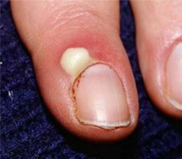
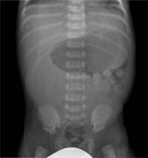

Source: "MEQ Surgery by MDCU 70 rotate 1", MEQ part, recalled by students; the numbers are the paper's own unless said otherwise.
No answer key was found for this paper; answers appear only where the paper itself gives one,
everything else is "not given in the source". Only four numbered questions are recalled (1, 5, 12,
14), plus one labelled "xx", which is kept at the end under its own heading.
exam_year 2017 is taken from the PDF's own creation date (October 2017); the Drive copy is dated April 2022. The paper does not state the year.
The rotation (1) is not mapped to a G.
Pictures with no face, name, label or ID band were checked by eye and are kept in images/ under their question; the others are described in words only.

## Q1 (original no. 1)
ให้รูป Thromboangiitis obliterans ถามวินิจฉัย+รักษา

**Answer:** dx thromboangiitis obliterans (named in the recalled stem); treatment not given in the source
**Explanation:** not stated
**Guideline / source:** not stated

## Q5 (original no. 5)
จงให้การวินิจฉัย บอกชื่อเชื้อก่อโรคที่พบบ่อยที่สุด และวิธีการรักษา
[picture in the paper: a finger with a swollen, pus-filled lesion beside the nail]

**Answer:** not given in the source
**Explanation:** not stated
**Guideline / source:** not stated

## Q12 (original no. 12)
gastroschisis dx , management

**Answer:** dx gastroschisis (named in the recalled stem); management not given in the source
**Explanation:** not stated
**Guideline / source:** not stated

## Q14 (original no. 14)
6 mo child with sudden bilious vomiting
[picture in the paper: an abdominal x-ray of an infant]
1.) dx
2.) management

**Answer:** not given in the source
**Explanation:** not stated
**Guideline / source:** not stated

## Unnumbered questions
(Labelled "xx" in the paper; kept here unchanged, outside the numbered list.)

xx. มีรูป Bedsore ถามว่าท่าไหน
Answer: not given in the source.
