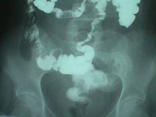
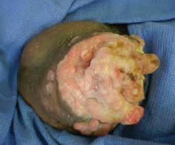

Source: "OSCE&MEQ surgery R2 MDCU70", OSCE part ("OSCE surgery Rotate D MDCU70"), recalled by students; the numbers are the paper's own unless said otherwise.
No answer key was found; there are no checklists. Where the paper itself gives an answer ("ตอบ ...") it is kept as
the answer, not in the stem. The file name says R2 but both headings in the paper say "Rotate D MDCU70"; the rotation is kept as 2 from the job and file name.
Station numbers 7, 8 and 11 are not in the paper.
The MEQ part of this paper is in exams/mdcu70-gen-2-meq.
exam_year 2018 is taken from the paper's file date (March 2018, the PDF's own creation date); the paper does not state the year.
The rotation (2) is not mapped to a G.
Pictures with no face, name, label or ID band were checked by eye and are kept in images/ under their question; the others are described in words only.

## Q1 (original no. 1)
ใส่ถุงมือ ฉีดยา เย็บ vertical matress1strip + ผูกด้วยเครื่องมือ

**Station type:** procedure (suturing)
**Checklist:** not given in the source
**Explanation:** not stated
**Guideline / source:** not stated

## Q2 (original no. 2)
ซักประวัติผู้ป่วย หญิง ให้CC:ปวดท้องนาน3เดือน และจะส่ง investigation อะไร 1 อย่าง
(epigastium pain ปวดตื้อๆ15-30min กินอาหารแล้วปวดมากขึ้น...)

**Station type:** history taking
**Checklist:** not given in the source
**Explanation:** not stated
**Guideline / source:** not stated

## Q3 (original no. 3)
แสดงการตรวจ PR ผู้ป่วยมาด้วยถ่ายเป็นเลือด

**Station type:** physical examination
**Checklist:** not given in the source
**Explanation:** not stated
**Guideline / source:** not stated

## Q4 (original no. 4)
เรื่องx-ray Ba enema ให้อ่านฟิล์ม
[picture in the paper: a barium enema film of the colon]

**Station type:** imaging interpretation
**Checklist:** not given in the source
**Explanation:** not stated
**Guideline / source:** not stated

## Q5 (original no. 5)
มีเครื่องมือวางบนโต๊ะ5อันแปะป้ายA-E ให้บอกชื่อ+การใช้งาน

**Station type:** instruments and devices
**Checklist:** items listed in the paper: A Vascular graft; B Chest tube; C Redivac; D Curved Metzenbaum scissors; E Babcock forceps (uses not given in the source)
**Explanation:** not stated
**Guideline / source:** not stated

## Q6 (original no. 6)
ผู้ป่วยได้รับอุบัติเหตุจำเป็นต้องเย็บ radial artery, ผูก vein, เย็บ subcu, เย็บ skin ต้องใช้ไหมแบบใดตามลำดับ และบอกด้วยว่าไหมที่ตอบมีชื่อการค้า เส้นใย การabsorbด้วย //ให้ช้อยA-Eเป็นไหมจริงปิดชื่อ

**Station type:** instruments and devices (sutures)
**Checklist:** answer given in the paper: prolene, silk, vicryl, nylon (trade names, filament and absorption not given in the source)
**Explanation:** not stated
**Guideline / source:** not stated

## Q9 (original no. 9)
มีหุ่นจำลอง ให้PRคลำprostate
A. อธิบายสิ่งที่พบ
B. diagnosis

**Station type:** physical examination (manikin)
**Checklist:** not given in the source
**Explanation:** not stated
**Guideline / source:** not stated

## Q10 (original no. 10)
ผู้ชายมีแผลที่อวัยวะเพศมา 3 เดือน ไม่เจ็บแผล จงวินิจฉัย management
[picture in the paper, placed just below this station: a large ulcerated, fungating growth on the penis]

**Station type:** written station
**Checklist:** not given in the source
**Explanation:** not stated
**Guideline / source:** not stated

## Q12 (original no. 12)
ให้แสดงการใส่ถุงมือ+คลุมผ้า+ทำความสะอาดแผล (มีแขนเทียมให้)

**Station type:** procedure (wound care)
**Checklist:** not given in the source; the paper adds: "**ใน checklist(อาจารย์เอาให้ดูหลังสอบ แปบนึง) เห็นมีตัวเข้มว่า ต้องใช้ sponge คีบ"
**Explanation:** not stated
**Guideline / source:** not stated
