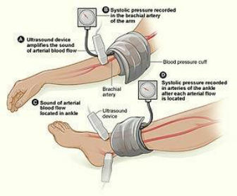
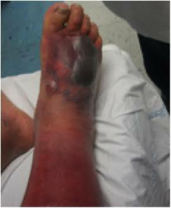
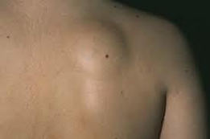
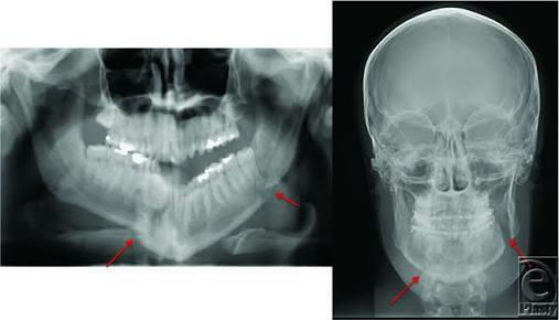

Source: "MEQ Surgery Rotate A MDCU70", MEQ paper, recalled by students; the numbers are the paper's own unless said otherwise.
No answer key was found. Some answers are written in grey after the questions in the paper; those are kept as
the answer and marked as the students' own. Everything else is "not given in the source".
The paper says "ข้อสอบ 14 ข้อ ให้เวลาข้อละ 3 นาที" (14 questions, 3 minutes each).
none shows a face, name or label.
exam_year 2018 is taken from the paper's file date (May 2018, the PDF's own creation date); the paper does not state the year.
The rotation (A) is not mapped to a G.
Pictures with no face, name, label or ID band were checked by eye and are kept in images/ under their question; the others are described in words only. Left out: the Q12 drawing, because it prints the name of the sign that the question asks for.

## Q1 (original no. 1)
ภาพการวัด ABI
[picture in the paper: drawing of ankle-brachial index measurement with cuffs on the arm and ankle and an ultrasound probe]
- อธิบายวิธีการวัด
- แปลผลอย่างไร

**Answer:** not given in the source
**Explanation:** not stated
**Guideline / source:** not stated

## Q2 (original no. 2)
ภาพ malignant melanoma
- Diagnosis
- Treatment

**Answer:** not given in the source
**Explanation:** not stated
**Guideline / source:** not stated

## Q3 (original no. 3)
ภาพ Omphalocele
- Diagnosis
- Associated anomaly
- Management ก่อนส่งต่อ

**Answer:** not given in the source
**Explanation:** not stated
**Guideline / source:** not stated

## Q4 (original no. 4)
ภาพ Pale stool ประวัติเด็ก 2 เดือน มาด้วยซีด อึขาว ปัสสาวะเข้ม เจาะ Lab มาหมดแล้ว ซีดนิดหน่อย เป็น direct hyperbilirubineamia
- Differential diagnosis
- เป็นหมอที่ rural area จะทำอย่างไร

**Answer:** not given in the source
**Explanation:** not stated
**Guideline / source:** not stated

## Q5 (original no. 5)
วีดีโอตรวจ Key muscles ให้บอก muscle, innervation, nerve roots

**Answer:** muscles: Gastrocnemius, Abductor digiti minimi, Deltoid (as written in grey in the paper by the students; not an official key); innervation and nerve roots not given in the source
**Explanation:** not stated
**Guideline / source:** not stated

## Q6 (original no. 6)
ภาพ Vixol ประวัติเด็กวัยรุ่นกลืน corrosive agent มา 30 นาทีก่อนมา รพ. ญาติเอาขวดมาด้วย มีตรวจร่างกายให้ mucosa บวมแดง, V/S ดี, หายใจไม่มีปัญหา, Lung clear, Heart ดี
- ท่านเป็นแพทย์รับ consult จงสั่งการรักษาในผู้ป่วยรายนี้

**Answer:** not given in the source
**Explanation:** not stated
**Guideline / source:** not stated

## Q7 (original no. 7)
Ultrasound: Acute cholecystitis
- บรรยายภาพ
- แนวทางการรักษา

**Answer:** not given in the source
**Explanation:** not stated
**Guideline / source:** not stated

## Q8 (original no. 8)
ภาพ Necrotizing fasciitis
[picture in the paper: a swollen red lower leg and foot with dark discoloured patches]
- Diagnosis
- จงสั่งการรักษา

**Answer:** not given in the source
**Explanation:** not stated
**Guideline / source:** not stated

## Q9 (original no. 9)
ภาพ lipoma
[picture in the paper: a smooth bulge under the skin of the back near the shoulder]
- Diagnosis
- ชื่อการรักษา

**Answer:** treatment name: Lipoma excision (as written in grey in the paper by the students; not an official key); diagnosis not given in the source
**Explanation:** not stated
**Guideline / source:** not stated

## Q10 (original no. 10)
ภาพตำแหน่ง Hernia
- ให้บอกชื่อแต่ละตำแหน่ง
- ปัจจัยเสี่ยง 2 ข้อ

**Answer:** risk factors: chronic cough, BPH (as written in grey in the paper by the students; not an official key); names of the sites not given in the source
**Explanation:** not stated
**Guideline / source:** not stated

## Q11 (original no. 11)
ประวัติหน้ากระแทก fracture ให้ 3 films
[pictures in the paper: a panoramic jaw x-ray and a frontal skull x-ray, each with red arrows at the mandible]
- Diagnosis
- Definite treatment

**Answer:** Diagnosis: Mandibular fracture at?? (site left unfinished in the paper); Definite treatment: Open reduction and internal fixation (as written in grey in the paper by the students; not an official key)
**Explanation:** not stated
**Guideline / source:** not stated

## Q12 (original no. 12)
ประวัติปวด RUQ pain ให้ anatomical landmark มาที่ Costal margin ตัด MCL กดตอนหายใจเข้าแล้วหยุดหายใจ+guarding
[picture in the paper: drawing of a hand pressing below the right costal margin, captioned with the name of the sign]
- Sign ในโจทย์คืออะไร
- Landmark ชื่อ

**Answer:** Sign: Murphy's sign positive, invuluntory guarding; Landmark: Murphy's points (as written in grey in the paper by the students; not an official key)
**Explanation:** not stated
**Guideline / source:** not stated

## Q13 (original no. 13)
ภาพเด็ก umbilical hernia + อวัยวะเพศหญิงด้านขวาบวม ให้ประวัติว่า Preterm ตอนนี้อายุ 2 เดือนละ
- Diagnosis มาให้ครบ
- Treatment

**Answer:** Diagnosis: Umbilical hernia +- indirect inguinal hernia; Treatment: observe til 3yr then umbilicoplasty and elective herniotomy for IIH (as written in grey in the paper by the students; not an official key)
**Explanation:** not stated
**Guideline / source:** not stated

## Q14 (original no. 14)
ให้ภาพ colostomy ถามว่ารูปอะไร ทำในโรคอะไร (2โรค) และprocedure ชื่ออะไร

**Answer:** not given in the source
**Explanation:** not stated
**Guideline / source:** not stated

## Flagged for checking
- Q12: the picture in the paper prints the name of the sign under the drawing, so the question gives away part of its answer. Kept as the paper has it.
- Q13: the students' answer (observe until 3 years, then umbilicoplasty, plus elective herniotomy) should be checked against a paediatric surgery source.
