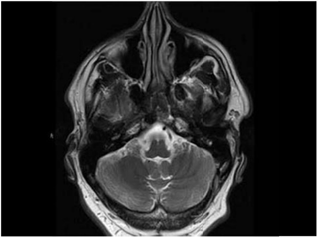

Source: "MCQ Surgery subspecialty by MDCU70 rotate 1" (file "Subspa-MCQ-rotate 1MDCU70"), questions recalled by students, mixed Thai and English. This is a subspecialty MCQ paper (urology, paediatric surgery, neurosurgery, colorectal, cardiothoracic and plastic topics), so it is kept apart from General Surgery and is not tagged into the exam topic map.
The paper's own numbers are kept (Q1, 2, 4, 11, 28, 30, 33, 37, 39, 40, 43, 51, 58, 61, 64, 69, 75, 77, 80, 89, 90); the other numbers of the exam are not in the paper. One question is written "xx" with no number (the burn question). It is numbered Q201 and its heading says "unnumbered question 1" - there "original no." is only its order among the unnumbered questions, not a number printed in the paper.
Answers: no answer key was found for this paper and the paper marks no answers, so every answer is "not given in the source". The only hint is the author's note under Q28 ("if you answer choice E"), which is part of the stem as written and is not treated as the answer.
Q1, Q4, Q51 and Q64 have only a stem and no choices. A choice the paper leaves blank is "(not recalled)". Q64 is written twice in the paper; it is given once.
Picture: the paper has one brain MRI picture, printed at the end of the left column after Q11. The author's note under Q28 ("รูปประมาณนี้มั้ง", something like this picture) points to it, so it is filed under Q28; check this by eye. The picture has no name, label or ID band.
exam_year 2017 is taken from the paper's file date (October 2017); the paper does not state the year.
The rotation number (1) is not mapped to a G.

## Q1 (original no. 1)
ให้ clinical Torsion testis มา (จำไม่ทัน)

**Answer:** not given in the source (the paper has only the stem, no choices)
**Explanation:** not stated
**Guideline / source:** not stated

## Q2 (original no. 2)
ข้อใดผิดเกี่ยวกับ hepatoblastoma

A. most common CA in liver
B. AFP positive
C. ตอบสนองต่อchemotherapy ไม่แน่ใจอ่ะ TT

**Answer:** not given in the source
**Explanation:** not stated
**Guideline / source:** not stated

## Q4 (original no. 4)
What are 3 most common trauma causes of death in children?

**Answer:** not given in the source (the paper has only the stem, no choices)
**Explanation:** not stated
**Guideline / source:** not stated

## Q11 (original no. 11)
What is long-term complication in 2 years old patient who underwent kasai operation

A. intrahepatic biliary cyst
B. common bile duct stone
C. asccending cholangitis
D. upper gi bleed from esophageal varices
E. cirrhosis and portal hypertension although patient is jaundice free

**Answer:** not given in the source
**Explanation:** not stated
**Guideline / source:** not stated

## Q28 (original no. 28)
จาก Imaging จะเจออาการอะไร
รูปประมาณนี้มั้ง ถ้าตอบข้อ E. นะ (the author's note under the choices)

A. Impaired finger to nose
B. Papilledema both eyes
C. Bitemporal hemianopia
D. Hemiparesis
E. Sensory neural hearing loss

**Answer:** not given in the source
**Explanation:** not stated
**Guideline / source:** not stated

## Q30 (original no. 30)
brain tumor ในข้อใดสามารถรักษาได้ด้วยการให้ยาโดยไม่ต้องผ่าตัด

A. Acoustic neuroma
B. Prolactinoma
C. Meningioma
D. GBM
E. Non hormone producing pituitary adenoma

**Answer:** not given in the source
**Explanation:** not stated
**Guideline / source:** not stated

## Q33 (original no. 33)
ชาย 60 ปี เป็น DM มาด้วย right flank pain and hematuria ตรวจพบ stone in right distal ureter and mild hydronephrosis คนไข้แพ้ NSAIDs อย่างรุนแรง ควรให้อะไรเพื่อบรรเทาอาการ flank pain

A. Ketolac?
B. Morphine
C. Diclofenac
D. IV fluid
E. จำไม่ได้ง่า

**Answer:** not given in the source
**Explanation:** not stated
**Guideline / source:** not stated

## Q37 (original no. 37)
ทำ US พบ csytic lesion with internal calcification what to do next?

A. Do nothing
B. F/U US 6 month
C. CT scan
D. Partial Nephrectomy
E. Aspirate cyst

**Answer:** not given in the source
**Explanation:** not stated
**Guideline / source:** not stated

## Q39 (original no. 39)
Thai male 25 years with heaviness in scrotal sac. Physical examination : enlarge testis 6 cm without tenderness. What should you do in the next step ?

A. Scrotal ultrasound
B. FNA
C. Core needle biopsy
D. Rt. Scrotal orchidectomy
E. Rt. Inguinal orchidectomy

**Answer:** not given in the source
**Explanation:** not stated
**Guideline / source:** not stated

## Q40 (original no. 40)
A 1 year-old boy มาด้วยไม่สามรถดึง prepuce ลงมาได้ ไม่เคยมีประวัติการติดเชื้อมาก่อน ยังปัสสาวะได้ปกติ ควรทำอย่างไร?

A. Circumcision
B. Topical steroid
C. Topical antibiotics
D. รอให้อายุครบ 4 ปี
E. ให้ยาชาแล้วดึง prepuce ให้เปิดออก

**Answer:** not given in the source
**Explanation:** not stated
**Guideline / source:** not stated

## Q43 (original no. 43)
คนไข้มาด้วยdysuria hematuria mild tenderness UAเจอrbc,wbcสูง bactมาก ถามproper management

A. oral fluoroquinolone 3-5วันแล้วobserve(มั้ง)
B. IV cephtriaxone kub ultrasound(มั้ง)
C. oral fluoroquinolone 3-5วันแล้วทำCT cystoscopyดูโรค...(มั้ง)
D. IV cephtriaxone with retain foley and continuous irrigation
E. Cultureเชื้อก่อนค่อยวางแผน

**Answer:** not given in the source
**Explanation:** not stated
**Guideline / source:** not stated

## Q51 (original no. 51)
อะไรควรทำตอน1ปี ใน cleft palate

**Answer:** not given in the source (the paper has only the stem, no choices)
**Explanation:** not stated
**Guideline / source:** not stated

## Q58 (original no. 58)
เป็น bed sore โจทย์บอกเลยว่า เป็น secondary type ให้ทำไร

A. cover with tensor fascia lata flap
B. cover with gluteal flap
C. cover with STSG
D. excision and...
E. Hydrocolloid dressing

**Answer:** not given in the source
**Explanation:** not stated
**Guideline / source:** not stated

## Q61 (original no. 61)
Indication rubber band, except

A. immunocompromised patient
B. coagulopathy
C. immunosuppressive drug
D. anal sex
E. portal hypertension

**Answer:** not given in the source
**Explanation:** not stated
**Guideline / source:** not stated

## Q64 (original no. 64)
Colon cancer ไปเกาะกับuterus มีก้อนที่ตับ pericolic lymphnode positive 2 จาก 16 ให้ staging
(the paper writes this stem twice)

**Answer:** not given in the source (the paper has only the stem, no choices)
**Explanation:** not stated
**Guideline / source:** not stated

## Q69 (original no. 69)
ให้ลักษณะของ CAF แล้วถามว่าให้ทำไร

A. Lifestyle modification
B. ยา 0.2% nitro
C. Botox
D. LIS
E. ?

**Answer:** not given in the source
**Explanation:** not stated
**Guideline / source:** not stated

## Q75 (original no. 75)
Female 54 yrs old
CC: painless bleeding per rectum for 2 days
PE: BP 110/70 mmHg PR 78 bpm
Rectal examination: minimal blood clot, no mass
PH: CA cervix s/p brachytherapy 10 yrs ago
History of recurrent hematuria for 6 months
LAB: Hct 30% platelet, coag normal
What is the most likely diagnosis?

A. Radiation proctitis
B. Bleeding hemorrhoid
C. Rectal cancer
D. Rectal varices
E. Angiodysplasia

**Answer:** not given in the source
**Explanation:** not stated
**Guideline / source:** not stated

## Q77 (original no. 77)
which management is the most appropriate for 32-year-old female patient with mechanical valve replacement 8 years ago and well control INR (INR 3.2) that unfortunately has acute appendicitis?

A. ให้ vitamin K แล้วผ่าตัด appendectomy ใน 12 hr
B. ให้ FFP แล้วทำ urgent appendectomy
C. หยุดยา แล้วรอให้INRลงมาปกติแล้วค่อยผ่า appendectomy
D. ให้ATBอย่างเดียว
E. 4 units PRC and 6 units FFP ...

**Answer:** not given in the source
**Explanation:** not stated
**Guideline / source:** not stated

## Q80 (original no. 80)
ชาย 35 ปี มาด้วย acute dyspnea& fever ตรวจร่างกาย BT 38.5 มี pansystolic murmur จงให้การวินิจฉัย

A. Rheumatc fever
B. Degenerative
C. Infective endocarditis
D. จำไม่ได้ง่า
E. Cardiac tumor

**Answer:** not given in the source
**Explanation:** not stated
**Guideline / source:** not stated

## Q89 (original no. 89)
เด็ก preterm 800 g on intubation and mechanical support cause of ARSD with pneumonia and sepsis. Continuous murmur at left parasternal border, which is incorrect?

A. Dx PDA
B. Correct by Sx is needed
C. Med for pneumo and sepsis
D. med for treat condition(murmur) Sx is needed when med fail ลืมช้อยนึงอ่ะ
E. (not recalled)

**Answer:** not given in the source
**Explanation:** not stated
**Guideline / source:** not stated

## Q90 (original no. 90)
เด็กมี wide split S2 dyspnea systolic ejection murmur เจอincomplete rt. Ventricular nerve block สาเหตุ??

A. asd
B. vsd
C. pda
D. coarction of aorta
E. tof

**Answer:** not given in the source
**Explanation:** not stated
**Guideline / source:** not stated

## Q201 (original no. 1, topic: unnumbered question 1 (no number in the paper))
girl ถูกนำมา ER เพราะโดน burn ขนาด 4x7 cm แผลสีขาว posterior right leg ,vein thrombosis is noted ถาม management

A. Silver...... ทาจนแผล heal
B. STSG
C. FTSG
D. Local flap
E. จำไม่ได้

**Answer:** not given in the source
**Explanation:** not stated
**Guideline / source:** not stated

## Flagged for checking
- No answer key exists for this paper in the files supplied.
- exam_year 2017 is taken from the file date.
- The picture is filed under Q28 only because of the author's note; the paper does not label it.
- Q1, Q4, Q51 and Q64 have no choices.
