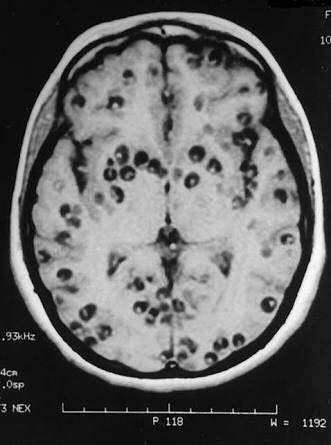

Source: "Ac Sub Spe Rotate 3 MDCU 70" (file "sub special MCQ MDCU70 Rotate3."), questions recalled by students, mixed Thai and English. This is a subspecialty MCQ paper, so it is kept apart from General Surgery and is not tagged into the exam topic map.
The paper's own numbers are kept (Q1, 2, 3, 5, 9, 16-29, 32, 43, 44, 55, 59, 72, 73, 88); the other numbers of the exam are not in the paper. Five questions are written "XX" with no number. They are numbered Q201-Q205 in the order they appear, and their heading says "unnumbered question n" - there "original no." is only their order among the unnumbered questions, not a number printed in the paper.
Answers: there is no answer key. Some questions (mostly the neurosurgery ones, Q16-Q22 and Q26-Q29, with Q3 and one "XX") are written as a short description followed by "ans: ...". Those answers were written in the paper by the students who recalled the exam. They are NOT an official key and may be wrong. They are copied as written and marked as such in the Answer line. Every other question says "not given in the source".
The paper numbers its choices 1, 2, 3 ...; they are given here as A, B, C ... in the same order. Many questions list only the choices the students remembered. Q16-Q22, Q26-Q29 and Q3 have no choices because the paper gives only the description and the recalled answer; Q27, Q88, Q204 and Q205 have only a stem.
Q25 has one picture (a brain MRI) with no name, label or ID band; the small scanner settings printed on it are kept.
exam_year 2018 is taken from the paper's file date (May 2018); the paper does not state the year.
The rotation number (3) is not mapped to a G.

## Q1 (original no. 1)
Mass at renal, hyperechoic, patient intermittent pain with movement. What is the proper managment?

A. F/U ultrasound
B. Biopsy
C. Partial nephrectomy
D. Total nephrectomy
E. CMT

**Answer:** not given in the source
**Explanation:** not stated
**Guideline / source:** not stated

## Q2 (original no. 2)
Male 70 yr, heavy smoker, gross painless hematuria, no LUTS, no flank pain. What is most likely diagnosis?

A. RCC
B. TCC
C. Stone

**Answer:** not given in the source
**Explanation:** not stated
**Guideline / source:** not stated

## Q3 (original no. 3)
ก้อนที่ penis จะwork upอะไรต่อ น่าจะตอบ incisional biopsy ตรงแอคเก่า

**Answer:** incisional biopsy (the author writes "probably" and that it matches an old past exam) (written under the question in the paper by the students; not an official key)
**Explanation:** not stated
**Guideline / source:** not stated

## Q5 (original no. 5)
female 55yr asymptomatic microscopic hematuria. Hx of right staghorn stone s/p PCNL 10 yr ago. VCUG nm proper investigation?

A. retrograde pyelogram
B. CT urography
C. URS

**Answer:** not given in the source
**Explanation:** not stated
**Guideline / source:** not stated

## Q9 (original no. 9)
ใครควรจะ retain foley

A. AUR
B. Recurrent UTI
C. Dysuria+หนอง
D. ตกคร่อมตอ+bleeding

**Answer:** not given in the source
**Explanation:** not stated
**Guideline / source:** not stated

## Q16 (original no. 16)
Male 20 years old with no U/D and no Hx of trauma presented with drowsiness in the morning/ motor at least 3 all extremities/ CT-nc: intraventricular hemorrhage

**Answer:** CTA r/o AVM (written under the question in the paper by the students; not an official key)
**Explanation:** not stated
**Guideline / source:** not stated

## Q17 (original no. 17)
female 38 years old presented with spontaneous with right CN VI, CII palsies and left hemianesthesia/ CT: a popcorn pattern hyperintensity mass rt pons

**Answer:** cavernous malformation (written under the question in the paper by the students; not an official key)
**Explanation:** not stated
**Guideline / source:** not stated

## Q18 (original no. 18)
elderly with HT presented with sudden drowsiness/ CT-nc: large hematoma at posterior cranial fossa = cerebellar hemorrhage

**Answer:** surgical treatment indicated (written under the question in the paper by the students; not an official key)
**Explanation:** not stated
**Guideline / source:** not stated

## Q19 (original no. 19)
elderly with HT presented with sudden loss of consciousness/ high BP, irregular breathing, deep comatose, pupils 1 mm not reactive to light both eyes, abnormal extension motor response all extremities, neck stiffness +ve

**Answer:** SAH (written under the question in the paper by the students; not an official key)
**Explanation:** not stated
**Guideline / source:** not stated

## Q20 (original no. 20)
imaging: left occipital lobe contusion (เดา)

**Answer:** ทํา angiogram with embolisation ไม่เกิดประโยชน์ (written under the question in the paper by the students; not an official key)
**Explanation:** not stated
**Guideline / source:** not stated

## Q21 (original no. 21)
Elderly with Hx of lung cancer presented with neurodeficit(s)/ imaging: CT, MRI T1+T2+FLAIR showed +- irregular ring enhancing lesion with perilesional edema

**Answer:** schwannoma (written under the question in the paper by the students; not an official key)
**Explanation:** not stated
**Guideline / source:** not stated

## Q22 (original no. 22)
A patient with Hx. of poorly controlled DM, presented with 3 weeks neurodeficit(s)

**Answer:** toxoplasmosis (written under the question in the paper by the students; not an official key)
**Explanation:** not stated
**Guideline / source:** not stated

## Q23 (original no. 23)
What of the following is not true in brain abscess?

A. Mostly have fever

**Answer:** not given in the source (only one choice was recalled)
**Explanation:** not stated
**Guideline / source:** not stated

## Q24 (original no. 24)
ATB that cannot go through BBB

A. vancomycin
B. ampicillin
C. chloramphenical
D. aminoglycoside

**Answer:** not given in the source
**Explanation:** not stated
**Guideline / source:** not stated

## Q25 (original no. 25)
A 12 year old girl presented with the first episode of a tonic clonic seizure/ imaging: multiple small ring enhancement and focal enhancing lesions = intracerebral+intraventricular cysts

A. cysticercosis
B. brain abscess
C. Toxoplasmosis metastasis

**Answer:** not given in the source
**Explanation:** not stated
**Guideline / source:** not stated

## Q26 (original no. 26)
Child bearing age woman presented with infertility and bilateral hemianopia/ imaging: pituitary tumor

**Answer:** prolactinoma (written under the question in the paper by the students; not an official key)
**Explanation:** not stated
**Guideline / source:** not stated

## Q27 (original no. 27)
Pinealoma physical examinations/ light near dissociation = pupil accomodates but does not react to light

**Answer:** not given in the source (the paper has only the stem, no choices)
**Explanation:** not stated
**Guideline / source:** not stated

## Q28 (original no. 28)
A middle aged man presented with increased intracranial pressure, left hemiparesis, right FTN +ve, weber lateralised to left but rinne AC>BC both ears

**Answer:** vestibular schwannoma (written under the question in the paper by the students; not an official key)
**Explanation:** not stated
**Guideline / source:** not stated

## Q29 (original no. 29)
A middle aged man presented with increased intracranial pressure, left hemiparesis

**Answer:** convexity meningioma (written under the question in the paper by the students; not an official key)
**Explanation:** not stated
**Guideline / source:** not stated

## Q32 (original no. 32)
ชายแก่ ไข้ ไอ CXR เจอ pleural effusion ทำอะไรต่อ

A. Ultrasoud effusion
B. Thoracocentesis
C. Bronchoscope
D. ICD
E. Decorticate

**Answer:** not given in the source
**Explanation:** not stated
**Guideline / source:** not stated

## Q43 (original no. 43)
ตรง ac ผู้ป่วย motorcycle accident มี nasal and oral bleeding, hypotension ควรทำอะไรเป็นอันดับแรก

A. ใส่ ET tube
B. IV resuscitation
C. anterior nasal packing

**Answer:** not given in the source
**Explanation:** not stated
**Guideline / source:** not stated

## Q44 (original no. 44)
ผู้หญิง อายุ 35ปี มีแผลหน้าท้อง ลึกถึง subcutaneous fat ขนาด 5×8 cm ควรรักษาด้วยวิธีใด

A. primary closure
B. secondary closure
C. skin graft
D. skin flap
E. free flap

**Answer:** not given in the source
**Explanation:** not stated
**Guideline / source:** not stated

## Q55 (original no. 55)
at opd ไข้ ไอ หอบ มีright pleural effusion tapได้ thick green fluid รักษาอย่างไรต่อ

A. oral ATB
B. percutaneous drain
C. ICD
D. decorticate

**Answer:** not given in the source
**Explanation:** not stated
**Guideline / source:** not stated

## Q59 (original no. 59)
Newborn, excessive drooling, มี air in bowel loop รักษายังไง

A. Ligate fistula, delayed primary repair
B. Divert fistula, esophageal anastomosis

**Answer:** not given in the source
**Explanation:** not stated
**Guideline / source:** not stated

## Q72 (original no. 72)
ผู้หญิง DM HIV มีไข้ ปวดหัว CT brain ถาม Dx

A. Cystic cercosis
B. Metastasis
C. Brain abscess
D. Toxoplasmosis

**Answer:** not given in the source
**Explanation:** not stated
**Guideline / source:** not stated

## Q73 (original no. 73)
Anterior mediastinal mass with clinical MG (ptosis, weakness). What would be proper management in this patient?

A. Thymomectomy + biopsy if malignant start CMT RT
B. CMT RT as treatment, Sx is just for residual tumor
C. Sx excision then CMT therapy due to ray resistance

**Answer:** not given in the source
**Explanation:** not stated
**Guideline / source:** not stated

## Q88 (original no. 88)
fistula in ano รักษาแบบใด incorrect

**Answer:** not given in the source (the paper has only the stem, no choices)
**Explanation:** not stated
**Guideline / source:** not stated

## Q201 (original no. 1, topic: unnumbered question 1 (no number in the paper))
Pyelonephitis treatment

**Answer:** bed rest, IV ATB, anti-pyretic drug, hydration (all of the above) (written under the question in the paper by the students; not an official key)
**Explanation:** not stated
**Guideline / source:** not stated

## Q202 (original no. 2, topic: unnumbered question 2 (no number in the paper))
Management of communication hydrocele

A. (not recalled)
B. (not recalled)
C. (not recalled)
D. Hydrocelectomy through scrotal incision
E. Hydrocelectomy through inguinal incision

**Answer:** not given in the source
**Explanation:** the paper numbers the two recalled choices 4 and 5; the choices 1-3 are not recalled
**Guideline / source:** not stated

## Q203 (original no. 3, topic: unnumbered question 3 (no number in the paper))
Pleural effusion, tapped found thick green. What will be the management of choice?

A. ICD
B. Percutaneous drainage with stent
C. Decorticate

**Answer:** not given in the source
**Explanation:** not stated
**Guideline / source:** not stated

## Q204 (original no. 4, topic: unnumbered question 4 (no number in the paper))
Staging diverticulitis
Her....

**Answer:** not given in the source (the paper has only this cut-off stem, no choices)
**Explanation:** not stated
**Guideline / source:** not stated

## Q205 (original no. 5, topic: unnumbered question 5 (no number in the paper))
view ที่ใช้ดู maxilla

**Answer:** not given in the source (the paper has only the stem, no choices)
**Explanation:** not stated
**Guideline / source:** not stated

## Flagged for checking
- The "ans:" answers are written by students, not an official key.
- Q21: the stem describes an elderly patient with a history of lung cancer and a ring-enhancing lesion with oedema; the recalled answer says "schwannoma". Is that what the student meant?
- Q17: the stem says "CN VI, CII palsies"; kept as written.
- Q27, Q88, Q204 and Q205 have only a stem.
- exam_year 2018 is taken from the file date.
