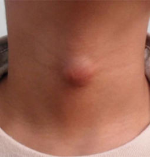
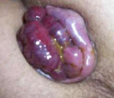
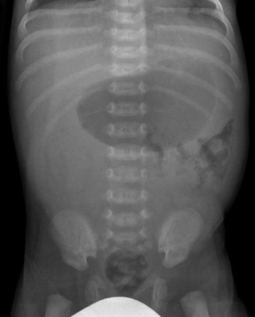
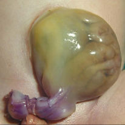
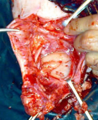
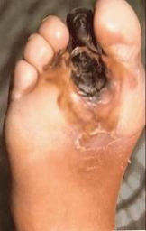
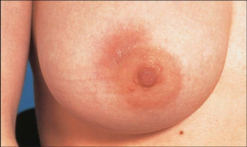
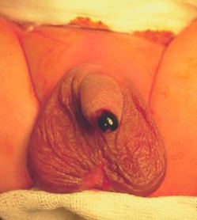
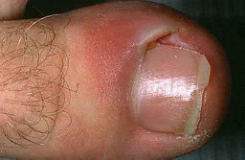

Source: "OSCE + MEQ rotate A MDCU72", MEQ part (slides), recalled by students; the numbers are the paper's own unless said otherwise.
No answer key was found. The students wrote answers by hand on the slides; those are kept as the answer and
marked as the students' own. Small handwriting that could not be read with confidence is marked [?].
The paper opens with the students' comments: "-OSCE ตรงแอคประมาณครึ่งนึง / -MEQ ตรงประมาณ 90-100% / -เพราะว่าสอบต่อกันสองอย่าง + ตรงแอคมากๆ + สอบเสร็จหยุดยาวเลยคำถามไม่ครบนิดนึงนะ".
The slides for MEQ5 and MEQ9 have their numbers circled in red in the paper; the paper does not say why.
The OSCE part of this paper is in exams/mdcu72-gen-a-osce.
exam_year 2020 follows the MDCU72 A MCQ paper's own PDF date (March 2020); this paper's PDF has no date of its own and its Drive copy is dated April 2022. The paper does not state the year.
The rotation (A) is not mapped to a G.
Pictures with no face, name, label or ID band were checked by eye and are kept in images/ under their question; the others are described in words only. Left out: MEQ4 and MEQ5 (they show faces) and the students' handwritten answer for MEQ12.

## Q1 (original no. 1)
มีก้อนที่คอมานานหลายปี ช่วง 1 ปีนี้โตมากขึ้น
[picture in the paper: a round lump in the midline of the front of the neck]
- 1.1 Provisional diagnosis
- 1.2 Investigation 1 ข้อ

**Answer:** 1.1: thyroglossal duct cyst; 1.2: U/S (highlighted); also written: thyroid scans, blood test, R/O ectopic thyroid gland (handwritten in the paper by the students; not an official key)
**Explanation:** not stated
**Guideline / source:** not stated

## Q2 (original no. 2)
มีเลือดออกทางทวารหนัก ตรวจพบมีก้อนที่ทวารหนัก ต้องดันกลับเอง
[picture in the paper: a purple, swollen, lobulated mass protruding from the anus]
- 2.1 บรรยายลักษณะของก้อน
- 2.2 สาเหตุของการมีเลือดออกทางทวารหนัก
- 2.3 Treatment

**Answer:** 2.1: Thrombosed circumferential mass protruding from anal canal; 2.2: strangulated prolapsed hemorrhoid (written, then crossed out in the paper); 2.3: Closed hemorrhoidectomy [Urgent] (handwritten in the paper by the students; not an official key)
**Explanation:** not stated
**Guideline / source:** not stated

## Q3 (original no. 3)
จงบอกความแตกต่างระหว่าง superficial second-degree burn กับ deep second-degree burn ในทุกๆด้าน รวมทั้งการดูแลรักษา

**Answer:** Superficial 2nd degree: Heal w/ no scarring, ∴ ป้องกัน infect.; Deep 2nd degree: Heal w/ Severe scarring, ∴ ใส่ pressure garment; a note between them: เปลี่ยนได้ถ้า Tx. ไม่ดี [?] (handwritten in the paper by the students; not an official key)
**Explanation:** not stated
**Guideline / source:** not stated

## Q4 (original no. 4)
[picture in the paper: an infant with a cleft lip]
- 4.1 จงให้คำแนะนำในการดูแลผู้ป่วยต่อมารดา
- 4.2 What is the recommended age to repair the problem as seen in the picture? Reason?

**Answer:** 4.1: กินอาหารได้ตามปกติ [?], Genetic Counseling; 4.2: 3 month (10 week) (handwritten in the paper by the students; not an official key)
**Explanation:** not stated
**Guideline / source:** not stated

## Q5 (original no. 5)
ผู้ป่วยถูกฟันด้วยมีดที่บริเวณใบหน้า เกิดบาดแผลดังรูป จะเกิน injury ต่อ nerve ใดบ้าง และจะตรวจได้อย่างไร
[picture in the paper: side view of a man's face with a long cut across the cheek]

**Answer:** Buccal branch of facial n. → ลองให้ยิ้มดู [จะยิ้มไม่ได้ 1 ข้าง]; Stessen duct ? (as written, with a question mark) (handwritten in the paper by the students; not an official key)
**Explanation:** not stated
**Guideline / source:** not stated

## Q6 (original no. 6)
A newborn baby with sudden bilious vomiting, previously healthy
[picture in the paper: an abdominal x-ray of a newborn]
- 6.1 Provisional diagnosis
- 6.2 Treatment

**Answer:** 6.1: Midgut volvulus; 6.2: Ladd's procedure (handwritten in the paper by the students; not an official key)
**Explanation:** not stated
**Guideline / source:** not stated

## Q7 (original no. 7)
[picture in the paper: a newborn's abdominal wall defect with a large membrane-covered sac and the cord attached]
- 7.1 What is the diagnosis?
- 7.2 What anomalies do you have to look for?
- 7.3 What is your initial management?

**Answer:** 7.1: Omphalocele; 7.2: Beckwith Wiedemann Syndrome, Wilm's tumor; 7.3: IV resuscitate; Povidone Iodine ชุบ Sterile gauze โปะไว้ + Sterile gauze แห้ง [?]; IV ATB; NG tube [decompression], NPO; Keep warm/↓ fluid loss: ใส่ตู้อบ [?] / คลุมถุงพลาสติก; รีบส่งตัว (handwritten in the paper by the students; not an official key)
**Explanation:** not stated
**Guideline / source:** not stated

## Q8 (original no. 8)
จงเขียน Postoperative order ของการผ่าตัดเพื่อรักษาไส้เลื่อน
[picture in the paper: an open groin operation]

**Answer:** One day: Routine post. op. care; v/s record q 15 min. x 4 time then q 30 min. x 2 time then q 1 hr. until stable; Morphine 3 mg iv prn for pain q 4 hr.; Metoclopramide 10 mg iv prn for N/V q 6 hr.; 5% D/2 iv 2000 ml rate 80 ml/hr.; Observe void, if not void after 6hr please notify; Observe Scrotal hematoma, wound hematoma. Continue: regular diet; record v/s, I/O OD. Med: Paracetamol (500 mg) 2 tabs po prn for pain q 4-6 hr. (handwritten in the paper by the students; not an official key)
**Explanation:** not stated
**Guideline / source:** not stated

## Q9 (original no. 9)
[picture in the paper: the sole of a foot with black, dead tissue at the second toe]
- 9.1 Describe the lesion
- 9.2 Cause (3 ข้อ)
- 9.3 Physical examination (3 ข้อ)

**Answer:** 9.1: Gangrenous right 2nd toe; 9.2: Hypertension, Smoking, Dyslipidemia (→ Atherosclerotic change); 9.3: extremities pulse, ABI, Handheld doppler Ultrasonography (handwritten in the paper by the students; not an official key)
**Explanation:** not stated
**Guideline / source:** not stated

## Q10 (original no. 10)
Female with history of breast feeding
[picture in the paper: a breast with a red area of skin]
- 10.1 Describe the lesion
- 10.2 Give 2 differential diagnosis

**Answer:** 10.1: Redness of skin at right upper outer periareolar area; 10.2: Acute mastitis of right breast; Inflammatory Carcinoma ? (with a question mark) (handwritten in the paper by the students; not an official key)
**Explanation:** not stated
**Guideline / source:** not stated

## Q11 (original no. 11)
A newborn with imperforate anus
[picture in the paper: the perineum of a newborn boy]
- 11.1 Diagnosis
- 11.2 Associated anomalies
- 11.3 Treatment

**Answer:** 11.1: Anorectal malformation: Rectourethral fistula; 11.2: Vertebra, Anorectal malformation, Cardiac anomaly, TE-fistula, Renal/Radial, Limb; 11.3: 3 step operation: 1. Colostomy 2. Posterior Sagittal anorectoplasty [PSARP] 3. Closure of colostomy (handwritten in the paper by the students; not an official key)
**Explanation:** not stated
**Guideline / source:** not stated

## Q12 (original no. 12)
เจ็บเท้ามา 2 วัน
[picture in the paper: a red, swollen nail fold of a big toe]
- 12.1 Diagnosis
- 12.2 Cause
- 12.3 Management

**Answer:** 12.1: Paronychia; 12.2: ∵ ตัดเล็บผิดวิธี [?] → infection; 12.3: Tx: warm soak + oral antibiotics; incisional & drainage; remove nail (handwritten in the paper by the students; not an official key)
**Explanation:** not stated
**Guideline / source:** not stated

## Flagged for checking
- Q2: the students wrote "strangulated prolapsed hemorrhoid" and then crossed it out; no other cause is written.
- Q8: drug doses and the IV fluid order are the students' handwriting; check them before use.
- Q10: the students marked "Inflammatory Carcinoma" with a question mark.
