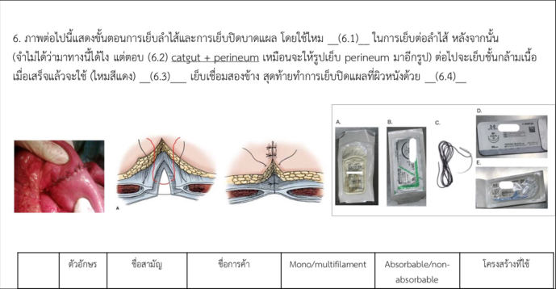
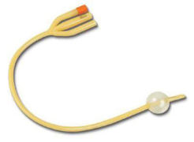

Source: "OSCE + MEQ rotate A MDCU72", OSCE part, recalled by students; the numbers are the paper's own unless said otherwise.
No answer key was found; there are no checklists, so every checklist is "not given in the source".
The paper opens with the students' comments: "-OSCE ตรงแอคประมาณครึ่งนึง / -MEQ ตรงประมาณ 90-100% / -เพราะว่าสอบต่อกันสองอย่าง + ตรงแอคมากๆ + สอบเสร็จหยุดยาวเลยคำถามไม่ครบนิดนึงนะ".
Stations 1-9 are listed on page 1. Page 3 has a slide labelled "OSCE11" (a 3-way Foley catheter) with the
students' handwritten answers; it is kept as Q11, its own number, although it looks like the same station as Q6.
The MEQ part of this paper is in exams/mdcu72-gen-a-meq.
exam_year 2022 is taken from the paper's file date (April 2022, the Drive file date; the PDF has no date of its own, so this may be a later upload); the paper does not state the year.
The rotation (A) is not mapped to a G.
Pictures with no face, name, label or ID band were checked by eye and are kept in images/ under their question; the others are described in words only.

## Q1 (original no. 1)
จงซักประวัติผู้ป่วยมาด้วยก้อนในตับให้ครอบคลุม มีอาจารย์นั่งติ๊กว่าเราซักประเด็นนี้ยัง คนไข้จำลองจะซักแล้วได้ negative ทั้งหมด แต่ซักไปเรื่อยๆจนหมดเวลา

**Station type:** history taking (simulated patient)
**Checklist:** not given in the source
**Explanation:** not stated
**Guideline / source:** not stated

## Q2 (original no. 2)
เย็บ vertical mattress 3 sutures ใน 2 นาที มีกล่องถุงมือให้ใส่ด้วย แต่อาจารย์ในฐานให้ข้ามขั้นใส่ถุงมือเลย

**Station type:** procedure (suturing)
**Checklist:** not given in the source
**Explanation:** not stated
**Guideline / source:** not stated

## Q3 (original no. 3)
ให้ประวัติผู้ป่วยปัสสาวะมีเลือดปน มีรายละเอียดมากกว่านี้นิดนึง เขียน investigation + differentials

**Station type:** written station
**Checklist:** not given in the source
**Explanation:** not stated
**Guideline / source:** not stated

## Q4 (original no. 4)
แสดงการตรวจเต้านมทั้งหมด และอธิบายขั้นตอน (หุ่นมี lesion ผิดปกติอยู่จริง แต่คำสั่งไม่ได้บอกให้รายงานด้วยแต่บางคนก็รายงานอาจารย์ด้วย)

**Station type:** physical examination (manikin)
**Checklist:** not given in the source
**Explanation:** not stated
**Guideline / source:** not stated

## Q5 (original no. 5)
Identify+ บอกที่ใช้: penrose drainage, abdominal stapler, army navy retractor, chest tube, (rubber band ligator?),…

**Station type:** instruments and devices
**Checklist:** not given in the source
**Explanation:** not stated
**Guideline / source:** not stated

## Q6 (original no. 6)
three-way foley catheter + indication

**Station type:** instruments and devices
**Checklist:** not given in the source
**Explanation:** not stated
**Guideline / source:** not stated

## Q7 (original no. 7)
ให้สีซองไหมมา ให้บอกชื่อไหม + ชนิดไหม

**Station type:** instruments and devices (sutures)
**Checklist:** not given in the source
**Explanation:** not stated
**Guideline / source:** not stated

## Q8 (original no. 8)
บรรยายผล mammogram + บอกชื่อ view + บอก differential diagnoses ที่คิดถึง

**Station type:** imaging interpretation
**Checklist:** not given in the source
**Explanation:** not stated
**Guideline / source:** not stated

## Q9 (original no. 9)
ถามเรื่องด้ายกับการใช้ตามนี้เลย

[picture in the paper, pasted by the students to show the question: a printed question numbered "6." reading "ภาพต่อไปนี้แสดงขั้นตอนการเย็บลำไส้และการเย็บปิดบาดแผล โดยใช้ไหม __(6.1)__ ในการเย็บต่อลำไส้ หลังจากนั้น (จำไม่ได้ว่ามาทางนี้ได้ไง แต่ตอบ (6.2) catgut + perineum เหมือนจะให้รูปเย็บ perineum มาอีกรูป) ต่อไปจะเย็บชั้นกล้ามเนื้อ เมื่อเสร็จแล้วจะใช้ (ไหมสีแดง) __(6.3)__ เย็บเชื่อมสองข้าง สุดท้ายทำการเย็บปิดแผลที่ผิวหนังด้วย __(6.4)__"; with a photo of a sutured bowel, two drawings of a layered wound closure, photos of five suture packets labelled A-E, and an empty table with the columns ตัวอักษร, ชื่อสามัญ, ชื่อการค้า, Mono/multifilament, Absorbable/non-absorbable, โครงสร้างที่ใช้]

**Station type:** instruments and devices (sutures), written
**Checklist:** not given in the source (the pasted question only shows "catgut + perineum" as the remembered answer to 6.2)
**Explanation:** not stated
**Guideline / source:** not stated

## Q11 (original no. 11)
OSCE11
[picture in the paper: a three-way Foley catheter]
- 11.1 ชื่ออุปกรณ์
- 11.2 Specific indication

**Station type:** instruments and devices
**Checklist:** 11.1: 3-way foley catheter; 11.2: Continuous Bladder irrigation (After clot removed) (handwritten in the paper by the students; not an official key)
**Explanation:** not stated
**Guideline / source:** not stated
