Source: "MEQ Surgery Rotate C MDCU 72" (file "MEQ Surgery Rotate C", dated October 2019), questions recalled by students, mixed Thai and English. The paper's own review says: 14 questions, 3 minutes each; you sit in one place while the examiner shows slides one after another; you may choose any seat (some seats may see the slides less clearly); before entering you get a name sticker to stick on every page of the answer sheet; the paediatric surgery questions almost give the diagnosis from the picture, but several diseases look alike, so look at the child's age; the exam was fairly close to the past exam ("ตรงแอค"), only the first question was a surprise. The paper was sat at the end of the whole surgery rotation, so it combines General Surgery and subspecialty content and is filed whole. It is a low-priority set (see CLAUDE.md). The OSCE part of the same exam is in `mdcu72-gen-c-osce`.
Numbers Q1-Q14 are the paper's own. No answer key was found and the paper gives no answers, so every answer is "not given in the source". Q5, Q7, Q8, Q9, Q11 and Q14 are only a picture with items (their stems say so). The names of examiners written in the paper are kept as written.
Pictures with no name, label or ID band are kept in images/ under their question. The Q11 picture is left out because it carries a website watermark. The paper's Q10 note says the real exam had a video and three pictures.
exam_year 2019 follows the PDF date (October 2019) and the MDCU 72 rotate C MCQ paper; the paper does not state the year.
The rotation letter (C) is not mapped to a G.

## Q1 (original no. 1)
ผู้ป่วยชายไทยมาด้วยอาการตัวเหลืองตาเหลือง
PE : palpable, painless, non-tender cystic mass below costal margin, move along with respiration

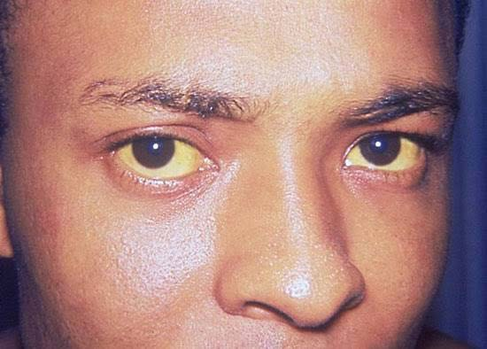
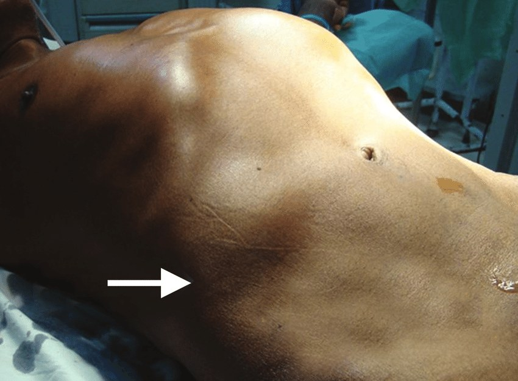
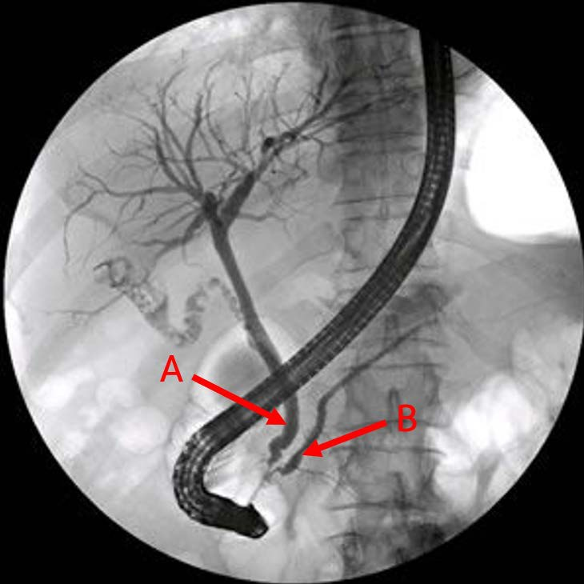

1.1 จงบอกชื่อ sign ที่ตรวจพบได้ที่ตรวจได้ในผู้ป่วยรายนี้
1.2 จง differential diagnosis (benign 1 โรค, malignant 4 โรค)
1.3 จงตอบชื่อเต็มของการตรวจนี้
1.4 identify A,B

**Answer:** not given in the source
**Explanation:** not stated
**Guideline / source:** not stated

## Q2 (original no. 2)
ผู้ป่วยชายอายุ 40 ปี มาด้วยอาการปวดท้อง

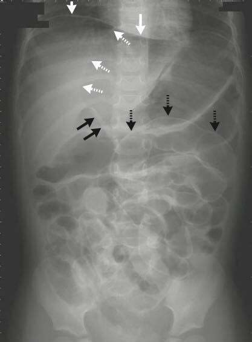

2.1 บรรยายความผิดปกติที่พบในผู้ป่วยรายนี้
2.2 ยกตัวอย่างสาเหตุที่น่าจะเกิดมากที่สุด 2 อย่าง

**Answer:** not given in the source
**Explanation:** not stated
**Guideline / source:** not stated

## Q3 (original no. 3)
ผู้ป่วยมีประวัติเป็น DM มีแผลดังรูป

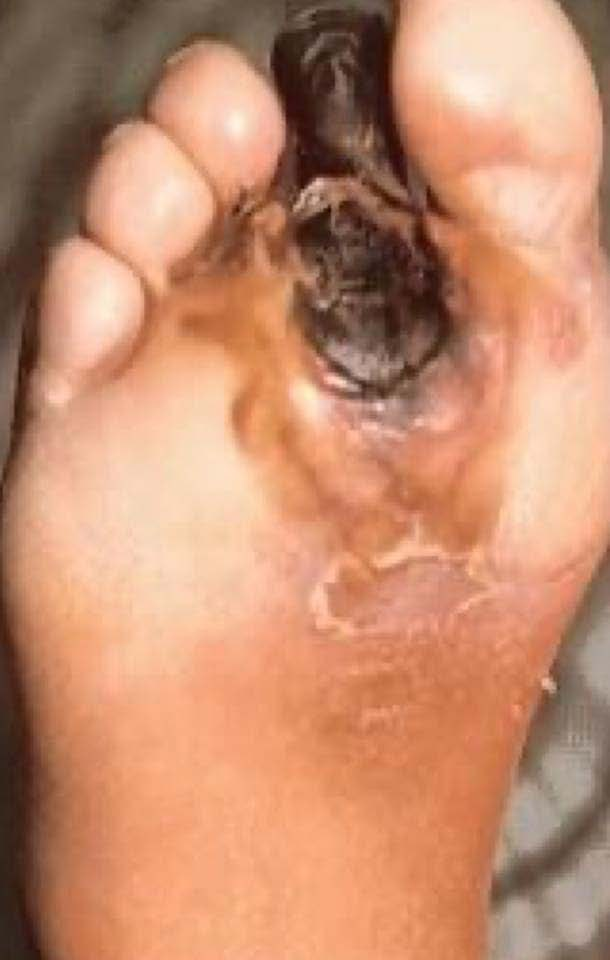

3.1 บรรยายความผิดปกติที่พบ
3.2 จะตรวจร่างกายอะไรเพิ่มเติม
3.3 น่าจะเกิดจากอะไรมากที่สุด

**Answer:** not given in the source
**Explanation:** not stated
**Guideline / source:** not stated

## Q4 (original no. 4)
ผู้ป่วยมีแผลที่นิ้วเท้าดังรูป

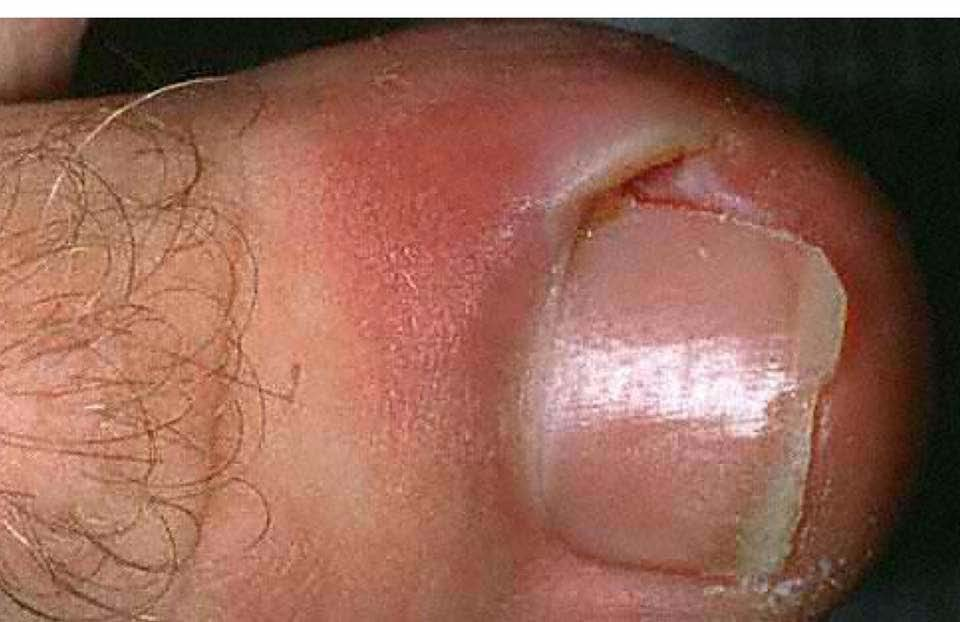

4.1 จงให้การวินิจฉัย
4.2 เกิดจากอะไรมากที่สุด (2 อย่าง)
4.3 รักษายังไง
(*ถ้ามียา ให้ตอบชื่อ + dose ด้วย)

**Answer:** not given in the source
**Explanation:** not stated
**Guideline / source:** not stated

## Q5 (original no. 5)
(no stem text in the paper; the question has only the pictures and items 5.1-5.3)

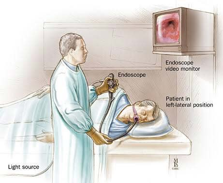
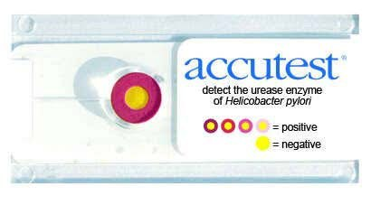

5.1 จงบอกชื่อการตรวจนี้
5.2 แปลผลว่าอะไร
5.3 จะทำการรักษายังไง
5.1 ต้องตอบสองคำตอบเลย
5.3 ให้ตอบ dose ยาด้วย

**Answer:** not given in the source
**Explanation:** not stated
**Guideline / source:** not stated

## Q6 (original no. 6)
เปิดวิดิโอแสดงการตรวจ motor function ของกล้ามเนื้อ 3 มัด ถามว่าเป็นการตรวจกล้ามเนื้อมัดไหน innervation ด้วย nerve root อะไร
(วิดิโอเหมือนในสไลด์อาจารย์พีรพงษ์เลย กลุ่มไหนไม่ได้เรียนกับอาจารย์ก็ไปขอสไลด์เพื่อนนะ)

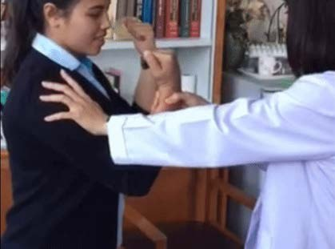
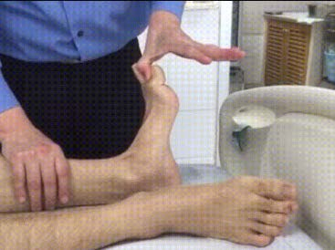
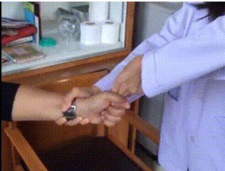

**Answer:** not given in the source
**Explanation:** not stated
**Guideline / source:** not stated

## Q7 (original no. 7)
(no stem text in the paper; the question has only the picture and items 7.1-7.2)

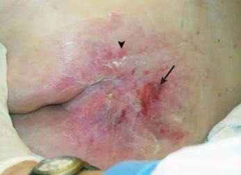

7.1 แผลที่พบเกิดจากผู้ป่วยทำท่าอะไร
7.2 โดนกระดูกอะไร

**Answer:** not given in the source
**Explanation:** not stated
**Guideline / source:** not stated

## Q8 (original no. 8)
(no stem text in the paper; the question has only the picture and items 8.1-8.2)

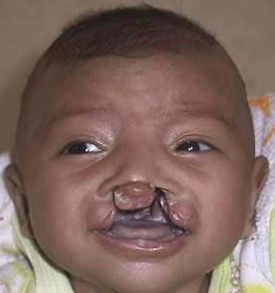

8.1 เด็กคนนี้ควรได้รับการผ่าตัดตอนอายุเท่าไหร่
8.2 เพราะเหตุใด

**Answer:** not given in the source
**Explanation:** not stated
**Guideline / source:** not stated

## Q9 (original no. 9)
(no stem text in the paper; the question has only the picture and items 9.1-9.2)

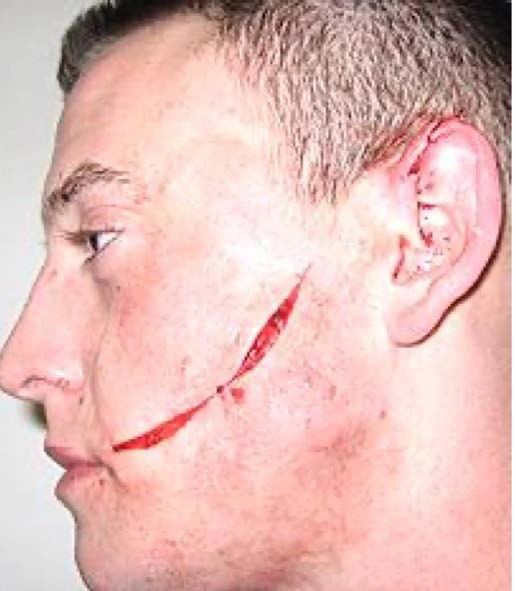

9.1 บอกความผิดปกติที่น่าจะเกิดในผู้ป่วยรายนี้
9.2 สามารถตรวจได้อย่างไร

**Answer:** not given in the source
**Explanation:** not stated
**Guideline / source:** not stated

## Q10 (original no. 10)
ผู้ป่วยมาด้วยอาการกลืนลำบาก มีผลการตรวจดังนี้
(ของจริงคือจะมีวิดิโออันนึงกับรูปสามรูปนะ แต่รู้สึกว่ารูปจะเห็น diaphragm ไม่ค่อยชัด)

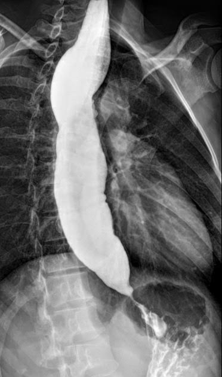

10.1 จงบอกชื่อการตรวจดังกล่าว
10.2 บรรยายความผิดปกติที่พบ
10.3 วินิจฉัยและบอกพยาธิสภาพของโรค

**Answer:** not given in the source
**Explanation:** not stated
**Guideline / source:** not stated

## Q11 (original no. 11)
(no stem text in the paper; the question has only the picture and items 11.1-11.2)
[picture in the paper: a photograph of lumpy tissue around the anus; left out because it carries a website watermark]

11.1 จงให้การวินิจฉัย
11.2 ควรตรวจอะไรเพิ่มเติม และจะให้การรักษาอย่างไร

**Answer:** not given in the source
**Explanation:** not stated
**Guideline / source:** not stated

## Q12 (original no. 12)
เด็กผู้ชาย 6 เดือน มาด้วย scrotal swelling

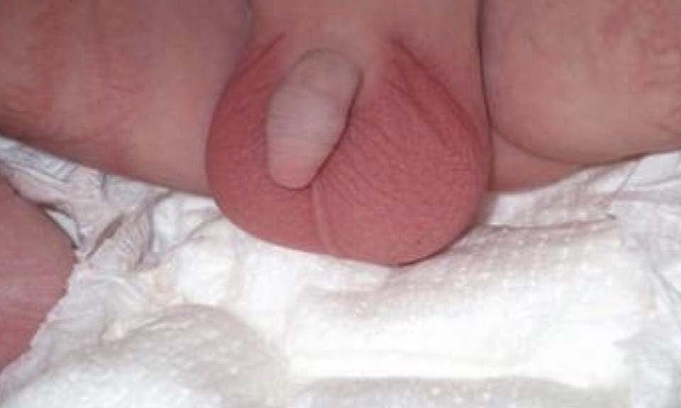

12.1 บอกการตรวจร่างกายที่สำคัญในผู้ป่วยรายนี้
12.2 ผ่าตัดอะไร ตอนอายุเท่าไหร่

**Answer:** not given in the source
**Explanation:** not stated
**Guideline / source:** not stated

## Q13 (original no. 13)
เด็กผู้ชาย 6 เดือน intermittent crying และมีอุจจาระดังรูป

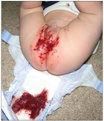

13.1 จงให้การวินิจฉัย
13.2 จงบอก initial management และ definite management

**Answer:** not given in the source
**Explanation:** not stated
**Guideline / source:** not stated

## Q14 (original no. 14)
(no stem text in the paper; the question has only the picture and items 14.1-14.3)

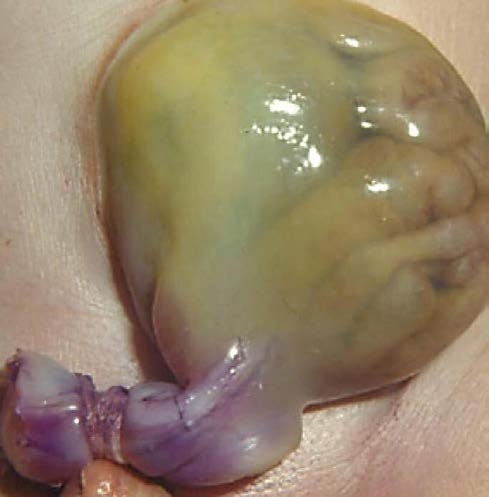

14.1 วินิจฉัย
14.2 ควรหาความผิดปกติอะไรเพิ่มเติม
14.3 จงบอก initial management

**Answer:** not given in the source
**Explanation:** not stated
**Guideline / source:** not stated

## Flagged for checking
- No answer key exists for this paper in the files supplied.
- Q11's picture is not included (watermark).
