Source: "OSCE Surgery Rotate C MDCU 72" (file "OSCE Surgery Rotate C", dated October 2019), stations recalled by students, mixed Thai and English. The paper's own review says: this rotation had 12 stations (4 minutes each) and one rest station where a ward-round review is written; the stations with an examiner were the rectal examination, suturing and history stations, the rest were written; before the exam each student gets a name sticker, hands it to the examiner or sticks it on the answer sheet at each station, and drops the answer sheet in the slot before moving on (do not forget the sticker). The paper was sat at the end of the whole surgery rotation, so it combines General Surgery and subspecialty content and is filed whole. It is a low-priority set (see CLAUDE.md). The MEQ part of the same exam is in `mdcu72-gen-c-meq`.
Numbers Q1-Q12 are the paper's own. The paper ends with the students' "Suggestions" for stations 1-7 (in Thai); they are put in the Checklist line as "students' suggestion" and are NOT an official key. Stations 8-12 are marked "ตามแอคหละ" (as in the past exam). The names of examiners written in the paper are kept as written.
No answer key was found, so a checklist the paper does not give is "not given in the source".
Pictures with no name, label or ID band are kept in images/ under their station. The mammogram films of Q2 and the IVP films after the scout film in Q10 are not in the paper. The letters A-E in the Q6 suture picture are part of the paper's image.
exam_year 2019 follows the PDF date (October 2019) and the MDCU 72 rotate C MCQ paper; the paper does not state the year.
The rotation letter (C) is not mapped to a G.

## Q1 (original no. 1)
ผู้ป่วยมาด้วยอาการถ่ายเป็นเลือด จงแสดงการตรวจร่างกายและวินิจฉัย
(ตอนแรกจะคว่ำรูปมีแต่คนไข้กับหุ่น PR พอตรวจเสร็จอาจารย์จะเปิดรูปแล้วถามในห้องว่า A, B คืออะไร) (station with an examiner)

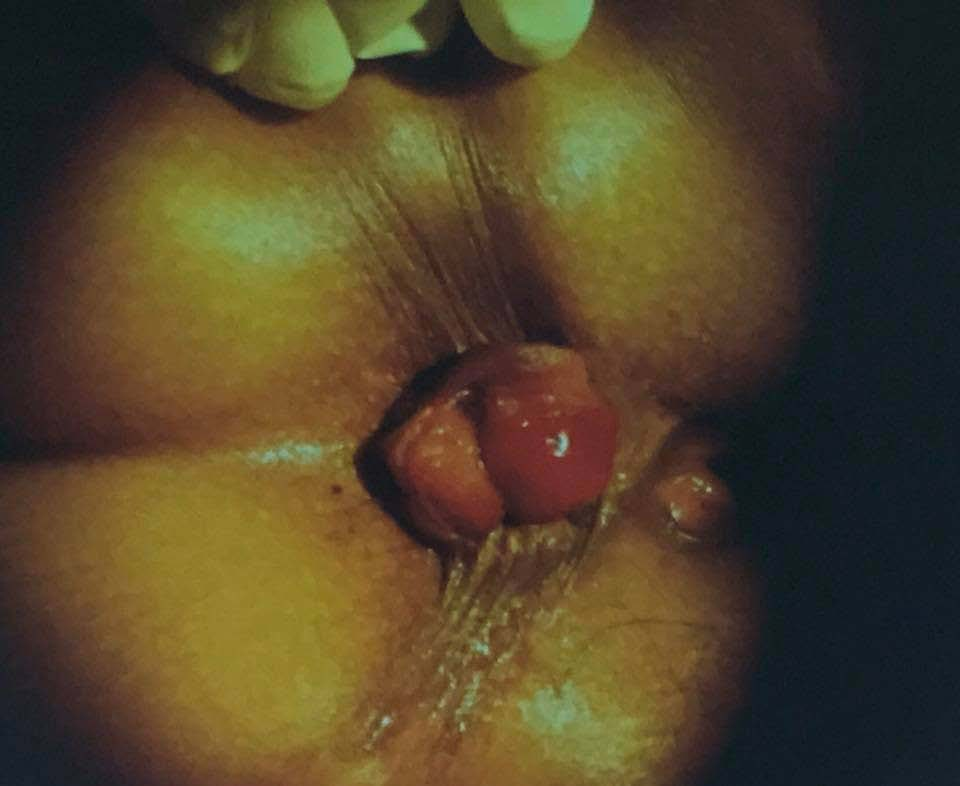

**Station type:** examination (rectal examination on a model) and picture diagnosis
**Checklist:** students' suggestion: introduce yourself, ask the patient's name, say what you will examine, invite the patient onto the bed and position the patient, then go to the model, put on gloves, apply KY jelly, look first for any lesion at the anus (tell the examiner that you are looking), warn the patient before inserting the finger, palpate and ask the patient to squeeze, wipe the patient afterwards, tell the patient to dress, then report to the examiner; afterwards the examiner turns the picture over and asks for the diagnosis: A external haemorrhoid, B internal haemorrhoid, diagnosis combined haemorrhoid (recalled by the students; not an official key)
**Explanation:** not stated
**Guideline / source:** not stated

## Q2 (original no. 2)
ผู้ป่วยหญิงอายุ 60 ปี ตรวจเช็คสุขภาพประจำปี
2.1 บอกชื่อท่าการตรวจ
2.2 พบอะไรบ้างในผู้ป่วยรายนี้
2.3 provisional diagnosis
2.4 ส่งตรวจอะไรเพิ่มเติม
โจทย์ให้รูป mammogram มาสี่รูป Rt MLO, Lt MLO, Rt CC, Rt CC (the films are not included in the paper)

**Station type:** imaging interpretation (mammogram)
**Checklist:** students' suggestion: 2.1 four pictures, so four answers: each is MLO or CC, left or right; 2.2 in this rotation: a lobulated hyperdensity lesion, coarse calcification about 1 x 1 cm in size, at the right upper outer quadrant, right and left axillary lymphadenopathy; 2.3 not sure it is CA breast, because the mass had a very sharp border; 2.4 ultrasound (recalled by the students; not an official key)
**Explanation:** not stated
**Guideline / source:** not stated

## Q3 (original no. 3)
เย็บ simple suture, vertical mattress อย่างละ 1 ท่า ทำตามลำดับเหมือนกับคนไข้จริง (สมมติว่าใส่ถุงมือและฉีดยาชาเสร็จแล้ว) (station with an examiner)

**Station type:** suturing
**Checklist:** students' suggestion, asked of the examiner (the paper names "อ.เหมือนเทพ"): introduce yourself to the patient first; pinch the wound with forceps and ask whether it hurts; say that you are going to insert the needle; the needle must enter at the middle of the wound, and you cannot stitch across to the other side in one go (recalled by the students; not an official key)
**Explanation:** not stated
**Guideline / source:** not stated

## Q4 (original no. 4)
ผู้ป่วยชาย อายุ 40 ปี มาด้วยอาการปวดท้อง มีผลการตรวจเป็นดังนี้

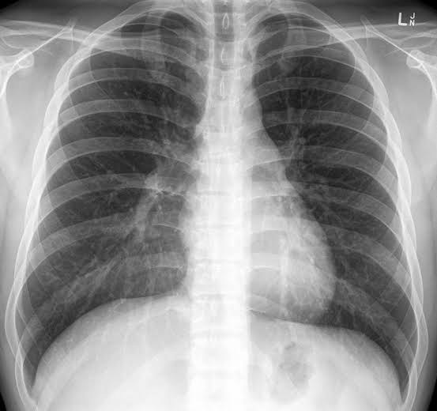
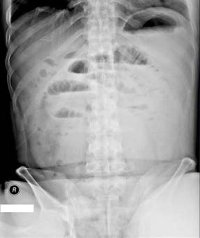
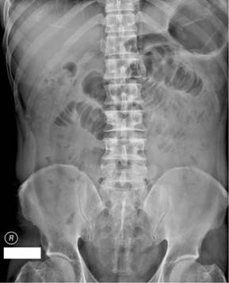

4.1 ถามว่าภาพแต่ละภาพคืออะไร ถ่ายท่าอะไร ตอบตามลำดับ
4.2 บรรยายความผิดปกติที่พบ
4.3 วินิจฉัยพร้อมบอกสาเหตุที่พบมากที่สุด

**Station type:** imaging interpretation (acute abdomen series)
**Checklist:** students' suggestion: the answer is "gut obstruction" by the usual formula; three films were given, but the viewing box held only two, and the third lay on the table where some candidates did not see it (recalled by the students; not an official key)
**Explanation:** not stated
**Guideline / source:** not stated

## Q5 (original no. 5)
ผู้ป่วยหญิงไทยอายุ 40 ปี ปวดท้อง 6 ชั่วโมง ก่อนมาโรงพยาบาล
5.1 ซักประวัติผู้ป่วยรายนี้เพิ่มเติม
5.2 ควรส่งตรวจอะไรเพิ่มเติม 1 อย่าง

**Station type:** history taking
**Checklist:** students' suggestion: the student glimpsed the examiner's checklist: start with introducing yourself, ask the patient's name, occupation, address and home province; this patient was a woman, so also ask gynaecological history; the student was unsure whether PH, FH and SH had to be asked; this patient had gut obstruction, so operation history, no stool and no flatus are very important (recalled by the students; not an official key)
**Explanation:** not stated
**Guideline / source:** not stated

## Q6 (original no. 6)
ภาพต่อไปนี้แสดงขั้นตอนการเย็บลำไส้และการเย็บปิดบาดแผล โดยใช้ไหม __(6.1)__ ในการเย็บต่อลำไส้ หลังจากนั้น (จำไม่ได้ว่ามาทางนี้ได้ไง แต่ตอบ (6.2) catgut + perineum เหมือนจะให้รูปเย็บ perineum มาอีกรูป) ต่อไปจะเย็บชั้นกล้ามเนื้อ เมื่อเสร็จแล้วจะใช้ (ไหมสีแดง) __(6.3)___ เย็บเชื่อมสองข้าง สุดท้ายทำการเย็บปิดแผลที่ผิวหนังด้วย __(6.4)__

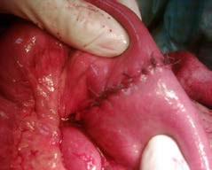
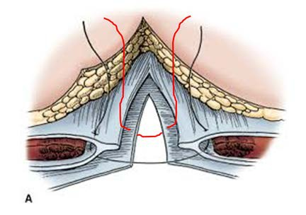
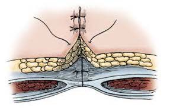
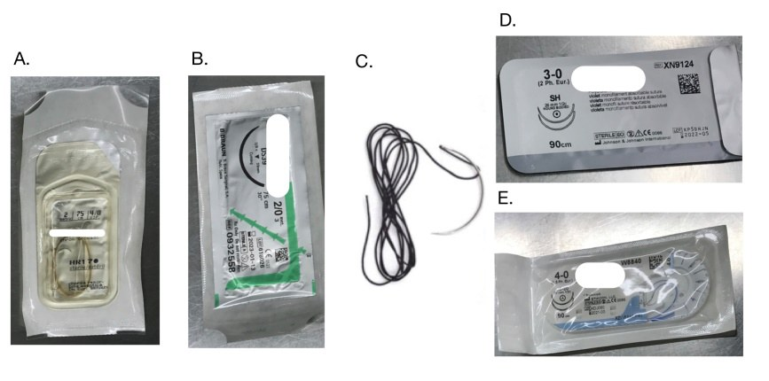

ตาราง (columns: ตัวอักษร, ชื่อสามัญ, ชื่อการค้า, Mono/multifilament, Absorbable/non-absorbable, โครงสร้างที่ใช้; rows 6.1 to 6.4, the structure for 6.1 is pre-filled: Bowel)

**Station type:** suture identification and operative steps
**Checklist:** students' note: the question is an essay with blanks as in the table; some sub-items say which structure is sewn next so the picture is not needed, others ask you to look at the picture; the suture packets have their names covered (one was given as a loose thread); answers go in the table (recalled by the students; not an official key)
**Explanation:** not stated
**Guideline / source:** not stated

## Q7 (original no. 7)
ให้แสดงวิธีการล้างมือ บรรยายขั้นตอนการทำ และใส่ถุงมือ sterile

**Station type:** hand washing and sterile gloving
**Checklist:** students' suggestion: say that you take off your watch; the hand wash was done with alcohol; say aloud what you are doing: rub the palms, the backs of the hands, the nail areas, and so on; then put on gloves, which looked like real surgical gloves, very tight and hard to put on, so be careful at this step (recalled by the students; not an official key)
**Explanation:** not stated
**Guideline / source:** not stated

## Q8 (original no. 8)
จงบอกชื่อของเครื่องมือที่พบ และประโยชน์
A. 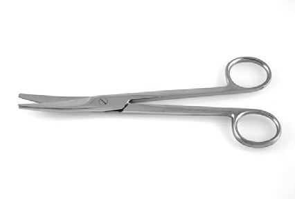
B. 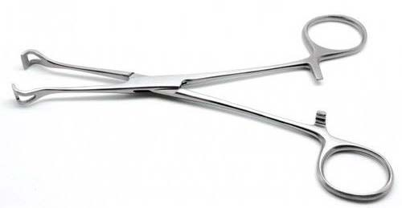
C. 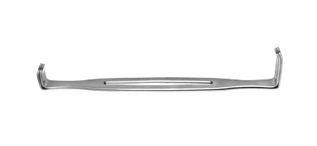
D. 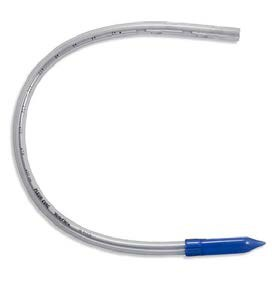

**Station type:** instrument identification
**Checklist:** students' note: stations 8-12 "ตามแอคหละ" (as in the past exam)
**Explanation:** not stated
**Guideline / source:** not stated

## Q9 (original no. 9)
จงบอกชื่อของเครื่องมือที่พบ และประโยชน์
A. 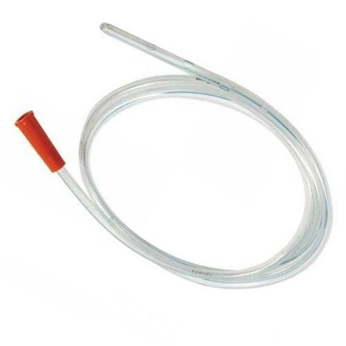
B. 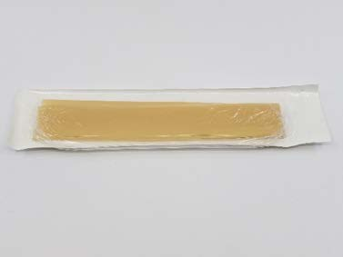

**Station type:** instrument identification
**Checklist:** students' note: stations 8-12 "ตามแอคหละ" (as in the past exam)
**Explanation:** not stated
**Guideline / source:** not stated

## Q10 (original no. 10)
ให้ภาพ IVP ของผู้ป่วยรายหนึ่งมา (อันนี้รูป film scout คล้ายๆกับที่เราได้เลย แต่ของจริงคือให้รูปตั้งแต่ scout phase ไปยัง post void phase เลยอะ ซึ่งเยอะมาก แต่หลังสอบเจออาจารย์ อาจารย์บอกว่าดูแค่รูปแรกก็ตอบได้แล้ว)

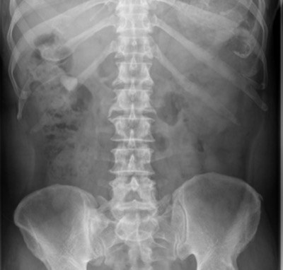

10.1 บรรยายความผิดปกติที่พบ
10.2 จงให้การวินิจฉัย
10.2 รักษายังไง

**Station type:** imaging interpretation (IVP)
**Checklist:** students' note: stations 8-12 "ตามแอคหละ" (as in the past exam)
**Explanation:** not stated
**Guideline / source:** not stated

## Q11 (original no. 11)
ผู้ป่วยชาย อายุ 70 ปี มาด้วยอาการปัสสาวะเป็นสีเลือดสด
11.1 ซักประวัติอะไรเพิ่มเติมเพื่อวินิจฉัยแยกโรค (เขียนตอบ ไม่มีคนไข้)
11.2 ส่งตรวจอะไรเพิ่มเติม

**Station type:** history taking and investigation (written)
**Checklist:** not given in the source
**Explanation:** not stated
**Guideline / source:** not stated

## Q12 (original no. 12)
12.1 อุปกรณ์ดังกล่าวคืออะไร
12.2 specific indication ของอุปกรณ์นี้คืออะไร

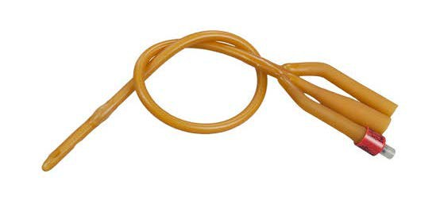

**Station type:** instrument identification
**Checklist:** not given in the source
**Explanation:** not stated
**Guideline / source:** not stated

## Flagged for checking
- No answer key or checklist exists for this paper in the files supplied; the students' suggestions are marked as such.
- Q2: the students are unsure that the finding is breast cancer because the border was very sharp.
- Q10 has two sub-items numbered 10.2; kept as written.
