Source: the MEQ part (page 14-17) of "AChalasia Surgery Rotate B / MDCU72" (file "AChalasia [Sx Rotate B MDCU72 _ Gen+Supspe+OSCE+MEQ]", dated July 2020), questions recalled by students, mostly a picture with short items. The paper was sat at the end of the whole surgery rotation, so it combines General Surgery and subspecialty content and is filed whole. It is a low-priority set (see CLAUDE.md). The OSCE part is in `mdcu72-mixed-b-osce`; the subspecialty MCQ part is in `mdcu72-subspe-b-mcq`.
Numbers Q1-Q13 are the paper's own. No answer key was found and the paper gives no answers, so every answer is "not given in the source". Most questions have no stem text, only a picture and items (their stems say so); Q4 has a stem and notes that the real picture had no arrow.
Pictures with no name, label or ID band are kept in images/ under their question.
exam_year 2020 follows the PDF date (July 2020) and the paper's mention of the covid crisis in its General Sx MCQ part.
The rotation letter (B) is not mapped to a G.

## Q1 (original no. 1)
(no stem text in the paper; the question has only the picture and the items below)

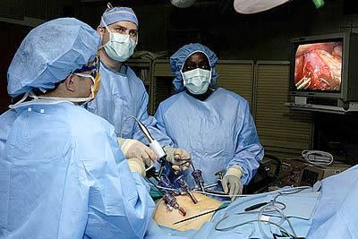
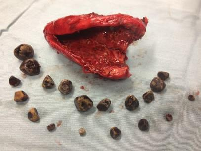

ในภาพคืออวัยวะอะไร
ข้างในคืออะไร
ผ่าตัดอะไร, อะไรคือ indication ในการทำ

**Answer:** not given in the source
**Explanation:** not stated
**Guideline / source:** not stated

## Q2 (original no. 2)
(no stem text in the paper; the question has only the picture and the items below)

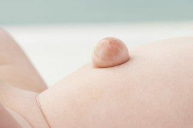

Dx
Mx

**Answer:** not given in the source
**Explanation:** not stated
**Guideline / source:** not stated

## Q3 (original no. 3)
(no stem text in the paper; the question has only the picture and the items below)

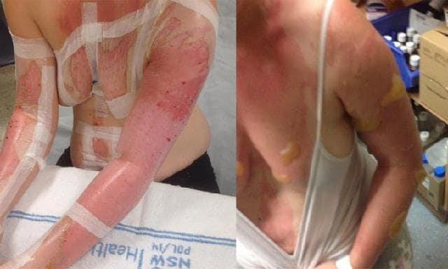

Dx
Mx

**Answer:** not given in the source
**Explanation:** not stated
**Guideline / source:** not stated

## Q4 (original no. 4)
ผู้ป่วยสูงอายุสุขภาพดีจู่ๆ ก็วูบไป ตื่นมาตรวจร่างกายก็ปกติดี DTX 40 mg/dl (รูปจริงไม่มีลูกศรให้นะ)

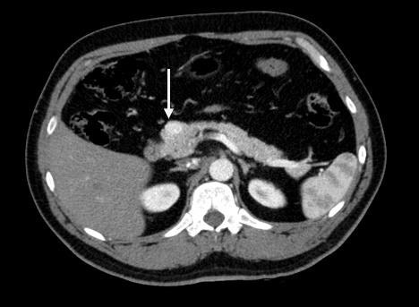

Dx
อธิบาย pathophysio ด้วย
Ix

**Answer:** not given in the source
**Explanation:** not stated
**Guideline / source:** not stated

## Q5 (original no. 5)
(no stem text in the paper; the question has only the picture and the items below)

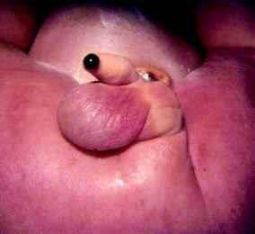

Dx
Mx

**Answer:** not given in the source
**Explanation:** not stated
**Guideline / source:** not stated

## Q6 (original no. 6)
(no stem text in the paper; the question has only the picture and the items below)

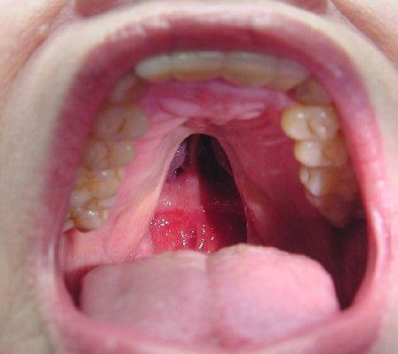

Dx
MX
Age for Mx and why?

**Answer:** not given in the source
**Explanation:** not stated
**Guideline / source:** not stated

## Q7 (original no. 7)
(no stem text in the paper; the question has only the picture and the items below)

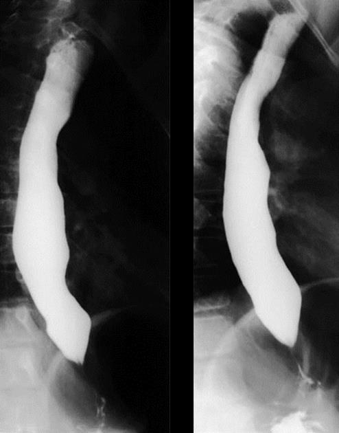

นี่คือ investigation อะไร
บรรยาย lesion
Dx

**Answer:** not given in the source
**Explanation:** not stated
**Guideline / source:** not stated

## Q8 (original no. 8)
(no stem text in the paper; the question has only the picture and the items below)

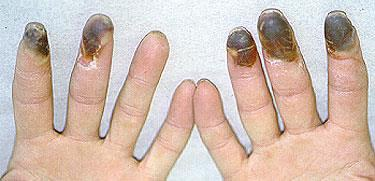

Dx
Mx

**Answer:** not given in the source
**Explanation:** not stated
**Guideline / source:** not stated

## Q9 (original no. 9)
(no stem text in the paper; the question has only the picture and the items below)

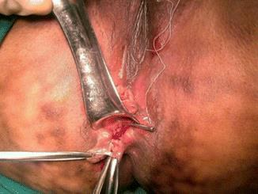

Forceps อันซ้ายคีบอะไรอยู่
Dx
Definitive Mx

**Answer:** not given in the source
**Explanation:** not stated
**Guideline / source:** not stated

## Q10 (original no. 10)
(no stem text in the paper; the question has only the picture and the items below)

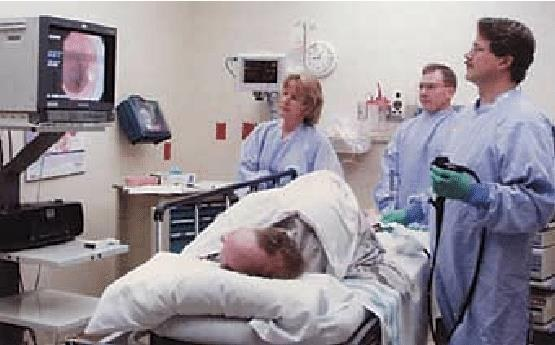
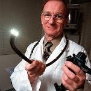

นี่คือ Investigation อะไร
Indication ในการทำ
ก่อนมาทำอันนี้ต้องเตรียมตัวด้วยการกินยาอะไร (บอกมาสองชื่อ)

**Answer:** not given in the source
**Explanation:** not stated
**Guideline / source:** not stated

## Q11 (original no. 11)
(no stem text in the paper; the question has only the picture and the items below)

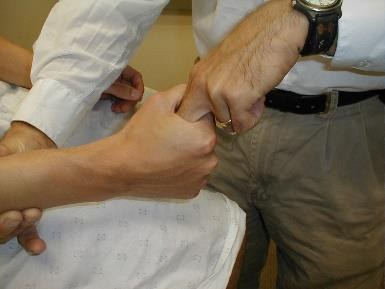
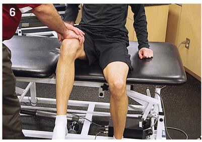
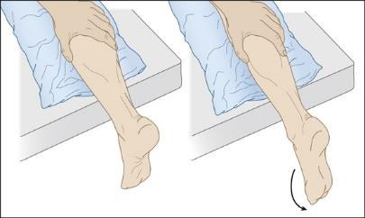

บอกชื่อ muscle ที่ตรวจ กับ ระดับ spinal cord ที่ส่ง nerve มาเลี้ยง

**Answer:** not given in the source
**Explanation:** not stated
**Guideline / source:** not stated

## Q12 (original no. 12)
(no stem text in the paper; the question has only the picture and the items below)

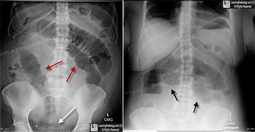

นี่คือภาพอะไร
บรรยาย lesion
Dx
M/C cause

**Answer:** not given in the source
**Explanation:** not stated
**Guideline / source:** not stated

## Q13 (original no. 13)
(no stem text in the paper; the question has only the picture and the items below)

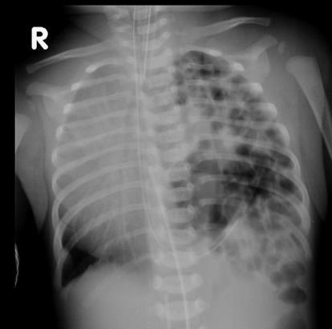

Dx
Mx

**Answer:** not given in the source
**Explanation:** not stated
**Guideline / source:** not stated

## Flagged for checking
- No answer key exists for this paper in the files supplied.
