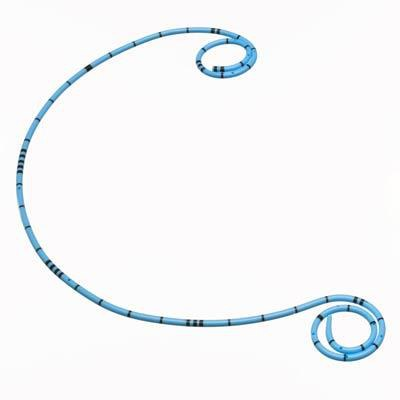
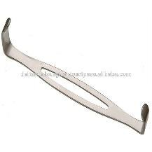
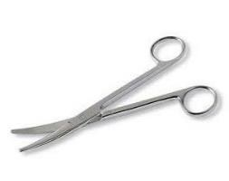
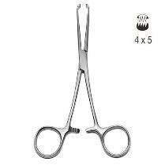
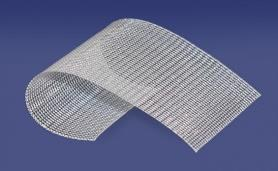
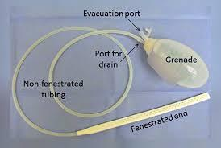
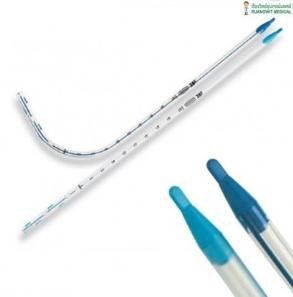
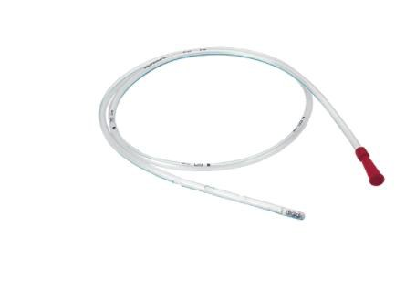
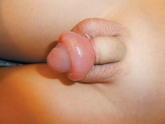
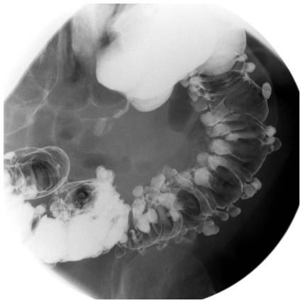

Source: the OSCE part (page 12-13) of "AChalasia Surgery Rotate B / MDCU72" (file "AChalasia [Sx Rotate B MDCU72 _ Gen+Supspe+OSCE+MEQ]", dated July 2020), stations recalled by students, mixed Thai and English. The paper's own note says: OSCE 12 stations; some questions were so short that there was time left over and some were long with many questions so the student could not finish in time; almost all were "ตรงแอค" (as in the past exam), but the student forgot the "brain block" (the paper's wording: "แต่ล่ก ลืม brain block เส้า TOT"). The paper was sat at the end of the whole surgery rotation, so it combines General Surgery and subspecialty content and is filed whole. It is a low-priority set (see CLAUDE.md). The MEQ part is in `mdcu72-mixed-b-meq`. The same file also holds a General Sx MCQ part and a subspecialty MCQ part; the subspecialty MCQ part is in `mdcu72-subspe-b-mcq` and the General Sx MCQ part is not filed (the owner already has that exam).
Numbers Q1-Q12 are the paper's own. No answer key was found and the paper gives no checklists, so every checklist is "not given in the source". The word "อัลลัย" in Q5-Q7 is the student's spelling and is kept as written. Q9 says only that the suture topic was "as in the past exam".
Pictures with no name, label or ID band are kept in images/ under their station. The mammogram and ultrasound pictures of Q10 are not in the paper. The Q6 pictures are listed in the paper's order.
exam_year 2020 follows the PDF date (July 2020) and the paper's mention of the covid crisis in its General Sx MCQ part.
The rotation letter (B) is not mapped to a G.

## Q1 (original no. 1)
Physical examination acute appendicitis

**Station type:** examination (abdomen)
**Checklist:** not given in the source
**Explanation:** not stated
**Guideline / source:** not stated

## Q2 (original no. 2)
ซักประวัติ คลำก้อนได้ที่เต้านม

**Station type:** history taking
**Checklist:** not given in the source
**Explanation:** not stated
**Guideline / source:** not stated

## Q3 (original no. 3)
ฉีดยาชา

**Station type:** local anaesthetic injection
**Checklist:** not given in the source
**Explanation:** not stated
**Guideline / source:** not stated

## Q4 (original no. 4)
เย็บ simple suture 1, Vertical mattress 1

**Station type:** suturing
**Checklist:** not given in the source
**Explanation:** not stated
**Guideline / source:** not stated

## Q5 (original no. 5)
นี่คืออัลลัย ใช้ทำอัลลัย

**Station type:** instrument identification
**Checklist:** not given in the source
**Explanation:** not stated
**Guideline / source:** not stated

## Q6 (original no. 6)
นี่คืออัลลัย ใช้ทำอัลลัย

**Station type:** instrument identification
**Checklist:** not given in the source
**Explanation:** not stated
**Guideline / source:** not stated

## Q7 (original no. 7)
นี่คืออัลลัย ใช้ทำอัลลัย

**Station type:** instrument identification
**Checklist:** not given in the source
**Explanation:** not stated
**Guideline / source:** not stated

## Q8 (original no. 8)
Dx + management

**Station type:** picture diagnosis and management
**Checklist:** not given in the source
**Explanation:** not stated
**Guideline / source:** not stated

## Q9 (original no. 9)
ออกเรื่องไหม ก็ตรงแอค ไปท่องซะ

**Station type:** suture identification
**Checklist:** not given in the source
**Explanation:** not stated
**Guideline / source:** not stated

## Q10 (original no. 10)
อ่านผล Mammogram+US (the films are not included in the paper)

**Station type:** imaging interpretation (mammogram and ultrasound)
**Checklist:** not given in the source
**Explanation:** not stated
**Guideline / source:** not stated

## Q11 (original no. 11)
อ่านผลสิ่งนี้

**Station type:** imaging interpretation
**Checklist:** not given in the source
**Explanation:** not stated
**Guideline / source:** not stated

## Q12 (original no. 12)
ให้ถุงมือกับหุ่น DRE มา แต่ไม่มีอาจารย์คุม PR บรรยายลักษณะ prostate (ถาม describe, diagnosis, next management)

**Station type:** examination (rectal examination on a model) and diagnosis
**Checklist:** not given in the source
**Explanation:** not stated
**Guideline / source:** not stated

## Flagged for checking
- No answer key or checklist exists for this paper in the files supplied.
- Q10's films are not in the paper.
