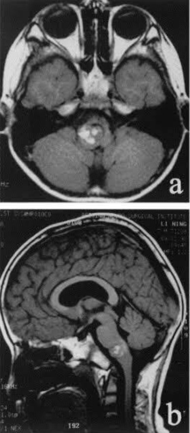
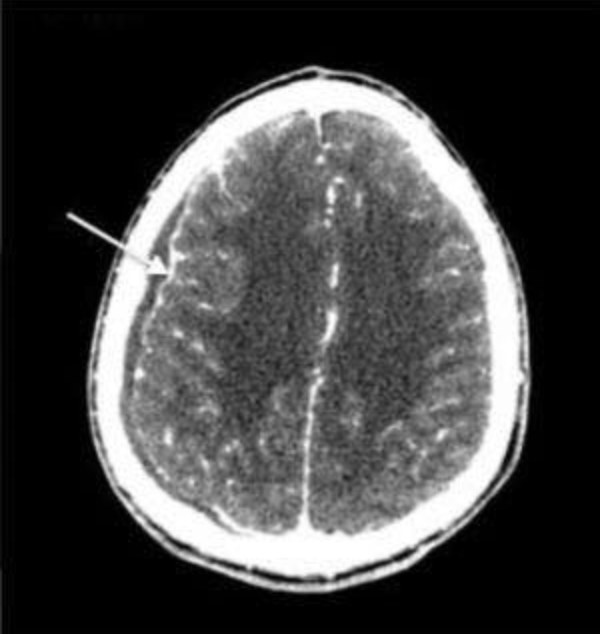
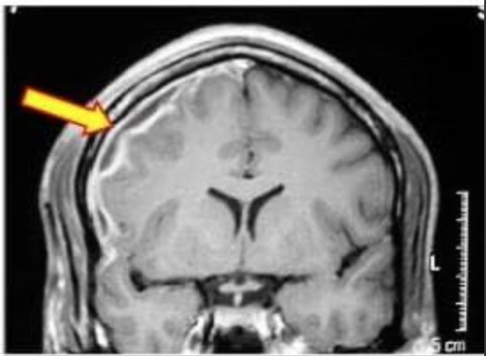

Source: "MDCU 72 Rotate A: AC subspecialty" (file "MDCU 72A Subspe surgery MCQ"), questions recalled by students, mixed Thai and English. The paper's own note says the exam had 90 questions in 120 minutes and that there were many cardiothoracic questions. This is a subspecialty MCQ paper, so it is kept apart from General Surgery and is not tagged into the exam topic map.
The paper's own numbers are kept (Q1, 3, 8, 9, 10, 11, 17, 20, 24, 30, 31, 34, 38, 43, 46, 48, 49, 53, 58, 62, 70, 86, 88, 89); the other numbers of the 90 are not in the paper. Two questions have no number in the paper ("X. Uro ..." and "Plastic. ..."). They are numbered Q201-Q202 in the order they appear, and their heading says "unnumbered question n" - there "original no." is only their order among the unnumbered questions, not a number printed in the paper.
Answers: no answer key was found for this paper and the paper marks no answers, so every answer is "not given in the source".
A choice the paper leaves blank is "(not recalled)"; a choice written only as dots is kept as dots. Q31 has only the stem. Q89 and Q30 mention a picture that is not in the paper.
exam_year 2020 is taken from the paper's file date (April 2020); the paper does not state the year.
Pictures with no name, label or ID band are kept in images/ under their question (Q20 two MRI images; Q24 one CT and one MRI). The Q20 stem says the lower picture is not the real picture.
The rotation letter (A) is not mapped to a G.

## Q34 (original no. 34)
Long-term complications to left-to-right shunt disease

A. Heart failure
B. IE
C. Hypoplasia of pulmonary artery
D. Reverse shunt through defect
E. Cyanosis

**Answer:** not given in the source
**Explanation:** not stated
**Guideline / source:** not stated

## Q11 (original no. 11)
มีLUTS ตรวจ psa ได้ 3.5 คลำ prostate ก้อนเรียบดี แต่มีก้อนขรุขระทางด้านซ้าย ทำอะไร

A. ให้alpha blocker
B. ให้alpha blocker+5alpha reductase inhibitor
C. ให้antiandrogen
D. ตัดชิ้นเนื้อต่อมลูกหมากไปดู
E. prostectomy

**Answer:** not given in the source
**Explanation:** not stated
**Guideline / source:** not stated

## Q17 (original no. 17)
ญ 34 ปี progressive intermittent headache for 2 months, blurred vision , diplopia , bilat lateral rectus palsy , papilledma bilaterally ,no weakness DTR3+all, CN intact, cerebellar sign negative

A. occipital abscess
B. Cerebellar tumor
C. (not recalled)
D. Ruptured AVM
E. Venous sinus thrombosis

**Answer:** not given in the source
**Explanation:** not stated
**Guideline / source:** not stated

## Q89 (original no. 89)
ให้รูปFEEMมา ถามว่าอันตรายจากภาวะนี้คืออะไร (the picture is not included in the paper)

A. Abnormal vascular malformation
B. Defect of frontal bone and ethmoid bone
C. Incarcerated of herniated brain
D. Increase intracranial pressure
E. Premature closure of suture

**Answer:** not given in the source
**Explanation:** not stated
**Guideline / source:** not stated

## Q201 (original no. 1, topic: unnumbered question 1 (no number in the paper))
Uro พบใน Parkinson disease

A. urinary retention
B. overactive bladder
C. urinary tract infectin

**Answer:** not given in the source
**Explanation:** not stated
**Guideline / source:** not stated

## Q86 (original no. 86)
ชายมีแผล หลัง debridement แล้ว blood supply ไม่ค่อยดี ควรเย็บแบบไหน

A. Simple
B. Vertical Mattress
C. Horizontal Mattress
D. Continuous
E. Continuous locking

**Answer:** not given in the source
**Explanation:** not stated
**Guideline / source:** not stated

## Q43 (original no. 43)
Car accident ทำให้มี injury ต่อ aorta ที่ตำแหน่งใดมากที่สุด

A. arch of aorta
B. mid descending aorta
C. ascending aorta
D. just above diaphragm
E. isthmus

**Answer:** not given in the source
**Explanation:** not stated
**Guideline / source:** not stated

## Q8 (original no. 8)
RCC ข้อใดถูก

A. Most common presenting symptom คือ hematuria
B. (not recalled)
C. (not recalled)
D. Increased risk ใน ESRD
E. Need tissue diagnosis before surgery

**Answer:** not given in the source
**Explanation:** not stated
**Guideline / source:** not stated

## Q1 (original no. 1)
เด็กอายุ 3ปี เคยเป็น VUR grade 4 ได้ prophylactic ATB มาแล้ว 2 yr ครั้งนี้มาทำ VCUG ผลปกติ ไม่มี VUR ถามทำอะไร

A. Stop ATB
B. VCUG next 6 mo
C. (not recalled)
D. ให้ prophylactic ATB จนอายุ5ปี
E. (not recalled)

**Answer:** not given in the source
**Explanation:** not stated
**Guideline / source:** not stated

## Q58 (original no. 58)
Fournier’s gangrene ข้อใดผิด

A. คือ necrotizing fasciitis of perineal body
B. (not recalled)
C. (not recalled)
D. ATB ไปก่อน
E. M/c cause คือ anal cancer

**Answer:** not given in the source
**Explanation:** not stated
**Guideline / source:** not stated

## Q38 (original no. 38)
A 45-year-old male patient came to ER with ecitatory back pain, tearing in character. His BP was 200/120 mmHg, HR 120/min. What is the least appropriate management?

A. IV morphine
B. EKG/ cardiac enzyme
C. IV Sodium nitroprusside
D. CT whole aorta
E. Ecchocardiogram

**Answer:** not given in the source
**Explanation:** not stated
**Guideline / source:** not stated

## Q88 (original no. 88)
What is not sign and symptoms of fracture zygoma?

A. Trismus
B. Diplopia
C. Lingual crossbite
D. Periorbital ecchymosis
E. Paresthesia of intraorbital nerve

**Answer:** not given in the source
**Explanation:** not stated
**Guideline / source:** not stated

## Q48 (original no. 48)
ผู้ชาย 45 ปี ascending colon CT เจอ ascending colon mass peri... lymph node จะทำการรักษายังไง

A. Preop chemo with right colos
B. Preop chemoradio with right colos
C. Preop radio with right colos
D. Right colos with post op radio
E. Right colos

**Answer:** not given in the source
**Explanation:** not stated
**Guideline / source:** not stated

## Q62 (original no. 62)
Infant abdominal distention, plain film show dilate sigmoid and transitional zone at rectum, performed biopsy, which will see in biopsy

A. Normal ganglion in rectum and paucity ganglion in sigmoid
B. Abnormal ganglion and increas acetylcholine in sigmoid
C. Absent ganglion and normal acetylcholine in rectum
D. Absent ganglion and increase acetylcholine in rectum
E. Absent ganglion and decrease acetylcholine in rectum

**Answer:** not given in the source
**Explanation:** not stated
**Guideline / source:** not stated

## Q31 (original no. 31)
45yr old girl presented with diplopia and ptosis, X CXR found ant mediastinum mass, what is appropriate management?

**Answer:** not given in the source (the paper has only the stem, no choices)
**Explanation:** not stated
**Guideline / source:** not stated

## Q49 (original no. 49)
A 55 years old woman was diagnosed rectal cancer. A finding was mid rectal with fixation to uterus and 1 cm. nodule in left lobe of liver. She was performed LAR, TAH and BSO, pelvic LN dissection and wedge resection of liver nodule. The histopathology was adenocarcinoma invaded to pericolic fat and uterus. 2/16 pericoloic nodes and 2/4 right internal iliac reveal metastatic carcinoma. Liver resection was fibronodular hyperplasia. What is staging?

A. T3N1M1 stage 4
B. T4N1M1 stage 4
C. T4N2M1 stage 4
D. T4N1M0 stage 3
E. T4N2M0 stage 3

**Answer:** not given in the source
**Explanation:** not stated
**Guideline / source:** not stated

## Q46 (original no. 46)
Which one is not contraindication of rubber band ligation?

A. immunocompromise
B. on immunosuppressive with CMT
C. anal sex
D. coagulopathy

**Answer:** not given in the source
**Explanation:** not stated
**Guideline / source:** not stated

## Q10 (original no. 10)
55 year-old male cystoscope : multiple sessile bladder tumor pathology : high grade transitional cell carcinoma with muscularis propria invasion ได้ complete tumor resection แล้ว CT : no metastasis , no lymph node invasion ทำการรักษาอย่างไร

A. Intravesical CMT
B. Intravesical BCG
C. Repeat transurethral resection of tumor base
D. Radical cystectomy
E. Follow up cystoscope and CT

**Answer:** not given in the source
**Explanation:** not stated
**Guideline / source:** not stated

## Q3 (original no. 3)
เด็ก mild left hydronephrosis (เป็นอาการแบบ UPJ obstruction) ไม่เคยมี UTI ไม่มีอาการอะไร renal function Lt : Rt = 50:50 ถาม management

A. left nephrectomy
B. left pyeloplasty
C. DJ stent
D. Follow up
E. (not recalled)

**Answer:** not given in the source
**Explanation:** not stated
**Guideline / source:** not stated

## Q53 (original no. 53)
ผู้ป่วยชายอายุ bed ridden มาด้วยปวดท้องซ้ายล่าง ........ มี localized peritonitis. Film abdomen เป็น bowel dilation, right upper large air coffee bean shape ย้อยไปทาง LLQ. ถาม management

A. NPO, IV observe
B. Exploratory laparotomy
C. Sigmoidoscope
D. ....
E. ....

**Answer:** not given in the source
**Explanation:** not stated
**Guideline / source:** not stated

## Q9 (original no. 9)
ข้อใดไม่ใช่ risk ในการเกิด SCC penile

A. phimosis
B. paraphimosis
C. chronic balanhitis
D. poor hygiene
E. HPV

**Answer:** not given in the source
**Explanation:** not stated
**Guideline / source:** not stated

## Q20 (original no. 20)
Rt facial palsy, Rt lateral rectus palsy, Lt hemianesthesia
Img... lesionอยู่บริเวณเดียวกับในรูป A&B (รูปด้านล่างไม่ใช่รูปจริง)

A. AVM
B. cavernous angioma
C. hemangioma
D. intracerebral hematoma
E. medulloblastoma

**Answer:** not given in the source
**Explanation:** not stated
**Guideline / source:** not stated

## Q70 (original no. 70)
9 mo old, Hx of vomit, mucous bloody stool, intermittent abdominal cramp, Investigation ?

A. Proctoscope
B. Rectal exam
C. stool exam
D. CT abdomen
E. USG

**Answer:** not given in the source
**Explanation:** not stated
**Guideline / source:** not stated

## Q202 (original no. 2, topic: unnumbered question 2 (no number in the paper))
Plastic. ผู้ป่วยอายุ...ปี ถูก 57% electrical burn ข้อใดผิด

A. EKG monitoring
B. มี hemoglobinuria
C. Keep urine output 30 cc/hr
D. (not recalled)
E. Alkalinize urine

**Answer:** not given in the source
**Explanation:** not stated
**Guideline / source:** not stated

## Q30 (original no. 30)
77 year old male came to hospital with right hemiparesis grade 3
cr non contrast as below (picture from google) What is the next appropriate management? (the picture is not included in the paper)

A. non-contrast CT
B. cerebral angiogram
C. dexamethasone IV
D. mannitol 20% IV
E. lumbar puncture

**Answer:** not given in the source
**Explanation:** not stated
**Guideline / source:** not stated

## Q24 (original no. 24)
ชาย อายุ 18 ปี มาด้วย ไข้ ชัก weakness ทำ CT scan ได้ผลดังนี้ diagnosis คืออะไร (จำโจทย์เป๊ะๆไม่ได้ แต่น่าจะประมาณนี้)

A. Epidural empyema
B. Subdural empyem
C. Brain abscess
D. (not recalled)
E. (not recalled)

**Answer:** not given in the source
**Explanation:** not stated
**Guideline / source:** not stated

## Flagged for checking
- No answer key exists for this paper in the files supplied.
- exam_year 2020 is taken from the file date.
- Q31 has no choices; Q89 and Q30 refer to pictures that are not in the paper.
