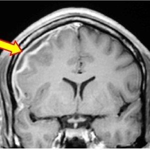
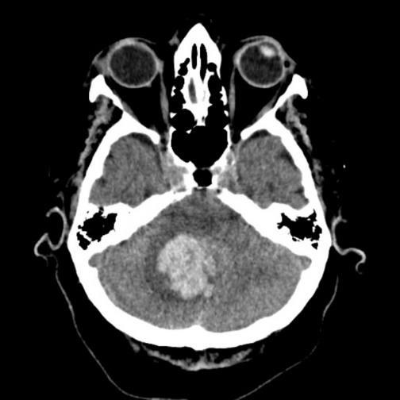
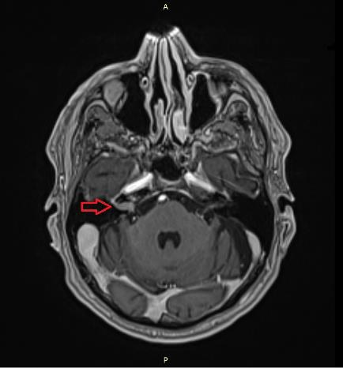
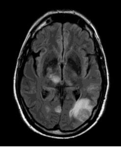
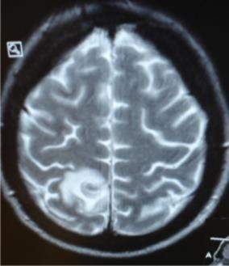
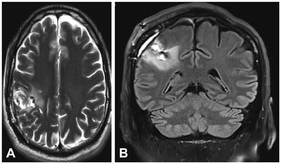

Source: the subspecialty MCQ part (page 8-11) of "AChalasia Surgery Rotate B / MDCU72" (file "AChalasia [Sx Rotate B MDCU72 _ Gen+Supspe+OSCE+MEQ]", dated July 2020), questions recalled by students, mixed Thai and English. The paper's own note says: 90 questions, 2 hours, many "ตรงแอค" (as in the past exam) except URO. This is a subspecialty MCQ paper, so it is kept apart from General Surgery and is not tagged into the exam topic map. The same file also holds a General Sx MCQ part (not filed; the owner already has that exam), an OSCE part (`mdcu72-mixed-b-osce`) and a MEQ part (`mdcu72-mixed-b-meq`).
The paper's own numbers Q1-Q31 are kept (the other numbers of the 90 are not in the paper). The bracketed subject tags ([Colo], [CVT], [Neuro], [PED], [Plastic], [URO]) are the paper's own and are kept at the start of each stem; the paper tags Q7-Q9 as [CVT] although they are not cardiothoracic questions.
Answers: no answer key was found for this paper and the paper marks no answers, so every answer is "not given in the source".
A choice written as "-" in the paper is kept as "-"; a choice the paper leaves blank is "(not recalled)". Q6 and Q13 have only "-" choices. Q14 and Q24 mention a picture that is not in the paper.
Pictures with no name, label or ID band are kept in images/ under their question (Q15-Q19 are brain scans).
exam_year 2020 follows the PDF date (July 2020).
The rotation letter (B) is not mapped to a G.

## Q1 (original no. 1)
[Colo] ให้อาการ Diverticulitis ยาวๆ มา จบที่เจอ Pericolic abscess no peritonitis ถาม Hinchey classification

A. Class I
B. Class II
C. Class III
D. Class IV
E. Class V

**Answer:** not given in the source
**Explanation:** not stated
**Guideline / source:** not stated

## Q2 (original no. 2)
[Colo] not contraindication in Rubber band

A. Coagulopathy
B. on anticoagulant drug
C. HIV
D. immunocompromised host
E. Anal sex

**Answer:** not given in the source
**Explanation:** not stated
**Guideline / source:** not stated

## Q3 (original no. 3)
[Colo] what is false about fournier gangrene (ตรงแอค)

A. -
B. -
C. -
D. -
E. Anal cnacer is the most common cause

**Answer:** not given in the source
**Explanation:** not stated
**Guideline / source:** not stated

## Q4 (original no. 4)
[Colo] ให้อาการ lower GI bleed มามากมายมึนงง แต่สุดท้ายถาม Dx by most incidence

A. Divertuculum
B. Cancer
C. IBD
D. Angiodysplasia
E. -

**Answer:** not given in the source
**Explanation:** not stated
**Guideline / source:** not stated

## Q5 (original no. 5)
[Colo] not a characteristics of chronic anal fissure

A. sentinel pile
B. fibrotic edge
C. sphicter spasm
D. hypertrophic anal papilla
E. -

**Answer:** not given in the source
**Explanation:** not stated
**Guideline / source:** not stated

## Q6 (original no. 6)
[CVT] PDA ligation ไม่ทำในไหน

A. -
B. -
C. -
D. -
E. -

**Answer:** not given in the source
**Explanation:** not stated
**Guideline / source:** not stated

## Q7 (original no. 7)
[CVT] ชาย 18 ปี มี"แผลขอบเรียบที่กระพุ้งแก้ม" เจ็บมาก มา 7 วัน ทำไง

A. รอดูอาการ
B. incisional biopsy
C. excisional biopsy
D. wide excision margin 0.5 cm
E. wide excision margin 1 cm

**Answer:** not given in the source
**Explanation:** not stated
**Guideline / source:** not stated

## Q8 (original no. 8)
[CVT] Which is the most common malignancy of parotid gland ?

A. Mucoepidermoid carcinoma
B. Adenoid cystic carcinoma
C. Acinic cell carcinoma
D. Carcinoma ex pleomorphic adenoma
E. Adenocarcinoma

**Answer:** not given in the source
**Explanation:** not stated
**Guideline / source:** not stated

## Q9 (original no. 9)
[CVT] เจอ mass at anterior mediastinum ไม่ ddx อะไร

A. Thymoma
B. Pherochromocytoma
C. Lymphoma
D. Seminoma
E. Teratoma

**Answer:** not given in the source
**Explanation:** not stated
**Guideline / source:** not stated

## Q10 (original no. 10)
[CVT] which management is th most appropriate for 32 years patient with mechanical valve replacement (INR 3.2) having acute appendicitis

A. Vit K แล้วผ่า
B. FFP แล้วผ่า
C. หยุด Warfarin รอ INR ลงแล้วค่อยผ่า
D. antibiotics only
E. 4 unit PRC + 6 unit FFP แล้วผ่า

**Answer:** not given in the source
**Explanation:** not stated
**Guideline / source:** not stated

## Q11 (original no. 11)
[Neuro] ผู้ป่วยชายอายุ 60 ปี sudden severe headache, no neurologicat defect, stiffneck positive, non contrast CT normal ส่งอะไรต่อดี

A. Contrast CT
B. angiogram
C. lumbar puncture
D. -
E. -

**Answer:** not given in the source
**Explanation:** not stated
**Guideline / source:** not stated

## Q12 (original no. 12)
[Neuro] What looks like bacterial meningitis (ตรงแอค)

A. -
B. RBC 10,000 WBC 500 Glucose 40
C. -
D. -
E. -

**Answer:** not given in the source
**Explanation:** not stated
**Guideline / source:** not stated

## Q13 (original no. 13)
[Neuro] Kernohan's phenomenon (ตรงแอค)

A. -
B. -
C. -
D. -
E. -

**Answer:** not given in the source
**Explanation:** not stated
**Guideline / source:** not stated

## Q14 (original no. 14)
[Neuro] คิดว่ารูปประมาณนี้ (the picture is not included in the paper)

A. Cysticercosis
B. (not recalled)
C. (not recalled)
D. (not recalled)
E. (not recalled)

**Answer:** not given in the source
**Explanation:** not stated
**Guideline / source:** not stated

## Q15 (original no. 15)
[Neuro] คิดว่ารูปประมาณนี้

A. Subdural empyrema
B. Epidural empyrema
C. (not recalled)
D. (not recalled)
E. (not recalled)

**Answer:** not given in the source
**Explanation:** not stated
**Guideline / source:** not stated

## Q16 (original no. 16)
[Neuro] คิดว่ารูปประมาณนี้

A. Cerebellar hemorhage
B. (not recalled)
C. (not recalled)
D. (not recalled)
E. (not recalled)

**Answer:** not given in the source
**Explanation:** not stated
**Guideline / source:** not stated

## Q17 (original no. 17)
[Neuro] น่าจะมีอาการอะไร (แต่โจทย์จริงมันไม่มีลูกศรชี้ให้อ่ะนะ)

A. SNSL
B. (not recalled)
C. (not recalled)
D. (not recalled)
E. (not recalled)

**Answer:** not given in the source
**Explanation:** not stated
**Guideline / source:** not stated

## Q18 (original no. 18)
[Neuro] ไม่ ddx อะไร (รูปประมาณนี้)

A. Astrocytoma
B. Abscess
C. Hemorrhage
D. Vestibular schwannoma
E. (not recalled)

**Answer:** not given in the source
**Explanation:** not stated
**Guideline / source:** not stated

## Q19 (original no. 19)
[Neuro] ผู้ป่วยหญิง อายุน้อย ปวดหัว

A. AVM
B. (not recalled)
C. (not recalled)
D. (not recalled)
E. (not recalled)

**Answer:** not given in the source
**Explanation:** not stated
**Guideline / source:** not stated

## Q20 (original no. 20)
[PED] Wilm’s tumor ข้อไหนผิด

A. poor prognosis
B. present 12-48 months
C. การรักษา “includes surgery, radiation and chemotherapy”
D. soft tissue mass with calcification ใน plain abdomen film
E. เกี่ยวกับ denys-drash syndrome

**Answer:** not given in the source
**Explanation:** not stated
**Guideline / source:** not stated

## Q21 (original no. 21)
[PED] what true about omphalocele

A. -
B. -
C. -
D. -
E. Viscesation of intestine and liver

**Answer:** not given in the source
**Explanation:** not stated
**Guideline / source:** not stated

## Q22 (original no. 22)
[Plastic] เย็บแผล ขอบแผลขาด blood supply ควรเย็บด้วยวิธีอะไร

A. Simple
B. Vertical
C. Horizontal
D. Continuous
E. Continuous lock

**Answer:** not given in the source
**Explanation:** not stated
**Guideline / source:** not stated

## Q23 (original no. 23)
[Plastic] Which of the following is incorrect ?

A. FTSG is lesser chance to taking than STSG
B. FTSG is preferred to use in face more than STSG
C. FTSG ใช้ในเด็กน้อยกว่า STSG
D. FTSG ได้ texture ที่ดีกว่า STSG
E. FTSG มีcosmeticดีกว่า STSG

**Answer:** not given in the source
**Explanation:** not stated
**Guideline / source:** not stated

## Q24 (original no. 24)
[Plastic] รูปหน้าโดนฟันแก้ม (ตรงแอค) (the picture is not included in the paper)

A. stensen duct
B. Frontal branch of CN VII
C. Marginal mandibular branch of CN VII
D. Infraorbital n.
E. Procerus m.

**Answer:** not given in the source
**Explanation:** not stated
**Guideline / source:** not stated

## Q25 (original no. 25)
[Plastic] the most common malignant tumor of parotid gland

A. adenocarcinoma
B. Adenoid cystic carcinoma
C. mucoepidermoid carcinoma
D. Pleomorphic adenoma
E. Acinar-cell carcinoma

**Answer:** not given in the source
**Explanation:** not stated
**Guideline / source:** not stated

## Q26 (original no. 26)
[Plastic] Bed sore ให้อาการแบบ secondary type ทำอะไรดี

A. Cover FTSG
B. Cover STSG
C. excision
D. Hydrocolloid dressing
E. -

**Answer:** not given in the source
**Explanation:** not stated
**Guideline / source:** not stated

## Q27 (original no. 27)
[Plastic] ผู้ป่วยชาย หนัก 60 kg burn 40% BSA มา 8 hrs ได้ fluid resuscitate ครบ parland 8 hrs ถามว่าต้องให้อะไรต่อ

A. 600 ml/hr
B. 500
C. 400
D. 300
E. 200

**Answer:** not given in the source
**Explanation:** not stated
**Guideline / source:** not stated

## Q28 (original no. 28)
[URO] สาเหตุ UTI ในคนอายุมากกว่า 35 ปี

A. Congenital
B. Sexual intercourse
C. อั้นปัสสาวะ
D. ผ่าตัดอุ้งเชิงกราน
E. VUR

**Answer:** not given in the source
**Explanation:** not stated
**Guideline / source:** not stated

## Q29 (original no. 29)
[URO] Mild prostate enlargement with wood-liked nodule + PSA 4 ส่ง Ix อะไรดี

A. CT KUB
B. Cystourethroscopy
C. TRUS Bx
D. Finasteride
E. nothing

**Answer:** not given in the source
**Explanation:** not stated
**Guideline / source:** not stated

## Q30 (original no. 30)
[URO] ให้ผล US bosniack II มาแบบชัดๆ ตรงเป๊ะ อย่างกะอ่านผลจาก CT ถามว่าเป็นอะไร

A. Class I
B. Class II
C. Class III
D. Class IV
E. บอกไม่ได้ ต้องส่ง CT

**Answer:** not given in the source
**Explanation:** not stated
**Guideline / source:** not stated

## Q31 (original no. 31)
[URO] ข้อใดผิดเกี่ยวกับ Wilm's tumor

A. poor prognosis
B. พบใน 24-48 months
C. Plan film finding soft tissue with calcification
D. about Denys Drash syndrome
E. -

**Answer:** not given in the source
**Explanation:** not stated
**Guideline / source:** not stated

## Flagged for checking
- No answer key exists for this paper in the files supplied.
- Q7-Q9 are tagged [CVT] in the paper although they are not cardiothoracic questions; kept as written.
- Q14 and Q24 refer to pictures that are not in the paper.
