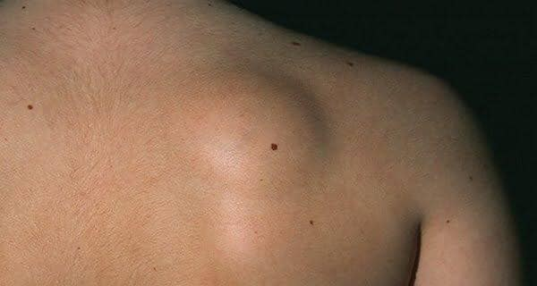

Source: "AC MEQ Subspecialty Sx MDCU 72 ROTATE D" (file "MEQ SSX Rotate D"), questions recalled by students, mixed Thai and English. The paper says: 14 questions, 3 minutes each. The paper was sat at the end of the whole surgery rotation, so it combines General Surgery and subspecialty content and is filed whole. It is a low-priority set (see CLAUDE.md). The OSCE part of the same exam is in `mdcu72-sx-d-osce`.
Numbers Q1-Q14 are the paper's own. No answer key was found, so every answer is "not given in the source". Q14 is only the number with no text. Q11 says "Paronychia เหมือนเดิม" (the same as before; the paper does not say which earlier exam).
Pictures: the paper has two pictures. The Q2 picture is a screenshot of a social-media post, so it is left out and described in words. The Q7 picture (a soft swelling on the back and shoulder, no face, name or label) is kept in images/. The other questions mention pictures that are not in the paper.
exam_year 2020 follows the PDF date (January 2020) and the MDCU 72 rotate D MCQ paper; the paper does not state the year.
The rotation letter (D) is not mapped to a G. The set code uses "sx" because the exam combines General Surgery and subspecialty content (the job was first listed as "subspe").

## Q1 (original no. 1)
ให้รูป Perianal abscess + treatment (the picture is not included in the paper)

**Answer:** not given in the source
**Explanation:** not stated
**Guideline / source:** not stated

## Q2 (original no. 2)
ให้รูป penrose drain กับ retention suture*** (เหมือนในรูปแต่เป็นสีแดง) ถามว่าใช้ทำอะไร
[picture in the paper: a screenshot of a social-media post with a photo of a belly wound closed with retention sutures and drains, and a diagram of retention sutures; left out because it shows a social-media post]

**Answer:** not given in the source
**Explanation:** not stated
**Guideline / source:** not stated

## Q3 (original no. 3)
ให้รูปเด็ก umbilical hernia + indirect inguinal hernia ถาม diag, management (the picture is not included in the paper)

**Answer:** not given in the source
**Explanation:** not stated
**Guideline / source:** not stated

## Q4 (original no. 4)
ให้รูปเด็กไม่มีรูก้น กับรูป film prone lateral cross table ถามชื่อ film, diag, management (the pictures are not included in the paper)

**Answer:** not given in the source
**Explanation:** not stated
**Guideline / source:** not stated

## Q5 (original no. 5)
คนประสบอุบัติเหตุ ให้รูป film มาหลายๆ view ถาม diag, management (น่าจะ Rt. mandibular fracture, ทำ ORIF) (the pictures are not included in the paper)

**Answer:** not given in the source
**Explanation:** not stated
**Guideline / source:** not stated

## Q6 (original no. 6)
ผู้ป่วยมีผื่นที่เท้ามา x เดือน ให้รูปมา (น่าจะ malignant melanoma) ถาม management (the picture is not included in the paper)

**Answer:** not given in the source
**Explanation:** not stated
**Guideline / source:** not stated

## Q7 (original no. 7)
ผู้ป่วยมาด้วยก้อนนิ่มที่หลัง มา 3 เดือน ถาม diag, indication ในการผ่าตัด, ชื่อการผ่าตัด

**Answer:** not given in the source
**Explanation:** not stated
**Guideline / source:** not stated

## Q8 (original no. 8)
ให้รูปคนเป็น DM นิ้วเท้าดำๆ แห้งๆ มา ถาม differential diag, ส่งตรวจอะไรเพิ่ม (the picture is not included in the paper)

**Answer:** not given in the source
**Explanation:** not stated
**Guideline / source:** not stated

## Q9 (original no. 9)
ให้สถานการณ์มา แล้วให้ประเมิน GCS score (มีสองรอบ+โจทย์ยาวๆ เปลี่ยนหน้าเร็วมาก) ถามว่าเจอ sign อะไรได้บ้าง, ถ้า CT น่าจะเจออะไร

**Answer:** not given in the source
**Explanation:** not stated
**Guideline / source:** not stated

## Q10 (original no. 10)
ให้รูปนมมา มี peau de orange มั้ง ให้บรรยาย, diag, ส่งตรวจอะไรเพิ่ม, ถามอะไรไม่รู้อีกข้อ (the picture is not included in the paper)

**Answer:** not given in the source
**Explanation:** not stated
**Guideline / source:** not stated

## Q11 (original no. 11)
Paronychia เหมือนเดิม

**Answer:** not given in the source
**Explanation:** not stated
**Guideline / source:** not stated

## Q12 (original no. 12)
UGIB มา 2 รอบก่อนมารพ. จะซักประวัติอะไรเพิ่ม 3 อย่าง, management

**Answer:** not given in the source
**Explanation:** not stated
**Guideline / source:** not stated

## Q13 (original no. 13)
ให้รูป burn มา โจทย์บอกว่ายังเจ็บ ถามว่า degree ไหน, management (the picture is not included in the paper)

**Answer:** not given in the source
**Explanation:** not stated
**Guideline / source:** not stated

## Q14 (original no. 14)
(no text in the paper after the number)

**Answer:** not given in the source
**Explanation:** not stated
**Guideline / source:** not stated

## Flagged for checking
- No answer key exists for this paper in the files supplied.
- exam_year 2020 is taken from the file date.
- Q14 has no text; Q11 refers to an earlier exam without saying which.
