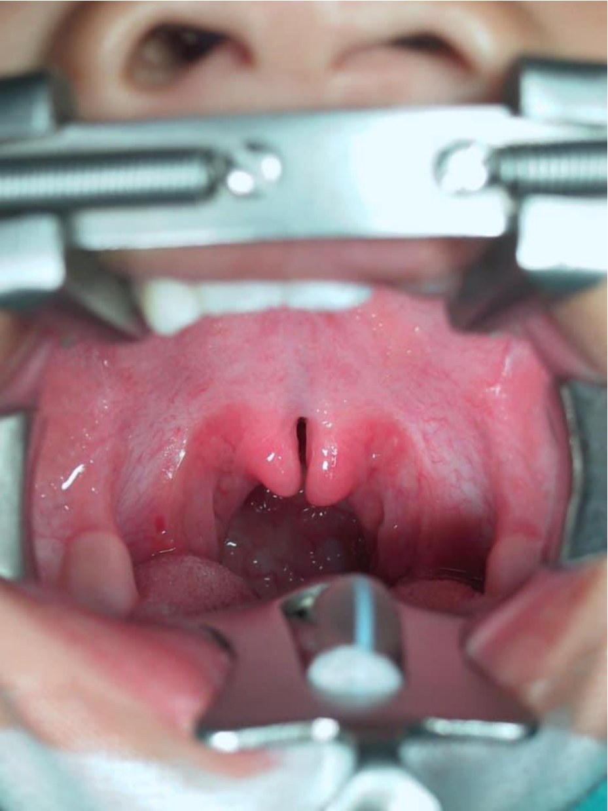
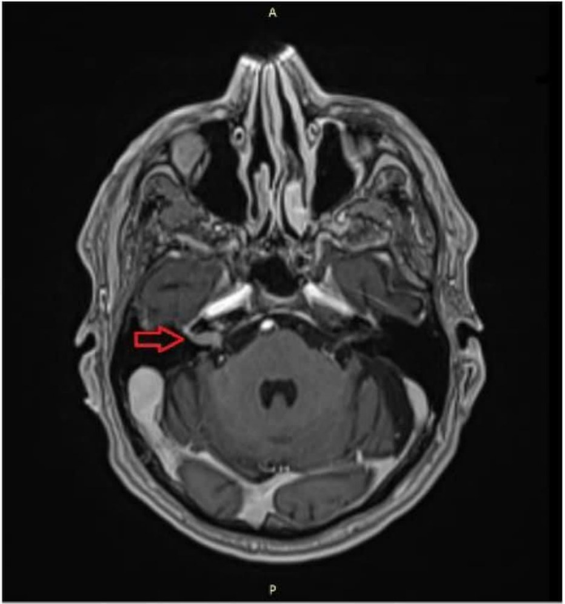
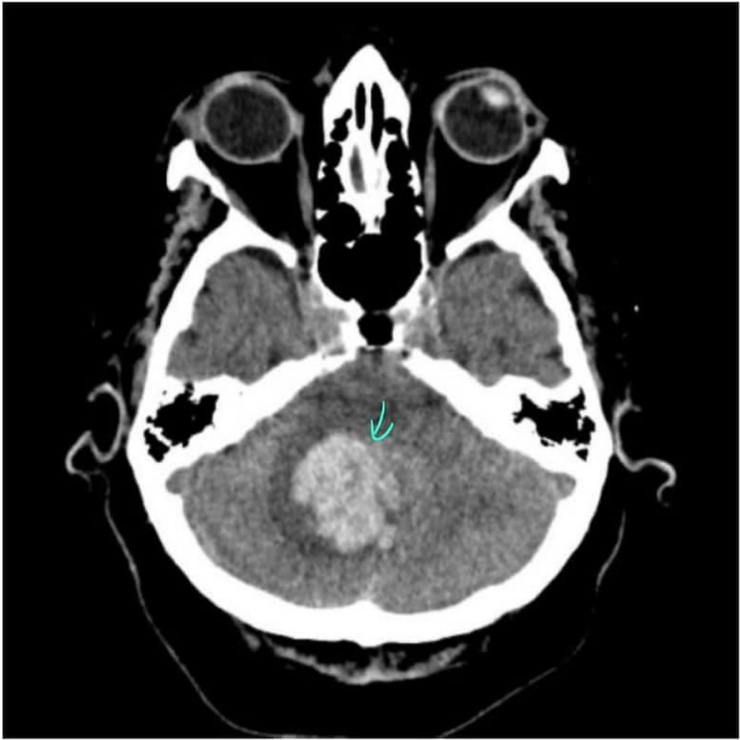
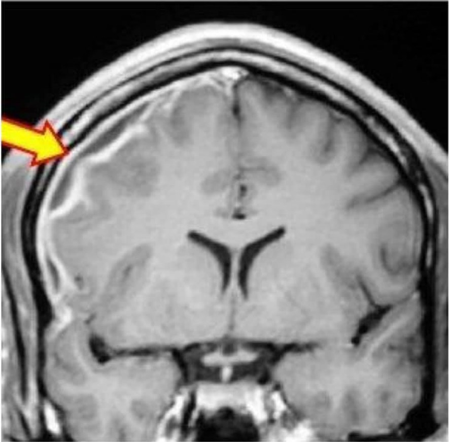
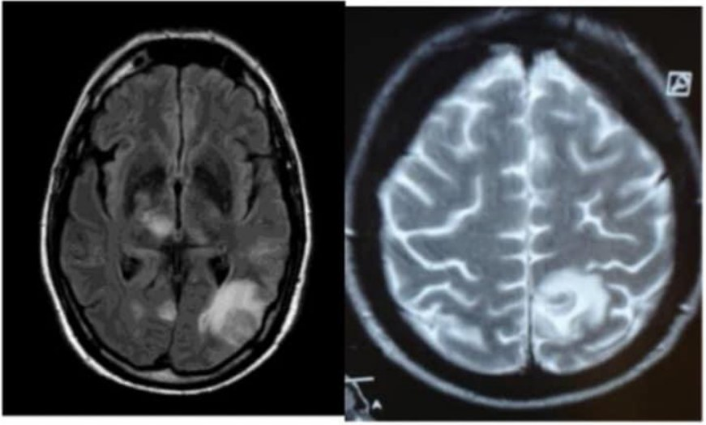

Source: "73-AC Sx supspec MCQ rotate D" (file "73-AC Sx supspec MCQ rotate D"), questions recalled by students under the headings PED, Colo, Plastic, Uro, Neuro and CVT. This is a subspecialty MCQ paper, so it is kept apart from General Surgery and is not tagged into the exam topic map. The topic heading is written in brackets at the start of the first question under it.
Four pages of the PDF are screenshots (the brain scans and one urology question) and were read from the page images; the rest is typed text. Three questions print their own number (Q15, Q16, Q18); all the others have no number in the paper. Those are numbered Q201-Q223 in the order they appear, and their heading says "unnumbered question n" - there "original no." is only their order among the unnumbered questions, not a number printed in the paper.
Answers: no answer key was found for this paper. In the screenshot pages a choice is highlighted in pink (or green) by the student who made them; where such a highlight exists the answer says so. It is a student's marking, NOT an official key, and may contain mistakes. Every other answer is "not given in the source". A blank choice is "(not recalled)"; many questions have only some of the choices.
exam_year 2020 is an inference: the PDF was created in March 2021, after the MDCU73 rotation sat its exam, and the MDCU74 papers are dated 2021; please check it.
Pictures with no name, label or ID band are kept in images/, cropped from the screenshot pages so that the highlighted answer text is not part of them (Q15, Q16, Q18, Q213, Q217). The mouth photo (Q213) shows part of the patient's nose and eyes.
The rotation letter (D) is not mapped to a G.

## Q201 (original no. 1, topic: unnumbered question 1 (no number in the paper))
[paper topic: PED] 8m girl cystic mass at left cervical, normal skin, non tender

A. dermoid cyst
B. Hemangioma
C. lymphatic malformation
D. venous malformation
E. lymphovenous malform

**Answer:** not given in the source
**Explanation:** not stated in the source
**Guideline / source:** not stated

## Q202 (original no. 2, topic: unnumbered question 2 (no number in the paper))
midline mass มา 3 month , protrude ตาม tongue, thyroid fn normal, thyroid scan normal อะไรผิด

A. overall excellent prognosis
B. no chance turn to carcinoma

**Answer:** not given in the source
**Explanation:** not stated in the source
**Guideline / source:** not stated

## Q203 (original no. 3, topic: unnumbered question 3 (no number in the paper))
เด็กหญิง meconium ออกมา urethra

A. Ileostomy
B. double end colostomy
C. PSARP
D. 24 hr prone lateral cross table

**Answer:** not given in the source
**Explanation:** not stated in the source
**Guideline / source:** not stated

## Q204 (original no. 4, topic: unnumbered question 4 (no number in the paper))
[paper topic: Colo] Hinchey classification โจทย์ยาวๆ : pericolic abscess >5 cm , no peritonitis

A. class I
B. II
C. III
D. IV

**Answer:** not given in the source
**Explanation:** not stated in the source
**Guideline / source:** not stated

## Q205 (original no. 5, topic: unnumbered question 5 (no number in the paper))
หญิง 42 ปี rectal ca s/p lar ผล bx เปน poor dif adenocarcinoma invasion limited to m. propria, pericolic LN positive 2/15, internal iliac 2/4. Next management?

A. Post op chemo
B. Post op radio
C. Post op chemoradio
D. Abdominoperitoneal resection

**Answer:** not given in the source
**Explanation:** not stated in the source
**Guideline / source:** not stated

## Q206 (original no. 6, topic: unnumbered question 6 (no number in the paper))
Abdominal distention and constipation. Funnel-shaped recto sigmoid 3 cm. Treatment?

A. Transanal endorectal pull through
B. PSARP

**Answer:** not given in the source
**Explanation:** not stated in the source
**Guideline / source:** not stated

## Q207 (original no. 7, topic: unnumbered question 7 (no number in the paper))
Staging CA colon(ออกหลายข้อ)

**Answer:** not given in the source
**Explanation:** not stated in the source
**Guideline / source:** not stated

## Q208 (original no. 8, topic: unnumbered question 8 (no number in the paper))
[paper topic: Plastic] Premalignant lesion

A. solar keratosis

**Answer:** not given in the source
**Explanation:** not stated in the source
**Guideline / source:** not stated

## Q209 (original no. 9, topic: unnumbered question 9 (no number in the paper))
ตรงแอคเกือบหมด (the writer's list: - คิด parkland - basal cell ca - รูปแผลแก้ม -> stensen duct - crouzon -> tarsorrhaphy - zygoma fracture -> Water’s view - อะไรทำให้ malocclusion -> maxilla fracture - initial mx ของ burn -> orotracheal tube - ข้อใดผิด -> donor site full thickness spontaneous healed)

**Answer:** not given in the source
**Explanation:** not stated in the source
**Guideline / source:** not stated

## Q210 (original no. 10, topic: unnumbered question 10 (no number in the paper))
What is the most common malignant tumor of the parotid gland?

A. Mucoepidermoid
B. adenocarcinoma

**Answer:** not given in the source
**Explanation:** not stated in the source
**Guideline / source:** not stated

## Q211 (original no. 11, topic: unnumbered question 11 (no number in the paper))
50 kg, %burn = 50, ได้สารน้ำไปแล้ว 2 ลิตร , ไม่ได้บอกชั่วโมงที่burn, bp 120/90, Hr 160 ต้องให้สารน้ำยังไง

A. ตาม urine outputให้เพียงพอ
B. ตาม parkland แบบเคร่งครัด

**Answer:** not given in the source
**Explanation:** not stated in the source
**Guideline / source:** not stated

## Q212 (original no. 12, topic: unnumbered question 12 (no number in the paper))
suture technique for เย็บ tissue tend to collapse เช่น mucosa ของในปาก

A. simple interrupted
B. continuous over and over
C. subcuticular
D. half - buried

**Answer:** not given in the source
**Explanation:** not stated in the source
**Guideline / source:** not stated

## Q213 (original no. 13, topic: unnumbered question 13 (no number in the paper))
ถามภาวะแทรกซ้อน

**Answer:** not given in the source
**Explanation:** not stated in the source
**Guideline / source:** not stated

## Q214 (original no. 14, topic: unnumbered question 14 (no number in the paper))
[paper topic: Uro] Female แก่ๆ with DM with peripheral neuropathy presented with frequency urination. PE : คลำได้ที่ suprapubic area

A. overactive bladder
B. overflow incontinence

**Answer:** not given in the source
**Explanation:** not stated in the source
**Guideline / source:** not stated

## Q215 (original no. 15, topic: unnumbered question 15 (no number in the paper))
Painless gross hematuria ไม่น่าใช่อะไร

A. Bladder CA
B. RCC
C. Prostate CA
D. Urethral CA
E. BPH

**Answer:** not given in the source
**Explanation:** not stated in the source
**Guideline / source:** not stated

## Q216 (original no. 16, topic: unnumbered question 16 (no number in the paper))
[uro] 5 alpha reductase inhibitor ทำให้สร้าง hormone อะไรน้อยลง

A. 5 alpha reductasterone
B. Dihydrotestosterone (DHT)
C. Dicarboxytestosterone
D. Dimethytestosterone

**Answer:** B (highlighted in the paper, with a slash through the letter)
**Explanation:** not stated in the source
**Guideline / source:** not stated

## Q217 (original no. 17, topic: unnumbered question 17 (no number in the paper))
[paper topic: Neuro] [Neuro] (stem is only the picture)

A. SNSL (the paper adds the handwritten note "sensorineural hearing loss")

**Answer:** not marked: the only choice listed is A, written out under the picture
**Explanation:** not stated in the source
**Guideline / source:** not stated

## Q16 (original no. 16)
[Neuro] คิดว่ารูปประมาณนี้

A. Cerebellar hemorrhage

**Answer:** A (highlighted in the paper)
**Explanation:** not stated in the source
**Guideline / source:** not stated

## Q15 (original no. 15)
[Neuro] คิดว่ารูปประมาณนี้

A. Subdural empyema

**Answer:** A (highlighted in the paper)
**Explanation:** not stated in the source
**Guideline / source:** not stated

## Q18 (original no. 18)
[Neuro] ไม่ ddx อะไร (รูปประมาณนี้)

A. Astrocytoma
B. Abscess
C. Hemorrhage
D. Vestibular schwannoma
E. (not recalled)

**Answer:** D (highlighted in the paper)
**Explanation:** not stated in the source
**Guideline / source:** not stated

## Q218 (original no. 18, topic: unnumbered question 18 (no number in the paper))
[paper topic: CVT] 72 ปี , angina 3 month, CAG: triple vss disease with good target (distal run off), best influence long term

A. LIMA for LAD
B. LIMA for Cx (โจทย์น่าจะพิมพ์ผิด)
C. saphenous for …
D. saphenous for ....

**Answer:** not given in the source
**Explanation:** not stated in the source
**Guideline / source:** not stated

## Q219 (original no. 19, topic: unnumbered question 19 (no number in the paper))
ไข้, pansystolic murmur -> IE

**Answer:** not given in the source
**Explanation:** not stated in the source
**Guideline / source:** not stated

## Q220 (original no. 20, topic: unnumbered question 20 (no number in the paper))
Which of the following conditions is not the indication of lung resection in lung abscess

A. Lung abscess size >6cm
B. Ruptured lung abscess
C. Massive hemoptysis
D. To rule out malignancy
E. Persistent abscess following 14 days of conservative tx

**Answer:** not given in the source
**Explanation:** not stated in the source
**Guideline / source:** not stated

## Q221 (original no. 21, topic: unnumbered question 21 (no number in the paper))
Most common anterior mediastinal mass

A. Thymoma

**Answer:** not given in the source
**Explanation:** not stated in the source
**Guideline / source:** not stated

## Q222 (original no. 22, topic: unnumbered question 22 (no number in the paper))
ตรงแอค Lobectomy เอา FEV1 เท่าไร

A. FEV1 > 1.5

**Answer:** not given in the source
**Explanation:** not stated in the source
**Guideline / source:** not stated

## Q223 (original no. 23, topic: unnumbered question 23 (no number in the paper))
ตรงแอค อะไรไม่ใช่ indication sx lung abscess

A. abscess ยังอยู่ หลัง 2 wk conservative treatment
B. r/o CA
C. rupture abscess to pleural space
D. massive hemoptysis
E. size >6 cm

**Answer:** not given in the source
**Explanation:** not stated in the source
**Guideline / source:** not stated

## Flagged for checking
- The highlighted answers are a student's marking, not an official key.
- exam_year 2020 is an inference.
- Q213 has no choices (it asks for the complication shown in the photo); Q209 is a list of topics the writer says were "almost exactly like the past exam".
