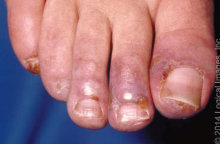
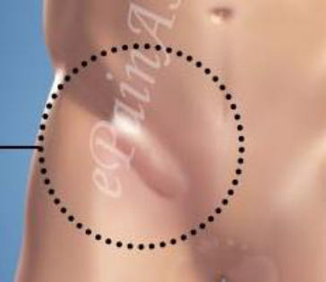
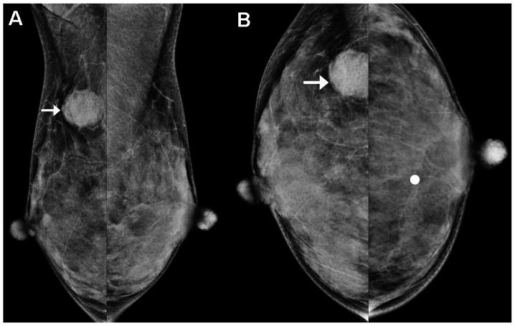
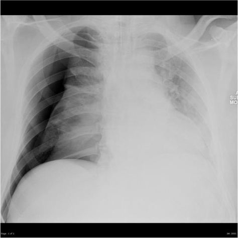
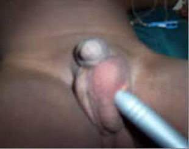
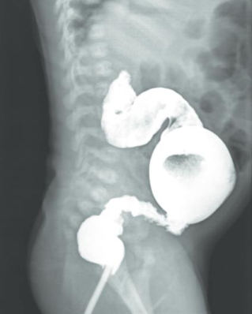
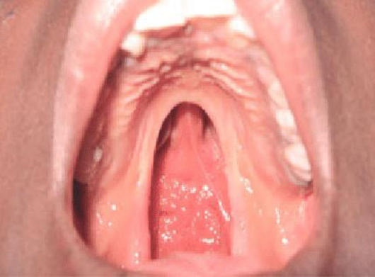

Source: "AC OSCE Surgery MDCU 74 Rotation A", Short Essay Questions, recalled by students; the numbers are the paper's own unless said otherwise.
No answer key was found for this paper; answers appear only where the paper itself gives one,
everything else is "not given in the source".
Thai wording was read from the page images (the text layer drops a vowel).
exam_year 2022 is taken from the paper's file date (April 2022); the paper does not state the year.
The rotation (A) is not mapped to a G.
The paper skips SEQ number 2. Its question "10." has parts 9.1 and 9.2, and "11." has parts 10.1 and
10.2; they are kept as written. Two questions at the end have no number and are kept under their
own heading.
Pictures with no face, name, label or ID band were checked by eye and are kept in images/ under their question; the others are described in words only. Left out: Q7 and the unnumbered face-injury question (they show faces).

## Q1 (original no. 1)
[picture in the paper: toes with purple-blue discoloration (a stock photo)]
1.1 บรรยายความผิดปกติ
1.2 วินิจฉัย

**Answer:** not given in the source
**Explanation:** not stated
**Guideline / source:** not stated

## Q3 (original no. 3)
ผู้ป่วยมาด้วยก้อนบริเวณขาหนีบลงมาที่ถุงอัณฑะดังรูปเป็นเวลาหลายเดือน โดยสามารถดันกลับเข้าไปได้
[picture in the paper: a drawing of a groin swelling extending to the scrotum, circled]
3.1 วินิจฉัย
3.2 การรักษา
3.3 ปัจจัยเสี่ยงที่ทำให้เกิดภาวะนี้

**Answer:** not given in the source
**Explanation:** not stated
**Guideline / source:** not stated

## Q4 (original no. 4)
[picture in the paper: two mammogram views, A and B, with an arrow on a rounded mass]
4.1 ชื่อการตรวจ
4.2 บรรยายความผิดปกติ
4.3 วินิจฉัย
4.4 จะส่งตรวจอะไรต่อไป

**Answer:** not given in the source
**Explanation:** not stated
**Guideline / source:** not stated

## Q5 (original no. 5)
(วิดีโอ https://youtu.be/u7D1-zj98l8?t=34 ตัดคำบรรยายด้านล่างออก)
5.1 บรรยายความผิดปกติ
5.2 วินิจฉัย

**Answer:** not given in the source
**Explanation:** not stated
**Guideline / source:** not stated

## Q6 (original no. 6)
ผู้ป่วยหญิงสูงอายุ นอนโรงพยาบาลเนื่องจากมี pneumonia ใส่ ET tube ต่อมามีอาการเหนื่อยมากขึ้น ได้ส่งตรวจ chest x-ray ได้ผลดังรูป
[picture in the paper: a chest x-ray with a hyperlucent right hemithorax]
6.1 บรรยายความผิดปกติ
6.2 วินิจฉัย
6.3 ให้การรักษา

**Answer:** not given in the source
**Explanation:** not stated
**Guideline / source:** not stated

## Q7 (original no. 7)
[picture in the paper: an ulcerated, crusted lesion of the nose]
7.1 วินิจฉัย
7.2 ให้การรักษา

**Answer:** not given in the source
**Explanation:** not stated
**Guideline / source:** not stated

## Q8 (original no. 8)
[picture in the paper: an infant's genitalia with a penlight held against the scrotum]
8.1 วินิจฉัย
8.2 คำแนะนำในการรักษา

**Answer:** not given in the source
**Explanation:** not stated
**Guideline / source:** not stated

## Q10 (original no. 10)
ผู้ป่วยเด็กทารกมาด้วยอาการอาเจียนสีเขียวเฉียบพลัน ท้องอืด ปวดท้อง
9.1 โรคที่เป็นไปได้
9.2 จะส่งตรวจอะไรเพิ่มเติมเพื่อวินิจฉัย

**Answer:** not given in the source
**Explanation:** not stated
**Guideline / source:** not stated

## Q11 (original no. 11)
จากข้อที่ 10 ส่งตรวจ barium enema ได้ผลดังรูป
[picture in the paper: a barium enema in an infant]
10.1 การรักษาเบื้องต้น
10.2 การรักษาเฉพาะ

**Answer:** not given in the source
**Explanation:** not stated
**Guideline / source:** not stated

## Unnumbered questions
(These two have no number in the paper. They are kept here unchanged, outside the numbered list.)

ผู้ป่วยเด็กมาด้วยลักษณะดังรูป ควรต้องได้รับการแก้ไขที่อายุเท่าใดและเพราะอะไร
[picture in the paper: an open mouth showing a cleft in the palate]

Answer: not given in the source.

ผู้ป่วยได้รับบาดเจ็บถูกฟันบริเวณใบหน้าดังรูป โครงสร้างใดจะได้รับบาดเจ็บบ้าง
[picture in the paper: a long cut across the cheek of an intubated patient]
Answer: not given in the source.
