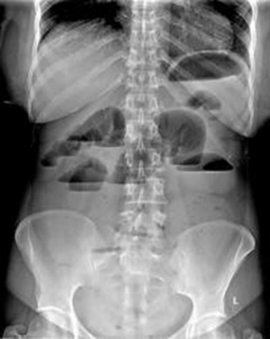
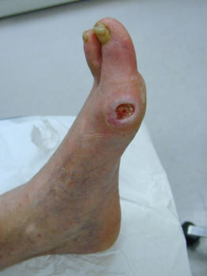

Source: "AC GenSx Osce Rotate D" (AC osce 74D), MEQ part, recalled by students; the numbers are the
paper's own. No answer key was found for this paper. Answers appear only where the recalled paper
itself gives one; everything else is "not given in the source".
exam_year 2021 follows the MDCU74 PDFs' own creation dates (September-November 2021); the Drive copies are dated April 2022 and the paper does not state the year.
The rotation letter (D) is not mapped to a G.
Pictures with no face, name, label or ID band were checked by eye and are kept in images/ under their question; the others are described in words only. Left out: the Q2 drawing, because its labels are the answer.

## Q1 (original no. 1)
ให้ film duodenal atresia มา ถาม dx กับสาเหตุที่พบมากสุด

**Answer:** dx duodenal atresia (named in the recalled stem); most common cause not given in the source
**Explanation:** not stated
**Guideline / source:** not stated

## Q2 (original no. 2)
ให้เติมชนิดของ hernia (ออกรูปนี้เลย ปิดตัวหนังสือT_T)
[picture in the paper: abdominal wall hernia sites labelled epigastric, umbilical, incisional, Spigelian, inguinal and femoral hernia; the recaller says the labels were covered in the exam]

**Answer:** the labels shown in the recalled picture: epigastric, umbilical, incisional, Spigelian, inguinal, femoral hernia
**Explanation:** not stated
**Guideline / source:** not stated

## Q3 (original no. 3)
ให้ประวัติคนไข้หลังผ่าตัดไส้ติ่งมา 6 เดือน การตรวจชุดนี้เรียกว่า? อ่านผลฟิลม์? Dx? สาเหตุที่พบได้บ่อยที่สุด? Management?
[picture in the paper: an upright abdominal X-ray with dilated bowel loops and air-fluid levels]

**Answer:** not given in the source
**Explanation:** not stated
**Guideline / source:** not stated

## Q4 (original no. 4)
คลิปตรวจ muscle test ถามว่าตรวจ muscle อะไร และ nerve root ไหน (น่าจะสุ่มออก 3 รูป)

**Answer:** not given in the source
**Explanation:** not stated
**Guideline / source:** not stated

## Q5 (original no. 5)
Describe lesion? Dx? Management? (Malignant melanoma)

**Answer:** dx malignant melanoma (named in the recalled stem); description and management not given in the source
**Explanation:** not stated
**Guideline / source:** not stated

## Q6 (original no. 6)
Describe lesion? Dx? Physical examination เพิ่มเติม?
[picture in the paper: a foot with an ulcer on the side of the great toe]

**Answer:** not given in the source
**Explanation:** not stated
**Guideline / source:** not stated

## Q7 (original no. 7)
รูปนม ถาม view + describe lesion

**Answer:** not given in the source
**Explanation:** not stated
**Guideline / source:** not stated

## Q8 (original no. 8)
Preauricular sinus บอกแนวทางการรักษา

**Answer:** not given in the source
**Explanation:** not stated
**Guideline / source:** not stated

## Q9 (original no. 9)
Burn degree ไหน, วิธีการดูแลแผล

**Answer:** not given in the source
**Explanation:** not stated
**Guideline / source:** not stated

## Q10 (original no. 10)
Ba swallow บรรยาย Bird beak, Achalasia

**Answer:** from the recalled stem: bird beak, achalasia
**Explanation:** not stated
**Guideline / source:** not stated
