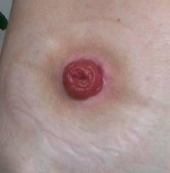

Source: "AC GenSx Osce Rotate D" (AC osce 74D), OSCE part, recalled by students; the numbers are the
paper's own. No answer key was found for this paper. Answers appear only where the recalled paper
itself gives one; everything else is "not given in the source".
exam_year 2021 follows the MDCU74 PDFs' own creation dates (September-November 2021); the Drive copies are dated April 2022 and the paper does not state the year.
The rotation letter (D) is not mapped to a G.
Pictures with no face, name, label or ID band were checked by eye and are kept in images/ under their question; the others are described in words only.

## Q1 (original no. 1)
PR หุ่น prostate แข็งๆอัน wood like บรรยาย+วินิจฉัย

**Station type:** examination
**Checklist:** not given in the source
**Explanation:** not stated
**Guideline / source:** not stated

## Q2 (original no. 2)
ฉีดยาชา+simple suture 1 ครั้ง

**Station type:** suturing
**Checklist:** not given in the source
**Explanation:** not stated
**Guideline / source:** not stated

## Q3 (original no. 3)
ซักประวัติกลืนลำบาก achalasia

**Station type:** history
**Checklist:** not given in the source
**Explanation:** not stated
**Guideline / source:** not stated

## Q4 (original no. 4)
ใส่ถุงมือ sterile + Wet dressing

**Station type:** wound dressing
**Checklist:** not given in the source
**Explanation:** not stated
**Guideline / source:** not stated

## Q5 (original no. 5)
อุปกรณ์ 5 อัน curved mayo scissors, trocar, Deaver retractor, towel clamp,chest drain

**Station type:** instrument identification
**Checklist:** the instrument names are given in the recalled stem; uses: not given in the source
**Explanation:** not stated
**Guideline / source:** not stated

## Q6 (original no. 6)
จงแสดงการตรวจร่างกายมาด้วยก้อนที่คอ+วินิจฉัย(ดูรูป) dx thyroglossal duct cyst

**Station type:** examination
**Checklist:** from the recalled stem: dx thyroglossal duct cyst; examination steps not given in the source
**Explanation:** not stated
**Guideline / source:** not stated

## Q7 (original no. 7)
ไหม เย็บ กล้ามเนื้อ ลำไส้ ผูกเส้นเลือดแดง เส้นเลือดดำ เย็บผิวหนัง (ให้ prolene silk nilon vicryl catgut เลือกตอบ4ข้อ) เติม generic name, mono/polyfilament, absorbable/non-absorbable

**Station type:** instrument identification
**Checklist:** not given in the source
**Explanation:** not stated
**Guideline / source:** not stated

## Q8 (original no. 8)
ซักประวัติ hematuria+จะตรวจร่างกายอะไร (เขียนตอบใส่กระดาษ)

**Station type:** history
**Checklist:** not given in the source
**Explanation:** not stated
**Guideline / source:** not stated

## Q9 (original no. 9)
ให้รูป Prolapsed hemorrhoid (strangulated/thrombosed มนจ) ถามว่าคือไร+tx

**Station type:** other
**Checklist:** from the recalled stem: prolapsed hemorrhoid (strangulated/thrombosed); tx not given in the source
**Explanation:** not stated
**Guideline / source:** not stated

## Q10 (original no. 10)
วิธีใส่ foley (เขียนตอบ)

**Station type:** other
**Checklist:** not given in the source
**Explanation:** not stated
**Guideline / source:** not stated

## Q11 (original no. 11)
Indication lipoma excision

**Station type:** other
**Checklist:** not given in the source
**Explanation:** not stated
**Guideline / source:** not stated

## Q12 (original no. 12)
ให้รูปนี้ถามว่าคืออะไร +ให้ ostomy bag ถามว่าคืออะไร ใช้ทำอะไร
[picture in the paper: a stoma on the abdominal wall]

**Station type:** instrument identification
**Checklist:** not given in the source
**Explanation:** not stated
**Guideline / source:** not stated
