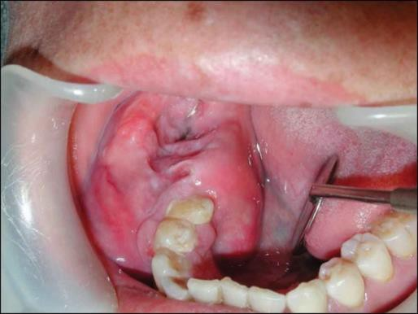
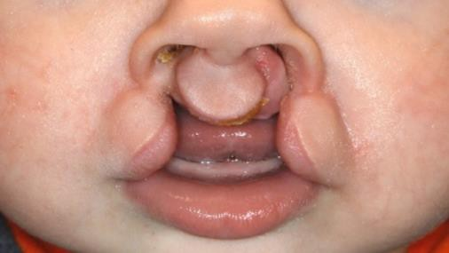
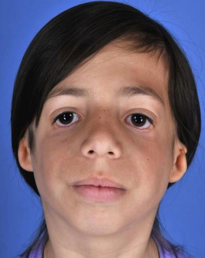

Source: "AC MCQ Subspecialty Surgery MDCU 74 Rotation A" (file "AC MCQ Subspecialty Surgery MDCU 74 Rotation A"), questions recalled by students in formal English. This is a subspecialty MCQ paper (urology, paediatric, neurosurgical, cardiothoracic and plastic topics), so it is kept apart from General Surgery and is not tagged into the exam topic map.
The paper's own numbers are kept (Q1, 5, 6, 10, 11, 19, 29, 38, 44, 48, 51, 55, 56, 61, 69, 88, 89, 90); the other numbers are not in the paper. The last 8 questions have no number in the paper. They are numbered Q201-Q208 in the order they appear, and their heading says "unnumbered question n" - there "original no." is only their order among the unnumbered questions, not a number printed in the paper.
Answers: no answer key was found for this paper and the paper marks no answers, so every answer is "not given in the source".
A choice letter the paper leaves blank is "(not recalled)". Q69 continues over a page break and is joined.
exam_year 2021 is taken from the paper's file date (November 2021); the paper does not state the year.
Pictures with no name, label or ID band are kept in images/ under their question (Q89, Q90, Q202). The picture for Q202 belongs to the unnumbered question that follows Q90's choices; its stem says only "From this image".
The rotation letter (A) is not mapped to a G.

## Q1 (original no. 1)
A Thai female patient presents with right flank pain with gross hematuria. History of renal stone 2 years ago. What is the most appropriate investigation?

A. Intravenous pyelography
B. Retrograde pyelography
C. CT urography
D. MR urography
E. Cystoscopy

**Answer:** not given in the source
**Explanation:** not stated in the source
**Guideline / source:** not stated

## Q5 (original no. 5)
A male child presents with swollen prepuce below the glans penis. What should be done first?

A. Ventral slit
B. Circumcision
C. Manual reduction
D. Topical corticosteroid
E. (not recalled)

**Answer:** not given in the source
**Explanation:** not stated in the source
**Guideline / source:** not stated

## Q6 (original no. 6)
A 7-month-old girl with history of antenatal hydronephrosis is referred for ultrasonography of the KUB system. Ultrasonography of the KUB system shows persistent severe left hydronephrosis without hydroureter. Diuretic renography shows differential renal function in left : right kidney as 22 : 78. Obstructive curve is also seen on the left side. What is the next management?

A. Left pyeloplasty
B. Left nephrectomy
C. Left percutaneous nephrostomy
D. Left antegrade DJ stent insertion
E. Follow-up with ultrasonography of the KUB system

**Answer:** not given in the source
**Explanation:** not stated in the source
**Guideline / source:** not stated

## Q10 (original no. 10)
What is the advantage of alpha adrenergic antagonist compared with 5-alpha reductase inhibitor?

A. Reduce prostate size
B. Faster onset of action
C. Increase bladder capcity

**Answer:** not given in the source
**Explanation:** not stated in the source
**Guideline / source:** not stated

## Q11 (original no. 11)
A male patient presents with a prostate gland 60 g and PSA 3.5. What is the appropriate management?

A. Alpha blocker and 5 alpha reductase inhibitor
B. TURP + biopsy

**Answer:** not given in the source
**Explanation:** not stated in the source
**Guideline / source:** not stated

## Q19 (original no. 19)
A 4 years old boy presents with dyspnea. Physical examination shows systolic ejection murmur and fixed split S2. EKG shows incomplete right bundle branch block. What is the diagnosis?

A. ASD
B. VSD
C. TOF
D. PDA
E. Coarctation of aorta

**Answer:** not given in the source
**Explanation:** not stated in the source
**Guideline / source:** not stated

## Q29 (original no. 29)
Which of the following aortic dissections requires only medical treatment?

A. Hematoma in ascending aorta
B. Flap in descending aorta
C. Reduced renal perfusion
D. With pleural effusion

**Answer:** not given in the source
**Explanation:** not stated in the source
**Guideline / source:** not stated

## Q38 (original no. 38)
A 38 weeks GA male infant presents with respiratory distress since birth. Heart sounds are heard at the right chest and scaphoid abdomen is observed. What is the proper management?

A. Emergence repair
B. Endotracheal tube and OG tube

**Answer:** not given in the source
**Explanation:** not stated in the source
**Guideline / source:** not stated

## Q44 (original no. 44)
A 6 months old boy presented with irreducible cystic lesion at the right scrotal sac, both testes are palpable and normal. What is the most appropriate management?

A. Observation
B. Marsupialization of the cord
C. Hydrocelectomy by inguinal approach
D. Hydrocelectomy by scrotal approach

**Answer:** not given in the source
**Explanation:** not stated in the source
**Guideline / source:** not stated

## Q48 (original no. 48)
A 51-year-old female presented with left side hearing loss and tinnitus in left ear. Weber test air conduction > bone conduction in both sides, Rinne test lateralized to the right side. Impaired finger to nose, heel to knee tests. Malar pinprick sensation loss. Where is the site of the lesion?

A. Left jugular foramen
B. Left vestibular schwannoma
C. Left CP angle schwannoma
D. Left CP angle epidermoid
E. Left trigeminal schwannoma

**Answer:** not given in the source
**Explanation:** not stated in the source
**Guideline / source:** not stated

## Q51 (original no. 51)
A Thai male presents with fever and headache for 1 week. He had head trauma 3 weeks ago. PE: Battle sign at right temporal area, stiff neck positive. Minimal fluid was observed in the mastoid sinus. What is the most likely diagnosis?

A. Meningitis
B. Encephalitis
C. Cerebritis
D. Mastoiditis
E. Hydrocephalus

**Answer:** not given in the source
**Explanation:** not stated in the source
**Guideline / source:** not stated

## Q55 (original no. 55)
A 40-year-old male presents with first episode of seizure 2 hr PTA. BP 120/80 mmHg without neurological deficits. Calcified mass is found in CT brain. What is the next step of management?

A. Observe
B. CT contrast
C. MR angiography
D. IV mannitol

**Answer:** not given in the source
**Explanation:** not stated in the source
**Guideline / source:** not stated

## Q56 (original no. 56)
A patient presents with fever and neck stiffness. CSF result shows elevated WBC, low glucose, elevated protein. Which antibiotic cannot be used?

A. Gentamicin
B. Ceftriaxone
C. Cefotaxime
D. Penicillin
E. Vancomycin

**Answer:** not given in the source
**Explanation:** not stated in the source
**Guideline / source:** not stated

## Q61 (original no. 61)
What is the appropriate management for acute anal fissure?

A. Stool softener
B. Lateral internal sphincterotomy

**Answer:** not given in the source
**Explanation:** not stated in the source
**Guideline / source:** not stated

## Q69 (original no. 69)
Adult female presents with anal pile with pruritus. There is history of anal sex. Anal examination shows small condyloma without intra-anal lesion. This condyloma could be treated by trichloroacetic acid. What should be the next step of management?

A. Imiquimod cream
B. Per vaginal examination
C. Antiviral agents
D. Colonoscopy

**Answer:** not given in the source
**Explanation:** not stated in the source
**Guideline / source:** not stated

## Q88 (original no. 88)
A 3 years old child presents with a black hairy nevus 10 cm on the back since birth. What is the proper management?

A. Excision
B. Wide excision
C. Closed observation
D. Staged excision
E. Dermabrasion

**Answer:** not given in the source
**Explanation:** not stated in the source
**Guideline / source:** not stated

## Q89 (original no. 89)
From the image, what is the most likely diagnosis?

A. Hemangioma
B. Ameloblastoma
C. Soft tissue sarcoma
D. Squamous cell carcinoma

**Answer:** not given in the source
**Explanation:** not stated in the source
**Guideline / source:** not stated

## Q90 (original no. 90)
As a general practitioner, what should you do when a baby in this image presents at your office?

A. Nasoalveolar molding
B. Cleft taping with hypoallergenic tape
C. Refer to a specialist

**Answer:** not given in the source
**Explanation:** not stated in the source
**Guideline / source:** not stated

## Q201 (original no. 1, topic: unnumbered question 1 (no number in the paper))
Which message regarding brain abscess is incorrect?

A. Most are febrile
B. Right to leftt shunt increases risk
C. Chronic otitis media increases risk
D. Sinusitis increases risk

**Answer:** not given in the source
**Explanation:** not stated in the source
**Guideline / source:** not stated

## Q202 (original no. 2, topic: unnumbered question 2 (no number in the paper))
From this image, what should be investigated to detect hidden problems?

A. Hearing
B. Vision
C. Swallowing

**Answer:** not given in the source
**Explanation:** not stated in the source
**Guideline / source:** not stated

## Q203 (original no. 3, topic: unnumbered question 3 (no number in the paper))
A newborn female presents with fused labia and enlarged clitoris. Which laboratory testing should be sent?

A. Serum electrolytes
B. Serum vitamin K level
C. Serum albumin

**Answer:** not given in the source
**Explanation:** not stated in the source
**Guideline / source:** not stated

## Q204 (original no. 4, topic: unnumbered question 4 (no number in the paper))
What is the treatment of choice for stage 2 pressure ulcer with damage to superficial veins?

A. FTSG
B. STSG
C. Hydrocolloid dressing

**Answer:** not given in the source
**Explanation:** not stated in the source
**Guideline / source:** not stated

## Q205 (original no. 5, topic: unnumbered question 5 (no number in the paper))
General recommendations for patients with urinary stones include all of the following except?

A. Limit sodium intake
B. Limit animal protein
C. Limit calcium intake
D. Adequate hydration
E. Limit oxalate-rich foods

**Answer:** not given in the source
**Explanation:** not stated in the source
**Guideline / source:** not stated

## Q206 (original no. 6, topic: unnumbered question 6 (no number in the paper))
What is the difference between infected hydronephrosis and pyonephrosis?

A. Retrograde/hematogenous
B. No function loss/Parenchymal and function loss

**Answer:** not given in the source
**Explanation:** not stated in the source
**Guideline / source:** not stated

## Q207 (original no. 7, topic: unnumbered question 7 (no number in the paper))
A child with suspected infantile hypertrophic pyloric stenosis. What is the best investigation for diagnosis?

A. Ultrasonography
B. CT whole abdomen
C. Barium enema
D. Upper GI study with barium
E. Upper GI study with water-soluble contrast

**Answer:** not given in the source
**Explanation:** not stated in the source
**Guideline / source:** not stated

## Q208 (original no. 8, topic: unnumbered question 8 (no number in the paper))
What is true about omphalocele comparing with gastroschisis?

A. Advanced maternal age
B. Better prognosis
C. Bowel and spleen as eviscerated contents
D. Urgent intervention is required

**Answer:** not given in the source
**Explanation:** not stated in the source
**Guideline / source:** not stated

## Flagged for checking
- No answer key exists for this paper in the files supplied.
- exam_year 2021 is taken from the file date.
