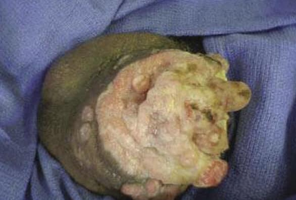

Source: "AC OSCE+MEQ Surgery MDCU75 Rotate C", OSCE part (the MEQ part is set mdcu75-gen-c-meq).
Answers: "Solution ... By JOB MDCU76", a student's key (student-key), not an official key.
Stems are as students recalled them, in their own words.
The paper has no question numbers. The stations are numbered here in the order they appear in the
paper; those numbers are not the exam's own.
exam_year 2022 is taken from the paper's file date (October 2022); the paper does not state the year.
The rotation letter (C) is not mapped to a G.
The paper opens with this list of stations (as written): เย็บให้ดูหน่อย / ไหมนี้ใช้กับอะไร / ซักคนไข้ CA breast /
ซัก BPH เขียนตอบ / ล้างมือ +ใส่ถุงมือ / อุปกรณ์ผ่าตัด / อุปกรณ์ (สายๆทั้งหลาย) / Foley / Penile SCC / ตรวจร่างกาย /
Pneumothorax / TNM CA colon. The BPH and pneumothorax stations are not described further in the paper.
Pictures with no face, name, label or ID band were checked by eye and are kept in images/ under their question; the others are described in words only.

## Q1 (original no. 1)
ผู้ป่วยชายแก่มาด้วยก้อนแบบนี้ที่อวัยวะเพศ เป็นมา1เดือน ไม่เจ็บ (รูปเดียวกับในสไลด์เรียน)
[picture of the penile mass]
1. diagnosis
2. treatment

**Station type:** other
**Checklist:** from the student key:
1. Diagnosis = penile cancer (squamous cell carcinoma of the penis)
2. Treatment: biopsy ด้วย; partial / total penectomy (เคสนี้ก้อน involves glan penis ด้วย เลยทำแค่ circumcision ไม่ได้); adjuvant therapy = systemic chemotherapy / inguinal lymph node dissection
**Explanation:** not stated
**Guideline / source:** not stated

## Q2 (original no. 2)
ให้ template มาประมาณนี้ "จะเย็บ (สิ่งเหล่านี้) ด้วยไหม (ชนิดนี้) ซึ่งในรูปคือ (เบอร์นี้) ที่มีคุณสมบัติ (ดังนี้)"
- ในข้อสอบจะเย็บ
1. เย็บปิด vein
2. เย็บต่อ artery
3. เย็บกล้ามเนื้อ
4. เย็บผิว
- มีช้อยส์ไหมให้ = catgut, nylon, silk, vicryl, prolene
- ใส่คุณสมบัติไหมเอง

**Station type:** instrument identification
**Checklist:** from the student key:
1. vein: silk
2. artery: prolene
3. muscle: vicryl
4. skin: nylon
The key pastes an appendectomy operative note (mesoappendix ligated with silk 3-0; peritoneum closed with continuous chromic catgut 3-0; internal oblique and transversus abdominis approximated with chromic catgut 3-0; sheath closed with continuous vicryl 2-0; skin closed with nylon 3-0, interrupted vertical mattress) and a handwritten table: PDS (polydioxanone, monofilament, absorbable, bowel); chromic catgut (multi, absorbable, perineum); polypropylene / prolene (mono, non-absorbable, vessel); nylon / Dafilon (mono, skin) (partly [unclear])
**Explanation:** not stated
**Guideline / source:** not stated

## Q3 (original no. 3)
Rectal cancer is resected with lymph nodes. Pathology results: subserosal fibroadipose tissue invasion, all 27 lymph nodes have no invasion
1. จะส่งอะไรเพื่อตรวจ M stage
2. ถ้า M stage negative, จะสรุป TNM staging เป็นอะไร

**Station type:** other
**Checklist:** from the student key:
1. ชอบ metastasis ไป lung, liver, brain → CT brain + contrast, CXR, CT abdomen
2. T3N0M0
Key's T/N table: Tis = อยู่ใน lamina propria; T1 = invade submucosa; T2 = invade muscularis propria; T3 = invade serosa / pericolic fat; T4 = adjacent structure / organ; N1 = 1-3 pericolic nodes; N2 = >3 pericolic nodes
**Explanation:** not stated
**Guideline / source:** not stated

## Q4 (original no. 4)
ซักประวัติผู้ป่วยมาด้วยก้อนที่เต้านม 3 เดือน/ มีผู้ป่วยจำลองให้ซัก

**Station type:** history
**Checklist:** from the student key:
Character of mass: site, size + โตขึ้นมั้ย, shape, surface, consistency, mobility, tenderness
Associated symptoms: น้ำนมไหล, หัวนมบุ๋ม, คลำได้ก้อนตรงอื่นอีกมั้ย
Past history: เคยเป็นมาก่อนมั้ย, เคยรักษาอะไรมั้ย, คนในครอบครัวเป็นมั้ย
Risk factors: early menarche, late menopause, มีลูกตอนอายุเท่าไหร่, ให้นมลูกมั้ย, กินยาคุมมั้ย, alcohol, smoking
**Explanation:** not stated
**Guideline / source:** not stated

## Q5 (original no. 5)
ให้เย็บ vertical mattress 2 stitch + ผูกsurgeon knot ด้วยเครื่องมือ (ระวังไม่ทัน)

**Station type:** suturing
**Checklist:** not stated in the key
**Explanation:** not stated
**Guideline / source:** not stated

## Q6 (original no. 6)
จงบอกชื่อของแต่ละอย่าง + วิธีการใช้ของ
- Deaver retractor
- curve mayo scissor/ Metzenbaum
- Kocher clamp
- Volkman curette/ volkman spoon/ bone curette/ double ended curette
- Babcock clamp

**Station type:** instrument identification
**Checklist:** from the student key:
Kocher: tooth forceps; จับ bone / fascia / tissue เหนียวๆ; เป็น traumatic clamp
Deaver retractor: ปากยาว; ดึงถ่าง visceral organ ในช่องท้อง
Babcock: จับ tubular structure - bowel, fallopian tube, appendix
Mayo scissors: ปากกับด้ามยาวพอกัน; curved = ใช้ตัด tissue ใหญ่ เหนียว ex. fascia; straight = ใช้ตัดไหม
Metzenbaum scissors: ปากเล็กกว่าด้าม (delicate); ใช้ตัด tissue ชิ้นเล็ก
Volkmann curette: scrape away and remove fibrous tissue and other debris from bone
**Explanation:** not stated
**Guideline / source:** not stated

## Q7 (original no. 7)
ให้ล้างมือด้วยแอลกอฮอล์โดยให้พูดอธิบายไปด้วย
เสร็จแล้วให้ใส่ถุงมือ sterile ให้ดู

**Station type:** sterile gloving
**Checklist:** from the student key: hand washing follows the pasted chart "Hand Hygiene Technique with Alcohol-Based Formulation" (duration of the entire procedure 20-30 seconds; steps 1a to 8). Sterile gloving: not stated in the key.
**Explanation:** not stated
**Guideline / source:** chart in the key: Hand Hygiene Technique with Alcohol-Based Formulation (source of the chart not stated)

## Q8 (original no. 8)
ตรวจร่างกาย
ให้ตรวจร่างกายคนไข้ชาย อายุ … ปี มาด้วยปวดท้องด้านขวาล่าง เป็นเวลา 6 ชั่วโมง
BP, BT, PR, RR WNL หมด (จำไม่ได้)

**Station type:** examination
**Checklist:** not stated in the key
**Explanation:** not stated
**Guideline / source:** not stated

## Q9 (original no. 9)
ให้ของมา 3 อย่าง
- ICD tube
- NG tube
- Proctoscope
ถามว่าคืออะไรบ้าง/ ตัวอย่างวิธีการใช้อย่างละ 2 วิธี

**Station type:** instrument identification
**Checklist:** from the student key:
ICD tube: drain ลม หนอง เลือด: pleural effusion, hemothorax, pneumothorax, empyema thoracis
NG tube: feeding ในผู้ป่วย malnutrition; ประเมิน upper GI bleeding; gastric / intestinal decompression
Proctoscope: วินิจฉัย lesion ในทวารหนัก ex. anal fissure, hemorrhoid; ใช้ระหว่างผ่าตัดเพื่อหา anal fistula tract; take tissue sample for biopsy
**Explanation:** not stated
**Guideline / source:** not stated

## Q10 (original no. 10)
Foley วางอยู่บนโต๊ะ
1. นี่คืออะไร ขนาดเท่าไหร่ (ดูข้างหลอด)
2. อธิบายวิธีการใช้งาน
3. จงยกตัวอย่างผู้ป่วยที่ต้องใช้งานอุปกรณ์นี้

**Station type:** instrument identification
**Checklist:** from the student key:
3. drain urine ออก เช่นใน acute urinary retention; คำนวณ urine output เช่นในผู้ป่วย burn
The key pastes "Table 1: Indications for Foley Catheter Use". Appropriate: acute urinary retention or bladder outlet obstruction; to accurately measure urine output in critically ill patients; perioperative use for selected procedures; open sacral or perineal wounds in incontinent patients; patient requiring prolonged immobilization (eg, pelvic fractures); improved comfort for end-of-life care. Inappropriate: for incontinence, as a substitute for patient care; to obtain urine for testing or culture in patients who voluntarily void.
1 and 2: not stated in the key
**Explanation:** not stated
**Guideline / source:** not stated
