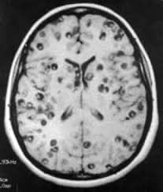

Source: "AC MCQ Subspecialty Sx MDCU75 Rotate D" (a PDF, with a Word copy), questions recalled by students under the topic headings CVT, PEDSx, Plastic, COLO, URO and NEURO. This is a subspecialty MCQ paper, so it is kept apart from General Surgery and is not tagged into the exam topic map.
The paper has no question numbers. The questions are numbered Q1-Q28 here in the order they appear, so "original no." is only that order and is not a number printed in the paper. The topic heading is written in brackets at the start of the first question under it.
Answers: "Solution AC MCQ sub spe surgery MDCU75 rotate D, by MDCU76 Maimai and Ig" (file "Solution AC MCQ sub spe surgery MDCU75 rotate D by MDCU76 Maimai and Ig"), a copy of the paper where the chosen choice is highlighted in pink, with handwritten notes and pasted lecture slides and textbook pages. It is a student-written key, NOT an official key, and may contain mistakes. Its notes are summarised under Explanation (partly [unclear] where hard to read); the pasted material is only mentioned, not copied.
Q17 and Q18 are the same question written twice, and Q11 and Q13 are two versions of the same hernia question. Some questions have fewer than four choices because only the choices the students remembered are listed. Q16 and Q23 mention a picture; only the Q23 picture is in the paper.
exam_year 2022 is taken from the paper's file date (October 2022); the paper does not state the year.
Pictures with no name, label or ID band are kept in images/ (Q23).
The rotation letter (D) is not mapped to a G.

## Q1 (original no. 1)
[paper topic: CVT] ข้อใดไม่สามารถ diag empyema thoracis

A. PH>7.2
B. wbc>5000
C. Glucose<40
D. LDH>1000

**Answer:** A (highlighted in the key)
**Explanation:** key: pastes a slide on empyema diagnosis (gram stain or culture positive, WBC > 15,000, protein > 3 g/dl, pH < 7, glucose < 40 mg/dl, LDH > 1000 U/L).
**Guideline / source:** not stated

## Q2 (original no. 2)
what is not the long term complication of left to right shunt

A. Cyanosis
B. Infective endocarditis
C. Pulmonary artery hypoplasia
D. Right to left shunt

**Answer:** C (highlighted in the key)
**Explanation:** key: handwritten "hyper" before "plasia" and "pulmonary hypertension" (Eisenmenger-type lesion) beside the choice.
**Guideline / source:** not stated

## Q3 (original no. 3)
Which conduits for CABG is the most durable?

A. Great saphenous vein
B. Internal thoracic artery
C. Radial artery
D. Right gastroepiploic artery
E. PTFE with ring graft

**Answer:** B (highlighted in the key)
**Explanation:** key: handwritten "= IMA"; a textbook page is pasted.
**Guideline / source:** not stated

## Q4 (original no. 4)
Most important factor ในการเลือกทำ total correction vs palliative (shunt operation) in ToF

A. Patient age
B. degree of overriding aorta
C. degree of pulmonary stenosis
D. size of pulmonary artery
E. size of VSD

**Answer:** D (highlighted in the key)
**Explanation:** key: pastes Thai textbook pages on one-stage and two-stage repair.
**Guideline / source:** not stated

## Q5 (original no. 5)
Female w/ low thoracic pain อ้วกหลังกินข้าว (boerhaave syndrome) รักษายังไง

A. antibiotic + conservative
B. surgery
C. bronchoscope

**Answer:** B (highlighted in the key)
**Explanation:** not stated in the key
**Guideline / source:** not stated

## Q6 (original no. 6)
ชายอายุ 70 ปี diag ว่าเป็น HIV มา 4 สัปดาห์แต่ไม่ได้รับ HAART ต่อมาพบ emphysematous cystitis ทำอะไรต่อ

A. CT w/o contrast
B. CT with contrast
C. Continuous bladder irrigation
D. UA, urine culture
E. CD4

**Answer:** D (highlighted in the key)
**Explanation:** key: pastes an emphysematous cystitis summary (management: early empirical antibiotics, may narrow per culture; urine culture important).
**Guideline / source:** not stated

## Q7 (original no. 7)
Which pf the following is true regarding spontaneous pneumothorax?

A. Primary spontaneous pneumothorax typically occurs in tall, thin, older adult
B. Osteosarcoma is the most common malignant tumor that causes secondary spontaneous pneumothorax in children
C. Catamenial pneumothorax usually occurs during the end of menstrual cycle in patient taking contraceptives
D. Hemothorax occurs in 20% of patient with spontaneous pneumothorax.
E. Pleurectomy is preferred than pleurodesis in patient with recurrent pneumothorax

**Answer:** B (highlighted in the key)
**Explanation:** key: corrections written on the other choices: A "young" (instead of older adult), C "beginning" (instead of the end of the cycle), D "5-10%" (instead of 20%), E "less than"; a slide on complications of pneumothorax is pasted.
**Guideline / source:** not stated

## Q8 (original no. 8)
[paper topic: PEDSx] เด็ก 3 ขวบกลืนเหรียญ 50 สตางค์เข้าไป respiratory system ดี การตรวจร่างกายอื่นๆปกติดี imaging พบเหรียญ 50 สตางค์อยู่ในกระเพาะอาหารของเด็ก ถามว่าควร manage อย่างไรต่อไป

A. Emergency EGD
B. Discharge and follow up next 3 days
C. Encourage drinking to ...
D. (not recalled)
E. (not recalled)

**Answer:** B (highlighted in the key)
**Explanation:** key: pastes a flow chart on foreign body ingestion.
**Guideline / source:** not stated

## Q9 (original no. 9)
Which choice is not a long term post kasai complication?

A. portal hypertension
B. variceal bleeding
C. hepatoblastoma
D. choledochal cyst
E. ….

**Answer:** C (highlighted in the key)
**Explanation:** key: pastes a slide on Kasai complications (ascending cholangitis 30-60%, portal hypertension 34-76%, hepato-pulmonary syndrome, intrahepatic biliary cysts).
**Guideline / source:** not stated

## Q10 (original no. 10)
เด็กแรกเกิด absence of anal opening ทำไรใน 24 ชม.แรก

A. Perineal examination
B. Prone lateral cross table
C. Urine examination

**Answer:** A (highlighted in the key)
**Explanation:** key: handwritten: wait about 48 hours, look for a fistula; if no fistula, a lateral prone cross-table X-ray.
**Guideline / source:** not stated

## Q11 (original no. 11)
A 1 month old healthy baby boy with bilat.inguinal hernia, which is the most appropriate management

A. Open preperitoneal prosthetic mesh repair
B. High ligation of the hernia sac
C. A cooper ligament repair
D. A bassini type repair
E. A shouldice repair

**Answer:** B (highlighted in the key)
**Explanation:** key: handwritten "Schwartz's"; a textbook passage on high ligation of the sac in children is pasted.
**Guideline / source:** not stated

## Q12 (original no. 12)
เด็กชายอายุ 4 เดือนมาด้วย jaundice, acolic stool, dark urine ตรวจร่างกายพบ hepatomegaly ส่ง investigation อะไร

A. Liver function test
B. Doppler us
C. Liver fibroscan
D. MRCP

**Answer:** B (highlighted in the key)
**Explanation:** key: pastes a slide on the diagnosis of biliary atresia (ultrasound, triangular cord sign, IOC or DISIDA by age, choledochal cyst to surgery).
**Guideline / source:** not stated

## Q13 (original no. 13)
เด็ก1เดือน bilat IIH ทำไร

A. mesh repair
B. high ligation of hernia sac
C. Basini repair
D. ….repair
E. …..repair

**Answer:** B (highlighted in the key)
**Explanation:** not stated in the key
**Guideline / source:** not stated

## Q14 (original no. 14)
เด็กชายอายุ 10 ปี 1สัปดาห์ ปวดท้อง 4 วัน, กิน ATB อ้วก ไม่อยากอาหาร วันนี้ที่รพ tachycadia ปวด RLQ

A. Meckel diverticulitis
B. intussusception
C. ureteric stone
D. appendiceal abscess
E. mesenteric adenomitis

**Answer:** E (highlighted in the key)
**Explanation:** key: notes beside the choices: Meckel "2 years old", intussusception "3 years old", ureteric stone and appendiceal abscess crossed out; a note about gastroenteritis (partly unclear).
**Guideline / source:** not stated

## Q15 (original no. 15)
เด็กอายุ 4 เดือนมาตรวจที่ well baby clinic คลำได้อัณฑะโตข้างนึง no waxing and waning, silk glove sign negative, transillumination test positive มี management อย่างไร

A. Follow up in next 2 months
B. Tab fluid at OPD
C. Elective hydrocelectomy

**Answer:** A (highlighted in the key)
**Explanation:** key: hydrocele in an infant under 1 year: observe; silk glove sign positive suggests a patent processus vaginalis (communicating hydrocele); a textbook passage is pasted.
**Guideline / source:** not stated

## Q16 (original no. 16)
[paper topic: Plastic] (มีรูปให้) male, 57 yo, flame burn at right armpit, 10*10 cm painful pink wound bed, appropriate management ?

A. Dressing wound with silver sulfadiazine
B. Debridement + local flap coverage
C. Debridement + STSG
D. Debridement + FTSG
E. Escharotomy

**Answer:** A (highlighted in the key)
**Explanation:** key: first-degree burn, conservative treatment; a note that a full-thickness burn (third degree) needs a graft; a slide on topical antibiotics is pasted. The paper's picture is not included.
**Guideline / source:** not stated

## Q17 (original no. 17)
[paper topic: COLO] Which structure is not related to colonic anatomy?

A. Taenia coli
B. appendices epiploicae
C. Marginal artery connecting SMA and IMA
D. White line of toldt
E. Valves of Houston

**Answer:** E (highlighted in the key)
**Explanation:** key: notes: taenia coli are 3 bands of smooth muscle joining at the caecum and distal sigmoid; appendices epiploicae are fat-filled pouches on the colon; the white line of Toldt is a peritoneal reflection; the marginal artery is the collateral circulation of the colon; valves of Houston are in the rectum.
**Guideline / source:** not stated

## Q18 (original no. 18)
ข้อใดไม่ใช่ anatomy of colon

A. Tenia coli
B. Appendix epiploica
C. Marginal arteries between sma&ima
D. White line of toldt
E. Valve of Houston

**Answer:** E (highlighted in the key)
**Explanation:** key: the same question as Q17 (an arrow links them).
**Guideline / source:** not stated

## Q19 (original no. 19)
[paper topic: URO] Most common presentation transitional cell invade renal pelvis

A. Hematuria
B. Azotemia
C. Asymptomatic

**Answer:** A (highlighted in the key)
**Explanation:** key: pastes a slide on clinical presentations (haematuria, microscopic or gross, is the most common).
**Guideline / source:** not stated

## Q20 (original no. 20)
yo male psa=114, DRE enlarged prostate

A. ct abdomen and bone scan
B. TURP
C. TUR-Bx

**Answer:** C (highlighted in the key)
**Explanation:** key: notes beside the choices: serum PSA > 20 ng/ml and an abnormal DRE lead to biopsy; a question whether it should be TRUS biopsy (partly unclear).
**Guideline / source:** not stated

## Q21 (original no. 21)
Most presentation of TCC of renal pelvis?

A. Hematuria
B. Abdominal mass
C. Asymptomatic

**Answer:** A (highlighted in the key)
**Explanation:** not stated in the key
**Guideline / source:** not stated

## Q22 (original no. 22)
A 45 year-year-old presents with asymptomatic microscopic hematuria.Urinalysis shows sp.gr 1.025 RBC 10-20 WBC 20-30 and epithelium 0-1 cell. CTU demonstrates complete staghorn stone. Past medical history reveals osteopenia and poorly controlled DM. What is most likely etiology of the stone?

A. Dietary Ca and Vit D
B. Chronic infection with …
C. Poorly controlled DM
D. urinary obstruction

**Answer:** B (highlighted in the key)
**Explanation:** key: staghorn (struvite) stone is associated with urinary tract infection by urease-producing bacteria.
**Guideline / source:** not stated

## Q23 (original no. 23)
[paper topic: NEURO] [picture] ถามdx

A. Cerebral cysticercosis
B. multiple brain abscess
C. TB meningitis
D. viral encephalitis
E. gliomatosis cerebri

**Answer:** A (highlighted in the key)
**Explanation:** key: a note on the cystic lesions with a scolex (neurocysticercosis); two more MRI pictures are pasted.
**Guideline / source:** not stated

## Q24 (original no. 24)
Which one is CNS defensive mechanism?

A. Anatominal barrier
B. Complement system
C. PMN leukocyte

**Answer:** A (highlighted in the key)
**Explanation:** key: pastes a slide: CNS defensive mechanism = anatomical barrier and immunological response (humoral, phagocytic cell, complement).
**Guideline / source:** not stated

## Q25 (original no. 25)
อะไรนิยมใช้หยุดเลือดใน neurosurgery

A. bipolar cauterization
B. Monopolar cauteiztion
C. metallic clip
D. ligation
E. suture

**Answer:** A (highlighted in the key)
**Explanation:** key: a handwritten list of neurosurgical haemostasis methods: cottonoid, bone wax, Surgicel, Gelfoam, Raney clip, bipolar electrocauterisation.
**Guideline / source:** not stated

## Q26 (original no. 26)
Acromegaly เกิดจาก tumor ชนิดใด

A. pituitary tumor

**Answer:** A (highlighted in the key)
**Explanation:** key: pastes a slide on pituitary tumours.
**Guideline / source:** not stated

## Q27 (original no. 27)
What is the mechanism of brain tumor related edema + effect of steroid

A. Cytotoxic, steroid can’t help
B. Cytotoxic, can help
C. Vasogenic, can’t
D. Vasogenic, can
E. Mixed, can มั้ง

**Answer:** D (highlighted in the key)
**Explanation:** key: a note "vasogenic edema"; a slide on metastasis is pasted.
**Guideline / source:** not stated

## Q28 (original no. 28)
Upward gaze palsy + light near dissociation common sign of…?

A. pinealoma
B. Glioblastoma multiforme
C. Vestibular gaglioma??
D. Meningioma

**Answer:** A (highlighted in the key)
**Explanation:** key: pastes a slide on pineal region tumours (teenage, Parinaud syndrome).
**Guideline / source:** not stated

## Flagged for checking
- The highlighted answers are a student's, not an official key. Worth checking: Q1 (the key highlights "PH>7.2" as the choice that cannot diagnose empyema), Q7 (the key's own corrections on the other choices), Q14 (mesenteric adenitis) and Q20 (the key hints at a prostate biopsy rather than TUR).
- Q16 refers to a picture that is not in the paper.
