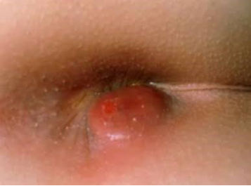

Source: "AC MCQs GenSx (Rotation A MDCU76)", questions recalled by students; the numbers are the
paper's own. The paper numbers two different questions "9"; the second is kept below under its own
heading ("Second question numbered 9") so that no number is changed. Q41 is a picture with no
stem text; Q58 has no choices.
Stems and choices are as students recalled them, in their own words. Choices the paper does not
list are not added.
Answers: "Keyบ้านๆ AC GenSx 76 Rotate A", a student's annotated copy that circles the chosen choice
(student-key), not an official key. It was read from the PDF copy in Drive; the .docx copy holds
only machine-read text of the handwriting. The key's handwritten notes are given under
Explanation, partly [unclear] where hard to read.
exam_year 2024 is taken from the paper's file date (January 2024); the paper does not state the year.
The rotation letter (A) is not mapped to a G.
Pictures with no face, name, label or ID band were checked by eye and are kept in images/ under their question; the others are described in words only.

## Q1 (original no. 1)
เคยผ่าคลอด low midline scar เป็น transverse line เจอ ก้อน defect 3 cm lateral rectus abdominis โป่งออกมาแนว longitudinal ตอนไอ

A. incisional hernia
B. Spigelian hernia
C. Direct

**Answer:** B
**Explanation:** key: lateral to rectus abdominis = semilunar line of Spiegel; through the Spigelian fascia (transversus abdominis + internal oblique aponeurosis). The key pastes a diagram of abdominal wall hernia sites and notes the C-section scar.
**Guideline / source:** not stated

## Q2 (original no. 2)
ก้างปลาติดคอจึงเอาออกด้วย EGD ตอนดึงออกมาคนไข้เจ็บคอมากหลังกลับบ้านกินยาแก้ปวดแล้ว ไม่หาย แล้วบริเวณคอปวด บวม แดง ร้อน มารพ. BT 38, U/S subcutaneus emphysema, what is dx

A. Pharyngo-esophageal perforation
B. Esophageal abscess
C. Zenker diverticulum rupture

**Answer:** A
**Explanation:** key: ไม่ต้องเป็น abscess ก็มีไข้ fever, sepsis ได้. The key pastes a textbook passage on esophageal perforation (instrumentation injuries cause about 75%; signs and symptoms include dysphagia, pain and fever, quickly progressing to sepsis if untreated; cervical perforations may present with neck stiffness and subcutaneous emphysema).
**Guideline / source:** textbook passage pasted in the key (book not named)

## Q3 (original no. 3)
Femoral hernia ระวังโดน important structure, structure นี้อยู่ด้านไหน: answer : lateral

A. Lateral
B. Medial
C. Anterior
D. Posterior
E. Superficial

**Answer:** A
**Explanation:** the recalled stem itself gives "answer : lateral". The key pastes groin anatomy diagrams (triangle of doom, triangle of pain: lateral femoral cutaneous nerve, femoral branch of genitofemoral nerve, external iliac artery and vein).
**Guideline / source:** not stated

## Q4 (original no. 4)
จะทำ graft ยาตัวไหนไม่ใช้ใน immunosuppression

A. Azathiopine
B. Tacrolimus
C. Cyclosporine
D. Mycophenolate
E. Levismasole

**Answer:** E
**Explanation:** key: levamisole is used with 5-FU as adjuvant treatment of stage III colon cancer. The key adds notes on transplant immunosuppression: triple-drug therapy = prednisolone + calcineurin inhibitor + antimetabolite; induction (depleting antibody thymoglobulin; non-depleting basiliximab, an IL-2 receptor blocker) and maintenance (corticosteroid, azathioprine, mycophenolate mofetil, sirolimus, cyclosporine, tacrolimus, belatacept), with side effects of each.
**Guideline / source:** not stated

## Q5 (original no. 5)
Upper GI bleed with epigastric pain at night time

A. Dieulafoy
B. Adenocarcinoma
C. Duodenal ulcer with bleeding

**Answer:** C
**Explanation:** key: Dieulafoy = aberrant vessel; duodenal ulcer is likely because the pain is at night (Thai note).
**Guideline / source:** not stated

## Q6 (original no. 6)
Pathogen of acute cholangitis

A. Escharichia Coli

**Answer:** A
**Explanation:** only one choice is recalled. The key pastes a passage: the most common pathogens in acute cholangitis include Klebsiella, E. coli, Enterobacter, Pseudomonas and Citrobacter.
**Guideline / source:** not stated

## Q7 (original no. 7)
Parathyroid scan

A. Sestamibi
B. Pet CT
C. CT contrast

**Answer:** A
**Explanation:** key: sestamibi = a radioisotope taken up by the parathyroid; SPECT/CT gives function plus anatomy; it can mislead when several glands are involved (handwriting partly [unclear]).
**Guideline / source:** not stated

## Q8 (original no. 8)
Papillary thyroid carcinoma mx

A. Subtotal thyroidectomy
B. Total thyroidectomy
C. Lobectomy

**Answer:** B
**Explanation:** key: lobectomy if micropapillary. The key pastes a thyroid nodule work-up flowchart (malignancy → TT).
**Guideline / source:** not stated

## Q9 (original no. 9)
Ulcer at ⅓ of lesser curvature of stomach โดนเส้นเลือดอะไร

A. right gastric artery
B. left gastric artery
C. right gastroepiploic artery
D. left gastroepiploic artery
E. short gastric artery

**Answer:** not marked in the key
**Explanation:** key: it is not clear which third is meant (ไม่รู้ว่าฝั่งไหน T-T); right gastric artery = lower part, left gastric artery = upper part. The key draws the gastric arteries.
**Guideline / source:** not stated

## Second question numbered 9
(The paper numbers this question 9 as well. It is kept here unchanged, outside the numbered list.)

ทำ laparoscopic LC เเล้วเลือดออกเยอะ vital sign เปลี่ยน BP drop, คนไข้มี adhesion ในท้องอยู่เดิม ต้องทำยังไงเพื่อหยุดเลือด

A. Convert to open surgery to stop bleed
B. ส่องกล้องต่อไปใช้ clip หนีบที่เลือดออกไว้

Answer (key): A. The key quotes Open Cholecystectomy, StatPearls (NCBI Bookshelf): extensive inflammation, adhesions, anatomical variances, bile duct injury, retained bile duct stones and uncontrolled bleeding are all indications to convert to an open procedure. It also pastes "Absolute contraindications for laparoscopic cholecystectomy" (surgeon: inability to perform lap cholecystectomy; patient: poor candidate for general anesthesia, uncontrollable coagulopathy, generalized peritonitis, suspected gallbladder cancer).

## Q10 (original no. 10)
60yr woman, History of GERD symptoms for 3 years treat medically, รอบนี้ presented with anemic symptoms, epigastric pain PR: melena เยอะมาก, provisional dx

A. Gastric CA c/ bleeding
B. Bleeding Duodenal ulcer

**Answer:** A
**Explanation:** key: medical treatment is usually tried for 2-4 weeks and she has not improved (Thai note, partly [unclear]). The key pastes "Alarm features in dyspepsia" (age > 60, unintended weight loss, dysphagia, anemia, GI bleeding, palpable mass, persistent vomiting, family history of upper GI cancer, among others).
**Guideline / source:** not stated

## Q11 (original no. 11)
Not indication for bariatric surgery

A. BMI 36
B. BMI 32 w/ OSA
C. Refuse to behavior mod
D. Young adult w/ HT

**Answer:** C
**Explanation:** key: BMI 36 → MBS; BMI 32 with OSA → MBS if medical treatment has failed; refusing behaviour modification: non-surgical treatment should come first. The key pastes the 2022 ASMBS/IFSO indications for metabolic and bariatric surgery (MBS recommended for BMI ≥ 35; considered for BMI 30-34.9 with metabolic disease; lower thresholds in Asian populations) and a BMI class table.
**Guideline / source:** 2022 ASMBS and IFSO indications for metabolic and bariatric surgery (pasted in the key)

## Q12 (original no. 12)
Pancreas dilate 3 mm and calcification??

A. Puestow
B. Conservative

**Answer:** B
**Explanation:** key: probably chronic pancreatitis (or IPMN, other malignancies); a 3 mm duct is about normal size. Large duct (> 5 mm) → drain (Puestow's); small duct → resection (Frey's, Beger's). The key pastes normal pancreatic duct diameters.
**Guideline / source:** not stated

## Q13 (original no. 13)
Woman arrived from USA yesterday and have leg edema, what's the ix in this case

A. Duplex ultrasound
B. CTA

**Answer:** A
**Explanation:** key: R/O VTE, especially femoropopliteal DVT. Duplex findings: non-compressible vein (low sensitivity in calf veins), no flow, thrombus, venous distension, loss of respiratory flow variation; also look for thrombus above the inguinal ligament in the iliac vein and for May-Thurner syndrome. Wells score ≤ 0 → D-dimer first; ≥ 500 → DUS; D-dimer < 500 excludes VTE.
**Guideline / source:** Wells score (named in the key)

## Q14 (original no. 14)
ใครหัามไปทำ laparoscopic surgery

A. triple vessel disease EF 15%
B. HBV infection

**Answer:** A
**Explanation:** key: the gas reduces venous return, leading to heart failure; HBV only means taking precautions (Thai note, partly [unclear]).
**Guideline / source:** not stated

## Q15 (original no. 15)
Trauma from accident, after Sx has multiple enterocutaneus fistula. What is management?

A. Ringer lactate
B. 3% nss
C. Albumin
D. 5%Dextrose

**Answer:** A
**Explanation:** key: the most physiologic fluid; "metabolic acidosis" is written beside D.
**Guideline / source:** not stated

## Q16 (original no. 16)
Which must be include in preop in term of hemostasis and coagulation

A. CBC with platelete
B. PT/INR
C. APTT
D. ADP platelet function
E. History and physical exam

**Answer:** E
**Explanation:** key: A to D are ordered according to history and physical examination; E always ("เสมอ!").
**Guideline / source:** not stated

## Q17 (original no. 17)
TSH ต่ำ. Thyroid scan ได้ cold nodule. ? Diagnosis.

A. Thyroid cancer
B. Grave's
C. autoimmune thyroiditis
D. Toxic adenoma

**Answer:** B
**Explanation:** key: thyroid cancer → euthyroid; Graves' → low TSH, and a cold nodule can occur ("Marine-Lenhart syn."); autoimmune thyroiditis → high TSH; toxic adenoma → not a cold nodule. The key pastes a differential diagnosis of cold nodules (great majority benign, thyroid malignancy in about 10%). Compare Q38.
**Guideline / source:** not stated

## Q18 (original no. 18)
multiple microcalcification at upper and lower inner part. Dx as invasive ductal carcinoma. PE แล้ว LN negative. ทำไรต่อ

A. BCT + SNLB
B. total mastectomy + SNLB
C. BCT + ALND
D. total mastectomy + ALND

**Answer:** B
**Explanation:** key pastes NCCN Guidelines Version 3.2024, Invasive Breast Cancer: contraindications to breast-conserving therapy include diffuse suspicious or malignant-appearing microcalcifications.
**Guideline / source:** NCCN Guidelines Version 3.2024, Invasive Breast Cancer (pasted in the key)

## Q19 (original no. 19)
ผู้ป่วยเป็น goiter. รักษาอะไร.

A. Total thyroidectomy
B. Subtotal thyroidectomy

**Answer:** not marked in the key
**Explanation:** key: asks what the goiter is like (large? obstructing?); surgery if there are compressive symptoms; toxic MNG: (1) drugs → not cured after 2 years → (2) I-131 or (3) surgery. The key pastes the thyroid nodule work-up flowchart.
**Guideline / source:** not stated

## Q20 (original no. 20)
what is NOT considered "prophylactic antibiotics"

A. ceftriaxone and metronidazole given to patient with acute appendicitis while waiting for appendectomy
B. vancomycin given 20 mins prior to herniorrhaphy with mesh ?? to patient allergic to penicillin
C. cefazolin given 1 hour prior to athroplasty

**Answer:** not marked in the key (the key brackets all three as correct, "ถูกทุกข้อ", with a question mark)
**Explanation:** key: B is OK if MRSA is suspected. Prophylaxis: appendectomy ceftriaxone + metronidazole or cefoxitin; colorectal ceftriaxone + metronidazole; biliary tract cefazolin or ciprofloxacin; vascular graft cloxacillin. The key pastes a table of antimicrobial prophylaxis by surgical procedure.
**Guideline / source:** not stated

## Q21 (original no. 21)
SIADH อะไรผิดปกติ

A. Na
B. K
C. Mg

**Answer:** A
**Explanation:** key: ADH ↑. Pasted slide: SIADH (syndrome of inappropriate ADH secretion) is the most common cause of euvolemic hyponatremia; persistent intake of free water at serum osmolalities lower than the usual threshold for thirst; common causes pulmonary disease, CNS disease.
**Guideline / source:** not stated

## Q22 (original no. 22)
Liver transplantต้องทำอะไร

A. Cross matching
B. HLA
C. ABO

**Answer:** C
**Explanation:** key pastes a slide: liver allocation by same blood group, no need for HLA typing and crossmatch (immune privileged organ); allocation policy patient based (sickest first) and center based.
**Guideline / source:** not stated

## Q23 (original no. 23)
เปลี่ยนตับ

A. Orthotopic
B. Allograft
C. Autograft

**Answer:** A
**Explanation:** key: orthotopic = put in the original place. Pasted slide: orthotopic liver transplantation; living vs cadaveric, split vs reduced size vs whole graft; most common indications: pediatric biliary atresia; adult cirrhosis caused by HCV, HBV, alcohol, HCC (Milan criteria), FHF.
**Guideline / source:** not stated

## Q24 (original no. 24)
Arrhythmia + VF

A. Hyperkalemia
B. Hypokalemia
C. HypoMg

**Answer:** A
**Explanation:** key: hypokalemia gives ↓T, ↓ST, U wave. Pasted slide on hyperkalemia (K > 5.5 mEq/L): causes; EKG change ↑T, ↑QRS, ↓P, ↑PR, sine wave → VF, cardiac arrest.
**Guideline / source:** not stated

## Q25 (original no. 25)
นมมีmicrocal axilla LNคลำไม่ได้

A. Masectomy ALND
B. Masectomy sentinel
C. BCS sentinel

**Answer:** B
**Explanation:** key: probably meaning widespread microcalcification (Thai note, partly [unclear]); pastes NCCN Version 3.2024 contraindications to breast-conserving therapy. Compare Q18.
**Guideline / source:** NCCN Guidelines Version 3.2024, Invasive Breast Cancer (pasted in the key)

## Q26 (original no. 26)
ทำให้เกิดcancer ข้อไหนผิด

A. Hep A-HCC
B. EBV-burkitt
C. HPV-penis
D. O.viver-cholang
E. H.pylori-gastric adeno

**Answer:** A
**Explanation:** key: HCC is from hepatitis B, C; EBV → Hodgkin, Burkitt (non-Hodgkin), nasopharyngeal CA; H. pylori → gastric adenoCA, gastric MALT lymphoma; B to E ticked.
**Guideline / source:** not stated

## Q27 (original no. 27)
Patient w obstructive jaundice symptoms. Imaging มี mass at hepatic hilum, dilated hepatic duct มี peritoneal nodules. What is used to relieve his symptoms

A. PTBD
B. ERCP + stent

**Answer:** B
**Explanation:** key: CA stage 4?; PTBD = percutaneous transhepatic biliary drainage; ERCP + stent is more common and recommended. The key highlights this question.
**Guideline / source:** not stated

## Q28 (original no. 28)
คนไข้ติดHBVไม่ควรทำอะไร

A. Observe ไม่เข้าผ่า
B. ใส่ goggle
C. ใส่apron

**Answer:** A
**Explanation:** not stated beyond the mark.
**Guideline / source:** not stated

## Q29 (original no. 29)
Patient มี small bowel obstruction symptoms.มี X ray มาให้ (มีขาว ๆ ที่ RLQ) ผู้ป่วยเป็นอะไร

A. Midgut volvulus
B. Gallstone ileus
C. Acute cholangitis
D. Acute cholecystitis

**Answer:** B
**Explanation:** key: probably a gallstone that has dropped to the IC valve (Thai note).
**Guideline / source:** not stated

## Q30 (original no. 30)
Who is not contraindicated for solid organ donation.

A. HIV infection
B. Malignant melanoma
C. Persistent hypertension
D. Creutzfeldt-Jakob disease

**Answer:** C
**Explanation:** key: A, B and D are absolute contraindications; CJD is a neurocognitive disease due to prion. Pasted list: absolute "CHUMP" (CJD, active HIV, uncontrolled infection, metastatic or non-curable malignant disease, past malignancy with transmission risk such as melanoma); not contraindications "LIP-HEAD" (localised tumours, treated infections, past malignancy with long cancer-free interval, hypertension, elderly, acute renal failure, diabetes mellitus).
**Guideline / source:** not stated

## Q31 (original no. 31)
คาดหวังปัสสาวะ นน 50 กก

A. 20-25 cc/hr
B. 30-50cc/hr
C. 2-3cc/kg/hr
D. 3-5cc/kg/hr

**Answer:** B
**Explanation:** key: 0.5-1 ml/kg/hr = 25-50 ml/hr.
**Guideline / source:** not stated

## Q32 (original no. 32)
post op fever day 5. remove urinary catheter on day 2, start your oral diet day 3, ambulate ได้ day 4. Which is the most unlikely cause

A. Atelectasis
B. UTI
C. Wound infection
D. DVT
E. Thrombophlebitis

**Answer:** C
**Explanation:** key: the key scribbles over "un" in "unlikely" and circles C, so it answers the most likely cause; atelectasis is crossed; UTI: catheter already removed?; DVT: ambulating, so probably ruled out.
**Guideline / source:** not stated

## Q33 (original no. 33)
Patient hematemesis จาก esophageal varice. Resus กับ sclerotherapy ไปแล้ว. ตอนนี้ bleed อีกรอบ. ให้ทำอะไร.

A. Band ligation
B. TIPS
C. portocaval shunt
D. Distal splenorenal shunt

**Answer:** A
**Explanation:** key: sclerotherapy = injecting a sclerosing agent into the varix; TIPS = transjugular intrahepatic portosystemic shunt. The key pastes a variceal bleeding management flowchart.
**Guideline / source:** not stated

## Q34 (original no. 34)
ผ่านมมาป็นมะเร็ง ละมีจำทำ skin flap ข้อไหนช่วยป้องกันDVT

A. Early ambulation+IV hydration
B. sequential compression device
C. ไม่ต้องให้อะไรเพราะผู้ป่วยไม่มี risk of DVT

**Answer:** A
**Explanation:** key: cancer can cause paraneoplastic DVT; the most common cause of flap failure is venous thrombosis; B is used in bleeding but does not help venous thrombosis of the flap (Thai note, partly [unclear]); C is wrong. The key says this came from a senior in plastic surgery.
**Guideline / source:** not stated

## Q35 (original no. 35)
กลืนอาหารไม่ลงทั้งsolid liquid ทำbariumเจอproximal dilate+taperingทำไรต่อ

A. EUS
B. Biopsy
C. Eso manometry
D. ไม่มีEGD

**Answer:** C
**Explanation:** key: DDx achalasia vs pseudoachalasia; EUS → GIST, staging a tumor; manometry is the gold standard for achalasia but cannot exclude pseudoachalasia; EGD would separate achalasia from pseudoachalasia; the ideal order is 1st EGD, 2nd manometry, but the recalled choices have no EGD.
**Guideline / source:** not stated

## Q36 (original no. 36)
พึ่ง open herniorraphy ไป. Post op day 5. ตอนนี้ไข้ 38C. ผิว บวม แดง tender. เจ็บแบบแสบ ๆ (?) เป็นอะไร

A. Mesh infection
B. Cutaneous nerve injury
C. Granuloma

**Answer:** A
**Explanation:** key: nerve injury would not give fever or redness, more a numb pain; granuloma would not be swollen and red (Thai notes, partly [unclear]).
**Guideline / source:** not stated

## Q37 (original no. 37)
มีmetasไปตับจะตัดแต่remnantไม่พอ จะทำอะไรก่อนตัด

A. TACE
B. PVE
C. Hep v embolize /occlusion?

**Answer:** A
**Explanation:** key: the remnant liver is not enough; 1st TACE → PVE. The key pastes the "Malignant liver tumor" slide (resectable needs adequate liver remnant / liver function; unresectable: XRT, TOCE, chemotherapy, relieve jaundice).
**Guideline / source:** not stated

## Q38 (original no. 38)
Low tsh+cold nodule

A. Thyroid cancer
B. Thyroid adenoma
C. Toxic adenoma goiter

**Answer:** not answered in the key (the key crosses this question out; it repeats Q17)
**Explanation:** not stated. Compare Q17.
**Guideline / source:** not stated

## Q39 (original no. 39)
Hyperparathyroid ข้อไหนไม่ทำให้เกิด

A. Plummer
B. Grave
C. Hashimoto
D. Medullary thyroid carcinoma

**Answer:** D
**Explanation:** key: corrects the stem to hyperthyroid ("ข้อไหนไม่ทำให้เกิด hyperthyroidism"); Plummer ✓, Graves ✓; Hashimoto is mostly diffuse and hypothyroid but can be hyperthyroid early; medullary thyroid carcinoma does not accumulate radioiodine but secretes calcitonin. Pasted slides: common causes of hyperthyroidism (Graves' disease, toxic adenoma, toxic multinodular goiter / Plummer's disease) and Hashimoto's thyroiditis.
**Guideline / source:** not stated

## Q40 (original no. 40)
ข้อไหนไม่มีปยกับคนไข้ มาด้วยเหลืองขึ้น+ epigastrium discomfort

A. CT
B. Biopsy
C. CA19-9,PSA,…
D. Colonoscope
E. Viral profile

**Answer:** B
**Explanation:** key: hepatic or post-hepatic jaundice?; CT for obstruction; tumor markers if a cancer is obstructing; viral profile for hepatitis. Biopsy of a liver cancer is done only to plan treatment, not to diagnose (risk of tumor seeding / bleeding); for a periampullary CA that will be resected, biopsy is not needed (handwriting partly [unclear]). The key pastes liver mass biopsy slides.
**Guideline / source:** not stated

## Q41 (original no. 41)
[picture in the paper: a red, swollen skin lesion; the recalled question has no stem text]

A. Gram pos rod
B. Gram pos cocci
C. Gram neg rod
D. Gram neg cocci
E. ตอบได้หลายข้อ

**Answer:** E
**Explanation:** key: B ✓ enterococcus; C ✓ E. coli. The key pastes a table of anaerobic and aerobic organisms isolated (Bacteroides, E. coli, coagulase-negative staphylococci, Enterococcus, S. aureus, MRSA, Klebsiella, among others).
**Guideline / source:** not stated

## Q42 (original no. 42)
RUQ pain, no jaundice wbc 26,000 ua normal. Air in gallbladder wall

A. Emer cholecystectomy
B. IV abx + elective cholecystectomy
C. Emer cholecystostomy
D. Elective cholecystostomy

**Answer:** B
**Explanation:** key: grade II. Pasted slides on acute cholecystitis grading (grade III severe with organ dysfunction; grade II moderate: WBC > 18,000/mm3, palpable tender RUQ mass, duration > 72 h, marked local inflammation including emphysematous cholecystitis) and treatment of grade II (antibiotics and supportive care → early or delayed LC, or GB drainage).
**Guideline / source:** not stated

## Q43 (original no. 43)
เดิน 200 เมตรปวดน่อง dorsalis pedis 1+

A. CT angiography
B. Endovascular treatment

**Answer:** A
**Explanation:** key: claudication; CTA 1st, as imaging to map the vessels before any revascularization (Thai notes, partly [unclear]).
**Guideline / source:** not stated

## Q44 (original no. 44)
Expanding epidural hematoma ใช้ยา warfarinอยู่

A. VitK
B. FFP
C. Bridging heparin
D. ผ่าเลยแล้วให้ heparin หลังผ่า

**Answer:** B
**Explanation:** key: urgent ("ด่วน!"); vitamin K is too slow, the liver has to make new factors; FFP gives the factors directly, so surgery can go ahead. Same topic as Q74.
**Guideline / source:** not stated

## Q45 (original no. 45)
เรียงลำดับถูก

A. Vasocon plt aggregation cog

**Answer:** A
**Explanation:** only one choice is recalled.
**Guideline / source:** not stated

## Q46 (original no. 46)
ต้องให้tetanus Ig

A. ไม่เคยได้toxoid+แก้วแตกตำขา
B. ไม่เคยได้toxoid+abrasion dorsum foot

**Answer:** A
**Explanation:** the key pastes a tetanus immunisation table (clean wound vs tetanus-prone wound, by immunisation status; human tetanus immunoglobulin for a tetanus-prone wound when not immunised or status unknown).
**Guideline / source:** not stated

## Q47 (original no. 47)
Adenomatous polypเจอ advice ทำอะไรสำคัญสุด

A. ตรวจgene family
B. Discuss
C. Psychotherapy เพราะผู้ป่วยเป็นมะเร็ง?

**Answer:** A
**Explanation:** key: FAP.
**Guideline / source:** not stated

## Q48 (original no. 48)
Loss gastric content

A. 0.9%
B. Ringer lactate
C. DN/2

**Answer:** A
**Explanation:** key: NaCl.
**Guideline / source:** not stated

## Q49 (original no. 49)
Pale, rim enhance 10 cm , mix-solid,cystic

A. Liver abscess
B. Tumor bleedในก้อน

**Answer:** A
**Explanation:** key pastes a liver abscess slide: organisms E. coli, B. fragilis (Asia: Klebsiella; SBE: Streptococcus, Staphylococcus; HIV: Candida); CT: low attenuation complex hypodense mass with peripheral or rim enhancement.
**Guideline / source:** not stated

## Q50 (original no. 50)
อันไหนบอกseverity ของ acute pan ไม่ได้

A. Amylase
B. WBC count
C. Glucose
D. Hypocalcemia

**Answer:** A
**Explanation:** the key pastes Ranson's prognostic criteria, the BISAP score and the Atlanta criteria for acute pancreatitis.
**Guideline / source:** Ranson's criteria; BISAP; Atlanta criteria (pasted in the key)

## Q51 (original no. 51)
ข้อไหนคือmalnutrition

A. Glucose<90
B. นน<50kg
C. นนลด 10%ใน3เดือน

**Answer:** C
**Explanation:** the key pastes a Thai nutrition screening and assessment flowchart.
**Guideline / source:** not stated

## Q52 (original no. 52)
DM,on ยา ASA gr 5จะ elective hernia

A. หยุด 7 วัน
B. ไม่ต้องหยุด
C. Bridgingด้วย

**Answer:** A
**Explanation:** key: ASA gr 5 = 325 mg.
**Guideline / source:** not stated

## Q53 (original no. 53)
ข้อไหนไม่ช่วยใน post op recovery.

A. Epidural anesthesia
B. รีบเอาNGออก
C. O2 supplement
D. Non-opoid
E. Post op gum chewing

**Answer:** C
**Explanation:** key: A ✓ less pain → active; B ✓ fewer complications of prolonged NG; C only in certain cases (the incidence of hypoxemia has dropped a lot); D ✓; E (±) ✓ helps bowel function return faster, supported by several papers but not yet a standard (handwriting partly [unclear]).
**Guideline / source:** not stated

## Q54 (original no. 54)
MIS ไม่ใช่

A. Recoveryเร็ว
B. เจ็บแผลน้อย
C. ดมยาสั้นกว่า

**Answer:** C
**Explanation:** not stated beyond the mark.
**Guideline / source:** not stated

## Q55 (original no. 55)
ผญอายุ 28 กินยาคุม 10 ปี rapid wash out

A. Hepatic adenoma
B. FNH
C. HCC

**Answer:** A
**Explanation:** key: hepatic adenoma and HCC share the imaging pattern (arterial enhancement, rapid washout); they are told apart by history: with cirrhosis or a history of HBV, think of HCC.
**Guideline / source:** not stated

## Q56 (original no. 56)
Chronic HCV, liver parenchyma normal , rapid wash out

A. HCC
B. FNH
C. Hepatic adenoma

**Answer:** not marked in the key
**Explanation:** key: chronic HCV favours HCC; normal parenchyma favours hepatic adenoma; imaging cannot tell them apart; and with chronic HCV the liver is unlikely to be normal.
**Guideline / source:** not stated

## Q57 (original no. 57)
ผู้ป่วย เหลือง anemia ปวดท้อง at epigastrium radiate to back. กิน anti inflammatory drug and acetaminophen แล้ว ดีขึ้น. คลำได้ก้อน irregular border at epigastrium

A. CA head of pancreas
B. Gastric adenocarcinoma
C. gastric GIST

**Answer:** A
**Explanation:** key: maybe already inflamed; pain to the back = retroperitoneal structure; B and C would not cause jaundice.
**Guideline / source:** not stated

## Q58 (original no. 58)
Esophagel variesจากcollateral อะไร

**Answer:** left gastric - esophageal vein (key)
**Explanation:** no choices are recalled.
**Guideline / source:** not stated

## Q59 (original no. 59)
ส่องกล้องเจอsubepithelial tumor

A. Biopsy
B. CT
C. Endoscopic ultrasound

**Answer:** A
**Explanation:** key: GIST → biopsy and immunostain CD117 / c-KIT.
**Guideline / source:** not stated

## Q60 (original no. 60)
New onset DM. perineal dermatitis. DVT. diagnosis?

A. Insulinoma
B. VIPoma
C. Glucagonoma
D. Gastrinoma
E. Pancreatic adenocarcinoma

**Answer:** C
**Explanation:** key: necrolytic migratory "edema" (as written); glucagon ↑ → glucose ↑ → glucose intolerance and DM. The key marks this question จำ (memorise).
**Guideline / source:** not stated

## Q61 (original no. 61)
Esophageal cancer (SCC). T2N0M0. Treatment

A. Esophagectomy
B. Definite chemotherapy

**Answer:** A
**Explanation:** key: in a healthy / fit patient.
**Guideline / source:** not stated

## Q62 (original no. 62)
หญิงท้อง 20 สัปดาห์ มีไข้ ปวดท้อง migrate tender rlq leukocytosis n/v+anorexiaทำไร

A. US
B. MRI
C. CT
D. Lap dx+- appendectomy

**Answer:** A
**Explanation:** key: highly suspicious → operate first (ผ่าก่อน); in pregnancy open surgery is preferred, so "Lap" in D is crossed out. The key pastes a table on acute appendicitis in the young, the elderly and in pregnancy.
**Guideline / source:** not stated

## Q63 (original no. 63)
แก่ๆ reducible herniaนัดมาผ่า

A. Hernirhapphy mesh
B. Herniorhapphy tissue repair

**Answer:** A
**Explanation:** key: at present a tension-free operation (Lichtenstein) is preferred.
**Guideline / source:** not stated

## Q64 (original no. 64)
เกิน6ชมเคยผ่าไส้ติ่ง ปวดท้อง prไม่เจออึ ไม่ตด

A. Conservative
B. Emer lap
C. Abdominal series

**Answer:** C
**Explanation:** key: acute abdomen; abdominal series for diagnosis. The key pastes a Thai passage on adhesive small bowel obstruction (most partial obstructions settle with conservative treatment; CT for closed-loop obstruction or strangulation; operate if no improvement within about 48 hours).
**Guideline / source:** not stated

## Q65 (original no. 65)
ปกติreducible herniaแต่อยู่ๆก่ไม่reduce มีปวดท้อง เป็นไข้

A. Emer hernio
B. Elective hernio

**Answer:** A
**Explanation:** key: strangulation (and obstruction) → must operate; if only incarcerated → try sedative + manual reduction; if it goes back, follow up at OPD; if still not reduced after 6 hours → emergency lap.
**Guideline / source:** not stated

## Q66 (original no. 66)
อายุ 28 คลำก้อนที่นม รสว่าcystic lesion

A. US
B. US+mammogram
C. Mammogram

**Answer:** A
**Explanation:** key: US for age < 35; US + mammogram for age > 35.
**Guideline / source:** not stated

## Q67 (original no. 67)
เพิ่งผ่าตัดมาดูระดับของ

A. Proteolysis
B. Gluconeogenesis
C. Ketogenesis
D. Cytokine

**Answer:** not answered in the key (the key crosses this question out)
**Explanation:** not stated
**Guideline / source:** not stated

## Q68 (original no. 68)
อายุ55 CT เจอ?? Saccular aneurysm? ปวดหลัง เจอ pulsatile mass

A. Elective Open repair
B. Endo vascular repair ถ้าขนาดใหญ่ขึ้น
C. ติดตามขนาด ใหญ่ขึ้นให้ผ่า

**Answer:** A
**Explanation:** key: saccular (not fusiform) and symptomatic, so it should be repaired anyway, without waiting for it to grow.
**Guideline / source:** not stated

## Q69 (original no. 69)
Lung cancer 6 hr spinal cord compression

A. Emergency radiotherapy

**Answer:** A
**Explanation:** only one choice is recalled.
**Guideline / source:** not stated

## Q70 (original no. 70)
upper gi bl ดูมีcirrhosis อีก 2 ชม bleedใหม่ เกิดจาก

A. Eso varies
B. PU
C. DU
D. Boerhaave

**Answer:** A
**Explanation:** key: Boerhaave and Mallory-Weiss tear come from severe vomiting.
**Guideline / source:** not stated

## Q71 (original no. 71)
ปวดLLQ imagingเจอ sigmoid diverticulitis เจอหลายdiveticulum มีabscess? 4 cm ทำไรต่อ

A. Sigmoidectomy with primary anastomosis
B. Sigmoidectomy with hartmann procedure
C. Antibiotics

**Answer:** C
**Explanation:** key: with or without an abscess, no operation; a large abscess (> 4 cm) may be sent for PCD; open surgery only when there is perforation / peritonitis. A and B crossed out.
**Guideline / source:** not stated

## Q72 (original no. 72)
which is not the benefit of pancreatic transplant…

A. improve carbohydrate and fat absorption
B. can do pancreatic and kidney transplant simultaneously
C. treat diabetes that does not respond to insulin

**Answer:** A
**Explanation:** key: the pancreas is transplanted for endocrine function; B is common because DM type 1 patients often end with ESRD, so the kidney transplant is a chance to treat the DM 1 with a pancreas at the same time.
**Guideline / source:** not stated

## Q73 (original no. 73)
ผู้ป่วยแขนบวมข้าวซ้ายหลัง mastectomy ไป (ให้รูปมา)

A. Lymphedema
B. Lymphangitis

**Answer:** A
**Explanation:** not stated beyond the mark.
**Guideline / source:** not stated

## Q74 (original no. 74)
Patients on warfarin, presented with car accident and expanding epidural hemorrhage. What to do preop?

A. Platelete
B. FFP
C. VitK
D. Stop warfarin and bridge with heparin
E. Change to aspirin

**Answer:** B
**Explanation:** key: warfarin is anti-vitamin K (factors 2, 7, 9, 10); emergency; C and D are too slow. Same topic as Q44.
**Guideline / source:** not stated

## Q75 (original no. 75)
ข้อไหนทำถูกต้อง

A. ล้างมือ เปลี่ยนถุงมือ+alc ล้างมือ
B. ล้างมือ ไม่ใช้ถุงมือ ล้างมือ

**Answer:** not answered in the key (the key ends at Q74)
**Explanation:** not stated
**Guideline / source:** not stated

## Flagged for checking
- Q9 (the first one), Q19, Q20 and Q56: the key marks no answer. What are the expected answers?
- Q32: the stem says "most unlikely", but the key changes it to "most likely" and circles wound infection. Which way was the real question asked?
- Q39: the stem says hyperparathyroid, and the key reads it as hyperthyroid. Which is right?
- Q62: the key marks US but also says to operate first if highly suspicious. Which is the expected answer?
