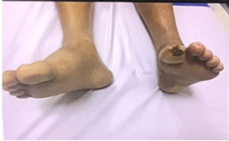

Source: "OSCE MEQ Surgery rotate A MDCU76", MEQ part (the OSCE part is set mdcu76-gen-a-osce).
Stems are as students recalled them after the exam, in their own words; notes in brackets are the
recaller's, not the examiner's. Answers come from a student's handwritten notes on the recalled
paper (student-key), not an official key. Handwriting that could not be read is marked [unclear].
exam_year 2024 is taken from the paper's file date (March 2024); the paper does not state the year.
The rotation letter (A) is not mapped to a G.
Pictures with no face, name, label or ID band were checked by eye and are kept in images/ under their question; the others are described in words only. Left out: pictures that only the key pastes (not in the exam).

## Q1 (original no. 1)
(ซ้ำ ac) ให้รูปเด็กขี้สีซีด
a. ถามว่าจะ ddx 2 โรค
b. ถ้าอยู่รพตจวจะ management ยังไง

**Answer:**
a. Biliary atresia (Thai note [unclear]); choledochal cyst
b. U/S, refer to a larger hospital (Thai, partly [unclear])
**Explanation:** not stated
**Guideline / source:** not stated

## Q2 (original no. 2)
ให้ film x ray
a. Film อะไร (acute abdomen series: ap supine, pa upright)
b. เห็นอะไร
i. Step ladder pattern
ii. Different height in the same loop
c. เกิดจากอะไร (adhesion)
d. รักษายังไง

**Answer:**
a. + chest upright PA too
b. small bowel obstruction (step ladder pattern and different height in the same loop ticked)
c. adhesion (underlined)
d. conservative 80%: IV fluid + NPO + NG tube for decompression
**Explanation:** not stated
**Guideline / source:** not stated

## Q3 (original no. 3)
Barium swallowing achalasia ( ตรงแอค )
a. what's this method called
b. describe
c. Dx

**Answer:**
a. Barium swallow
b. bird beak sign: esophageal dilatation & tapering at the esophageal sphincter
c. Achalasia
**Explanation:** the key pastes a barium swallow picture showing the bird beak appearance.
**Guideline / source:** not stated

## Q4 (original no. 4)
LUTS
a. ซักประวัติ
b. ตรวจร่างกายอะไร

**Answer:**
a. urgency, frequency, nocturia, incomplete emptying, intermittency?, straining?, stream?
b. palpate bladder (full bladder); PR (BPH [unclear]); ตรวจ genitalia; CVA tenderness (R/O upper UTI); ตรวจ neuro, e.g. bulbocavernosus reflex, perianal sensation
**Explanation:** not stated
**Guideline / source:** not stated

## Q5 (original no. 5)
รูป neck mass ดู infected (น่าจะเป็น carbuncle แต่ถ้าชื่อโรคมนจ TT)
a. ซักประวัติ
b. DDx 3 diseases
c. ตรวจอะไรเพิ่ม

**Answer:**
a. onset of the mass, pain?, redness?, acute? (Thai, partly [unclear]); fever; infection Hx: pharyngitis, infection of head & neck; Fam Hx of thyroid CA; Hx of neck Sx; hyper/hypothyroid
b. thyroid cyst; thyroglossal duct cyst infection; skin infection, e.g. furuncle, carbuncle
c. U/S
**Explanation:** not stated
**Guideline / source:** not stated

## Q6 (original no. 6)
cleft palate
a. คืออะไร
b. ผ่าตอนไหน
c. ทำไม

**Answer:**
a. Thai word [unclear]; complete / incomplete?
b. 9-12 months
c. before the child starts to speak (Thai, partly [unclear])
**Explanation:** not stated
**Guideline / source:** not stated

## Q7 (original no. 7)
Congenital diaphragmatic hernia
a. Diag
b. Management

**Answer:**
DDx with Lt eventration of diaphragm
a. film: bowel loops in the thorax (partly [unclear])
b. ET tube on ventilator until stable; 2-3 [unclear] after birth → surgery
**Explanation:** not stated
**Guideline / source:** not stated

## Q8 (original no. 8)
Burn ให้รูปผิวลอกๆเป็นสีชมพู + บรรยายว่าเจ็บมาก
a. Burnระดับไหน → น่าจะ second superficial
b. การดูเเล

**Answer:**
a. not written in the key (the stem note says second superficial)
b. heals by itself, so keep the wound moist, e.g. Bactigras, then cover with gauze (Thai, partly [unclear]); prevent infection: silver sulfadiazine; pain control: IV morphine ([unclear]), patient controlled analgesia
**Explanation:** not stated
**Guideline / source:** not stated

## Q9 (original no. 9)
รูปนิ้วชี้เท้าดำๆ
[picture in the recalled paper: feet of a patient lying on a bed, with a dark lesion on a toe]
น่าจะประมาณนี้มั้ง เเต่เปนที่นิ้วชี้เท้า
a. อธิบายลักษณะแผล
b. Diag
c. การตรวจร่างกายเพิ่มเติม

**Answer:**
a. sharp, irregular, necrotic? base ulcer on hypopigmented skin @ plantar side of great toe; no granulation; black (necrotic) (partly [unclear])
b. arterial ulcer (PAD)
c. ankle brachial index; pulse both sides: femoral, popliteal, posterior tibial, dorsalis pedis
**Explanation:** the key pastes a chart "Arterial vs. Venous lesions (location & appearance)".
**Guideline / source:** not stated

## Q10 (original no. 10)
ให้ประวัติผู้ชายอายุ 20 ปี สูบบุหรี่มา 5 ปี เจ็บหน้าอกกระทันหัน ให้ฟิล์ม (pneumothorax) ให้บรรยายฟิล์ม Dx
treatment

**Answer:**
film: visceral pleural line; no lung markings distal to the visceral pleural line
Dx: 1° spontaneous pneumothorax
treatment: thoracocentesis if tension pneumothorax, then ICD no. 28, 32 [unclear] @ 4-5th intercostal space, anterior/mid axillary line
**Explanation:** not stated
**Guideline / source:** not stated

## Flagged for checking
- Q9: the recaller says the exam picture was of the second toe (นิ้วชี้เท้า), but the key describes the lesion "@ plantar side of great toe". Which toe was it?
- Q10: the key's chest drain size is hard to read ("28, 32"). What size is correct?
