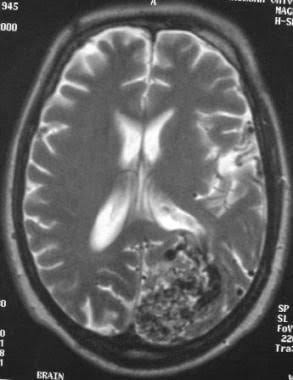
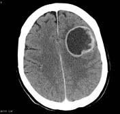
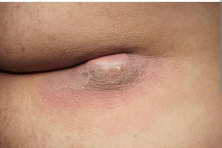

Source: "Ac sub specialty MCQ Surgery rotate A" (file "MCQs sub specialty surgery Rotate A MDCU76"), questions recalled by students; the numbers are the paper's own (Q1-Q30). This is a subspecialty MCQ paper (urology, paediatric, thoracic, neurosurgical, plastic and colorectal topics), so it is kept apart from General Surgery and is not tagged into the exam topic map.
Answers: "Key MCQ sub spe 76 rotate A", a student's annotated copy of the paper that circles the chosen choice. It is a student-written key, NOT an official key, and may contain mistakes. The key's handwritten notes are summarised under Explanation (partly [unclear] where hard to read); screenshots of textbooks, slides and web pages pasted into the key are only mentioned, not copied.
Questions with no choices (Q20, Q22) have no circled answer; Q15, Q21 and Q22 mention a picture that the paper does not include. Some questions have fewer than four choices because only the choices the students remembered are listed.
exam_year 2024 is taken from the paper's file date (March 2024); the paper does not state the year.
Pictures with no name, label or ID band are kept in images/ under their question (Q18, Q27, Q30). The Q30 photo had a web page caption that was cropped off.
The rotation letter (A) is not mapped to a G.

## Q1 (original no. 1)
ชายอายุ 70 ปี เป็น Bladder cancer ทำ TUR-BT ไปแล้ว ได้ patho เป็น invade lamina propia แต่ไม่ invade muscularis propia จะทำอะไรต่อ

A. Clinical observe
B. F/U cystoscope in 3 M
C. Intravesicle BCG
D. PET CT
E. Radical cystectomy

**Answer:** C
**Explanation:** key: this is non-muscle-invasive bladder cancer (Ta, T1, CIS). Treatment is TUR-BT, then adjuvant intravesical therapy (immunotherapy BCG, or chemotherapy mitomycin-C). If it becomes muscle-invasive: radical cystectomy with bilateral pelvic lymphadenectomy en bloc. The key also underlines choice B (follow-up cystoscopy at 3 months) and notes that the stage must be known first. The key pastes a slide.
**Guideline / source:** not stated

## Q2 (original no. 2)
ชาย 40 ปีเป็น penile CA pT2N0M0 lesion involve glan & shaft upto 3 cm from Mon pubis ทำ incisional biopsy ไปได้เป็น well-diff SCC จะทำอะไรต่อ

A. Partial penectomy
B. Total penectomy
C. Laser ablation

**Answer:** B
**Explanation:** key: penile cancer is SCC; diagnosis by incisional biopsy; lymph drainage to inguinal nodes. Primary treatment is tumour resection with a margin of about 2 cm: small tumour at the glans, partial penectomy; larger, total penectomy; adjuvant inguinal node dissection and systemic chemotherapy. The key writes "confirmed" beside choice B.
**Guideline / source:** not stated

## Q3 (original no. 3)
หญิงมอเตอร์ไซค์ล้มเป็นแผล abrasion 4x4 cm at left cheek เป็นแผล dirty wound จะทำอย่างไร

A. Saline irrigation + moist gauze
B. Saline irrigation + silver sulfadiazine
C. Scrubbing + ATB ointment
D. Scrubbing + silver sulfadiazine

**Answer:** C
**Explanation:** key: aims of treatment are 1. promote wound healing without infection (Bactigras + gauze, Terramycin ointment, do not let the gauze stick so epithelialisation is not disturbed) and 2. avoid an accidental tattoo (scrub out the dirt and foreign particles before dressing the wound).
**Guideline / source:** not stated

## Q4 (original no. 4)
เด็กอายุ 3 วัน มี bilious vomiting & few blood per rectum มี abdominal distention ทำ abd film เห็นเป็น small bowel dilatation และทำ duplex USG เห็นเป็น reverse relationship ระหว่าง SMA กับ SMV จะทำอะไรต่อ

A. Ba swallow + small bowel follow through
B. Ba enema + reduction procedure
C. NG decompress
D. CT with contrast
E. Explore lap

**Answer:** C
**Explanation:** key: keyword is malrotation (bile-stained vomiting, reversed SMA/SMV relationship, midgut volvulus, whirlpool sign). Plain film, upper GI (bird-beak, corkscrew) and CT (whirlpool) show it; treatment is Ladd procedure plus appendectomy. Initial management: treat gut obstruction with IV fluid and correction of electrolytes, NG decompression, Foley to monitor urine output, antibiotics for gram-negatives and anaerobes. The key pastes a reference article extract.
**Guideline / source:** not stated

## Q5 (original no. 5)
Empyema thoracis มักเกิดจากเชื้ออะไร

A. Strep pneumo + Staph aureus
B. Klebsiella + H.influ
C. Bacteroides + Peptostreptococcus spp.
D. P.aeruginosa + E.coli
E. A.baum + …

**Answer:** A
**Explanation:** key: from Schwartz: commonest organisms are S. pneumoniae and S. aureus (pleural fluid and blood culture); then gram-negative aerobes (Enterobacterales) and anaerobes (streptococci); the clinical picture matters more than culture results, and many are mixed infections. The key pastes the Schwartz passage.
**Guideline / source:** not stated

## Q6 (original no. 6)
อาการ Myasthenia gravis ทำ CXR ไปไม่มีก้อนใดๆ อะไรใช้รักษาไม่ได้

A. Cholinesterase inhibitors
B. Corticosteroid
C. Radiation
D. Immunosuppressant
E. Thymectomy

**Answer:** C
**Explanation:** key: cholinesterase inhibitor = pyridostigmine; immunosuppressant = prednisolone, mycophenolate, azathioprine; the key ticks B and E as acceptable treatments.
**Guideline / source:** not stated

## Q7 (original no. 7)
เด็กอายุเท่าไหร่ไม่รู้แต่น้อยกว่า 1 ปี คลำเจอ sternocleidomastoid mass + มี plagiocephaly ไม่มี hemifacial hypoplasia, mx?

A. Surgery release sternocleidomastoid m.
B. Incisional biopsy SCM mass
C. Observe

**Answer:** C
**Explanation:** key: diagnosis by keyword is fibromatosis colli; treatment is physiotherapy for about 1 year. The key pastes a slide on fibromatosis colli.
**Guideline / source:** not stated

## Q8 (original no. 8)
PSA 8, IPSS 22 ทำอะไร มีอาการ LUTs

A. Mri prostate
B. Uroflowmetry
C. TRUS biopsy

**Answer:** C
**Explanation:** key: causes of a raised PSA include cancer, BPH, trauma (for example a Foley catheter), ejaculation, infection (UTI, prostatitis); DRE feel (firm, rubbery or hard nodule) matters. Staging: localised (up to T2) radical prostatectomy or radiation (IMRT, brachytherapy); locally advanced (T3N0M0) hormone plus surgery or IMRT; metastatic: hormone plus palliative care.
**Guideline / source:** not stated

## Q9 (original no. 9)
Hx of colon cancer pT3N0M0 , fu มา2 ปี เจอ liver nodule 3 cm, ทำอะไร

A. Imaging guide biopsy
B. Liver resection
C. RFA

**Answer:** B
**Explanation:** key: colorectal liver metastasis; biopsy is avoided (tumour seeding); RFA only for lesions under 3 cm; choose resection when major hepatic vessels are involved (partly [unclear]).
**Guideline / source:** not stated

## Q10 (original no. 10)
ให้รูป chronic anal fissure แบบดูกับ proctoscope, mx?

A. LIS
B. Botox

**Answer:** A
**Explanation:** key: the cause is sphincter spasm that compromises blood flow; management 1. nitroglycerine or nifedipine, 2. Botox, 3. lateral internal sphincterotomy (LIS, boxed). The key draws an anal canal with hypertrophic anal papilla, fibrotic edges, internal sphincter and sentinel pile. The picture is not in the paper.
**Guideline / source:** not stated

## Q11 (original no. 11)
หลังทำ hysterectomy มีอาการ continuous urinary incontinence ต้องใส่ แพมเพิร์ส(ตลอด?) ถามว่าเกิดจากอะไร

A. Pelvic diaphragm hypermobile
B. Vesico vaginal fistula

**Answer:** A
**Explanation:** key: the circled choice is A. The key's note (partly [unclear]) lists lower urinary tract injury as the other cause.
**Guideline / source:** not stated

## Q12 (original no. 12)
คนแก่ท้องผูก มี bleeding per rectum, colono แล้วเจอ telangiectasia ถามว่าเคยมีประวัติอะไรมาก่อน

A. Brachytherapy CA prostate
B. Rectal enema
C. Fecal impaction ..

**Answer:** A
**Explanation:** key: keyword radiation proctitis (a table of chronic radiation proctitis grades is pasted; grade I intermittent rectal bleeding with telangiectasia).
**Guideline / source:** not stated

## Q13 (original no. 13)
Lung abscess 2 cm มี massive hemoptysis. Mx?

A. Lobectomy and…

**Answer:** A
**Explanation:** key: for massive haemoptysis, initial management is to protect the airway (a double-lumen tube or similar) and manage the bleeding side; then treatment by cause: bronchoscopic intervention, angiographic embolisation, surgery. The key mentions CXR, CT with contrast and flexible bronchoscopy.
**Guideline / source:** not stated

## Q14 (original no. 14)
CT เจอ lung nodule, spiculated mass. Biopsy confirms cancer, no mediastinal metastasis. What is the mx

A. Lobectomy and ln dissection
B. Neoadjuvant + lobectomy + …
C. Wedge lung and LN dissection

**Answer:** A
**Explanation:** key: pastes a lymph node map: N2 disease is neoadjuvant, N1 is anatomical resection (not non-anatomical wedge); a supraclavicular node would be N3.
**Guideline / source:** not stated

## Q15 (original no. 15)
ให้รูป CT น่าจะ brain abscess + มี hx of chronic otitis media, ถาม diag

A. Brain abscess

**Answer:** A
**Explanation:** not stated in the key. The CT picture is not in the paper.
**Guideline / source:** not stated

## Q16 (original no. 16)
โดนน้ำร้อนลวก 5% TBSA Burn + bloody bullae + nonblanchable ถาม degree of burn

A. Deep partial
B. Superficial partial
C. Full thickness burn

**Answer:** A
**Explanation:** key: pastes a burn classification table (deep partial thickness: blisters that are easily unroofed and do not blanch with pressure).
**Guideline / source:** not stated

## Q17 (original no. 17)
ข้อใดไม่ใช่ concept ในการรักษา fistula in ano

A. Horseshoe tract resection
B. External opening drainage
C. Internal opening closure
D. Remove infected anal gland
E. Preserve sphincter

**Answer:** E
**Explanation:** key: pastes a slide "Concepts of treatment": prevent reinfection, get rid of the cryptoglandular infection, adequate drainage through the external opening. The circled choice is E.
**Guideline / source:** not stated

## Q18 (original no. 18)
25 yo male มี seizure, ให้รูป CT brain มา (น่าจะ AVM) what is not used to manage this patient.

A. Chemotherapy
B. Radiosurgery
C. Craniotomy and excision
D. Embolisation
E. Anti epileptic drugs

**Answer:** A
**Explanation:** key: AVM often presents with seizure; treatment options are surgery, endovascular embolisation, radiosurgery, or a combination (a slide with angiograms is pasted).
**Guideline / source:** not stated

## Q19 (original no. 19)
เด็กผู้หญิง 6 ขวบ เป็น VUR กิน prophylactic antibiotic วันละ 1 เม็ด มาตรวจ VCUG เจอ bilateral hydronephrosis VUR grade 3 จะทำอะไรต่อ

A. เพิ่มโดสยา
B. Bilateral ureter implantation

**Answer:** B
**Explanation:** key: treat the root cause: flow disruption, bacterial overgrowth, impaired organs, foreign bodies; ureteric reimplantation corrects the reflux.
**Guideline / source:** not stated

## Q20 (original no. 20)
TRAM flap

**Answer:** not given in the key: the paper has no choices; the key adds only a short handwritten note (unclear)
**Explanation:** key: a short handwritten note that is [unclear].
**Guideline / source:** not stated

## Q21 (original no. 21)
เด็กอายุ 2 เดือน acholic stool ตรวจ ultrasound no gallbladder seen (?) (ให้รูป ultrasound มา) จะทำอะไรต่อ

A. IOC
B. ต่อ liver กับ jejunum

**Answer:** A
**Explanation:** key: triangular cord sign; positive leads to IOC; negative: under 60 days, DISIDA (radionuclide in gut, then liver biopsy, plus phenobarbital); over 60 days, IOC. The ultrasound picture is not in the paper.
**Guideline / source:** not stated

## Q22 (original no. 22)
Spot dx รูป treacher collins

**Answer:** not a lettered choice: the paper has no choices; the stem itself names Treacher Collins
**Explanation:** key: pastes a picture of Treacher Collins syndrome with its signs labelled (partial absence of lower eyelashes, downward slanting palpebral fissures, coloboma, absent ear canal, cleft, small lower jaw). The picture is not in the paper.
**Guideline / source:** not stated

## Q23 (original no. 23)
ผู้ป่วย triple vessel disease จะทำ CABG. ใช้อะไรดีสุด

A. LIMA ต่อ LAD
B. LIMA ต่อ circumflex artery

**Answer:** A
**Explanation:** key: the circled choice is A; a short handwritten note is [unclear].
**Guideline / source:** not stated

## Q24 (original no. 24)
Associated anomalies in omphalocele

A. Down’s syndrome
B. Noonan syndrome
C. Turner syndrome

**Answer:** A
**Explanation:** key: trisomy 13, 18, 21; Beckwith-Wiedemann (Wilms tumour, large organs); pentalogy of Cantrell (cleft sternum, ectopia cordis, anterior midline diaphragmatic hernia, epigastric omphalocele); exstrophy of cloaca; prune belly syndrome (urinary tract, defect of abdominal wall muscle, cryptorchidism).
**Guideline / source:** not stated

## Q25 (original no. 25)
เด็ก ambiguous genitalia ตรวจอะไร

A. Electrolytes

**Answer:** A
**Explanation:** key: think of 21-hydroxylase deficiency: salt wasting leads to hypovolaemia and shock; also check 17-OHP (raised). A small diagram of the steroid pathway is drawn.
**Guideline / source:** not stated

## Q26 (original no. 26)
ให้อาการของ kernohan phenomenon มา ถามว่าอาการพวกนี้เรียกว่าอะไร

A. Kernohan phenomenon

**Answer:** A
**Explanation:** key: draws a brain herniation at the uncus pressing the opposite cerebral peduncle; findings: 1. ipsilateral fixed dilated pupil, 2. ipsilateral hemiparesis, 3. coma.
**Guideline / source:** not stated

## Q27 (original no. 27)
คนไข้ซึมลงใน … เดือนที่ผ่านมา ให้รูป CT มา เป็นอะไร

(รูปนี้เป๊ะ)

A. GBM
B. Ependymoma
C. Meningioma

**Answer:** A
**Explanation:** key: "spot dx".
**Guideline / source:** not stated

## Q28 (original no. 28)
What is not a contraindication for CT with contrast

A. Pregnant
B. Anaphylactic reaction to contrast media
C. Renal insufficiency Cr 3.2
D. Hematuria

**Answer:** D
**Explanation:** key: pastes a table of contraindications and precautions for contrast; the note beside choice D asks whether the concern is acute kidney injury (partly [unclear]).
**Guideline / source:** not stated

## Q29 (original no. 29)
Colonoscopy found polyps เยอะมากตลอดแนว colon. Gene อะไรผิดปกติ

A. APC
B. Ret
C. BRCA2

**Answer:** A
**Explanation:** key: FAP.
**Guideline / source:** not stated

## Q30 (original no. 30)

Red ,tender, fluctuate, มีรู

A. Pilonidal abscess
B. Infected sebaceous cyst

**Answer:** A
**Explanation:** key: punctate lesion (a pit) beside the swelling. The paper's picture is labelled by the web page it came from; that caption was cropped off.
**Guideline / source:** not stated

## Flagged for checking
- Several circled answers look doubtful and are worth checking against a textbook, for example Q11 (pelvic diaphragm for continuous incontinence after hysterectomy), Q17 (the choice circled for "not a concept" of fistula treatment) and Q18 (chemotherapy for AVM, which fits "what is not used").
- Q20 has no choices and only an unclear handwritten note.
- Q15, Q21 and Q22 refer to pictures that are not in the paper.
