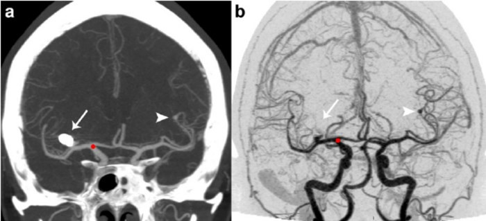
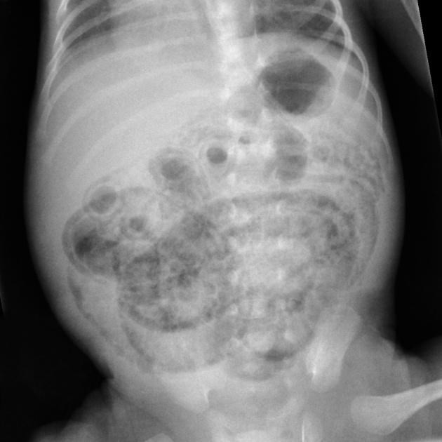
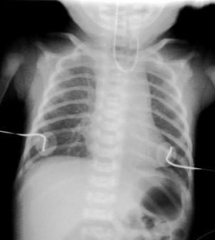
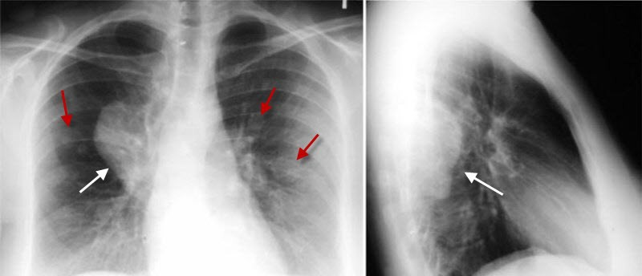

Source: "MCQ sub specialty MDCU76 rotate C, 18th August 2023" (file "Ac sub spe surgery Mdcu 76 . Rotate C"), questions recalled by students, grouped under the topic headings NEURO, Uro, COLO, Ped, CVT and Plastic. This is a subspecialty MCQ paper, so it is kept apart from General Surgery and is not tagged into the exam topic map.
The paper restarts its question numbers in every topic. Each question keeps the paper's own number and topic, and gets a unique Q id so it can be named: the first topic (NEURO) keeps Q1-Q8; every later topic, in the paper's order, gets ids from 101 (Uro), 201 (COLO), 301 (Ped), 401 (CVT) and 501 (Plastic): the id is the topic's position x 100 + the paper's own number. The heading shows both, e.g. "## Q201 (original no. 1, topic: COLO)".
Answers: "Solution for MCQ sub specialty MDCU76 rotate C by KP, Tae, Tan, Gift, Lilly, and academic team MDCU76" (two PDF copies, "Key MCQ sub spe 76 rotate C (by Mdcu76)" and "solution MCQ sub spe surg MDCU 76 rotate C by rotate D", which show the same marks), a copy of the paper where a student marked the chosen choice with a cross. It is a student-written key, NOT an official key, and may contain mistakes. The key's handwritten notes are summarised under Explanation (partly unclear where hard to read); textbook pages, slides, web screenshots and photographs pasted into the key are only mentioned, not copied.
Choices written a-e in the paper are A-E here. Several questions have fewer than four choices because only the choices the students remembered are listed. The paper has no picture for Neuro Q1, Plastic Q2 and Q4 or Colo Q2 although the stems say "ให้รูป" (a picture is given).
exam_year 2023 is taken from the paper itself (it is dated 18th August 2023).
Pictures with no name, label or ID band are kept in images/ (Q8, Q302, Q303, Q403). The Q403 chest film had a website watermark that was cropped off.
The rotation letter (C) is not mapped to a G.

## Q1 (original no. 1)
ให้รูป cysticercosis (ตรงแอค)

**Answer:** not given in the key: the paper has no choices and the key marks nothing
**Explanation:** key: no note. The paper's own picture is not included.
**Guideline / source:** not stated

## Q2 (original no. 2)
ข้อไหนคือantibiotic ที่ให้ไม่ได้ เพราะไม่ผ่าน BBB (ตรงแอค เปลี่ยนช้อยส์เฉยๆ)

A. Penicillin
B. Vancomycin
C. Fosfomycin
D. Chloramphenicol
E. Aminoglycoside

**Answer:** E
**Explanation:** key: marks E.
**Guideline / source:** not stated

## Q3 (original no. 3)
จงประเมิน Glassgow coma scale : ตาเปิดเมื่อ pain, พูด incomprehensible word, withdraw from pain

A. 3
B. 5
C. 7
D. 9
E. 12

**Answer:** D
**Explanation:** key: E2 V3 M4 = 9.
**Guideline / source:** not stated

## Q4 (original no. 4)
How long does the Xanthochromia persist?

A. 3 days
B. 7 days
C. 14 days
D. 30 days
E. 60 days

**Answer:** C
**Explanation:** key: marks C.
**Guideline / source:** not stated

## Q5 (original no. 5)
Considering the specimen from the Spinal tap, which result is concordant with bacterial meningitis

A. Glucose = 3 mg/dl
B. Protein = 4 mg/dl
C. Neutrophil 50%
D. WBC 5 cell/HPF

**Answer:** A
**Explanation:** key: bacterial meningitis CSF values written beside the choices: glucose < 40, protein > 200, WBC > 1000-2000 (the key ticks A).
**Guideline / source:** not stated

## Q6 (original no. 6)
Patient with near-light dissociation, มีปวดหัวตอนเช้า, ataxia what is the most likely diagnosis

A. Pinealoma
B. Posterior fossa ependymoma

**Answer:** A
**Explanation:** key: raised ICP; a pineal tumour causes Parinaud syndrome and can press the superior cerebellar peduncle (handwritten, partly unclear).
**Guideline / source:** not stated

## Q7 (original no. 7)
Calcification frontal lobe

A. MRI angiography
B. CT scan with contrast

**Answer:** A
**Explanation:** key: marks A; no note.
**Guideline / source:** not stated

## Q8 (original no. 8)
ถามว่าก่อนรักษาเคยเป็นอะไร

A. Primary intraventricular hemorrhage
B. Secondary intraventricular hemorrhage
C. Subarachnoid hemorrhage

**Answer:** C
**Explanation:** key: handwritten "berry aneurysm".
**Guideline / source:** not stated

## Q101 (original no. 1, topic: Uro)
LUTS psa=1 mildly enlarge rubbery IPSS=22 ถามว่าจะ manage ยังไง

A. ให้ alpha blocker
B. ให้ 5-alpha reductase inhibitor

**Answer:** A
**Explanation:** key: marks A.
**Guideline / source:** not stated

## Q102 (original no. 2, topic: Uro)
PSA=8, IPSS=22 manage ยังไง

A. MRI prostate
B. Biopsy

**Answer:** A
**Explanation:** key: marks A.
**Guideline / source:** not stated

## Q103 (original no. 3, topic: Uro)
Beads-like appearance in ct scan, what is the most likely diagnosis?

A. Emphysematous cystitis
B. Pyelonephritis

**Answer:** A
**Explanation:** key: "air around bladder".
**Guideline / source:** not stated

## Q104 (original no. 4, topic: Uro)
35 year old man with intermittency voiding, what is the most likely diagnosis?

A. Cystic calculus
B. Urethral calculus
C. Urethral stricture
D. BPH

**Answer:** C
**Explanation:** key: LUTS in a young man suggests urethral stricture.
**Guideline / source:** not stated

## Q105 (original no. 5, topic: Uro)
What is not the contraindication for shock wave lithotripsy?

A. Pregnancy
B. Active urinary tract infection
C. Obstruction distal to stone
D. Gross hematuria

**Answer:** D
**Explanation:** key: ticks A, B and C as contraindications; beside D it writes that it is a contraindication only if there is a bleeding tendency, and adds a handwritten choice E "near arterial aneurysm".
**Guideline / source:** not stated

## Q201 (original no. 1, topic: COLO)
CRLM and omental involvement + 2 liver lesions what is not done

A. liver wedge resection
B. HIPEC
C. Right hemicolonectomy with arterial supply
D. At least 12 pericolonic lymph node excision .
E. Omentum excision

**Answer:** B
**Explanation:** key: "done in distant metastasis"; pastes a colon cancer surgery extract that mentions HIPEC for peritoneal metastases.
**Guideline / source:** not stated

## Q202 (original no. 2, topic: COLO)
ให้รูป gastroschisis ถามว่า Mx อะไรที่ไม่ทำ

A. IV fluid
B. IV Abx
C. Retain OG tube
D. Bedside reduction

**Answer:** D
**Explanation:** key: ticks A, B and C; pastes an initial management slide (fluid resuscitation, NG decompression, wrapped bowel in warm saline-soaked gauze, covered by plastic wrap). The paper's picture is not included.
**Guideline / source:** not stated

## Q203 (original no. 3, topic: COLO)
Cecum colon cancer 2 cm what is the proper operation

A. Right hemicolectimy
B. Extensive right hemicolectomy
C. Sub total colectomy
D. Cecectomy

**Answer:** A
**Explanation:** key: pastes a table of resection types (right hemicolectomy includes the caecum).
**Guideline / source:** not stated

## Q204 (original no. 4, topic: COLO)
CA rectum ก้อนติด prostate กับ right seminal vesicle ถามว่าจะทำอะไร

A. En bloc pelvic exenteration
B. Chemoradiotherapy
C. Palliative care

**Answer:** B
**Explanation:** key: "CCRT before surgery because it is T4"; pastes a slide on standard colon cancer surgery (en bloc resection of surrounding structures if invaded) and an operative photo.
**Guideline / source:** not stated

## Q205 (original no. 5, topic: COLO)
คนแก่ clinical Diverticulosis ถามว่า bleed จากอะไร

A. Diverticulosis

**Answer:** A
**Explanation:** key: marks A.
**Guideline / source:** not stated

## Q206 (original no. 6, topic: COLO)
Which type of colonic polyp has the highest risk of malignancy?

A. Villous type
B. Tubulovillous type
C. Tubular type
D. Inflammatory type

**Answer:** A
**Explanation:** key: pastes a table of adenomatous polyps and a note that villous adenomas have the highest malignant potential.
**Guideline / source:** not stated

## Q301 (original no. 1, topic: Ped)
ผู้มีแพลนจะตั้งครรภ์ไปหาหมอเรื่องการป้องกันโรค neural tube defect ควรให้การแนะนำเรื่องการทาน folic acid อย่างไร

A. As soon as possible when pregnancy is confirmed and continue for 6 months
B. 1 month prior to pregnancy
C. 1 month after last LMP
D. 2 months after last LMP
E. Start 2nd and 3rd trimester

**Answer:** B
**Explanation:** key: pastes a web search extract (take 400 mcg folic acid daily from at least 1 month before pregnancy through the first 12 weeks).
**Guideline / source:** not stated

## Q302 (original no. 2, topic: Ped)
ให้อาการ + Diagnosis

A. Necrotizing enterocolitis
B. Intussusception
C. Intestinal malrotation

**Answer:** A
**Explanation:** key: pastes a flashcard link and a picture captioned pneumatosis intestinalis (necrotizing enterocolitis).
**Guideline / source:** not stated

## Q303 (original no. 3, topic: Ped)
เด็ก newborn มี drooling

ถามว่า Dx อะไร

A. Esophageal atresia
B. TE Fistula

**Answer:** B
**Explanation:** key: "air in stomach = presence of distal TEF".
**Guideline / source:** not stated

## Q304 (original no. 4, topic: Ped)
เด็ก 4 เดือน เจอ Reducible umbilical hernia จะ manage อย่างไร

A. ตรวจ thyroid function test
B. Primary repair immediately
C. ผ่าแก้, ถ้ายัง persist ตอนอายุ 4 yr

**Answer:** C
**Explanation:** key: umbilical hernia: wait until about 4 years; pastes an inguinal hernia treatment slide with handwritten notes.
**Guideline / source:** not stated

## Q401 (original no. 1, topic: CVT)
preterm baby with pda showed a sign of dyspnea despite the given diuresis, what is the next step

A. Surgery
B. Indomethacin
C. Acetylsalicylic acid

**Answer:** B
**Explanation:** key: "in preterm use indomethacin"; pastes a PDA flow chart (preterm: indomethacin up to 3 times; if contraindicated or unsuccessful, surgery).
**Guideline / source:** not stated

## Q402 (original no. 2, topic: CVT)
Systolic murmur radiate to axilla, tearing pain to back BP190/.. (Wide pulse pressure)

A. Aortic dissection
B. MI

**Answer:** A
**Explanation:** key: marks A.
**Guideline / source:** not stated

## Q403 (original no. 3, topic: CVT)
Posterior mediastinal tumour was discovered as an accidental finding in adult women

What is the most likely diagnosis?

A. neurilemmoma
B. neurofibroma
C. pheochromocytoma
D. esophageal cyst
E. Bronchogenic cyst

**Answer:** B
**Explanation:** key: a film with several nodules suggests neurofibromatosis. The photo's website watermark was cropped off.
**Guideline / source:** not stated

## Q404 (original no. 4, topic: CVT)
Abscess in lung upperlobe what is indication for surgery

A. hemoptysis
B. persistence fever
C. size not change after one week antibiotic
D. size more than 3 centimeter
E. connect with tracheobronchial tree

**Answer:** A
**Explanation:** key: handwritten notes (partly unclear): massive haemoptysis is an indication; marks beside the other choices include 2 weeks, > 6 cm.
**Guideline / source:** not stated

## Q405 (original no. 5, topic: CVT)
He has lung cancer, what is contraindication for surgery

A. Involve pericardium
B. Involve parietal pleura
C. Malignant pleural effusion

**Answer:** C
**Explanation:** key: T3 = chest wall, phrenic nerve, pericardium (parietal pleura also T3); pastes the TNM 8th edition table and a treatment options extract with absolute contraindications.
**Guideline / source:** not stated

## Q406 (original no. 6, topic: CVT)
Patient suffered from adhesion in his lung, he underwent the surgery which he has vomiting during the surgery, and after few days presented with pneumonia, what are the most likely microbes causing his pneumonia

A. Mixed aerobes and anaerobes
B. Gram positive aerobes
C. Gram negative anaerobes
D. Fungus

**Answer:** A
**Explanation:** key: "aspiration pneumonia".
**Guideline / source:** not stated

## Q501 (original no. 1, topic: Plastic)
Lesion ที่หน้า hypermigment แล้วมีขอบ pearly + telangiectasia

A. Malignant melanoma
B. Squamous cell carcinoma
C. Basal cell carcinoma

**Answer:** C
**Explanation:** key: BCC = elevated lesion, pearly skin, rodent ulcer, telangiectasia.
**Guideline / source:** not stated

## Q502 (original no. 2, topic: Plastic)
ให้รูป laceration wound ถึงหน้าผาก ถามว่า involve อะไร

A. Frontal branch of facial n.

**Answer:** A
**Explanation:** key: marks A. The paper's picture is not included.
**Guideline / source:** not stated

## Q503 (original no. 3, topic: Plastic)
Thyroglossal duct cyst ติดเชื้อจากอะไร

A. รูเชื่อมกับ Piriform sinus
B. รูเชื่อม Foramen cecum กับ Oral cavity

**Answer:** B
**Explanation:** key: marks B.
**Guideline / source:** not stated

## Q504 (original no. 4, topic: Plastic)
รูปก้อนที่แก้มซ้ายล่างๆหน่อย

A. Cystic hygroma
B. First branchial cyst

**Answer:** A
**Explanation:** key: pastes two photographs labelled "cystic hygroma" and "1st branchial cleft cyst". The paper's picture is not included.
**Guideline / source:** not stated

## Q505 (original no. 5, topic: Plastic)
แผลมุมฉาก เย็บยังไงดีสุด

A. Half buried suture
B. Simple interrupted
C. Continuous over and over
D. Subcuticular

**Answer:** A
**Explanation:** key: half-buried suture preserves blood supply at the tip (a slide and a drawing are pasted).
**Guideline / source:** not stated

## Q506 (original no. 6, topic: Plastic)
Facial cleft, most urgent issue

A. Airway
B. Feeding

**Answer:** A
**Explanation:** key: a handwritten note says the most urgent problem is corneal exposure, but it depends on which facial cleft.
**Guideline / source:** not stated

## Q507 (original no. 7, topic: Plastic)
จะส่งคนไข้คนไหนไป ward burn เพื่อดูแลพิเศษ

A. Burn 3rd degree บนหน้า 7% TBSA
B. ช้อยอื่น มีบางข้อ 2nd degree บางข้อ 3rd degree ไม่มีข้อไหน burn เยอะกว่า 7%
C. เด็ก 10 ขวบ bleb at foot 5%

**Answer:** A
**Explanation:** key: burn unit referral criteria written beside the stem: 2nd + 3rd degree > 20%; 2nd + 3rd degree > 10% in under 10 years or over 50 years; third degree > 5%; burns of special areas (face, cosmetics).
**Guideline / source:** not stated

## Q508 (original no. 8, topic: Plastic)
มีรูที่ผิวหนัง ตำแหน่ง medial to anterior border of sternocleidomastoid, diagnosis?

A. 1st branchial cleft cyst
B. 2nd branchial cleft cyst
C. 3rd branchial cleft cyst
D. 4th branchial cleft cyst

**Answer:** B
**Explanation:** key: marks B.
**Guideline / source:** not stated

## Flagged for checking
- The crossed answers are a student's, not an official key. Worth checking: Q7 (MRI angiography for a frontal calcification), Q105 (gross haematuria as not a contraindication of shock wave lithotripsy; the key adds that bleeding tendency is), Q201 (HIPEC as the thing not done), Q403 (neurofibroma) and Q404 (haemoptysis as the indication for surgery).
- Q1, Q202, Q502 and Q504 refer to pictures that are not in the paper.
