Source: "MDCU 76 Rotate D : AC sub specialty, October 27th, 2023" (file "MCQ subse sx rotate D 76"; the title says 90 questions in 120 minutes), questions recalled by students; the numbers are the paper's own (Q1-Q75). This is a subspecialty MCQ paper (plastic, CVT, neuro, paediatric, colorectal and urology topics, printed in brackets at the start of each stem), so it is kept apart from General Surgery and is not tagged into the exam topic map.
Answers: "key MCQ sub spe 76 rotate D", a student's annotated copy of the paper. The key author marks the chosen choice with a blue slash, and adds handwritten notes, highlights and pasted slides, textbook pages and web screenshots. It is a student-written key, NOT an official key, and may contain mistakes. A later reader of the key, who signs "March" and dates the notes August 2024 (written in the Thai year 2567), added pink corrections on some questions (Q13, Q16, Q22, Q35, Q45, Q51, Q66, Q67, Q69). Where the original mark and the correction differ, the Answer line gives the original mark and says what March circled. The handwritten notes are summarised under Explanation (partly unclear where hard to read); the pasted material is only mentioned, not copied. Where the marks are unclear, the Answer line says so.
Choices written 1-5 in the paper are written A-E here. Some questions have fewer than four choices because only the choices the students remembered are listed. Q15, Q17 (the key pastes a prolapse photo there), Q27 and Q75 mention pictures; Q15 and Q27 have no picture in the paper.
exam_year 2023 is taken from the paper itself (it is dated October 27th, 2023).
Pictures with no name, label or ID band are kept in images/ under their question. Left out: the photograph in Q6 (it shows a child's face and printed text on the linen).
The rotation letter (D) is not mapped to a G.

## Q1 (original no. 1)
(Plastic) ผู้ป่วยเป็นเบาหวาน มี chronic Ulcer ที่เกิดใหม่ บน healed burn scar จากแผลไฟไหม้เมื่อ 30 ปีก่อน ที่อยู่บน dorsum of foot

A. Marjolin ulcer
B. Arterial ulcer
C. Venous ulcer
D. Neuropathic ulcer
E. Diabetic ulcer

**Answer:** A
**Explanation:** key: Marjolin ulcer = skin cancer on a chronic ulcer or scar.
**Guideline / source:** not stated

## Q2 (original no. 2)
(Plastic) มีแผลที่กระพุ้งแก้มข้างซ้าย ขอบเรียบ แต่มีเลือดไหลออกตลอด น่าจะมาจากสาเหตุใด

A. Tobacco chewing
B. Vitamin B1 deficiency

**Answer:** A
**Explanation:** key: buccal cancer (a note on betel or tobacco chewing).
**Guideline / source:** not stated

## Q3 (original no. 3)
(CVT) คนทำงานในเหมือง asbestos เจอก้อน

A. Mesothelioma

**Answer:** A
**Explanation:** key: marks A.
**Guideline / source:** not stated

## Q4 (original no. 4)
(Plastic) เป็นมะเร็งเต้านมผ่า masectomy ไปแล้วจะเสริมเต้านม ใช้ flap จากที่ไหนถึงจะได้ปริมาณ muscle ที่พอดี

A. Posterior serratus
B. Latissimus dorsi
C. Rectus abdominis
D. Gastrocnemius
E. Gracillis

**Answer:** C
**Explanation:** key: rectus abdominis first choice (TRAM flap: pedicled on the superior epigastric artery, or free on the deep inferior epigastric); latissimus dorsi second. A TRAM flap slide is pasted.
**Guideline / source:** not stated

## Q5 (original no. 5)
(Plastic) ให้รูปหน้าเด็กมา (เห็นแค่ด้านหน้ากับด้านข้าง) ข้อไหนไม่ถูก

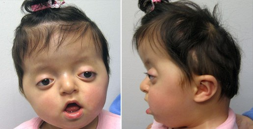

A. Usually diagnosed at birth
B. ใช้ Genetic testing ช่วยวินิจฉัยได้
C. มักมี Normal intelligence
D. Clinical feature ช่วย diag ได้
E. Skull plain film ช่วย diag ได้

**Answer:** C
**Explanation:** key: handwritten "Crouzon" (also Pfeiffer, Apert); ticks on the other choices; a note beside C that is partly unclear.
**Guideline / source:** not stated

## Q6 (original no. 6)
(Plastic) ให้รูปมา รูปนี้เป๊ะ ถามว่าความผิดปกติเกิดที่ไหน [picture in the paper: a photograph of an infant with a large swelling at the root of the nose (left out of this file: it shows a child's face and printed text on the linen)]

A. Meninges
B. Nasoethmoidal bone
C. Skull base
D. Cribiform plate

**Answer:** B
**Explanation:** key: handwritten "FEEM" (fronto-ethmoidal encephalomeningocele): nasofrontal, naso-ethmoidal, naso-orbital types; a slide on neural tube defects (cranium bifidum) is pasted.
**Guideline / source:** not stated

## Q7 (original no. 7)
(Neuro) ให้รูป ถามว่าจะความผิดปกติอะไร

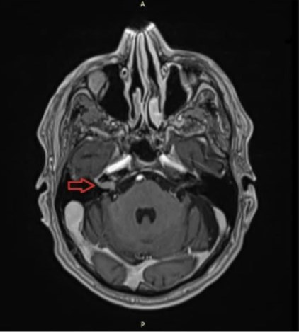

A. Sensorineural hearing loss
B. Finger-to-nose test
C. Bilateral hemianopia

**Answer:** A
**Explanation:** key: vestibular schwannoma (the vestibular part is often affected, symptoms may be unclear); imaging is MRI, which confirms the diagnosis without needing a tissue diagnosis.
**Guideline / source:** not stated

## Q8 (original no. 8)
(Neuro) C/I ในการ LP

A. Communicating hydrocephalus
B. Normal pressure hydrocephalus
C. Congenital aqueduct stenosis hydrocephalus
D. Post meningitis hydrocephalus
E. Post SAH hydrocephalus

**Answer:** C
**Explanation:** key: obstructive hydrocephalus is the contraindication; a table of contraindications to lumbar puncture is pasted (skin infection, raised ICP lesion, platelets < 20,000, INR >= 1.5, anticoagulants, coagulopathies).
**Guideline / source:** not stated

## Q9 (original no. 9)
(CVT) ข้อไหนไม่ใช่ Indication ในการผ่า lung abscess

A. Ruptured into pleural space
B. Develop bronchopleural fistula
C. Progression
D. Treat ABX 2 wk ไม่หาย
E. Massive hemoptysis

**Answer:** B (the only choice that is not ticked; circled with a question mark in the key)
**Explanation:** key: ticks A, C, D and E as indications; beside B it writes "empyema associated with" and "need ICD?"; a slide on indications for surgery (> 6 cm, persistent or enlarging abscess, CXR not better after 2 weeks of antibiotics, ruptured into the pleural space, massive haemoptysis, rule out cancer) is pasted.
**Guideline / source:** not stated

## Q10 (original no. 10)
(CVT) โดนแทงหลังแล้วปอดซ้ายมี hemopneumothorax ผ่านไปไม่กี่วัน drain ได้น้ำ milky white มี triglyceride สูง ถามว่าเกิดจากอะไร

A. Thoracic duct injury

**Answer:** A
**Explanation:** key: chylothorax.
**Guideline / source:** not stated

## Q11 (original no. 11)
(Neuro) คนไข้ชัก + loss of consciousness ให้รูปสมองที่ occipital lobe แหว่งๆ มา เป็น CT กับ MRI

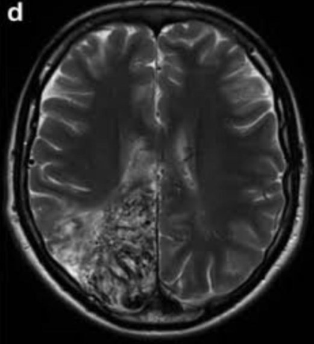

รูปประมาณนี้แต่เป็นข้างขวา ถามว่าข้อไหนมีประโยชน์น้อยสุด

A. Angiography embolization
B. Chemotherapy
C. Tumor resection
D. Stereotactic biopsy
E. Radiosurgery

**Answer:** A
**Explanation:** key: the key circles A ("for AVM") and writes that choices C, D and E are for tumour; the picture is labelled "AVM?" and "looks like CA" (partly unclear). The key seems to be unsure which choice is least useful.
**Guideline / source:** not stated

## Q12 (original no. 12)
Rt.Renal abscess ข้างๆ infected ascending colon ถามว่า spread by route อะไร

A. Vascular
B. Lymphatic
C. Direct contamination
D. Hematogenous
E. Transcoelomic

**Answer:** B
**Explanation:** key: "severe bowel infection"; pastes a chart of routes of kidney infection (ascending, haematogenous, lymphatic, direct extension from an adjacent organ such as colon or spleen).
**Guideline / source:** not stated

## Q13 (original no. 13)
(Ped) เด็กเกิดมา ได้ 3 ชม. ตรวจร่างกายเบื้องต้น ไม่มีรูก้นเป็น anorectal malformation บรรยาย PE, perineum exam มาให้แล้ว ถาม appropriate mx

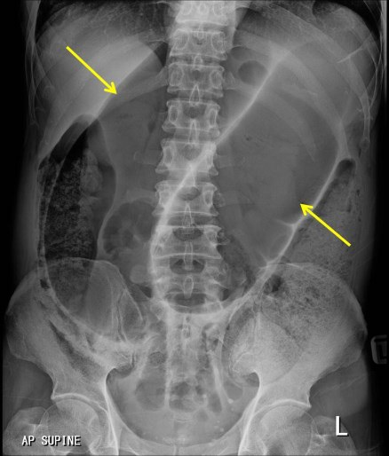

A. Prone cross-table lateral film
B. Re-exam in first 24 hrs
C. Colostomy
D. PSARP
E. CT pelvic abdomen

**Answer:** A (original blue mark); a later pink correction by March circles B
**Explanation:** key: handwritten "wait 24 hrs for meconium"; the pink correction by a reader named March (dated August 2024) circles B (re-exam in the first 24 hours: wait for meconium to appear) and notes perineal, vestibular and low types need no film; pastes a cross-table lateral film slide.
**Guideline / source:** not stated

## Q14 (original no. 14)
(Ped) Anorectal malformation แบ่ง grade high,low ตามอะไร

A. Coccygeal tip
B. Levator
C. I line
D. PC line
E. Sacrum

**Answer:** D
**Explanation:** key: the pubococcygeal (PC) line and the puborectalis decide high and low; a textbook passage is pasted.
**Guideline / source:** not stated

## Q15 (original no. 15)
(Colo) คนแก่ ๆ ปวดท้อง อึไม่ออก ให้รูปมา ถาม provisional dx

A. Sigmoid volvulus
B. midgut volvulus
C. Feces impaction

**Answer:** A
**Explanation:** key: "coffee bean sign" (a sigmoid volvulus picture is pasted). The paper's own picture is not included.
**Guideline / source:** not stated

## Q16 (original no. 16)
(Colo) Pericolonic Abscess 5 cm มีไข้ มี tenderness ไม่มี rebound tenderness

A. Hinchey I
B. Hinchey II
C. Hinchey III
D. Hinchey IV
E. Hinchey V

**Answer:** A (original blue mark); a later pink correction by March circles B
**Explanation:** key: the pink correction (dated August 2024) writes Hinchey I = pericolic small abscess, II = pelvic or inter-loop abscess larger than 4 cm; modified Hinchey tables are pasted.
**Guideline / source:** not stated

## Q17 (original no. 17)
(Colo) LLQ abdominal pain, fever 38 ให้ v/s PE no abdominal mass

A. Sigmoid Diverticulitis
B. Sigmoid cancer

**Answer:** A
**Explanation:** key: "diverticulitis?". A photo of a prolapsed rectum is pasted and struck through (it belongs to another question).
**Guideline / source:** not stated

## Q18 (original no. 18)
(Colo) Bleeding per rectum for 3 m. Normal defecation, หลังถ่ายรู้สึกตุ้บๆที่ anal canal, มี Skin tag, แผลฉีกขาดลึกๆ, ถาม ‘appropriate’ mx

A. Lifestyle modification
B. Botox
C. 2% isosorbide dinitrate ointment
D. LIS
E. Stool softener

**Answer:** D
**Explanation:** key: chronic anal fissure (more than 8 weeks); medical treatment (nitroglycerine ointment or CCB, then botulinum toxin) fails or pain and bleeding persist: lateral internal sphincterotomy. Acute fissure: soften stool and use lubricant or nitroglycerine ointment.
**Guideline / source:** not stated

## Q19 (original no. 19)
(Colo) ผู้ชายอายุ 50 ปี เจอ FOBT positive จากตรวจสุขภาพประจำปี Mx

A. EGD + colonoscope
B. F/U และทำ FOBT in 1 yr
C. F/U in 3 mo

**Answer:** A
**Explanation:** key: pastes a screening table.
**Guideline / source:** not stated

## Q20 (original no. 20)
(Ped) เด็กอ้วกออกมาหลังกินนม ~30 นาที ออกมาเป็นนมยังไม่ย่อย คลำได้ Oval mass at RUQ

A. Hypertrophic pyloric stenosis
B. Overfeeding
C. Choledochal cyst

**Answer:** A
**Explanation:** key: HPS.
**Guideline / source:** not stated

## Q21 (original no. 21)
(Colo) มีก้อนออกมาตอนเบ่งอุจจาระ หลังเบ่งก้อนกลับไปได้เอง ช่วงหลังๆต้องใช้มือดันกลับ มีรูปมาให้ ถามว่าเป็นอะไร

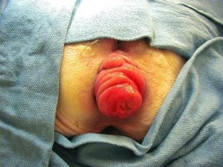

A. Prolapsed rectum
B. Internal Hemorrhoid

**Answer:** A
**Explanation:** key: marked on A in blue (pink strokes by a later reader sit on both choices); the note says to read the picture carefully (circular folds in rectal prolapse versus radial folds in prolapsed haemorrhoids; a comparison picture is pasted).
**Guideline / source:** not stated

## Q22 (original no. 22)
(Ped) ให้อาการเด็กอายุ 2 เดือน ตัวเหลือง อึสีซีด ฉี่สีเข้ม ตับโต ตรวจร่างกายอย่างอื่นปกติดีถามว่า investigation อะไรต่อ

A. Liver function test
B. doppler U/S
C. MRCP
D. Liver fibroscan

**Answer:** A (highlighted and boxed in the key and circled in pink by March, dated August 2024; a blue mark also sits beside B)
**Explanation:** key: "BA" (biliary atresia); March's flow: signs and symptoms, then LFT, then ultrasound; triangular cord sign positive goes to IOC; negative: age over 60 days IOC, under 60 days DISIDA; a choledochal cyst goes to surgery.
**Guideline / source:** not stated

## Q23 (original no. 23)
(Plastic) ให้รูปหน้าเด็กมา ถามว่าเด็กน่าจะมีปัญหาอะไร

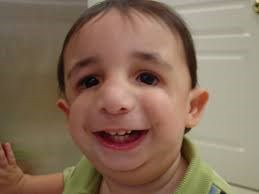

A. Hearing loss
B. Malocclusion

**Answer:** A
**Explanation:** key: handwritten "Treacher Collins" (1st and 2nd branchial arch defect; hearing problems); a diagram of Treacher Collins signs is pasted.
**Guideline / source:** not stated

## Q24 (original no. 24)
(Colo) ผู้ชาย มีนิสัยนั่งห้องน้ำตอนเช้านานเกิน 15 นาที แต่ตอนนี้อาการดูเป็น Hemorrhoid grade 2 & 3 แล้ว มีแปะรูป hemorrhoid ด้วย ถามว่า the most appropriate management คืออะไร

A. lifestyle modification
B. rubber band ligation

**Answer:** B
**Explanation:** key: internal haemorrhoids (note "int").
**Guideline / source:** not stated

## Q25 (original no. 25)
(Ped) แม่สังเกตได้ว่าลูกหน้าบูด irritate ตอนจะกินนม เด็กมีพังผืดใต้ลิ้น กินนมลำบาก น้ำหนักน้อย แม่เข้าเต้าแล้วเจ็บหัวนม ควรทำไง

A. Frenulotomy
B. Frenuloplasty
C. Bottle feed ไปก่อน

**Answer:** A
**Explanation:** key: ankyloglossia (tongue tie); under 3 months: local anaesthesia; over 3 months: general anaesthesia.
**Guideline / source:** not stated

## Q26 (original no. 26)
(Uro) ทำไมเด็กไทยสมัยหลายสิบปีก่อนเป็น endemic cystic stone เยอะ

A. Genetic factor
B. Climate factor
C. Low animal protein diet
D. Chronic UTI

**Answer:** C
**Explanation:** key: marks C.
**Guideline / source:** not stated

## Q27 (original no. 27)
(Colo) ให้รูป perianal abscess ถามว่า management ยังไง

A. Incision and drainage
B. IV antibiotics
C. Oral antibiotics

**Answer:** A
**Explanation:** key: antibiotics only if immunocompromised, complex, cellulitis or sepsis. The paper's picture is not included.
**Guideline / source:** not stated

## Q28 (original no. 28)
(CVT) ให้อาการมา กินเหล้าเยอะมาก กินอาหารมาเยอะมาก อ้วกแล้วเจ็บหน้าอก x-ray เจอ lt. pleural effusion, pneumomediastinum

A. Immediate sx
B. NPO and ABX

**Answer:** A
**Explanation:** key: Boerhaave syndrome; "within 12 hr".
**Guideline / source:** not stated

## Q29 (original no. 29)
(Ped) ให้อาการ scaphoid abdomen, decreased lung sound in left side, mediastinal shift to the right มา ถามว่าห้ามทำอะไร

A. Left chest drain
B. IV fluid
C. IV antibiotics
D. Keep warmth
E. Chest x-ray

**Answer:** A
**Explanation:** key: congenital diaphragmatic hernia ("CDH"); no mask ventilation ("ห้าม on mask").
**Guideline / source:** not stated

## Q30 (original no. 30)
(Neuro) แต่งงานมา 2 ปี ไม่คุมกำเนิด แต่ไม่มีลูก ประจำเดือนมา irregular, bilat galactorrhea and hemianopia said that she can’t see anything around me ถาม Dx

A. Prolactinoma
B. Craniopharyngioma
C. Sheehan syndrome
D. Granulomatous hypophytitis
E. Suprasellar/Sellar Metastasis

**Answer:** A
**Explanation:** key: dopamine agonist; treatment: bromocriptine.
**Guideline / source:** not stated

## Q31 (original no. 31)
(Ped) ข้อใดไม่ใช่ cause of congenital torticollis

A. Plagiocephaly
B. Scoliosis
C. Hemifacial atrophy
D. Atrophy of contralateral trapezius

**Answer:** D
**Explanation:** key: blue slash on D with a red circle ("not related"); red notes (partly unclear) on A, B and C (cervical scoliosis, hemifacial hypoplasia); a torticollis slide is pasted (congenital: fibrosis and SCM shortening; acquired: hemivertebrae, EOM imbalance; 90% resolve with rehabilitation within 1 year, otherwise surgery).
**Guideline / source:** not stated

## Q32 (original no. 32)
(Plastic) เจาะหูมา 3 ปีก่อนแล้วมีตุ่มขึ้นหลังหู ถามDx

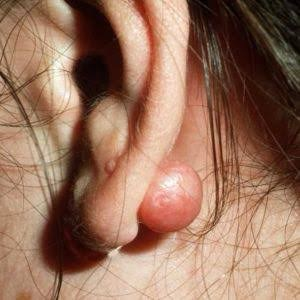

A. Hypertrophic scar
B. Keloid
C. Chronic abscess

**Answer:** B
**Explanation:** key: pastes a passage that hypertrophic scars stay within the site of injury and may regress, keloids spread beyond it and do not regress.
**Guideline / source:** not stated

## Q33 (original no. 33)
(CVT) มีประวัติสูบบุหรี่เยอะมาก, Pupil หด, ptosis, film เจอ lung nodule มา ถามว่าน่าจะเป็นอะไร

A. Bronchial Adenocarcinoma
B. Squamous cell CA
C. Small cell lung cancer
D. Large cell (type ของ lung CA อะ)

**Answer:** B
**Explanation:** key: Horner syndrome, Pancoast tumour (NSCLC, squamous cell); adenocarcinoma is more common in non-smokers; a lung cancer table is pasted.
**Guideline / source:** not stated

## Q34 (original no. 34)
(Neuro) โดนตีหัวข้างซ้าย สลบไป 5 นาที ฟื้นขึ้นมามีสติ เดินได้ จากนั้น 2 ชม. Become more drowsy ถามว่าเป็นอะไร

A. Chronic subdural hemorrhage
B. Acute epidural hemorrhage
C. Intracerebral hemorrhage
D. Intraventricular hemorrhage
E. Subarachnoid hemorrhage

**Answer:** B
**Explanation:** key: lucid interval; middle meningeal artery; lens-shaped (epidural) versus crescent-shaped with bridging veins (subdural); two CT pictures pasted.
**Guideline / source:** not stated

## Q35 (original no. 35)
(Uro) ผชอายุ 29 ฉี่ ๆ อยู่แล้วฉี่ไม่ออก มารพ. ปวดฉี่ คลำได้ palpable dome shape ที่ suprapubic + เจอ urethral stone size 1.5 cm ถามว่าทำอะไร

A. Foley catheter
B. 2% xylocaine jelly push
C. Suprapubic cystostomy
D. Cystoscope

**Answer:** A (original blue slash); a later pink correction by March circles B
**Explanation:** key: the pink correction (dated August 2024) ticks B with the note to use it before a Foley catheter (partly unclear).
**Guideline / source:** not stated

## Q36 (original no. 36)
(CVT) 2 cm spiculated mass ที่ LUL lung ไม่มี LN positive ถามว่าทำอะไร

A. Lobectomy + lymph node dissection
B. Left pneumonectomy + lymph node dissection
C. Neoadjuvant chemotherapy

**Answer:** A
**Explanation:** key: T1, no node (N0); a TNM table and an NSCLC treatment extract are pasted.
**Guideline / source:** not stated

## Q37 (original no. 37)
(CVT) CT urography เจอ hypodensity size 5 mm ใน right ureter + mild hydronephrosis ถามว่าทำอะไรต่อ

A. Right ureteroscope
B. Right nephroureterectomy

**Answer:** B
**Explanation:** key: transitional cell cancer.
**Guideline / source:** not stated

## Q38 (original no. 38)
(Neuro) คนไข้โดนแทงหลัง เสีย right leg motor and sensation และเสีย left leg pain and temperature sensation ถามว่าเกิดจากอะไร

A. Hemicord dissection
B. Anterior cord syndrome
C. Central cord syndrome
D. Diffuse axonal injury
E. Neurogenic shock

**Answer:** A
**Explanation:** key: Brown-Séquard syndrome (right proprioception and motor loss, left pain and temperature loss); notes on the other cord syndromes and spinal shock (bulbocavernosus reflex returns first) are written beside the choices; a spinal cord injury infographic is pasted.
**Guideline / source:** not stated

## Q39 (original no. 39)
(CVT) ข้อใดไม่ใช่ indication ของการแก้ไข pneumothorax ด้วยการผ่าตัด

A. เป็น Pilot
B. เป็น scuba diver
C. ทำงานในอยู่ใน small remote area
D. Persistent air leak 1 day
E. มี contralateral pneumothorax in the same admission

**Answer:** D
**Explanation:** key: persistent air leak counts only after 5-7 days; slides on indications for surgery in pneumothorax are pasted.
**Guideline / source:** not stated

## Q40 (original no. 40)
(Colo) no distant metastases, cancer invades not beyond muscularis propria, pericolic node positive 2 from 15 nodes, apical node positive 1 from 5 nodes show metastatic disease. ถามว่า Tx ยังไง

A. Post op chemo
B. Post op RT
C. Post op CCRT

**Answer:** A
**Explanation:** key: T1-2 with N1 and an apical node is stage III (colon: adjuvant chemotherapy; RT and CCRT struck through); a TNM staging figure is pasted.
**Guideline / source:** not stated

## Q41 (original no. 41)
(CVT) คนไข้หนังตาตก มีภาพซ้อน CT เจอ anterior mediastinal mass ถามว่าทำยังไง

A. Thymectomy ถ้าเจอ malignant feature ให้ chemoradiotherapy
B. Neoadjuvant chemoradiotherapy then surgery

**Answer:** A
**Explanation:** key: thymoma with myasthenia gravis.
**Guideline / source:** not stated

## Q42 (original no. 42)
(Plastic) เด็กอายุ 9 ปี มีไฝที่หลังมาตั้งแต่เกิด ใหญ่ขึ้นตามอายุ ปัจจุบันขนาด 10 cm ให้รูปมาด้วย ถามว่าคืออะไร

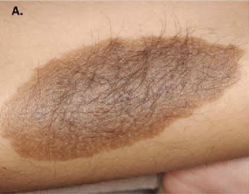

รูปนี้เป๊ะๆ

A. Congenital melanocytic nevus
B. Intradermal nevus
C. Junction nevus
D. Combined nevus
E. Compound nevus

**Answer:** A
**Explanation:** key: staged excision.
**Guideline / source:** not stated

## Q43 (original no. 43)
(Plastic) คนไข้น้ำหนัก 60 kg เมื่อ 4 hr ก่อนมาโรงพยาบาล โดน second degree burn 40% ได้ Ringer’s lactate ไปแล้ว 800 mL ตอนอยู่บนรถพยาบาล ถามว่าข้อใด initial manage ได้ถูก

A. ให้ RLS ด้วย rate 1000 mL/hr
B. ใส่ Foley catheter ให้ได้ urine output 20 mL/hr
C. Monitor CVP>16 mmHg

**Answer:** A
**Explanation:** key: Parkland calculation written beside the choices (4 x 60 x 40 = 9,600; half in the first 8 hours = 4,800).
**Guideline / source:** not stated

## Q44 (original no. 44)
(Plastic) คนไข้ขี่มอเตอร์ไซค์ล้ม มี loss of skin ที่ dorsum of hand ถามว่ารักษายังไง

A. Full thickness skin graft
B. Partial thickness skin graft
C. Biological dressing
D. Vacuum dressing
E. Primary closure

**Answer:** A (circled in red)
**Explanation:** key: a red circle on A with the note "afraid of impaired function?"; E is crossed out ("step ladder of reconstruction"); a note on full-thickness grafts for the hand is pasted.
**Guideline / source:** not stated

## Q45 (original no. 45)
(Plastic) คนไข้มี first degree burn ที่ anterior neck ร่วมกับ third degree burn ที่ chest wall จากนั้น the patient complained with normal voice that he cannot breath in ถามว่าจะทำอะไร

A. Escharotomy
B. Endotracheal Intubation + ventilator

**Answer:** B (original blue slash); a later pink correction by March circles A
**Explanation:** key: the pink correction (dated August 2024): the neck burn is first degree and not swollen, the voice is normal, and a circumferential eschar of the chest restricts breathing, so escharotomy.
**Guideline / source:** not stated

## Q46 (original no. 46)
(Ped) มีก้อนที่คอ ยื่นออกมาตามลิ้น ให้รูป ถามว่าคืออะไร

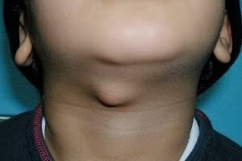

A. Thyroglossal duct cyst
B. Dermoid cyst

**Answer:** A
**Explanation:** key: note "moves with tongue protrusion".
**Guideline / source:** not stated

## Q47 (original no. 47)
(Ped) มีก้อนอยู่ที่ anterior border ของ SCM ให้รูปมา ถามว่าเป็นอะไร

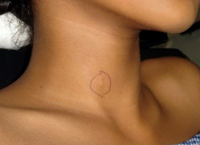

A. First branchial cleft sinus
B. Second branchial cleft sinus
C. Second branchial cleft cyst
D. Fourth branchial cleft remnant

**Answer:** B
**Explanation:** key: a note on the anterior border of SCM; red notes (partly unclear) about whether it is a sinus or a cyst.
**Guideline / source:** not stated

## Q48 (original no. 48)
(CVT) คนไข้อายุ 71 เป็น triple vessel disease จะทำ CAG แล้วใช้ internal mammary artery แต่ไม่พอ ถามว่าควรใช้เส้นเลือดอะไรเพิ่ม

A. Radial or ulnar artery
B. Great saphenous vein
C. Lesser saphenous vein
D. Inferior epigastric artery
E. PTFE with ring graft

**Answer:** B (circled in red with a question mark)
**Explanation:** key: note on patency: IMA > radial > saphenous vein; a conduit-for-bypass slide is pasted; choice A is crossed out in black.
**Guideline / source:** not stated

## Q49 (original no. 49)
(CVT) ผู้หญิงหายใจลำบาก ฟังได้ distant heart sound, neck vein engorgement

A. Pericardial effusion
B. Pulmonary effusion

**Answer:** A
**Explanation:** key: Beck triad (hypotension).
**Guideline / source:** not stated

## Q50 (original no. 50)
(CVT) Intravenous drug use, เป็น recurrent pneumonia บ่อยๆ

A. Pulmonary valve vegetation
B. Aortic regurgitation
C. Mitral valve vegetation
D. Papillary muscle injury

**Answer:** A
**Explanation:** key: "IE" (infective endocarditis).
**Guideline / source:** not stated

## Q51 (original no. 51)
(Uro) Intravenous drug use, เป็นไข้ ปวด flank pain, น่าจะเป็น acute pyelonephritis คิดว่าน่าจะเป็นเชื้ออะไร

A. Staph. Aureus
B. Klebsiella pneumoniae
C. E. Coli
D. Pseudomonas aeruginosa

**Answer:** C (original blue slash); a later pink correction by March circles A
**Explanation:** key: the original note says ascending infection; the pink correction (dated August 2024) circles A with the note haematogenous spread; another note beside the stem is partly unclear.
**Guideline / source:** not stated

## Q52 (original no. 52)
(CVT) ผู้หญิง เป็น Functional class II, severe mitral valve regurgitation ทำไรต่อ

A. Mitral valve repair
B. Mitral valve replacement
C. Balloon dilatation

**Answer:** A
**Explanation:** key: pink notes: if it is not rheumatic or infective endocarditis (repair not possible), repair before replacement.
**Guideline / source:** not stated

## Q53 (original no. 53)
(Uro) CT เจอ fat-containing tumor ที่ kidney ขนาด 3 cm ควรทำยังไง

A. ติดตามอาการไปเรื่อยๆ
B. Partial nephrectomy

**Answer:** A
**Explanation:** key: angiomyolipoma (AML): follow-up if under 4 cm; over 4 cm consider partial nephrectomy; if it ruptures arterial embolisation (partly unclear).
**Guideline / source:** not stated

## Q54 (original no. 54)
(Uro) ผู้ชายอายุเยอะ เป็น stress urine incontinence, ต่อมลูกหมากโต, คลำได้ cystic mass ใต้ umbilicus 2 fingerbreadth ทำยังไงต่อ

A. Alpha blocker
B. Alpha blocker + 5-alpha reductase inhibitor
C. Foley’s then TURP

**Answer:** A
**Explanation:** key: a red note "Foley + alpha blocker" is circled and "> 30 mL" is written; C is crossed out (partly unclear).
**Guideline / source:** not stated

## Q55 (original no. 55)
(Ped) เด็กผู้ชายอายุ 5 ขวบ รูดหนังหุ้มปลายลงมาไม่ได้ ตอนฉี่ออกมาแล้วหนังหุ้มปลายบวมๆ

A. Reassure ว่าเป็นตามวัยอยู่แล้ว
B. Topical steroid
C. TA cream
D. Dorsal slit cut

**Answer:** B
**Explanation:** key: phimosis.
**Guideline / source:** not stated

## Q56 (original no. 56)
(Ped) เด็กท้องอืด ไม่ถ่าย มีก้อนที่ขาหนีบ เมื่อก่อนบวมเป็นๆหายๆ ตอนนี้มันบวมตลอด ผิวหนังเป็นสีแดงๆ

A. Observe
B. ATB then elective herniotomy
C. Sedation + Manual reduction
D. Explore groin
E. Explore lap

**Answer:** D
**Explanation:** key: inguinal hernia, strangulated; a question about reducing an inguinal hernia in a 2-week-old boy is pasted.
**Guideline / source:** not stated

## Q57 (original no. 57)
(Ped) เด็กมี urethral meatus เปิดที่ ventral mid shaft, มี dorsal hood ถามว่าต้องห้ามไม่ให้ผปคพาไปทำอะไร

A. circumcision

**Answer:** A
**Explanation:** key: marks A.
**Guideline / source:** not stated

## Q58 (original no. 58)
(Ped) เด็กอ้วกเป็น bilious, ให้รูปมา ถามว่าทำอะไรต่อดี

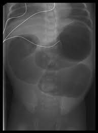

A. Jejunojejunostomy

**Answer:** A
**Explanation:** key: handwritten "triple bubble" and "jejunal atresia".
**Guideline / source:** not stated

## Q59 (original no. 59)
(Ped) เด็กเกิดมา delay meconium passing ทำ imaging เห็น dilation ของ descending colon แล้ว transition กลับไปเป็นขนาดปกติของ sigmoid กับ rectum, ทำยังไงดี

A. Rectal biopsy

**Answer:** A
**Explanation:** key: Hirschsprung disease.
**Guideline / source:** not stated

## Q60 (original no. 60)
(Ped) เด็กอายุ 14 ปี มีไข่ข้างเดียว ทำ laparoscopic diagnosis เจอไข่ในท้อง atrophy ทำไงต่อดี

A. Orchidopexy
B. Orchidectomy

**Answer:** B
**Explanation:** key: postpubertal.
**Guideline / source:** not stated

## Q61 (original no. 61)
(Ped) เด็กผู้ชายเกิดมา micropenis, undescended testis 2 ข้าง จะเจออะไร

A. Hyponatremia
B. Hypophosphatemia

**Answer:** A
**Explanation:** key: "CAH?" and aldosterone decreased.
**Guideline / source:** not stated

## Q62 (original no. 62)
(Colo) ผู้หญิงถ่ายเป็นเลือด ไปส่องกล้องเจอ polyp เยอะมาก ยาวตลอดแนว colon และ rectum เป็นโรคทางพันธุกรรมอะไร

A. FAP
B. Lynch syndrome
C. Juvenile polyposis

**Answer:** A
**Explanation:** key: marks A.
**Guideline / source:** not stated

## Q63 (original no. 63)
เด็กผู้ชายมีก้อนกลมๆที่คอโต ตรวจเจอ PPD positive ทำยังไงต่อ

A. ตรวจ PPD ซ้ำอีก
B. เริ่มให้ Anti-TB drug

**Answer:** B
**Explanation:** key: pastes a tuberculous lymphadenitis slide.
**Guideline / source:** not stated

## Q64 (original no. 64)
(Uro) PSA = 114, คลำต่อลูกหมากได้ก้อนแข็งๆ

A. TRUS + biopsy

**Answer:** A
**Explanation:** key: marks A.
**Guideline / source:** not stated

## Q65 (original no. 65)
(Colo) ผู้ชาย เคยเป็นฝีที่ก้น ปัจจุบันมีหนองไหลออกจากรูเปิดที่ perianal, น่าจะมาจาก cause ใด

A. Anal gland infection
B. Crohn’s disease

**Answer:** A
**Explanation:** key: fistula in ano.
**Guideline / source:** not stated

## Q66 (original no. 66)
(Colo) ผู้ชายมีก้อนที่ dentate line ยื่นไป lower anal canal น่าจะเกิดจากอะไร

A. HPV??

**Answer:** A
**Explanation:** key: handwritten "verrucous"; the whole question is struck through in pink by the later reader.
**Guideline / source:** not stated

## Q67 (original no. 67)
(CVT) ASD เจอประเภทมากที่สุด

A. Ostium primum
B. Ostium secundum
C. Patent foramen ovale
D. Primum + secundum

**Answer:** B (highlighted and circled in pink; a blue slash also sits beside C)
**Explanation:** key: ostium secundum = fossa ovalis defect, first; ostium primum second (endocardial cushion defect, with MV and TV anomalies); sinus venosus third; coronary sinus fourth; "PFO: not an ASD". A note on VSD types is also written.
**Guideline / source:** not stated

## Q68 (original no. 68)
(Plastic) เด็ก craniofacial หัวใจสำคัญในการรักษาที่ดีที่สุดก็คือ

A. Optimal time ในการ surgery
B. Team psycho-social support
C. หมอที่มีฝีมือ โรงบาลที่ดี

**Answer:** A
**Explanation:** key: pastes a management outline (multidisciplinary approach, craniofacial clinic).
**Guideline / source:** not stated

## Q69 (original no. 69)
(CVT) Aortic dissection ตรงไหนบ่อยสุด

A. Aortic arch
B. Distal to left subclavian artery
C. เหนือ diaphragm
D. ระดับ diaphragm

**Answer:** B (highlighted and circled in pink)
**Explanation:** key: "2nd" (isthmus?); the pasted passage says the commonest site is the ascending aorta just above the aortic valve and the second commonest is just distal to the left subclavian artery.
**Guideline / source:** not stated

## Q70 (original no. 70)
(Plastic) ก้อนที่กรามซ้าย บวมๆ ชาๆจากอะไร

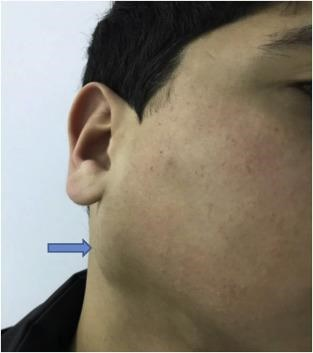

A. Mucoepidermoid carcinoma
B. Carcinoma pleomorphic ex adenoma
C. Acinar cell adenoma
D. Adenocarcinoma

**Answer:** A
**Explanation:** key: commonest malignant parotid tumour; facial numbness and a possible CN7 palsy suggest malignancy; the "rule of 80%" for salivary tumours (pleomorphic adenoma = benign mixed tumour) is pasted.
**Guideline / source:** not stated

## Q71 (original no. 71)
(Colo) ไข้ขึ้น ปวดท้อง RLQ มา 4 วัน

A. Appendices abscess

**Answer:** A
**Explanation:** key: "mass?"; a perforated appendicitis guideline flow chart is pasted.
**Guideline / source:** not stated

## Q72 (original no. 72)
(Uro) ปัสสาวะเป็น painless hematuria ทำ CT เจอ hypodensity mass ที่ bladder ส่อง cystogram เจอ sessile polyp ทำอะไรต่อ

A. Cystogram + biopsy
B. TUR-BT
C. Radical cystectomy

**Answer:** B
**Explanation:** key: T1 (TUR-BT and send for pathology); if it invades the muscularis propria, then cystectomy (pink note); T2, T3, T4 written beside C.
**Guideline / source:** not stated

## Q73 (original no. 73)
(Plastic) แผล 2nd degree burn ทาอะไร

A. Silver sulfadiazine
B. Betadine

**Answer:** A
**Explanation:** key: marks A.
**Guideline / source:** not stated

## Q74 (original no. 74)
(Neuro) ปวดหัว, no neurological deficit, stiff neck positive, non-contrast CT ปกติ ทำอะไรต่อ

A. Contrast-CT
B. Lumbar puncture

**Answer:** B
**Explanation:** key: SAH.
**Guideline / source:** not stated

## Q75 (original no. 75)
(Neuro) ให้รูปกับอาการมา ถามว่าเป็นอะไร

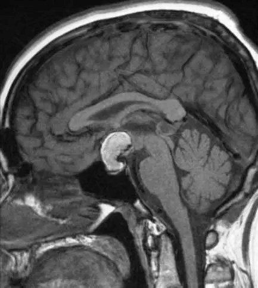

**Answer:** not given in the key as a lettered choice: the paper has no choices; the key writes "pituitary adenoma" and "transsphenoidal" beside the picture
**Explanation:** key: pituitary adenoma; transsphenoidal surgery.
**Guideline / source:** not stated

## Flagged for checking
- The marks are a student's, not an official key. Where a pink correction by March differs from the original mark (Q13, Q16, Q35, Q45, Q51) or the marks are unclear (Q9, Q11, Q21, Q22, Q31, Q54, Q67), the Answer line says so.
- Q66 is struck through by the later reader.
- Q6 picture left out (child's face with printed text on the linen); Q15 and Q27 mention a picture that is not in the paper.
