Source: "MEQ sub-specialty surgery MDCU 76 rotate C" (the second part of "OSCE MEQ SUBSPE SURGERY rotate C MDCU76"), questions recalled by students, mixed Thai and English. The paper was sat at the end of the whole surgery rotation, so it combines General Surgery and subspecialty content and is filed whole. It is a low-priority set (see CLAUDE.md). The OSCE part of the same exam is in `mdcu76-sx-c-osce`.
Numbers Q1-Q14 are the paper's own.
Answers: the key is "Solution for OSCE, MEQ sub specialty MDCU76 rotate C by KP, Tae, Tan, Gift, Lilly, and academic team MDCU76" (see the OSCE file for details). It is a key written by students and the academic team, NOT an official key, and may contain mistakes. Its handwriting and pasted slides are summarised in the Answer and Explanation lines; handwriting that is hard to read is marked as unclear.
Pictures: pictures with no name, label or ID band are kept in images/ under their question. Source captions printed under some pictures (Q4 breast photograph, Q13 stool photograph) are cropped out. Q8 mentions a video that is not in the paper; Q10 has no picture. The Q12 picture has black bars over the eyes in the paper.
exam_year 2023 follows the OSCE part of the same paper (August 2023); the exact day is not kept.
The rotation letter (C) is not mapped to a G.

## Q1 (original no. 1)
กินหมูกระทะแล้วปวดท้องมา 1 สัปดาห์ ก่อนหน้านี้ 1 เดือนก็เป็น ให้รูป Ultrasound ถุงน้ำดีมา ให้บรรยายผล วินิจฉัย และรักษา

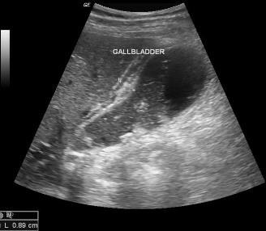

**Answer:** findings: pericholecystic fluid, thickened wall (3 mm or more), bile sludge, gallbladder stone; diagnosis: acute cholecystitis; treatment: laparoscopic cholecystectomy (LC) (student key; not official)
**Explanation:** the key numbers four labelled findings on the picture and notes a doubt beside the stone ("is it a stone?"); a pasted screenshot shows ultrasound signs of cholecystitis
**Guideline / source:** not stated

## Q2 (original no. 2)
คนไข้ปวดท้อง มี upright PA CXR ตรวจร่างกายเจออะไร บรรยายฟิล์ม เกิดจากอะไร รักษายังไง

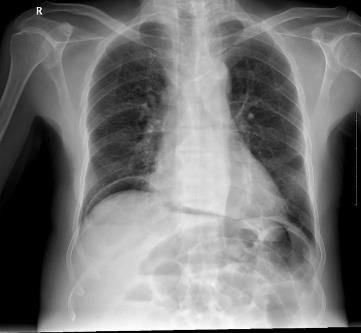

**Answer:** physical examination: distended abdomen, loss of hepatic dullness, guarding and board-like rigidity (the key notes tenderness for 4-6 hours); film: chest radiograph, PA, upright, adequate inspiratory effort, no rotation, cardiomegaly(?), multiple air-fluid levels, continuous diaphragm sign, double bowel wall sign; cause: pneumoperitoneum from a ruptured bowel (bowel ischaemia / obstruction); treatment: NPO, exploratory laparotomy (to be confirmed, the key suggests CT or a left lateral decubitus film) (student key; not official)
**Explanation:** the key's handwriting is partly unclear; it pastes slides on the leaping dolphin sign and Rigler's sign (double bowel wall sign) and the continuous diaphragm sign
**Guideline / source:** not stated

## Q3 (original no. 3)
คนไข้สูบบุหรี่มา 20 ปี เจ็บหน้าอกกะทันหัน ให้บรรยายฟิล์ม วินิจฉัย รักษา

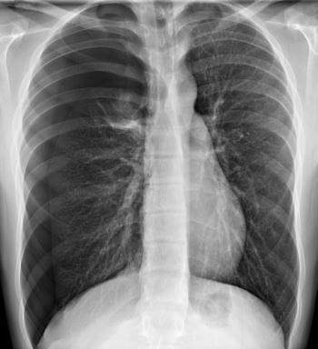

**Answer:** film: hyperinflated lung (anterior ribs 6 or more, posterior ribs 10 or more visible), tracheal shift to the left, flattened hemidiaphragm; diagnosis: pneumothorax; treatment: right-sided ICD (chest drain) anterior to the midaxillary line at the 5th intercostal space (student key; not official)
**Explanation:** the key adds notes on primary spontaneous pneumothorax (visible pleural line with no lung markings, collapsed lung, no subcutaneous emphysema, no tracheal deviation; size over 3 cm at the apex or 2 cm at the side; a large pneumothorax is aspirated or drained) and pastes a management flow chart
**Guideline / source:** not stated

## Q4 (original no. 4)
ให้รูปเต้านมมา mild tenderness และมี fixed left axillary LN ให้บรรยาย lesion โรคที่สงสัย การตรวจเพิ่มเติม

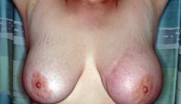

ต่อมามีรูป

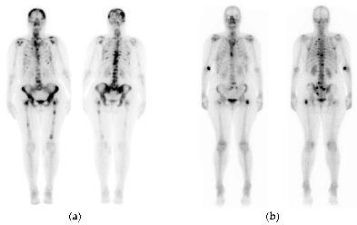

ถามว่าคืออะไร และจะตรวจอะไรอีกเพื่อประเมิน staging

**Answer:** lesion: ill-defined erythema of the left breast with skin retraction at the right inner upper and lower quadrant; a well-defined erythematous lesion at the right inner lower quadrant next to the areola; DDx: inflammatory breast cancer, mastitis, breast abscess; investigations: ultrasound, mammogram, bone scan; second picture: bone scan (bone scintigraphy); more tests: lymph node core needle biopsy, ultrasound and mammogram for BI-RADS staging (the key marks this part with a question mark); staging: T4b N2 M1 (skin, fixed node, bone metastasis) = stage 4 (student key; not official)
**Explanation:** the key describes both breasts (the left breast and the right quadrants); copied as written. The source caption printed under the picture is cropped out
**Guideline / source:** not stated

## Q5 (original no. 5)
Pale stool, Jaundice, Courvoisier's law จุด A คืออะไร และมี sign อะไร, คิดว่าเป็นโรคอะไร รักษายังไง

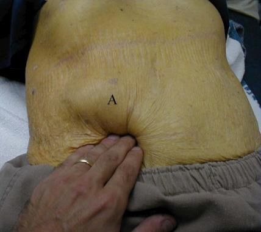

**Answer:** point A: gallbladder; sign: Courvoisier's sign; disease: periampullary cancer; treatment: Whipple operation (student key; not official)
**Explanation:** the key pastes a slide on Courvoisier's law
**Guideline / source:** not stated

## Q6 (original no. 6)
คนไข้กลืนติดมา มีรูป fluoroscope ถามว่าตรวจอะไร ให้บรรยายฟิล์ม ให้คำวินิจฉัย และบอก management 2 ข้อ

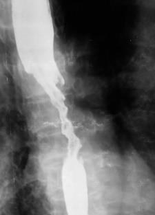

**Answer:** barium swallow; apple-core appearance of the oesophagus with proximal oesophageal dilatation and irregular mucosa; diagnosis: oesophageal cancer; management: oesophagogastroduodenoscopy (EGD) with biopsy, CT scan (student key; not official)
**Explanation:** the key notes that the student was unsure of the treatment part and asks for help ("pls help"); it pastes slides on barium swallow findings
**Guideline / source:** not stated

## Q7 (original no. 7)
คนไข้ปวดหลัง ร้าวลงถุงอัณฑะ มีคลื่นไส้อาเจียน ทำ KUB Plain film ให้บรรยายฟิล์ม และแสดงการวินิจฉัย

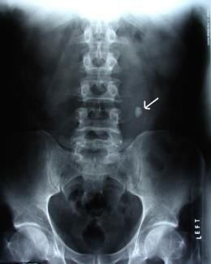

**Answer:** film: adequate KUB film; an oval stone-density calcification at the left ureter, at the tip of the left transverse process at the L4 level (size about 1 cm?); normal kidney, psoas shadow and bony structure; diagnosis: left (distal) ureteric calculus (student key; not official)
**Explanation:** the key notes "please ask urology to help" (the student was unsure) and pastes a KUB reading checklist and the treatment by stone size
**Guideline / source:** not stated

## Q8 (original no. 8)
Neuro exam มีวิดิโอมาให้ Babinski's reflex ถ้า dorsiflex แล้วหมายความว่ายังไง, Elbow flexor, Wrist extensor ระดับอะไร

**Answer:** dorsiflexion of the big toe: upper motor neuron lesion (upper motor tract dysfunction); elbow flexor (biceps): C5 (C5-6); wrist extensor: C6 (student key; not official)
**Explanation:** the key notes that its own slide says C6 for one of the levels; copied as written
**Guideline / source:** not stated

## Q9 (original no. 9)
คนไข้มีแผลไฟไหม้ที่หน้าอกและแขนขวา มีอาการแดง และเจ็บมาก ให้ประเมินความลึกของแผล และ wound management

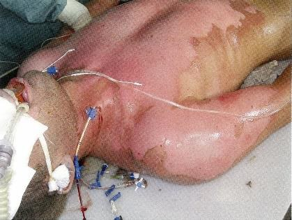

**Answer:** superficial second-degree burn; conservative treatment: prevent infection with 1% silver sulfadiazine; exposure treatment (keep dry, cool, avoid light) (student key; not official)
**Explanation:** not stated
**Guideline / source:** not stated

## Q10 (original no. 10)
มีแผลอะไรสักอย่างที่เท้าซ้าย ขยายขนาดขึ้นเรื่อย ๆ 3 เดือน ไม่เจ็บ ให้วินิจฉัยและรักษา

**Answer:** diabetic foot (the key circles "painless"); debride necrotic tissue, antibiotics, wet dressing (student key; not official)
**Explanation:** not stated
**Guideline / source:** not stated

## Q11 (original no. 11)
ให้วินิจฉัย หาความผิดปกติอื่น ๆ และ initial management

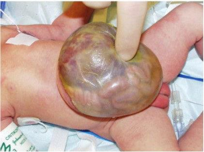

**Answer:** omphalocele; associated anomalies (from the pasted slide comparing omphalocele and gastroschisis); initial management: fluid resuscitation, NG decompression, wrap the bowel in warm saline-soaked gauze, cover with plastic wrap (student key; not official)
**Explanation:** the key's text is a pasted slide, partly annotated by hand
**Guideline / source:** not stated

## Q12 (original no. 12)
ให้วินิจฉัย รักษาตอนไหน และทำไม

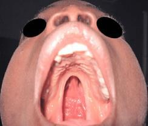

**Answer:** cleft palate; repair at 9-12 months, because of speech development (the key's handwritten reason is partly unclear) (student key; not official)
**Explanation:** the key pastes slides on cleft palate (speech disorder and maxillary hypoplasia) and a treatment timeline
**Guideline / source:** not stated

## Q13 (original no. 13)
เด็กน้อย pale stool ให้ DDx โรค, อยู่ รพช ทำยังไง

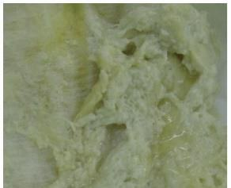

**Answer:** DDx: biliary atresia, Alagille syndrome, choledochal cyst; at a community hospital: liver function test, coagulogram, ultrasound (triangular cord sign), conjugated bilirubin, then refer to a hospital with paediatric surgery (for intraoperative cholangiography, DISIDA or surgery) (student key; not official)
**Explanation:** the key pastes a flow chart on the diagnosis of biliary atresia; the caption printed under the picture is cropped out
**Guideline / source:** not stated

## Q14 (original no. 14)
เด็กน้อยไม่ถ่ายขี้เทา ให้ฟิล์มมา ท่าอะไร โรคอะไร รักษายังไง

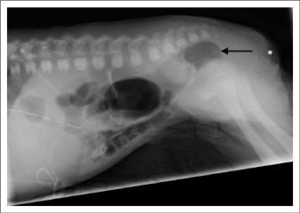

**Answer:** prone cross-table lateral view; anorectal malformation; air-filled distal rectal pouch; anal dimple 1 cm or less: PSARP (posterior sagittal anorectoplasty); more than 1 cm: 3-step surgery (colostomy, PSARP, closure of the colostomy) (student key; not official)
**Explanation:** not stated
**Guideline / source:** not stated

## Flagged for checking
- The key is written by students and the academic team, not an official key. Worth checking: Q2 (the key mentions cardiomegaly and bowel ischaemia for a pneumoperitoneum film), Q4 (side of the lesions), Q8 (the key notes a level disagreement with its slide) and Q10 (diagnosis of the foot lesion; no picture in the paper).
- Q8 refers to a video that is not in the paper.
